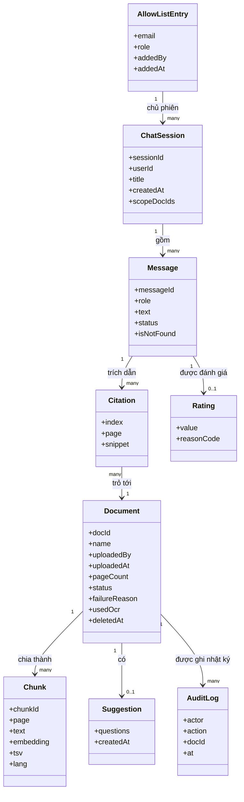
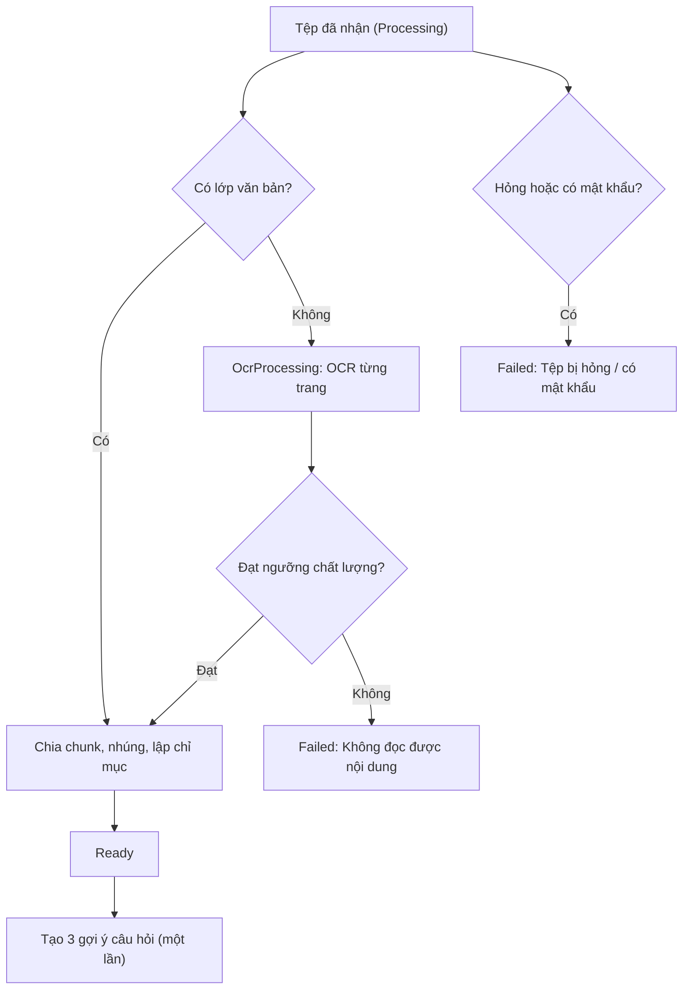
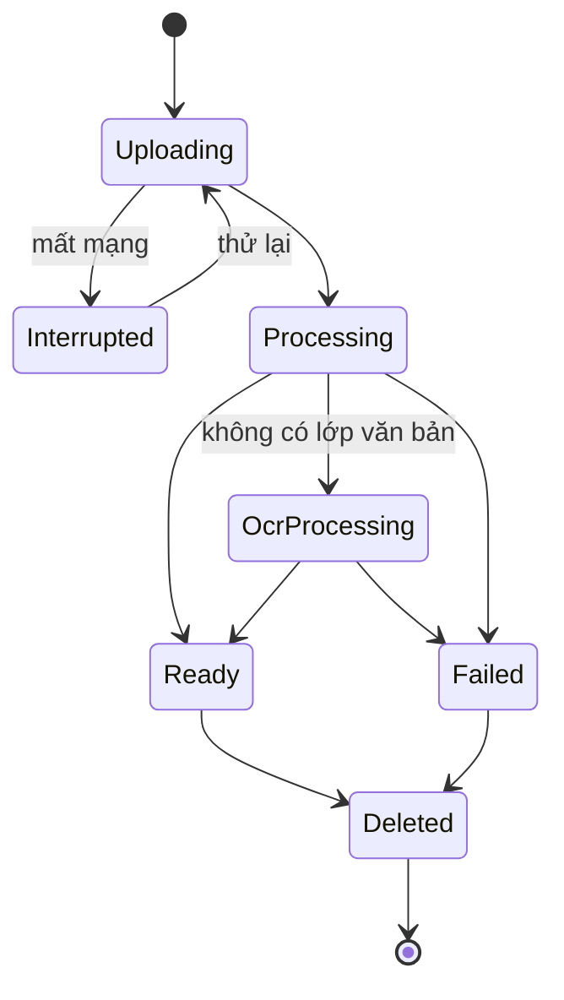
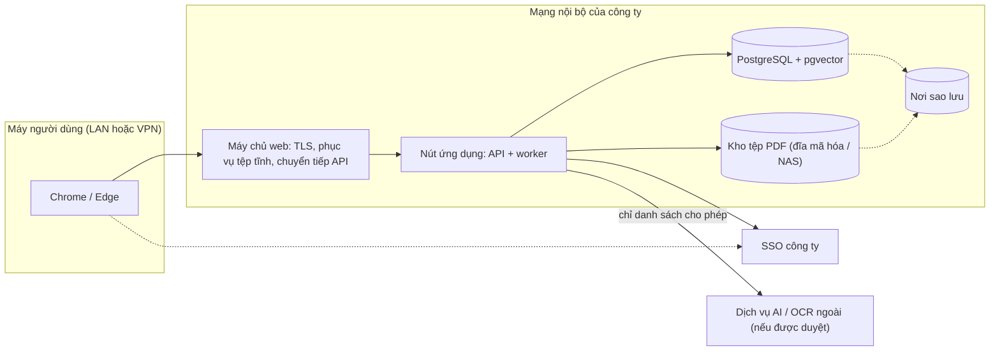

# MÔ TẢ KIẾN TRÚC PHẦN MỀM (SAD / SADD)
# Công cụ "Chat với tài liệu" – MVP

| Thuộc tính | Giá trị |
|---|---|
| Mã tài liệu | SAD-CWD-002 (thay thế [SAD-CWD-001](../design/SAD_Software_Architecture.md)) |
| Phiên bản | 0.1 |
| Trạng thái | Draft – chờ Trưởng đội kỹ thuật / kiến trúc sư review; Bảo mật thông tin xem mục 4.1 (SOP 5.4, bước 9) |
| Ngày | 2026-10-21 |
| Tiêu chuẩn | IEEE 1016-2009; mô hình 4+1 view theo SOP 5.4 |
| Prompt | `design/SAD_Prompt_IEEE_standard.md` (cấu trúc 4 mục: mục tiêu, phân rã thành phần, dữ liệu và luồng, vấn đề xuyên suốt). `design/SAD_prompt.md` cho các góc nhìn IEEE 1016 và `design/SAD_Prompt_with_template_.md` cần mẫu SADD của tổ chức nhưng repo không có mẫu này nên chưa dùng. Chuẩn 4+1 lấy từ SOP 5.4 |
| Kiểm tra | `design/SAD_IEEE_1016_Checklist.xlsx` (đối chiếu ở mục 9) |
| Nguồn đầu vào | [PRD.md](../requirements/PRD.md) v0.2, [BRD.md](../requirements/BRD.md) v0.5, [USER_STORIES.md](../03-analysis/USER_STORIES.md) v0.1, [Blueprint_UIUX_Design.md](../design/Blueprint_UIUX_Design.md) v0.2, [prototype UI](UI_UX_design/README.md) |
| Quan hệ với SAD-CWD-001 | Kế thừa bộ quyết định AD-01 – AD-12 và thêm AD-13, AD-14. Tài liệu này sắp xếp lại theo SOP 5.4 và bổ sung kiến trúc dữ liệu, luồng, độ tin cậy và quan sát. Hai bản không được giữ song song sau khi được duyệt |

**Quy ước:** `[Đề xuất]` = đề xuất của người thiết kế, chưa được xác nhận. `[TBD]` = còn thiếu, ghi mã câu hỏi mở. `[Giả định]` = dùng để tính toán, cần kiểm lại. Mã `AD-xx`, `CMP-xx`, `DM-xx`, `API-xx`, `US-xxx`, `BR-xxx`, `NFR-xxx`, `EC-xx`, `S-xx` lấy từ tài liệu nguồn.

## 0. Tóm tắt ràng buộc kỹ thuật

Phần này đặt đầu tiên theo yêu cầu của prompt.

| Hạng mục | Ràng buộc | Nguồn |
|---|---|---|
| Hệ thống | Ứng dụng web hỏi đáp trên PDF của đội BD; mỗi câu trả lời kèm tên tài liệu và số trang; không có thông tin thì nói "không tìm thấy" | BRD, PRD |
| Quy mô | ≤ 20 người dùng, ≤ 500 tài liệu, ≤ 300 trang/tài liệu, ≤ 50 MB/tệp, ≤ 10 tệp/lần, ≤ 2.000 ký tự/câu hỏi | NFR-004, DC-05 |
| Tải | 20 người dùng đồng thời, mỗi người 1 câu hỏi/phút `[Đề xuất]` | NFR-003 |
| Hiệu năng | Câu trả lời p90 ≤ 15 s, trạng thái đầu ≤ 1 s; PDF 100 trang có văn bản ≤ 3 phút, bản quét ≤ 15 phút (p90) | NFR-001, NFR-002 |
| Sẵn sàng và phục hồi | ≥ 95% giờ làm việc (8:00–18:00, thứ Hai – thứ Sáu); RPO ≤ 24 giờ; RTO ≤ 1 ngày làm việc | NFR-005, NFR-006 |
| Công nghệ đã chọn (2026-10-21) | Back-end Python (FastAPI); front-end Vue; PostgreSQL + pgvector; triển khai **tại chỗ (on-premise)** | AD-11, SAD-CWD-001 mục 5.2 |
| Công nghệ chưa chọn | Nhà cung cấp AI (chốt sau DEP-005); công cụ OCR (thử Tesseract và dịch vụ OCR đám mây); giao thức SSO (PD-001); kho tệp | AD-06, Q-A1 |
| Dữ liệu và bảo mật | Tài liệu phân loại "Nội bộ"; dịch vụ AI ngoài chỉ khi đáp ứng CON-005 (a)(b)(c); không ghi nội dung vào analytics; xóa tài liệu thì xóa dữ liệu xử lý trong ≤ 24 giờ | CON-005, BR-028, BR-029 |
| Trình duyệt | Chrome, Edge (2 phiên bản mới nhất), ≥ 1280 px | NFR-007 |
| Nguồn lực | 2 kỹ sư, 1 BA, 1 PO bán thời gian, 7 tuần; chi phí AI ≤ 300 USD/tháng | CON-006, NFR-009 |
| Đăng nhập | SSO công ty, không có phương án dự phòng | DEC-011 |

### 0.1 View ngữ cảnh

| Hướng | Nội dung |
|---|---|
| **Dịch vụ hệ thống cung cấp** | Hỏi đáp trên PDF kèm trích dẫn tên tài liệu và số trang; quản lý kho tài liệu (tải lên, xử lý, xóa); quản trị người dùng và nhật ký; số liệu sử dụng theo tuần |
| **Tác nhân** | Người dùng BD, Trưởng nhóm BD, Quản trị viên, Nhà tài trợ |
| **Dịch vụ cần từ môi trường** | SSO công ty (xác thực); dịch vụ AI (nhúng, sinh câu trả lời) và OCR, nếu được duyệt; hạ tầng tại chỗ (máy chủ, đĩa, mạng LAN hoặc VPN); nơi sao lưu |
| **Ngoài ranh giới** | Tài liệu gốc ở nơi khác; hệ thống phân tích bên ngoài (không nhận nội dung); người dùng ngoài tổ chức (BRD 5.2) |

Sơ đồ ngữ cảnh: mục 2.4 của SAD-CWD-001 và sơ đồ vật lý ở mục 5.4.

## 1. Mục tiêu kiến trúc và nguyên tắc thiết kế

### 1.1 Ba động lực chính

| # | Động lực | Cách thiết kế ưu tiên động lực này | Đánh đổi |
|---|---|---|---|
| 1 | **Riêng tư và tuân thủ dữ liệu** (Q1) | Một cổng AI duy nhất ra ngoài (AD-04); trình duyệt không bao giờ gọi AI; chỉ gửi đoạn văn bản cần thiết, không gửi mã người dùng hay tên tệp; kiểm tra quyền ở máy chủ cho mọi API; telemetry chỉ siêu dữ liệu | Thêm một lớp trung gian; phải tự quản lý ánh xạ trích dẫn thay vì để mô hình tự ghi nguồn |
| 2 | **Đáng tin: không bịa, có trích dẫn** (Q2) | Truy xuất lai (vector + từ khóa) để có bằng chứng trước khi sinh; mô hình chỉ được dùng đoạn đã truy xuất; máy chủ kiểm tra mọi trích dẫn có trong tập đoạn đã gửi; không đủ bằng chứng thì không gọi AI mà trả "không tìm thấy" | Có thể trả "không tìm thấy" cả khi tài liệu có thông tin diễn đạt khác; ngưỡng cần chỉnh theo bộ câu hỏi chuẩn (DEP-003) |
| 3 | **Phản hồi nhanh với đội nhỏ** (Q3, Q10) | Trả lời dần qua SSE để chữ đầu ≤ 5 s dù tổng thời gian tới 15 s; OCR chạy ở worker riêng, không chặn hỏi đáp; monolith mô-đun để 2 kỹ sư xây và kiểm thử được trong 7 tuần | Mô-đun nằm chung một tiến trình nên không mở rộng từng phần độc lập |

Các động lực còn lại (sẵn sàng, phục hồi, chi phí, khả năng cắt phạm vi) là ràng buộc cần đạt, không đổi thứ tự trên; xem bảng Q1–Q10 ở SAD-CWD-001 mục 2.1.

### 1.2 Mẫu kiến trúc

**Monolith mô-đun** (một ứng dụng FastAPI) cộng **một tiến trình worker** cùng mã nguồn cho xử lý tài liệu; bên trong dùng kiến trúc cổng và bộ nối (hexagonal): lõi nghiệp vụ gọi AI, OCR, kho tệp qua các giao diện ("cổng"), còn nhà cung cấp cụ thể là bộ nối thay được.

Lý do: (1) 2 kỹ sư, 7 tuần không đủ vận hành nhiều dịch vụ; (2) tải ≤ 20 người không cần phân tán; (3) nhà cung cấp AI và OCR chưa chốt (AD-06), bộ nối cho phép đổi mà không sửa lõi; (4) ranh giới mô-đun giữ được đường tách dịch vụ sau thí điểm. Phương án đã loại ở mục 6.

## 2. Phân rã thành phần

### 2.1 Tầng giao diện (Client)

| Hạng mục | Thiết kế | Ghi chú |
|---|---|---|
| Công nghệ | Vue (đã chốt) | Prototype HTML ở [UI_UX_design](UI_UX_design/README.md) làm chuẩn thiết kế; token ở `assets/tokens.css` chuyển thành biến CSS của Vue |
| Dạng chuyển giao | SPA tĩnh, phục vụ bởi máy chủ web nội bộ phía trước máy chủ ứng dụng `[Đề xuất]` | Không dùng CDN công cộng, không tải font hay script bên thứ ba (riêng tư) |
| Trạng thái | Trạng thái toàn cục (người dùng, vai trò, danh sách tài liệu) trong một kho Vue; trạng thái trang theo 5 trạng thái bắt buộc (Blueprint 3.2.4); bản nháp câu hỏi trong `sessionStorage` (DD-07) | Thư viện quản lý trạng thái `[TBD]` |
| Giao thức | REST/JSON cho lệnh và truy vấn; luồng SSE cho câu trả lời và trạng thái tài liệu | API-08 là **POST** trả luồng SSE, nên giao diện đọc luồng bằng `fetch` (không dùng `EventSource`, vì `EventSource` chỉ gửi GET) |
| Xác thực | Cookie phiên `HttpOnly`, `Secure`, `SameSite=Lax` `[Đề xuất]`; giao diện không tự lưu mã thông báo | Hết phiên (`AUTH_EXPIRED`) thì giao diện giữ bản nháp rồi chuyển tới đăng nhập |
| Thích ứng | ≥ 1280 px ba vùng; 1024 – 1279 px viewer là lớp phủ; < 1024 px chỉ đảm bảo đọc | EC-19 |

### 2.2 Tầng nghiệp vụ (Application)

Một ứng dụng FastAPI gồm các mô-đun; bảng đầy đủ ở mục 5.3.

| Nhóm | Mô-đun | Ranh giới dịch vụ |
|---|---|---|
| Truy cập | `auth`, `users` | SSO, phiên, allow-list, vai trò |
| Tài liệu | `documents`, `storage`, `audit` | Nhận tệp, trạng thái, xóa logic, ghi nhật ký |
| Hỏi đáp | `retrieval`, `answer`, `chat`, `suggest`, `summary` | Truy xuất, ghép prompt, kiểm tra trích dẫn, lịch sử |
| Ra ngoài | `ai-gateway` | Điểm duy nhất gọi AI và OCR đám mây |
| Đo lường | `telemetry`, `metrics` | Nhận và kiểm tra sự kiện, tổng hợp theo tuần |
| Nền | `jobs` (trong worker: `ingest`, xóa theo lịch, tạo gợi ý) | Xử lý bất đồng bộ |

**Worker:** lấy tác vụ từ hàng đợi trong PostgreSQL, chạy `ingest` (trích văn bản, OCR, chia chunk, lập chỉ mục), tạo gợi ý khi tài liệu "Sẵn sàng" (DEC-018), và xóa dữ liệu quá hạn (BR-029, hết hạn lịch sử 90 ngày). Số worker và số luồng OCR cấu hình được; mặc định chọn sau thử nghiệm DEP-005 và thử tải G4.

### 2.3 Tầng dữ liệu (Data infrastructure)

| Hạng mục | Thiết kế | Lý do |
|---|---|---|
| Cơ sở dữ liệu | PostgreSQL một cơ sở, hai khả năng: quan hệ và vector (pgvector) | Đã chốt; tránh thêm hạ tầng cho quy mô 500 tài liệu |
| Chỉ mục truy xuất | Cột vector có chỉ mục xấp xỉ (HNSW) và cột `tsvector` có chỉ mục GIN `[Đề xuất]` | Từ khóa bắt mã hợp đồng, số hiệu; vector bắt cách diễn đạt khác (AD-03) |
| Kho tệp PDF | Ổ đĩa mã hóa trên máy chủ ứng dụng hoặc NAS nội bộ; truy cập chỉ qua mô-đun `storage` `[TBD: Q-A8]` | Tại chỗ; không dùng dịch vụ đối tượng công cộng |
| Hàng đợi | Bảng `jobs` trong PostgreSQL, worker lấy bằng khóa hàng (`FOR UPDATE SKIP LOCKED`) `[Đề xuất]` | Không thêm Redis hay trình trung gian thông điệp; đủ cho vài chục tác vụ mỗi giờ |
| Bộ đệm | **Không có tầng bộ đệm riêng** | 20 người dùng; kết quả truy xuất phụ thuộc phạm vi và câu hỏi nên ít tái sử dụng |
| Lưu giữ | Tài liệu: đến khi xóa. Chunk, gợi ý, tệp gốc: xóa trong ≤ 24 giờ sau khi xóa tài liệu. Lịch sử hội thoại: 90 ngày. Nhật ký kiểm toán: 90 ngày (AD-12). Telemetry: `[TBD: DM-10]` | BR-029, OQ-013, AD-12 |

### 2.4 Tầng API (Backend)

Hợp đồng đề xuất ở Blueprint 3.3 (đã được SAD xác nhận về SSE và PDF). Mọi API đều qua `auth` kiểm tra phiên và vai trò ở máy chủ.

| ID | API | Mô-đun | Vai trò | Đầu vào → đầu ra chính | Story |
|---|---|---|---|---|---|
| API-01 | `GET /api/v1/me` | auth | mọi người đã xác thực | → người dùng, vai trò, được cấp quyền | US-001, 002 |
| API-02 | `POST /api/v1/documents` (multipart, 1–10 tệp) | documents | Trưởng nhóm BD | tệp → `202`, `docId` và trạng thái từng tệp | US-010, 011, 014 |
| API-03 | `GET /api/v1/documents?search=&sort=` | documents | BD, TN, QT | → danh sách | US-015 |
| API-04 | `GET /api/v1/documents/events` (SSE) | documents | BD, TN, QT | → sự kiện đổi trạng thái | US-012 |
| API-05 | `DELETE /api/v1/documents/{id}` | documents | người tải lên, QT | → 200, ghi nhật ký | US-016, 062 |
| API-06 | `GET /api/v1/documents/{id}/file` (hỗ trợ khoảng byte) | storage | BD, TN, QT | → PDF | US-022 |
| API-07 | `POST /api/v1/chat/sessions` | chat | BD, TN, QT | → `sessionId` | US-020 |
| API-08 | `POST /api/v1/chat/sessions/{sid}/messages` (SSE) | answer, chat | BD, TN, QT | `{text, scopeDocIds[]}` → `status`, `token`, `citation`, `done`, `error` | US-020 – 027 |
| API-09 | `POST /api/v1/chat/messages/{mid}/stop` | chat | BD, TN, QT | → dừng | US-027 |
| API-10 | `GET /api/v1/chat/sessions[/{sid}]` | chat | chủ phiên | → lịch sử | US-041 |
| API-11 | `POST /api/v1/chat/messages/{mid}/rating` | chat | BD, TN, QT | `{value, reasonCode}` | US-050 |
| API-12 | `POST /api/v1/documents/{id}/summary` | summary | BD, TN, QT | → tóm tắt có trích dẫn | US-040 |
| API-13 | `GET /api/v1/metrics/weekly` | metrics | QT, NTT | → số liệu tuần | US-051 |
| API-14 | `GET/POST/DELETE /api/v1/admin/users` | users | QT | → danh sách cho phép | US-061 |
| API-15 | `GET /api/v1/admin/audit-log` | audit | QT | → nhật ký | US-063 |
| API-16 | `POST /api/v1/telemetry/events` | telemetry | mọi người | sự kiện siêu dữ liệu → 204 | PRD 5.2 |
| API-17 | `GET /api/v1/suggestions` | suggest | BD, TN, QT | → ≥ 3 gợi ý | US-031 |

**Hợp đồng lỗi:** `{ "code": "<MÃ>", "retryable": true|false }`; giao diện ánh xạ mã sang thông báo tiếng Việt (Blueprint 3.3.3, DD-06). Máy chủ không trả chuỗi lỗi kỹ thuật cho người dùng.

## 3. Kiến trúc dữ liệu và luồng tích hợp

### 3.1 Chiến lược mô hình dữ liệu

- **Một lược đồ PostgreSQL dùng chung**, không tách cơ sở dữ liệu theo dịch vụ, vì chỉ có một ứng dụng và worker. Thực thể ở mục 5.1.
- **Cô lập:** quyền theo vai trò và theo chủ sở hữu kiểm tra ở lớp ứng dụng. Lịch sử hội thoại luôn lọc theo `user_id` của phiên; PM và QA chỉ xem bản ẩn danh khi điều tra (PQ-003).
- **Chunk** là đơn vị truy xuất: `doc_id`, `page`, `text`, `embedding`, `tsv`, `lang`. Số trang giữ trong từng chunk để trích dẫn đúng trang (US-022).
- **Chỉ mục:** vector HNSW trên `embedding`; GIN trên `tsv`. PostgreSQL không có từ điển tìm kiếm tiếng Việt sẵn, nên cột `tsv` dùng cấu hình `simple` cùng tiện ích `unaccent` `[Đề xuất]`; vector đảm nhận phần ngữ nghĩa. Số chiều vector phụ thuộc mô hình nhúng (AD-06 `[TBD]`); đổi mô hình thì phải lập chỉ mục lại.
- **Kết hợp điểm:** hợp nhất thứ hạng vector và từ khóa theo reciprocal rank fusion, lọc theo `scope_doc_ids` của câu hỏi `[Đề xuất]`.
- **Nhật ký và telemetry** nằm ở bảng riêng; telemetry không có trường văn bản tự do và lược đồ từ chối trường lạ (AD-10).

### 3.2 Luồng dữ liệu chính 1 – Hỏi đáp có trích dẫn (US-020 – US-027)

1. Giao diện kiểm tra câu hỏi (không trống, ≤ 2.000 ký tự) và gọi API-08 (`text`, `scopeDocIds`), hiện "Đang tìm…" ngay (≤ 300 ms phía giao diện).
2. Máy chủ kiểm tra phiên và quyền; nếu kho chưa có tài liệu "Sẵn sàng" thì trả `done` với `isNotFound` mà **không gọi AI** (US-023).
3. Gửi sự kiện `status` (searching, số tài liệu) trong ≤ 1 giây.
4. `retrieval` nhúng câu hỏi (qua `ai-gateway`, chỉ gửi văn bản câu hỏi) và truy xuất lai trong phạm vi; lấy top-k chunk. Không chunk nào vượt ngưỡng liên quan thì kết thúc ở bước 8 với `isNotFound` (ngưỡng `[TBD]`, chỉnh theo DEP-003).
5. `answer` ghép prompt: chỉ dẫn hệ thống (chỉ dùng ngữ cảnh, không có thì nói không có) cộng các chunk được gắn nhãn `[c1]`, `[c2]`… Không gửi tên tệp, mã người dùng hay email.
6. `ai-gateway` gọi mô hình theo chế độ luồng, có giới hạn thời gian; nhận token, chuyển thành sự kiện `token`.
7. Mỗi nhãn `[cN]` trong đầu ra được máy chủ đổi thành trích dẫn `{docId, docName, page, snippet ≤ 200 ký tự}` và gửi sự kiện `citation`. Nhãn không có trong tập chunk đã gửi bị bỏ, ý đó không được tính là có căn cứ.
8. Gửi `done` (`messageId`, `citationCount`, `isNotFound`); lưu `Message` và `Citation`; ghi telemetry (`answer_completed`, độ trễ, số trích dẫn, không có nội dung).
9. Nếu giao diện đóng kết nối hoặc gọi API-09, máy chủ hủy lời gọi AI; phần đã sinh được giữ (EC-04, US-027).

Thời hạn: quá 15 giây giao diện hiện thông báo chậm; quá 60 giây máy chủ dừng và trả `TIMEOUT` (EC-06).

### 3.3 Luồng dữ liệu chính 2 – Tải lên và xử lý tài liệu (US-010 – US-014)

1. Trưởng nhóm BD gọi API-02; máy chủ kiểm tra lại đuôi tệp, kích thước, số tệp và xác nhận nội dung thật sự là PDF (DD-05).
2. Lưu tệp vào `storage`, tạo `Document` trạng thái `Processing`, trả `202`.
3. Worker lấy tác vụ `ingest`: trích văn bản theo trang. Nếu trang không có lớp văn bản, chuyển sang OCR (trạng thái `OcrProcessing`).
4. OCR do bộ nối đã chọn sau DEP-005 thực hiện; kết quả phải đạt ngưỡng chất lượng NFR-011, nếu không `Failed` với `OCR_UNREADABLE`.
5. Chia chunk theo trang, nhúng, ghi chunk và chỉ mục; đặt `Ready`; đưa tác vụ tạo gợi ý.
6. Mỗi lần đổi trạng thái đẩy sự kiện qua API-04; giao diện tự cập nhật không tải lại trang.

### 3.4 Luồng dữ liệu chính 3 – Xóa tài liệu (US-016, US-062, US-064)

Máy chủ đặt `deleted_at`, ghi nhật ký, ngừng truy xuất ngay; tác vụ theo lịch xóa chunk, gợi ý và tệp gốc trong ≤ 24 giờ. Trích dẫn cũ trong lịch sử giữ nguyên nhưng không mở được (EC-14). Bản sao lưu là ngoại lệ đã ghi nhận (Q-A3), chờ Bảo mật thông tin duyệt.

## 4. Vấn đề xuyên suốt và hạ tầng

### 4.1 Bảo mật và tuân thủ

| Chủ đề | Thiết kế | Nguồn |
|---|---|---|
| Xác thực | SSO công ty qua OIDC hoặc SAML `[TBD: PD-001]`; máy chủ đổi kết quả đăng nhập thành cookie phiên; không lưu mật khẩu | DEC-011 |
| Phân quyền | Allow-list và vai trò kiểm tra ở máy chủ cho mọi API, kể cả đọc PDF theo khoảng byte; thu hồi quyền có hiệu lực ở yêu cầu kế tiếp | AD-09, EC-17 |
| CSRF | Cookie `SameSite=Lax` cộng kiểm tra tiêu đề tùy chỉnh trên mọi API ghi, kể cả API-08 (POST dạng luồng) `[Đề xuất]` | – |
| Mã hóa khi truyền | TLS 1.2+ giữa trình duyệt và máy chủ web nội bộ; kết nối ra AI bằng TLS | NFR-008 |
| Mã hóa khi lưu | Mã hóa ổ đĩa kho tệp và dữ liệu PostgreSQL ở mức ổ đĩa `[Đề xuất]` | NFR-008 |
| Bí mật | Khóa API dịch vụ AI chỉ ở biến môi trường hoặc kho bí mật của máy chủ; không có trong mã, nhật ký, giao diện | CON-005 |
| Biên tin cậy | Trình duyệt (không tin cậy) → máy chủ (tin cậy) → AI ngoài (bên thứ ba). Chặn lưu lượng ra Internet trừ danh sách cho phép gồm SSO và dịch vụ AI đã duyệt | US-060 |
| PDF là đầu vào không tin cậy | Worker chạy với quyền tối thiểu, giới hạn bộ nhớ, thời gian và số trang cho mỗi tệp; phát hiện PDF có mật khẩu hoặc hỏng | DC-05 |
| Prompt injection | Nội dung tài liệu được coi là dữ liệu: prompt tách rõ phần hệ thống và phần ngữ cảnh; chỉ trích dẫn nhãn có trong tập chunk đã gửi; không thực thi hành động nào theo nội dung tài liệu | – |
| Dữ liệu cá nhân trong AI | Không gửi email, mã người dùng, tên tệp tới AI; ánh xạ nhãn chunk → tài liệu giữ nội bộ | BR-028 |
| Phê duyệt | Cần văn bản của Bảo mật thông tin (DEP-001, hạn 2026-11-13) trước khi dùng dữ liệu thật; nếu không được, cần phương án AI nội bộ (RA-01) | AC-017, AC-028 |

### 4.2 Độ tin cậy và chịu lỗi

| Chủ đề | Thiết kế | Ghi chú |
|---|---|---|
| Triển khai | Một nút ứng dụng chạy API và worker, tự khởi động lại khi sập; chưa có đa nút | NFR-005 (≥ 95% giờ làm việc) chấp nhận được với một nút. Nâng cấp lên nhiều nút là việc sau thí điểm |
| Sao lưu | Sao lưu PostgreSQL và kho tệp ít nhất mỗi 24 giờ; thử khôi phục định kỳ trước ra mắt (G10) | RPO ≤ 24 giờ, RTO ≤ 1 ngày làm việc |
| Cổng AI | Giới hạn thời gian cho từng lời gọi; thử lại với backoff lũy tiến chỉ cho bước nhúng hoặc OCR (idempotent); **không tự thử lại** lời gọi sinh câu trả lời, để người dùng chủ động "Hỏi lại" | EC-07, tránh tính phí hai lần |
| Ngắt mạch | Sau một số lần lỗi liên tiếp, cổng AI trả ngay `AI_UNAVAILABLE` trong một khoảng thời gian rồi thử lại; ngưỡng `[TBD: chỉnh khi thử tải]` | Giảm thời gian chờ vô ích |
| Giới hạn tốc độ | Giới hạn câu hỏi theo người dùng và số lời gọi AI đồng thời; mặc định đủ cho NFR-003 `[Đề xuất]` | Bảo vệ chi phí NFR-009 |
| Hạn mức chi phí | Cảnh báo ở 80% hạn mức tháng; vượt hạn mức trả `BUDGET_EXCEEDED` | G10, NFR-009 |
| Suy giảm có kiểm soát | AI lỗi: hỏi đáp tạm ngừng; tải lên, xem, xóa vẫn dùng được | QA-03 |
| Hàng đợi | Tác vụ lỗi được đánh dấu `Failed` kèm lý do; tác vụ bị treo được giải phóng sau thời gian chờ | US-012 |

### 4.3 Quan sát (Observability)

| Chủ đề | Thiết kế |
|---|---|
| Nhật ký ứng dụng | JSON có cấu trúc; **không ghi** nội dung câu hỏi, câu trả lời, văn bản tài liệu; có mã yêu cầu để nối với telemetry |
| Chỉ số | Điểm cuối chỉ số theo định dạng Prometheus `[Đề xuất]`: độ trễ API và độ trễ chữ đầu tiên, số câu hỏi, lỗi theo mã, độ sâu hàng đợi, thời gian xử lý tài liệu, chi phí AI ước tính, dung lượng đĩa |
| Truy vết | Mã yêu cầu xuyên API → cổng AI; truy vết phân tán đầy đủ là tùy chọn, không bắt buộc cho MVP |
| Sức khỏe | Điểm cuối kiểm tra sức khỏe cho API, worker, PostgreSQL |
| Cảnh báo | Chi phí AI 80%, tác vụ lỗi liên tiếp, đĩa gần đầy, backup thất bại, p90 vượt 15 giây |
| Telemetry sản phẩm | 18 sự kiện PRD 5.2 qua API-16; chỉ siêu dữ liệu; kiểm thử gói tin trên staging (G8) |

## 5. Các góc nhìn 4+1 (SOP 5.4)

Theo SOP, mỗi góc nhìn có một sơ đồ chuẩn lưu dạng `.drawio` trong `docs/04-design/diagrams/`. Tình trạng:

| View | File `.drawio` theo SOP | Tình trạng | Sơ đồ trong tài liệu này |
|---|---|---|---|
| Logical | [logical-view.drawio](diagrams/logical-view.drawio) (sơ đồ lớp) | Đã tạo | Mermaid rút gọn, mục 5.1 |
| Process | [process-view.drawio](diagrams/process-view.drawio) (2 trang: sơ đồ hoạt động xử lý tài liệu; sơ đồ tuần tự hỏi đáp) | Đã tạo | Mermaid, mục 5.2 và 3.2 |
| Development | [development-view.drawio](diagrams/development-view.drawio) (sơ đồ thành phần) | Đã tạo | Mermaid, mục 5.3 |
| Physical | [physical-view.drawio](diagrams/physical-view.drawio) (sơ đồ triển khai, 3 môi trường) | Đã tạo | Mermaid, mục 5.4 |
| Scenarios | [scenarios-view.drawio](diagrams/scenarios-view.drawio) (use case, 4 kịch bản chính) | Đã tạo | Mục 5.5 |

File `.drawio` là nguồn chính (SOP 5.4, bước 4); sơ đồ Mermaid giữ lại để xem nhanh trong Markdown, nếu hai bên lệch nhau thì theo `.drawio`. Sơ đồ use case đầy đủ 30 use case: [UseCaseDiagram.drawio](../UseCaseDiagram.drawio). Bố cục các sơ đồ đã được kiểm tra bằng cách dựng ảnh từ trình xem diagrams.net; chưa mở trong ứng dụng draw.io.

### 5.1 View logic (Logical)

Đáp ứng yêu cầu chức năng: các khái niệm và quan hệ tĩnh. Sơ đồ nguồn (có thuộc tính, phương thức, cổng và bộ nối): [logical-view.drawio](diagrams/logical-view.drawio).

Thực thể dữ liệu chi tiết, lưu giữ và quy tắc xóa: SAD-CWD-001 mục 3.5 (DM-01 – DM-10).

### 5.2 View quá trình (Process)

Đồng thời, hiệu năng và hành vi lúc chạy. Sơ đồ nguồn: [process-view.drawio](diagrams/process-view.drawio).

| Tiến trình | Vai trò | Đồng thời |
|---|---|---|
| API | Phục vụ REST và các luồng SSE; mỗi câu hỏi là một tác vụ bất đồng bộ | Mỗi người dùng một câu hỏi tại một thời điểm; số lời gọi AI đồng thời có giới hạn |
| Worker | `ingest`, tạo gợi ý, xóa theo lịch | Số tác vụ song song và số luồng OCR cấu hình được |
| PostgreSQL | Dữ liệu, chỉ mục, hàng đợi | Kết nối từ API và worker qua vùng kết nối có giới hạn |

Luồng hỏi đáp: xem mục 3.2. Luồng xử lý tài liệu:

Trạng thái câu trả lời (Searching, Streaming, Completed, NotFound, Stopped, Interrupted, Failed) và trạng thái phiên đăng nhập: Blueprint 3.5.

### 5.3 View phát triển (Development)

Tổ chức tĩnh trong môi trường phát triển. Sơ đồ nguồn: [development-view.drawio](diagrams/development-view.drawio).

```mermaid
flowchart LR
    subgraph FE["frontend (Vue)"]
        UI["views + components"]
        ST["store"]
        API_C["api client + SSE client"]
    end
    subgraph BE["backend (FastAPI)"]
        ROUTES["api (routers)"]
        subgraph DOM["modules"]
            AUTH["auth, users"]
            DOCM["documents, audit"]
            QA["retrieval, answer, chat, suggest, summary"]
            MET["telemetry, metrics"]
        end
        subgraph PORTS["ports"]
            P_AI["AI port"]
            P_OCR["OCR port"]
            P_ST["storage port"]
        end
        subgraph ADP["adapters"]
            A_AI["AI adapter [TBD]"]
            A_OCR["OCR adapter [TBD]"]
            A_ST["file storage adapter"]
            A_DB["PostgreSQL + pgvector"]
        end
    end
    WRK["worker (ingest, schedule)"]
    UI --> ST --> API_C --> ROUTES
    ROUTES --> DOM
    DOM --> PORTS
    PORTS --> ADP
    WRK --> DOM
```

Quy tắc phụ thuộc: giao diện → router → mô-đun → cổng → bộ nối; mô-đun không gọi trực tiếp bộ nối hay bên ngoài; chỉ `ai-gateway` (cổng AI và OCR) ra ngoài; không phụ thuộc vòng. Đơn vị xây dựng: gói backend (ảnh container), gói frontend (tệp tĩnh).

### 5.4 View vật lý (Physical)

Ánh xạ thành phần lên hạ tầng tại chỗ. Sơ đồ nguồn (có giao thức, tường lửa ra ngoài và 3 môi trường): [physical-view.drawio](diagrams/physical-view.drawio). Cỡ máy `[TBD]`, chốt sau kiểm kê phần cứng và thử tải G4.

| Nút | Thành phần | Tài nguyên (theo mục 5.6) |
|---|---|---|
| Máy chủ web | Máy chủ web nội bộ, TLS | Nhẹ |
| Nút ứng dụng | API (FastAPI), worker, bộ nối | CPU cho OCR nếu dùng Tesseract; bộ nhớ cho trích văn bản PDF |
| Cơ sở dữ liệu | PostgreSQL + pgvector | Bộ nhớ đủ chứa chỉ mục vector |
| Kho tệp | Đĩa mã hóa hoặc NAS | Dung lượng theo mục 5.6 |
| Sao lưu | Bản sao hằng ngày | RPO ≤ 24 giờ |

Lưu lượng ra Internet từ nút ứng dụng chỉ tới SSO và dịch vụ AI/OCR đã duyệt; mọi đích khác bị chặn.

### 5.5 View kịch bản (Scenarios)

Bốn kịch bản kiểm chứng bốn view còn lại. Sơ đồ use case riêng cho bốn kịch bản: [scenarios-view.drawio](diagrams/scenarios-view.drawio).

| Kịch bản | Use case | Logical | Process | Development | Physical |
|---|---|---|---|---|---|
| K1 Hỏi đáp có trích dẫn, mở trang nguồn | UC-10, 11, 12, 13 | Message, Citation, Chunk | Luồng 3.2, SSE, hủy khi đứt kết nối | `answer`, `retrieval`, `ai-gateway`, API-08, API-06 | Web → App → DB, App → AI |
| K2 Tải bản quét và OCR | UC-30, 31, 32, 34 | Document, Chunk | Luồng 3.3, trạng thái tài liệu | `documents`, worker `ingest`, OCR port | App (worker), kho tệp, OCR |
| K3 Xóa tài liệu và xóa dữ liệu 24 giờ | UC-36, 37, 38 | Document, Chunk, AuditLog | Tác vụ theo lịch (3.4) | `documents`, `audit`, `jobs` | DB, kho tệp, sao lưu (ngoại lệ Q-A3) |
| K4 Đăng nhập và kiểm tra quyền | UC-01, 02 | AllowListEntry | Chuyển hướng SSO, hết phiên | `auth`, `users` | Trình duyệt ↔ SSO, App |

### 5.6 Góc nhìn tài nguyên (cỡ tối đa, `[Giả định]`)

Các con số là **cận trên theo giới hạn quy mô**, không phải dự báo; phải kiểm lại khi có dữ liệu thật và kết quả thử tải G4.

| Tài nguyên | Cách tính | Cận trên |
|---|---|---|
| Kho tệp PDF | 500 tài liệu × 50 MB | 25 GB (tệp thực tế thường nhỏ hơn nhiều) |
| Số trang | 500 × 300 | 150.000 trang |
| Số chunk | 2 chunk/trang `[Giả định]` | ≈ 300.000 |
| Vector | 300.000 × (số chiều × 4 byte); ví dụ 1.024 chiều ≈ 4 KB/vector | ≈ 1,2 GB; chỉ mục HNSW thêm khoảng 1,5–2 lần dữ liệu vector `[Giả định]` ⇒ tổng ≈ 3 – 3,6 GB |
| Văn bản chunk | 2 KB/chunk `[Giả định]` | ≈ 0,6 GB |
| Tải đồng thời | 20 người × 1 câu hỏi/phút (NFR-003) | ≈ 0,33 câu hỏi/giây trung bình; tối đa 20 luồng SSE cùng lúc |
| Băng thông tải lên | 10 tệp × 50 MB mỗi lần | 500 MB trong mạng nội bộ |
| CPU OCR | PDF quét 100 trang ≤ 15 phút (p90): 900 giây ÷ 100 trang | ≤ 9 giây mỗi trang nếu chạy tuần tự; có thể xử lý song song theo trang nếu dùng Tesseract; phần này thuộc nhà cung cấp nếu dùng OCR đám mây `[TBD: DEP-005]` |
| Bộ nhớ DB | Chỉ mục vector nên nằm gọn trong bộ nhớ | ≥ khoảng 3,6 GB cho vector và chỉ mục, cộng phần cho bộ đệm của PostgreSQL |

Số chiều vector phụ thuộc mô hình nhúng, chưa chọn (AD-06). Cỡ máy cụ thể `[TBD]`.

## 6. Quyết định kiến trúc và lý do

| ID | Quyết định | Trạng thái | Lý do | Phương án đã loại | Đánh đổi |
|---|---|---|---|---|---|
| AD-01 | Monolith mô-đun + worker | `[Đề xuất]` | 2 kỹ sư, 7 tuần; OCR không chặn hỏi đáp | Microservices: nhiều hạ tầng, khó kiểm thử với đội này | Phải giữ ranh giới mô-đun bằng quy tắc và kiểm tra phụ thuộc |
| AD-02 | Trả lời bằng SSE (POST dạng luồng) | Đã xác nhận 2026-10-21 | Một chiều, đơn giản, qua được proxy văn phòng | WebSocket: hai chiều không cần; chờ toàn bộ: chậm | Phải đọc luồng bằng `fetch`, xử lý đứt kết nối (EC-04) |
| AD-03 | Truy xuất lai trong PostgreSQL + pgvector | Đã xác nhận 2026-10-21 (lưu trữ) | Từ khóa bắt số hiệu, vector bắt ý | Chỉ vector hoặc chỉ từ khóa: bỏ sót; dịch vụ tìm kiếm riêng: thêm hạ tầng | Chiều vector gắn với mô hình nhúng |
| AD-04 | Một cổng AI duy nhất | `[Đề xuất]` | Gom kiểm soát chi phí, thời gian, kiểm toán CON-005 | Gọi AI từ nhiều mô-đun | Thêm một lớp trung gian |
| AD-05 | OCR bất đồng bộ trong worker | `[Đề xuất]` – chờ DEP-005 | Có thể tới 15 phút, không được chặn người dùng | OCR đồng bộ | Thêm trạng thái "Đang nhận dạng ký tự" |
| AD-06 | Nhà cung cấp AI và OCR | Chốt sau DEP-005 (hạn 2026-11-06) | Cần số đo chất lượng và chi phí | Chọn trước khi thử nghiệm | Chưa chốt kích thước vector và chi phí |
| AD-07 | Trình xem PDF của trình duyệt, mở đúng trang | Đã xác nhận 2026-10-21 | Đơn giản, đủ cho P0 | Thư viện PDF nhúng | Không tô sáng đoạn (PQ-006) |
| AD-08 | Xóa logic ngay, xóa vật lý ≤ 24 giờ | `[Đề xuất]` – ngoại lệ sao lưu chờ duyệt | Người dùng thấy xóa ngay | Xóa đồng bộ: dễ lỗi giữa chừng | Cửa sổ 24 giờ; bản sao lưu là ngoại lệ |
| AD-09 | Allow-list + vai trò, kiểm tra ở máy chủ | `[Đề xuất]` | Quy mô nhỏ, khớp DEC-001 | Phân quyền theo tài liệu | Không có quyền theo tài liệu |
| AD-10 | Telemetry chỉ siêu dữ liệu | `[Đề xuất]` | Đáp ứng DC-09 | Ghi nội dung | Phân tích chất lượng dựa vào 👍/👎 |
| AD-11 | Triển khai tại chỗ | Đã chốt 2026-10-21 | Đáp ứng CON-005(c) về nơi lưu trữ lâu dài | Đám mây công cộng | Phải tự vận hành sao lưu, giám sát; AI ngoài vẫn phụ thuộc DEP-001 |
| AD-12 | Nhật ký kiểm toán 90 ngày | Đã chốt 2026-10-21 | Khớp thời hạn lịch sử | 1 năm | Truy vết ngắn hơn |
| AD-13 | Ánh xạ trích dẫn bằng nhãn chunk, máy chủ kiểm tra | `[Đề xuất]` | Ngăn trích dẫn bịa; không gửi tên tệp ra ngoài | Để mô hình tự ghi tên tài liệu và trang | Cần xử lý nhãn trong đầu ra luồng |
| AD-14 | Hàng đợi tác vụ trong PostgreSQL | `[Đề xuất]` | Không thêm Redis hay trình trung gian | Redis/RabbitMQ | Phù hợp ở quy mô này; cần xem lại nếu tải tăng nhiều |

## 7. Truy vết

### 7.1 Yêu cầu phi chức năng → quyết định và thành phần

| NFR | Quyết định / thiết kế | Thành phần | Kiểm chứng |
|---|---|---|---|
| NFR-001 | AD-02, AD-03, mục 3.2 | `retrieval`, `answer`, `ai-gateway` | Thử tải G4 |
| NFR-002 | AD-05, mục 3.3 | worker `ingest`, `jobs` | Đo trên bộ mẫu (AC-036) |
| NFR-003 | AD-01, giới hạn đồng thời (4.2) | API, worker | Thử tải G4 |
| NFR-004 | Mục 5.6 | `documents`, `storage`, PostgreSQL | Thử dung lượng |
| NFR-005 | Mục 4.2 | Toàn hệ thống | Giám sát (AC-031) |
| NFR-006 | Mục 4.2 | Kho dữ liệu, kho tệp | Thử khôi phục (AC-032) |
| NFR-007 | Mục 2.1 | Giao diện | Kiểm thử trình duyệt (AC-033) |
| NFR-008 | Mục 4.1 | Toàn hệ thống | Quét bảo mật G5 |
| NFR-009 | AD-04, mục 4.2 | `ai-gateway` | Theo dõi chi phí G10 |
| NFR-010 | Giao diện tiếng Việt | Giao diện | Rà soát nội dung |
| NFR-011 | AD-05, AD-06 | OCR port | Thử nghiệm DEP-005 (AC-027, AC-030) |

### 7.2 Story → mô-đun và API

| Epic | Story | Mô-đun | API |
|---|---|---|---|
| E1 | US-001, 002 | `auth`, `users` | API-01 |
| E2 | US-010 – 014, 017 | `documents`, `storage`, worker | API-02, API-04 |
| E2 | US-015, 016 | `documents` | API-03, API-05 |
| E3 | US-020 – 027 | `retrieval`, `answer`, `chat`, `ai-gateway` | API-06, 07, 08, 09 |
| E4 | US-030, 031 | `suggest` | API-17 |
| E5 | US-040, 041, 042 | `summary`, `chat` | API-12, API-10 |
| E6 | US-050, 051 | `chat`, `metrics`, `telemetry` | API-11, API-13, API-16 |
| E7 | US-060 | `ai-gateway`, mục 4.1 | – |
| E7 | US-061 | `users` | API-14 |
| E7 | US-062, 063 | `documents`, `audit` | API-05, API-15 |
| E7 | US-064 | `jobs` (xóa theo lịch) | – |

### 7.3 Mối quan tâm (Blueprint 2.2) → mục trong SAD

| Mối quan tâm | Mục |
|---|---|
| C-01 Kiểm chứng nhanh | 3.2, AD-13, AD-07 |
| C-02 Không đoán khi thiếu thông tin | 1.1 (động lực 2), 3.2 |
| C-03 Phản hồi nhanh | 3.2, AD-02 |
| C-05, C-06 Tải hàng loạt, dọn kho | 3.3, 3.4 |
| C-07, C-08 Kiểm soát truy cập, nhật ký | 4.1, 2.4 |
| C-10 Riêng tư | 1.1, 4.1, AD-04, AD-10 |
| C-12 Không mất dữ liệu nhập | 2.1 (bản nháp trong `sessionStorage`) |
| C-14 Cắt được P1 | 1.2, mục 5.3 (mô-đun độc lập) |

## 8. Rủi ro và câu hỏi mở

| ID | Rủi ro hoặc câu hỏi | Ảnh hưởng | Chủ sở hữu | Hạn |
|---|---|---|---|---|
| RA-01 | DEP-001 không được duyệt; cần AI nội bộ | AD-04, AD-06, chi phí phần cứng | Bảo mật thông tin | 2026-11-13 |
| RA-02 | Hạ tầng tại chỗ nhưng chọn AI đám mây: CON-005(c) và đường ra Internet cần chấp thuận | AD-11 | Bảo mật thông tin, Trưởng đội kỹ thuật | 2026-11-13 |
| RA-03 | OCR tiếng Việt có dấu không đạt 95% | NFR-011 | Trưởng đội kỹ thuật | 2026-11-06 |
| RA-04 | Chi phí AI vượt 300 USD/tháng | NFR-009 | Nhà tài trợ | Liên tục |
| RA-05 | Một nút ứng dụng: sập thì mất cả dịch vụ | NFR-005 | Trưởng đội kỹ thuật | Sau thí điểm |
| RA-06 | Ngưỡng liên quan chưa chỉnh: nhiều "không tìm thấy" sai hoặc ít đúng | US-020, 023 | Trưởng đội kỹ thuật | Sau DEP-003 |
| Q-A1 | Nhà cung cấp AI | AD-06 | Trưởng đội kỹ thuật | 2026-11-06 |
| Q-A3 | Ngoại lệ sao lưu của BR-029 chờ Bảo mật thông tin duyệt | AD-08 | Bảo mật thông tin | 2026-11-13 |
| Q-A8 | Kho tệp: ổ đĩa mã hóa hay NAS; tên và dung lượng | 2.3, 5.4 | Trưởng đội kỹ thuật | 2026-10-30 |
| Q-A9 | Thư viện trích văn bản PDF: lưu ý giấy phép (một số thư viện phổ biến dùng AGPL) và hỗ trợ tiếng Việt | 3.3, 5.3 | Trưởng đội kỹ thuật | 2026-11-06 |
| Q-A10 | Giao thức SSO (OIDC hay SAML) và cách ánh xạ allow-list theo email | 4.1, PD-001 | Trưởng đội kỹ thuật | 2026-10-30 |

## 9. Đối chiếu checklist `SAD_IEEE_1016_Checklist.xlsx`

Đánh giá của người viết, chưa phải kết quả review độc lập.

| Hạng mục | Kết quả | Vị trí |
|---|---|---|
| Phạm vi và ranh giới | Đạt | Mục 0, 2.4, 5.4 |
| View ngữ cảnh | Một phần | Mục 0.1 (bảng dịch vụ cung cấp và cần). Sơ đồ ngữ cảnh dùng lại từ SAD-CWD-001 mục 2.4 và sơ đồ vật lý 5.4 |
| Động lực kiến trúc | Đạt | Mục 1.1 |
| Ràng buộc hệ thống | Đạt | Mục 0 |
| View thành phần | Đạt | Mục 2, 5.3 |
| View logic | Đạt | Mục 5.1 |
| View phụ thuộc | Một phần | Mục 5.3 (quy tắc và sơ đồ); chưa liệt kê thư viện cụ thể vì chưa chọn (Q-A9) |
| View tương tác | Đạt | Mục 3.2 – 3.4 |
| View động học trạng thái | Đạt | Mục 5.2 |
| View thông tin | Đạt | Mục 2.3, 3.1, 5.1 |
| View giao diện | Đạt | Mục 2.4 (API), mục 3.2 bước 5 và 7 (hợp đồng với AI) |
| View tài nguyên | Một phần | Mục 5.6: cận trên theo giả định; chưa có cỡ máy |
| Ánh xạ vật lý | Đạt | Mục 5.4, cỡ máy `[TBD]` |
| Quyết định kiến trúc | Đạt | Mục 6 |
| Phương án đã loại | Đạt | Mục 6 |
| Truy vết | Đạt | Mục 7 |

**Mức sẵn sàng:** sẵn sàng để review với Trưởng đội kỹ thuật; Bảo mật thông tin xem mục 4.1. Chưa sẵn sàng để chốt vì: (1) AI, OCR, kho tệp, SSO và cỡ máy còn `[TBD]`; (2) DEP-001 và DEP-005 chưa có kết quả; (3) chưa có thử tải G4; (4) các sơ đồ `.drawio` chưa được tech lead review và chưa mở thử trong ứng dụng draw.io.
