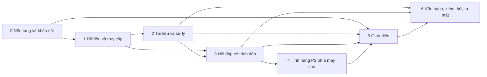

# KẾ HOẠCH TRIỂN KHAI (IMPLEMENTATION PLAN)
# Công cụ "Chat với tài liệu" – MVP

| Thuộc tính | Giá trị |
|---|---|
| Mã tài liệu | PLAN-CWD-001 |
| Phiên bản | 0.2 (0.1: bản đầu; 0.2: rà soát Definition of Ready, thêm CONTRACTS.md, tách 10 task lớn, thêm T-009) |
| Trạng thái | Draft – chờ PM/PO duyệt phạm vi và trình tự, Trưởng đội kỹ thuật duyệt tính khả thi (SOP 5.5) |
| Ngày | 2026-10-21 |
| Nguồn | [SAD.md](../04-design/SAD.md) (SAD-CWD-002 v0.1), [USER_STORIES.md](../03-analysis/USER_STORIES.md) (USR-CWD-001 v0.1), [PRD.md](../requirements/PRD.md) phụ lục lộ trình và mục 5.1, [BRD.md](../requirements/BRD.md) v0.5, [prototype UI](../04-design/UI_UX_design/README.md) |
| Chuẩn | `AI_SDLC-SOP.md` mục 5.5 (không có prompt riêng cho kế hoạch trong `SDLC-Prompt-Checklist/`) |
| Quy mô | **98 task**, tổng **545 giờ** `[Đề xuất]`; mỗi task là một file trong [tasks/](tasks/) |
| Hợp đồng dùng chung | [CONTRACTS.md](CONTRACTS.md) (CTR-CWD-001): kiểu dữ liệu, mã lỗi, API, SSE, telemetry, cấu hình, quy ước giao diện |

**Quy ước:** `[Đề xuất]` = đề xuất của người lập kế hoạch, chưa được xác nhận. `[TBD]` = còn thiếu, ghi mã câu hỏi mở. Mã `T-xxx` là task; `US-`, `BR-`, `NFR-`, `EC-`, `AD-`, `API-`, `G` lấy từ tài liệu nguồn.

## 1. Tóm tắt và kết luận chính

- **Phạm vi:** 30 story (15 P0, 15 P1) chia thành 98 task nhỏ; mỗi task là một mô-đun, lớp, hàm hoặc trang đủ nhỏ để một người kèm trợ lý AI hoàn thành sau vài vòng lặp và tự kiểm thử được.
- **Khối lượng theo ước lượng đề xuất:** 545 giờ (P0 481 giờ, P1 64 giờ). Năng lực giả định của 2 kỹ sư trong 7 tuần (2026-11-02 → 12-18) là **420 giờ** (30 giờ hiệu dụng mỗi kỹ sư mỗi tuần).
- **Kết luận: phạm vi hiện tại không vừa mốc 2026-12-18 với 2 kỹ sư theo các ước lượng này.** Xếp lịch theo năng lực cho kết quả hoàn tất khoảng **9.4 tuần** (khoảng 2027-01-06) nếu làm toàn bộ; ngay cả chỉ P0 cũng cần khoảng 8.1 tuần. Đây chính là rủi ro RSK-008 / OQ-018 mà BRD đã nêu; quyết định "giữ đủ" ngày 2026-10-21 cần được xem lại với con số này (mục 7).
- **Không có thông tin nào chặn việc bắt đầu ngay:** AI, OCR, SSO và kho tệp chưa chốt nhưng đã có cổng (ports) và bộ nối giả (T-008) để phát triển song song; các khảo sát (T-004 – T-007, T-010, T-011) chạy trong tuần 1 để chốt AD-06.
- **Mọi task đạt Definition of Ready** (mục 3.5): 98/98 task qua 12 tiêu chí kiểm tự động; mỗi task có phần đọc trước, đầu vào từ task trước, chữ ký, bảng test có tình huống và kết quả mong đợi, lệnh kiểm tra, ngoài phạm vi.
- **Số ước lượng là giả định:** chưa có số liệu năng suất thực của đội. Cần hiệu chỉnh sau tuần 1 (mục 7.3).

## 2. Giả định và ràng buộc của kế hoạch

| # | Giả định hoặc ràng buộc | Nguồn |
|---|---|---|
| Nhân lực: 2 kỹ sư, 1 BA, 1 PO bán thời gian; 7 tuần từ 2026-11-02 đến 12-18; thí điểm 4 tuần đến 2027-01-15; go/no-go 2027-01-22 | CON-006, CON-007 |
| Năng lực hiệu dụng: 30 giờ/tuần/kỹ sư (6 giờ × 5 ngày, đã trừ họp, review, chuyển ngữ cảnh) `[Đề xuất]` | Giả định |
| Ước lượng tính cho người làm chính kèm trợ lý AI, đã gồm viết test và đọc kỹ diff (người chịu trách nhiệm phải giải thích được thay đổi) | SOP 5.6 |
| Công nghệ đã chốt: Python (FastAPI), Vue, PostgreSQL + pgvector, triển khai tại chỗ. Các thư viện còn lại (SQLAlchemy, Alembic, Pinia, Vue Router, Vitest, Playwright, Locust…) là **đề xuất mặc định**, cần Trưởng đội kỹ thuật xác nhận ở tuần 1 | SAD 5.2; Q-A5 |
| Chưa chốt: nhà cung cấp AI (AD-06), công cụ OCR (DEP-005), giao thức SSO (PD-001), kho tệp (Q-A8), thư viện trích PDF (Q-A9), cỡ máy và CI tại chỗ | SAD 8 |
| Dữ liệu thật chỉ được dùng sau khi có phê duyệt Bảo mật thông tin (DEP-001, hạn 2026-11-13); trước đó dùng dữ liệu mẫu và bộ nối giả | CON-005, G5 |
| Bộ tài liệu mẫu và bộ câu hỏi chuẩn (DEP-003) hạn 2026-11-27; chặn T-004 (một phần), T-607, T-616, T-608 | DEP-003 |
| Chi phí AI ≤ 300 USD/tháng; cảnh báo ở 80% | NFR-009 |
| Ưu tiên task: P0 = phục vụ story P0 hoặc điều kiện ra mắt. Riêng T-203 (xóa tài liệu) và T-213 (xóa dữ liệu trong 24 giờ) phục vụ US-016, US-062, US-064 là **P1 theo PRD** nhưng được xếp P0 vì trụ cột Riêng tư coi "xóa thật trong 24 giờ" là điều kiện ra mắt (PRD mục 0.2); cần PM xác nhận (PQ-07) | PRD 0.2, BR-029 |

## 3. Cấu trúc mã nguồn và quy ước

### 3.1 Cây thư mục `[Đề xuất]`

Mã backend ở gốc kho (`app/`, `tests/`), không có thư mục `backend/` (quyết định 2026-10-23).

```
pyproject.toml
app/
  main.py                  # create_app()
  cli.py                   # add-admin
  domain/                  # types.py, status.py (CONTRACTS mục 2, T-009)
  core/                    # config.py, db.py, errors.py, features.py, metrics.py, wiring.py
  api/                     # routers: auth, me, documents*, chat, admin_*, metrics, telemetry, suggestions, health, deps.py
  modules/                 # auth, users, documents, audit, retrieval, answer, chat, suggest, summary, metrics, telemetry, jobs, usage
  ports/                   # ai.py, ocr.py, storage.py, idp.py   (Protocol)
  adapters/                # ai_gateway.py, ai_fake.py, ai_provider.py, ocr_fake.py, ocr_tesseract.py, storage_fs.py, idp_*.py
  models/                  # SQLAlchemy
  worker/                  # __main__.py, main.py, registry.py, scheduler.py, extract.py, chunker.py, indexer.py, ocr_step.py, ingest.py, purge.py, suggest.py
migrations/                # Alembic
tests/                     # unit/, integration/, security/, fixtures/
scripts/                   # make_sample_data.py, eval_*.py, ocr_trial.py, ai_trial.py
loadtest/
frontend/
  src/                       # api/, content/, stores/, views/, components/, composables/, utils/, styles/, router/
  e2e/
deploy/                      # compose.dev.yml, compose.prod.yml, Dockerfile.backend, web/, backup/, alerts.yml
ci/
docs/05-planning/            # PLAN.md, CONTRACTS.md, tasks/, spikes/, evidence/
```

Tên thư mục `modules/` khớp tên mô-đun trong SAD mục 3.1; `ports/` và `adapters/` khớp SAD mục 5.3. Quy tắc phụ thuộc: router → mô-đun → cổng → bộ nối; mô-đun **không** nhập `adapters`; chỉ `ai_gateway` gọi nhà cung cấp AI.

### 3.2 Quy ước làm việc `[Đề xuất]`

- Một task = một nhánh nhỏ và một yêu cầu review; không gộp nhiều task vào một thay đổi.
- Thông điệp commit nêu mã task và mã yêu cầu, ví dụ `T-201: upload API (US-010, US-011)`.
- Task có chữ ký hàm: giữ nguyên chữ ký trừ khi đã thống nhất đổi và cập nhật task phụ thuộc.
- Không đưa bí mật vào mã, nhật ký, ảnh container hay dữ liệu thử nghiệm.
- Không ghi nội dung câu hỏi, câu trả lời hay tài liệu vào nhật ký hay telemetry.
- Khi một task dùng trợ lý AI đáng kể, ghi vào mô tả thay đổi (SOP 5.6 bước 10).

### 3.3 Định nghĩa hoàn thành chung cho mọi task

- Mọi mục trong "Tiêu chí hoàn thành" của task đã đạt; mọi dòng trong bảng "Kiểm thử cần viết" đã thành test (hoặc bước kiểm tra) với đúng tình huống và kết quả mong đợi, và chạy xanh.
- Các lệnh ở mục "Lệnh kiểm tra" của task đạt. Backend: `make lint type test`. Frontend: `npm run lint type-check test build`.
- Tên, kiểu, mã lỗi, đường dẫn API, khóa cấu hình khớp từng chữ với CONTRACTS.md; không tự thêm mã lỗi hay trường JSON.
- Đã xem toàn bộ diff: không có tệp tạm, mã gỡ lỗi, thay đổi ngoài phạm vi hay tệp sinh tự động ngoài ý định.
- Người làm giải thích được hành vi thay đổi và các lựa chọn quan trọng (SOP 5.6); mã không hiểu hay không kiểm chứng được thì viết lại.
- Không có bí mật hay dữ liệu thật trong thay đổi.
- Cập nhật tài liệu liên quan (SAD, Blueprint, README) nếu hành vi khác với thiết kế, và ghi sai lệch vào mô tả thay đổi.
- Người review khác người làm (SOP 5.8); trợ lý AI không thay thế người review.

### 3.4 Cách giao task cho trợ lý AI

Mỗi file task cộng với các mục CONTRACTS.md ghi ở "Đọc trước" là đủ để làm; không cần nạp cả SAD hay Blueprint vào ngữ cảnh. Gợi ý lời nhắc `[Đề xuất]`:

```text
Đọc file task <file task> và đúng các mục ở phần "Đọc trước" (chủ yếu là CONTRACTS.md).
Mã của các task ở phần "Đầu vào có sẵn" đã có trong kho; dùng đúng tên và chữ ký của chúng, không viết lại.
Chỉ tạo hoặc sửa các file ghi trong task. Giữ nguyên chữ ký ở phần "Chữ ký và giao diện".
Viết từng test trong bảng "Kiểm thử cần viết" với đúng tình huống và kết quả mong đợi, trước hoặc cùng lúc với mã.
Chạy các lệnh ở phần "Lệnh kiểm tra" và báo kết quả thật. Không làm các mục ở phần "Ngoài phạm vi".
Nếu thiếu thông tin, yêu cầu mâu thuẫn, hoặc cần đổi CONTRACTS.md: dừng lại và liệt kê câu hỏi; không tự suy đoán.
Không thêm thư viện ngoài danh sách đã duyệt.
```

Kết quả "đã chạy test xanh" do trợ lý báo không phải bằng chứng; người làm tự chạy lại và đọc kết quả (SOP 5.7).

### 3.5 Định nghĩa sẵn sàng (Definition of Ready)

Một task chỉ được giao phát triển khi đạt mọi tiêu chí dưới đây. Kiểm tra chạy tự động mỗi lần sinh lại kế hoạch; sửa task bằng tay thì người sửa tự đối chiếu bảng này.

| Mã | Tiêu chí | Kết quả |
|---|---|---|
| R01 | Có mục tiêu một câu, nêu kết quả | 98/98 |
| R02 | Có mục "Đọc trước" trỏ tới đúng phần hợp đồng hoặc tài liệu cần dùng | 98/98 |
| R03 | Liệt kê file cần tạo hoặc sửa | 98/98 |
| R04 | Task viết mã có chữ ký hàm, lớp hoặc props/emits | 98/98 |
| R05 | Các bước cụ thể (≥ 2 bước) | 98/98 |
| R06 | Tiêu chí hoàn thành kiểm chứng được (≥ 2 tiêu chí, không có từ mơ hồ) | 98/98 |
| R07 | Mỗi test có tình huống đầu vào và kết quả mong đợi; số test ≥ số tiêu chí (task viết mã) | 98/98 |
| R08 | Có mục "Ngoài phạm vi" | 98/98 |
| R09 | Ước lượng ≤ 8 giờ (trừ task có khung thời gian cố định) | 98/98 |
| R10 | Kiểu dữ liệu dùng trong chữ ký đều được định nghĩa ở task này, task phụ thuộc hoặc CONTRACTS | 98/98 |
| R11 | Task có API ghi rõ mã HTTP và mã lỗi | 98/98 |
| R12 | Task P0 không phụ thuộc task P1 | 98/98 |

Ngoại lệ đã chấp nhận: T-617 (sửa lỗi sau UAT) có khung thời gian cố định 10 giờ vì khối lượng phụ thuộc số lỗi; mỗi lỗi lớn hơn 4 giờ được tách thành task riêng khi phát hiện.

Các task khảo sát (T-004 – T-007, T-010, T-011) và vận hành (T-601 – T-617) không viết mã ứng dụng; "test" của chúng là bước kiểm tra có tình huống và kết quả mong đợi.

## 4. Chiến lược chia lát cắt

- **Khung chạy được từ đầu (walking skeleton):** T-001 – T-003, T-008, T-009, T-501 dựng khung backend, frontend, CSDL, cổng và kiểu dữ liệu chung; mọi task sau chạy trên khung này.
- **Hợp đồng trước, mã sau:** mọi kiểu, mã lỗi, API và sự kiện nằm ở CONTRACTS.md; T-009 (backend) và T-503 (frontend) chép chúng thành mã một lần, nên back-end và front-end làm song song mà không lệch nhau.
- **Cổng và bộ nối giả trước:** AI, OCR, SSO, kho tệp đi qua cổng (T-008); phát triển và test dùng bộ nối giả, bộ nối thật thay vào sau khi chốt (T-209, T-302, T-315, T-108). Cách này giữ tiến độ dù AD-06, DEP-005, PD-001 chưa có kết quả.
- **Khảo sát sớm (tuần 1):** T-004, T-010 (OCR), T-005, T-011 (AI), T-006 (SSO), T-007 (thư viện PDF) cho số đo thật để chốt quyết định trước khi xây phần phụ thuộc.
- **Theo luồng dọc P0 trước:** tải lên → xử lý → sẵn sàng (pha 2), rồi hỏi đáp có trích dẫn (pha 3), cùng các trang giao diện tương ứng; sau đó mới đến P1.
- **P1 tắt được riêng:** cờ tính năng (T-614) cho phép cắt P1 mà không phá luồng P0 (DD-08, RSK-005).
- **Kiểm thử đi cùng:** mỗi task có test; bộ đánh giá chất lượng (T-607) và thử tải (T-608) chạy khi có đủ luồng, không để dồn vào tuần cuối.

## 5. Pha, khối lượng và đường găng

| Pha | Số task | Giờ | Trong đó P1 | Bắt đầu | Kết thúc |
|---|---|---|---|---|---|
| 0 Nền tảng và khảo sát | 11 | 54 | 0 | 2026-11-02 | 2026-11-10 |
| 1 Dữ liệu và truy cập | 14 | 71 | 0 | 2026-11-10 | 2026-11-23 |
| 2 Tài liệu và xử lý | 13 | 76 | 0 | 2026-11-20 | 2026-12-08 |
| 3 Hỏi đáp có trích dẫn | 16 | 87 | 16 | 2026-11-24 | 2026-12-30 |
| 4 Tính năng P1 phía máy chủ | 4 | 22 | 18 | 2026-12-16 | 2026-12-31 |
| 5 Giao diện | 25 | 143 | 30 | 2026-11-04 | 2027-01-06 |
| 6 Vận hành, kiểm thử, ra mắt | 15 | 92 | 0 | 2026-12-14 | 2026-12-28 |
| **Tổng** | **98** | **545** | **64** | | |

Ngày ở bảng là xấp xỉ theo lịch xếp mục 6 (5 ngày làm việc mỗi tuần, tuần 1 bắt đầu 2026-11-02).



**Đường găng về phụ thuộc** (chưa tính năng lực): 114 giờ qua [T-001](tasks/T-001-khung-ma-nguon-backend-va-cong-cu.md) → [T-002](tasks/T-002-nap-cau-hinh-va-bi-mat.md) → [T-003](tasks/T-003-csdl-phat-trien-ket-noi-va-alembic.md) → [T-101](tasks/T-101-migration-001-tai-lieu-chunk-goi-y.md) → [T-102](tasks/T-102-migration-002-phien-hoi-thoai-va-tin-nhan.md) → [T-103](tasks/T-103-migration-003-quan-tri-nhat-ky-telemetry-hang-doi.md) → [T-106](tasks/T-106-repository-quan-tri-nhat-ky-telemetry-chi-phi-ai.md) → [T-108](tasks/T-108-dang-nhap-sso-phien-va-get-me-api-01.md) → [T-109](tasks/T-109-kiem-tra-quyen-authz-va-chong-csrf.md) → [T-113](tasks/T-113-telemetry-luoc-do-su-kien-va-api-16.md) → [T-301](tasks/T-301-cong-ai-aigateway-thoi-han-han-muc-ghi-nhan.md) → [T-303](tasks/T-303-truy-xuat-lai-vector-tu-khoa-theo-pham-vi.md) → [T-304](tasks/T-304-nguong-lien-quan-va-quyet-dinh-khong-tim-thay.md) → [T-307](tasks/T-307-dich-vu-tra-loi-1-2-luong-chinh-co-trich-dan.md) → [T-316](tasks/T-316-dich-vu-tra-loi-2-2-dung-dut-ket-noi-loi-va-het-gio.md) → [T-308](tasks/T-308-api-hoi-thoai-phien-gui-cau-hoi-sse-dung-api-07-08-09.md) → [T-608](tasks/T-608-thu-tai-g4.md) → [T-612](tasks/T-612-ho-tro-uat.md) → [T-617](tasks/T-617-sua-loi-sau-uat-khung-thoi-gian-co-dinh.md). Đường này ngắn hơn nhiều so với tổng khối lượng, nên **giới hạn thật là năng lực của 2 người**, không phải phụ thuộc giữa các task.

## 6. Lịch tham khảo theo tuần

Lịch do thuật toán xếp danh sách (list scheduling): mỗi kỹ sư làm tuần tự các task của mình, task chỉ bắt đầu khi các task phụ thuộc đã xong, ưu tiên P0 trước P1. Mỗi tuần 30 giờ hiệu dụng mỗi kỹ sư. **Đây là điểm xuất phát để Trưởng đội kỹ thuật điều chỉnh, không phải cam kết.**

### 6.1 Tải theo tuần (giờ)

| Tuần | Bắt đầu | Kỹ sư A | Kỹ sư B | Mốc theo PRD |
|---|---|---|---|---|
| W1 | 2026-11-02 | 30 | 30 | Wireframe được duyệt; kết quả thử OCR |
| W2 | 2026-11-09 | 30 | 30 |  |
| W3 | 2026-11-16 | 30 | 30 | Tải lên → Sẵn sàng chạy từ đầu đến cuối |
| W4 | 2026-11-23 | 30 | 30 |  |
| W5 | 2026-11-30 | 30 | 30 | Hỏi đáp có trích dẫn chạy được; đánh giá lần đầu trên bộ câu hỏi chuẩn |
| W6 | 2026-12-07 | 30 | 30 | Hoàn tất tính năng |
| W7 | 2026-12-14 | 30 | 30 | Toàn bộ cổng G1 – G11 (hạn 2026-12-18) |
| W8 (sau mốc 2026-12-18) | 2026-12-21 | 30 | 30 |  |
| W9 (sau mốc 2026-12-18) | 2026-12-28 | 22 | 30 |  |
| W10 (sau mốc 2026-12-18) | 2027-01-04 | 0 | 13 |  |

### 6.2 Mốc tích hợp so với lộ trình PRD

Tuần hoàn tất = tuần chứa thời điểm xong của task muộn nhất trong nhóm (theo lịch ở trên).

| Mốc | Task cần xong | Theo PRD | Theo lịch này |
|---|---|---|---|
| Khảo sát xong, chốt AD-06 và ngưỡng OCR | nhiều task | Tuần 1 | W1 |
| Khung chạy được: CSDL, xác thực, quyền, mã lỗi | T-003, T-108, T-109, T-107 | Tuần 1 – 2 | W3 (trễ) |
| Tải lên → Sẵn sàng chạy đầu cuối (API) | T-201, T-208, T-209, T-210, T-211 | Tuần 3 | W5 (trễ) |
| Hỏi đáp có trích dẫn chạy đầu cuối (API) | T-307, T-316, T-308, T-210 | Tuần 5 | W7 (trễ) |
| Giao diện P0: kho tài liệu, tải lên, hỏi đáp, xem nguồn | nhiều task | Tuần 5 | W5 |
| Đánh giá chất lượng lần đầu trên bộ câu hỏi chuẩn | T-607 | Tuần 5 | W8 (trễ) |
| Hoàn tất mọi task P0 trừ UAT và sửa lỗi | nhiều task | Tuần 6 | W9 (trễ) |
| Hoàn tất toàn bộ, gồm UAT và sửa lỗi | nhiều task | Tuần 7 | W10 (trễ) |

### 6.3 Danh sách task

Cột Tuần là tuần dự kiến theo lịch ở trên; **in đậm** nghĩa là kết thúc sau tuần 7 (sau 2026-12-18).

#### Pha 0 Nền tảng và khảo sát

| Task | Tên | Người | Giờ | Ưu tiên | Tuần | Phụ thuộc | Story |
|---|---|---|---|---|---|---|---|
| [T-001](tasks/T-001-khung-ma-nguon-backend-va-cong-cu.md) | Khung mã nguồn backend và công cụ | A | 6 | P0 | W1 | — | — |
| [T-002](tasks/T-002-nap-cau-hinh-va-bi-mat.md) | Nạp cấu hình và bí mật | A | 3 | P0 | W1 | T-001 | — |
| [T-003](tasks/T-003-csdl-phat-trien-ket-noi-va-alembic.md) | CSDL phát triển, kết nối và Alembic | A | 5 | P0 | W1 | T-001, T-002 | — |
| [T-004](tasks/T-004-khao-sat-ocr-1-2-bo-mau-va-tesseract.md) | Khảo sát OCR (1/2): bộ mẫu và Tesseract | A | 6 | P0 | W1 | — | US-013 |
| [T-005](tasks/T-005-khao-sat-ai-1-2-mo-hinh-nhung-va-truy-xuat-tieng-viet.md) | Khảo sát AI (1/2): mô hình nhúng và truy xuất tiếng Việt | B | 5 | P0 | W1 | — | US-060 |
| [T-006](tasks/T-006-khao-sat-tich-hop-sso-pd-001.md) | Khảo sát tích hợp SSO (PD-001) | B | 6 | P0 | W1 | — | US-001 |
| [T-007](tasks/T-007-khao-sat-thu-vien-trich-van-ban-pdf.md) | Khảo sát thư viện trích văn bản PDF | A | 4 | P0 | W1 | — | US-012, US-013 |
| [T-008](tasks/T-008-cong-ports-va-bo-noi-gia-fake-adapters.md) | Cổng (ports) và bộ nối giả (fake adapters) | A | 5 | P0 | W2 | T-001, T-009 | — |
| [T-009](tasks/T-009-kieu-du-lieu-mien-va-chuyen-trang-thai.md) | Kiểu dữ liệu miền và chuyển trạng thái | A | 3 | P0 | W2 | T-001 | — |
| [T-010](tasks/T-010-khao-sat-ocr-2-2-dich-vu-dam-may-so-sanh-khuyen-nghi.md) | Khảo sát OCR (2/2): dịch vụ đám mây, so sánh, khuyến nghị | A | 6 | P0 | W1 | T-004 | US-013 |
| [T-011](tasks/T-011-khao-sat-ai-2-2-sinh-cau-tra-loi-do-tre-chi-phi-khuyen-nghi.md) | Khảo sát AI (2/2): sinh câu trả lời, độ trễ, chi phí, khuyến nghị AD-06 | B | 5 | P0 | W1 | T-005 | US-060 |

#### Pha 1 Dữ liệu và truy cập

| Task | Tên | Người | Giờ | Ưu tiên | Tuần | Phụ thuộc | Story |
|---|---|---|---|---|---|---|---|
| [T-101](tasks/T-101-migration-001-tai-lieu-chunk-goi-y.md) | Migration 001: tài liệu, chunk, gợi ý | A | 6 | P0 | W2 | T-003, T-009 | US-010, US-015 |
| [T-102](tasks/T-102-migration-002-phien-hoi-thoai-va-tin-nhan.md) | Migration 002: phiên hội thoại và tin nhắn | A | 4 | P0 | W2 | T-101, T-009 | US-020, US-041 |
| [T-103](tasks/T-103-migration-003-quan-tri-nhat-ky-telemetry-hang-doi.md) | Migration 003: quản trị, nhật ký, telemetry, hàng đợi | A | 4 | P0 | W2 | T-102 | US-061, US-063 |
| [T-104](tasks/T-104-mo-hinh-orm-va-repository-tai-lieu.md) | Mô hình ORM và repository tài liệu | A | 6 | P0 | W3 | T-101, T-009 | US-010, US-015 |
| [T-105](tasks/T-105-repository-hoi-thoai.md) | Repository hội thoại | A | 5 | P0 | W3 | T-102, T-104, T-009 | US-020, US-041 |
| [T-106](tasks/T-106-repository-quan-tri-nhat-ky-telemetry-chi-phi-ai.md) | Repository quản trị, nhật ký, telemetry, chi phí AI | A | 4 | P0 | W2 | T-103, T-009 | US-061, US-063 |
| [T-107](tasks/T-107-hop-dong-loi-va-bo-xu-ly-ngoai-le.md) | Hợp đồng lỗi và bộ xử lý ngoại lệ | A | 4 | P0 | W2 | T-001 | — |
| [T-108](tasks/T-108-dang-nhap-sso-phien-va-get-me-api-01.md) | Đăng nhập SSO, phiên và `GET /me` (API-01) | A | 8 | P0 | W3 | T-002, T-006, T-008, T-106, T-107, T-009 | US-001, US-002 |
| [T-109](tasks/T-109-kiem-tra-quyen-authz-va-chong-csrf.md) | Kiểm tra quyền (AuthZ) và chống CSRF | A | 5 | P0 | W3 | T-108, T-009 | US-002, US-061 |
| [T-110](tasks/T-110-api-quan-ly-allow-list-api-14.md) | API quản lý allow-list (API-14) | B | 5 | P0 | W3 | T-106, T-109, T-009 | US-061 |
| [T-111](tasks/T-111-mo-dun-nhat-ky-kiem-toan-api-15.md) | Mô-đun nhật ký kiểm toán (API-15) | B | 4 | P0 | W3 | T-106, T-109 | US-063, US-062 |
| [T-112](tasks/T-112-bo-noi-kho-tep-storageport.md) | Bộ nối kho tệp (StoragePort) | B | 5 | P0 | W2 | T-008 | US-010, US-022 |
| [T-113](tasks/T-113-telemetry-luoc-do-su-kien-va-api-16.md) | Telemetry: lược đồ sự kiện và API-16 | B | 7 | P0 | W3 | T-106, T-109, T-009 | US-051 |
| [T-605](tasks/T-605-du-lieu-mau-va-fixture-kiem-thu.md) | Dữ liệu mẫu và fixture kiểm thử | A | 4 | P0 | W3 | T-001 | — |

#### Pha 2 Tài liệu và xử lý

| Task | Tên | Người | Giờ | Ưu tiên | Tuần | Phụ thuộc | Story |
|---|---|---|---|---|---|---|---|
| [T-201](tasks/T-201-tai-len-tai-lieu-api-02.md) | Tải lên tài liệu (API-02) | A | 8 | P0 | W5 | T-104, T-107, T-109, T-111, T-112, T-204, T-009 | US-010, US-011, US-014 |
| [T-202](tasks/T-202-danh-sach-tai-lieu-api-03.md) | Danh sách tài liệu (API-03) | A | 4 | P0 | W5 | T-104, T-109 | US-015 |
| [T-203](tasks/T-203-xoa-tai-lieu-api-05.md) | Xóa tài liệu (API-05) | A | 5 | P0 | W5 | T-104, T-107, T-109, T-111, T-204 | US-016, US-062 |
| [T-204](tasks/T-204-hang-doi-tac-vu-jobs.md) | Hàng đợi tác vụ (jobs) | A | 6 | P0 | W3–W4 | T-103, T-009, T-002 | — |
| [T-205](tasks/T-205-worker-vong-lap-xu-ly-va-scheduler.md) | Worker: vòng lặp xử lý và scheduler | A | 4 | P0 | W4 | T-002, T-204, T-111 | — |
| [T-206](tasks/T-206-ingest-trich-van-ban-theo-trang.md) | Ingest: trích văn bản theo trang | A | 8 | P0 | W4 | T-007, T-009, T-605 | US-012, US-013 |
| [T-207](tasks/T-207-ingest-chia-chunk-theo-trang.md) | Ingest: chia chunk theo trang | A | 4 | P0 | W4 | T-009 | US-022 |
| [T-208](tasks/T-208-ingest-nhung-va-lap-chi-muc.md) | Ingest: nhúng và lập chỉ mục | A | 6 | P0 | W4–W5 | T-104, T-207, T-008 | US-020 |
| [T-209](tasks/T-209-ingest-duong-ocr-cho-pdf-anh-quet.md) | Ingest: đường OCR cho PDF ảnh quét | A | 8 | P0 | W4 | T-010, T-206, T-008 | US-013 |
| [T-210](tasks/T-210-ingest-dieu-phoi-va-chuyen-trang-thai.md) | Ingest: điều phối và chuyển trạng thái | A | 6 | P0 | W5 | T-205, T-206, T-207, T-208, T-209, T-211, T-104, T-204 | US-012, US-013 |
| [T-211](tasks/T-211-su-kien-trang-thai-tai-lieu-api-04-sse.md) | Sự kiện trạng thái tài liệu (API-04, SSE) | B | 6 | P0 | W4 | T-104, T-109, T-009 | US-012 |
| [T-212](tasks/T-212-tai-tep-pdf-cho-khung-xem-nguon-api-06.md) | Tải tệp PDF cho khung xem nguồn (API-06) | B | 5 | P0 | W4 | T-104, T-109, T-112 | US-022 |
| [T-213](tasks/T-213-tac-vu-xoa-du-lieu-trong-24-gio.md) | Tác vụ xóa dữ liệu trong 24 giờ | B | 6 | P0 | W6 | T-203, T-205, T-111, T-112, T-204 | US-064, US-016 |

#### Pha 3 Hỏi đáp có trích dẫn

| Task | Tên | Người | Giờ | Ưu tiên | Tuần | Phụ thuộc | Story |
|---|---|---|---|---|---|---|---|
| [T-301](tasks/T-301-cong-ai-aigateway-thoi-han-han-muc-ghi-nhan.md) | Cổng AI (AiGateway): thời hạn, hạn mức, ghi nhận | A | 8 | P0 | W5–W6 | T-002, T-008, T-107, T-106, T-113 | US-060 |
| [T-302](tasks/T-302-bo-noi-ai-that-1-2-nhung-theo-lo.md) | Bộ nối AI thật (1/2): nhúng theo lô | B | 5 | P0 | W6 | T-011, T-301 | US-060, US-020 |
| [T-303](tasks/T-303-truy-xuat-lai-vector-tu-khoa-theo-pham-vi.md) | Truy xuất lai (vector + từ khóa) theo phạm vi | A | 8 | P0 | W6 | T-104, T-301, T-605, T-009 | US-020, US-021 |
| [T-304](tasks/T-304-nguong-lien-quan-va-quyet-dinh-khong-tim-thay.md) | Ngưỡng liên quan và quyết định "không tìm thấy" | A | 4 | P0 | W6 | T-303, T-009 | US-023 |
| [T-305](tasks/T-305-dung-prompt-voi-nhan-chunk.md) | Dựng prompt với nhãn chunk | A | 5 | P0 | W6 | T-009 | US-020, US-022 |
| [T-306](tasks/T-306-kiem-tra-va-anh-xa-trich-dan.md) | Kiểm tra và ánh xạ trích dẫn | A | 5 | P0 | W6 | T-009 | US-022 |
| [T-307](tasks/T-307-dich-vu-tra-loi-1-2-luong-chinh-co-trich-dan.md) | Dịch vụ trả lời (1/2): luồng chính có trích dẫn | A | 6 | P0 | W6–W7 | T-105, T-301, T-303, T-304, T-305, T-306, T-113, T-009 | US-020, US-021, US-022, US-023, US-027 |
| [T-308](tasks/T-308-api-hoi-thoai-phien-gui-cau-hoi-sse-dung-api-07-08-09.md) | API hội thoại: phiên, gửi câu hỏi SSE, dừng (API-07/08/09) | A | 8 | P0 | W7 | T-105, T-107, T-109, T-307, T-316 | US-020, US-022, US-027 |
| [T-309](tasks/T-309-tra-loi-theo-ngon-ngu-cua-cau-hoi.md) | Trả lời theo ngôn ngữ của câu hỏi | A | 3 | P1 | **W9** | T-305, T-307 | US-024 |
| [T-310](tasks/T-310-cau-hoi-noi-tiep-trong-phien.md) | Câu hỏi nối tiếp trong phiên | A | 6 | P1 | **W9** | T-307, T-105, T-614 | US-025 |
| [T-311](tasks/T-311-pham-vi-tai-lieu-trong-api-08-va-ec-15.md) | Phạm vi tài liệu trong API-08 và EC-15 | A | 4 | P1 | **W9** | T-308, T-104, T-614 | US-026 |
| [T-312](tasks/T-312-so-lieu-hang-tuan-api-13.md) | Số liệu hàng tuần (API-13) | B | 8 | P0 | W4 | T-106, T-109, T-113 | US-051 |
| [T-313](tasks/T-313-danh-gia-api-11.md) | Đánh giá 👍/👎 (API-11) | B | 3 | P1 | **W8–W9** | T-105, T-109, T-113, T-614 | US-050 |
| [T-314](tasks/T-314-noi-telemetry-vao-dang-nhap-tai-len-xu-ly-va-xoa.md) | Nối telemetry vào đăng nhập, tải lên, xử lý và xóa | B | 5 | P0 | W6 | T-113, T-108, T-109, T-201, T-203, T-210 | US-051 |
| [T-315](tasks/T-315-bo-noi-ai-that-2-2-sinh-cau-tra-loi-dang-luong.md) | Bộ nối AI thật (2/2): sinh câu trả lời dạng luồng | B | 5 | P0 | W6 | T-302 | US-020, US-027 |
| [T-316](tasks/T-316-dich-vu-tra-loi-2-2-dung-dut-ket-noi-loi-va-het-gio.md) | Dịch vụ trả lời (2/2): dừng, đứt kết nối, lỗi và hết giờ | A | 4 | P0 | W7 | T-307 | US-027, US-020 |

#### Pha 4 Tính năng P1 phía máy chủ

| Task | Tên | Người | Giờ | Ưu tiên | Tuần | Phụ thuộc | Story |
|---|---|---|---|---|---|---|---|
| [T-401](tasks/T-401-lich-su-hoi-thoai-api-10-va-het-han-90-ngay.md) | Lịch sử hội thoại (API-10) và hết hạn 90 ngày | B | 6 | P1 | **W9** | T-105, T-109, T-113, T-205, T-614 | US-041 |
| [T-402](tasks/T-402-goi-y-cau-hoi-mau-api-17.md) | Gợi ý câu hỏi mẫu (API-17) | B | 6 | P1 | **W9** | T-210, T-301, T-104, T-205, T-614 | US-031, US-030 |
| [T-403](tasks/T-403-tom-tat-tai-lieu-api-12.md) | Tóm tắt tài liệu (API-12) | A | 6 | P1 | **W9** | T-301, T-305, T-306, T-104, T-109, T-113, T-614 | US-040 |
| [T-614](tasks/T-614-co-tinh-nang-cho-phan-p1.md) | Cờ tính năng cho phần P1 | A | 4 | P0 | W7 | T-002 | — |

#### Pha 5 Giao diện

| Task | Tên | Người | Giờ | Ưu tiên | Tuần | Phụ thuộc | Story |
|---|---|---|---|---|---|---|---|
| [T-501](tasks/T-501-khung-ma-nguon-frontend-va-cong-cu.md) | Khung mã nguồn frontend và công cụ | B | 5 | P0 | W1 | — | — |
| [T-502](tasks/T-502-token-thiet-ke-khung-ung-dung-dieu-huong-theo-vai-tro.md) | Token thiết kế, khung ứng dụng, điều hướng theo vai trò | B | 6 | P0 | W1–W2 | T-501, T-503 | US-001 |
| [T-503](tasks/T-503-client-api-va-bang-anh-xa-ma-loi.md) | Client API và bảng ánh xạ mã lỗi | B | 5 | P0 | W1 | T-501 | — |
| [T-504](tasks/T-504-client-luong-sse-post-cho-cau-tra-loi.md) | Client luồng SSE (POST) cho câu trả lời | B | 6 | P0 | W2–W3 | T-503 | US-027 |
| [T-505](tasks/T-505-kho-trang-thai-dang-nhap-bao-ve-route-s-01-va-s-02.md) | Kho trạng thái đăng nhập, bảo vệ route, S-01 và S-02 | B | 6 | P0 | W2 | T-503, T-502 | US-001, US-002 |
| [T-506](tasks/T-506-thanh-phan-dung-chung-thong-bao-hop-thoai-khung-xuong-huy-hi.md) | Thành phần dùng chung: thông báo, hộp thoại, khung xương, huy hiệu | B | 8 | P0 | W2 | T-502 | US-012 |
| [T-507](tasks/T-507-trang-kho-tai-lieu-bang-tim-kiem-sap-xep-s-04.md) | Trang Kho tài liệu: bảng, tìm kiếm, sắp xếp (S-04) | B | 8 | P0 | W2 | T-505, T-506 | US-015 |
| [T-508](tasks/T-508-tai-len-1-2-vung-keo-tha-va-kiem-tra-o-trinh-duyet.md) | Tải lên (1/2): vùng kéo thả và kiểm tra ở trình duyệt | B | 5 | P0 | W4 | T-507, T-521 | US-010, US-011, US-014 |
| [T-509](tasks/T-509-cap-nhat-trang-thai-tai-lieu-theo-thoi-gian-thuc.md) | Cập nhật trạng thái tài liệu theo thời gian thực | B | 4 | P0 | W6–W7 | T-504, T-507 | US-012 |
| [T-510](tasks/T-510-hop-thoai-xoa-va-tep-trung-thao-tac-theo-vai-tro.md) | Hộp thoại xóa và tệp trùng, thao tác theo vai trò | B | 6 | P1 | **W9** | T-506, T-507, T-523 | US-016, US-017, US-062 |
| [T-511](tasks/T-511-hoi-dap-1-3-bo-cuc-trang-va-thanh-ben.md) | Hỏi đáp (1/3): bố cục trang và thanh bên | B | 4 | P0 | W3 | T-505, T-506, T-507 | US-020 |
| [T-512](tasks/T-512-hien-thi-tin-nhan-tra-loi-dan-va-the-trich-dan.md) | Hiển thị tin nhắn: trả lời dần và thẻ trích dẫn | B | 6 | P0 | W5 | T-524, T-504 | US-020, US-022, US-023, US-027 |
| [T-513](tasks/T-513-khung-xem-nguon-s-05.md) | Khung xem nguồn (S-05) | B | 7 | P0 | W5 | T-512, T-511, T-521 | US-022 |
| [T-514](tasks/T-514-chon-pham-vi-tai-lieu.md) | Chọn phạm vi tài liệu | B | 5 | P1 | **W9** | T-524, T-507 | US-026 |
| [T-515](tasks/T-515-man-hinh-chao-va-goi-y-cau-hoi.md) | Màn hình chào và gợi ý câu hỏi | B | 5 | P1 | **W10** | T-524, T-507, T-521 | US-030, US-031 |
| [T-516](tasks/T-516-danh-sach-lich-su-s-06.md) | Danh sách lịch sử (S-06) | B | 5 | P1 | **W10** | T-511, T-524 | US-041 |
| [T-517](tasks/T-517-thao-tac-tren-cau-tra-loi-sao-chep-va-danh-gia.md) | Thao tác trên câu trả lời: sao chép và đánh giá | B | 6 | P1 | **W9** | T-512, T-521 | US-042, US-050 |
| [T-518](tasks/T-518-hop-thoai-tom-tat-tai-lieu.md) | Hộp thoại tóm tắt tài liệu | B | 3 | P1 | **W10** | T-507, T-510, T-512 | US-040 |
| [T-519](tasks/T-519-trang-quan-tri-nguoi-dung-s-07-va-nhat-ky-s-08.md) | Trang quản trị: người dùng (S-07) và nhật ký (S-08) | B | 8 | P0 | W5 | T-506, T-505 | US-061, US-063 |
| [T-520](tasks/T-520-trang-so-lieu-s-09.md) | Trang Số liệu (S-09) | B | 7 | P0 | W6 | T-506, T-505 | US-051 |
| [T-521](tasks/T-521-telemetry-phia-giao-dien.md) | Telemetry phía giao diện | B | 5 | P0 | W3 | T-503 | US-051 |
| [T-522](tasks/T-522-ra-soat-kha-nang-tiep-can-va-dap-ung.md) | Rà soát khả năng tiếp cận và đáp ứng | B | 8 | P0 | **W7–W8** | T-507, T-512, T-513, T-525, T-606 | — |
| [T-523](tasks/T-523-tai-len-2-2-hang-doi-tien-do-va-thu-lai-tung-tep.md) | Tải lên (2/2): hàng đợi, tiến độ và thử lại từng tệp | B | 5 | P0 | W5 | T-508, T-521 | US-010, US-014 |
| [T-524](tasks/T-524-hoi-dap-2-3-o-nhap-va-gui-cau-hoi.md) | Hỏi đáp (2/3): ô nhập và gửi câu hỏi | B | 6 | P0 | W4 | T-511, T-504 | US-020, US-027 |
| [T-525](tasks/T-525-hoi-dap-3-3-trang-thai-cua-cau-tra-loi.md) | Hỏi đáp (3/3): trạng thái của câu trả lời | B | 4 | P0 | W5 | T-512 | US-023, US-027, US-020 |

#### Pha 6 Vận hành, kiểm thử, ra mắt

| Task | Tên | Người | Giờ | Ưu tiên | Tuần | Phụ thuộc | Story |
|---|---|---|---|---|---|---|---|
| [T-601](tasks/T-601-duong-ong-ci.md) | Đường ống CI | B | 5 | P0 | **W8** | T-001, T-501 | — |
| [T-602](tasks/T-602-dong-goi-va-cau-hinh-trien-khai-tai-cho.md) | Đóng gói và cấu hình triển khai tại chỗ | B | 8 | P0 | W7 | T-003, T-501, T-205 | — |
| [T-603](tasks/T-603-sao-luu-khoi-phuc-va-buoi-thu-khoi-phuc.md) | Sao lưu, khôi phục và buổi thử khôi phục | B | 6 | P0 | **W8** | T-602 | US-064 |
| [T-604](tasks/T-604-giam-sat-suc-khoe-chi-so-va-canh-bao.md) | Giám sát: sức khỏe, chỉ số và cảnh báo | B | 6 | P0 | **W8** | T-301, T-602, T-204 | — |
| [T-606](tasks/T-606-kiem-thu-dau-cuoi-1-2-moi-truong-dang-nhap-tai-len-xoa.md) | Kiểm thử đầu cuối (1/2): môi trường, đăng nhập, tải lên, xóa | A | 5 | P0 | W7 | T-505, T-523, T-605, T-108, T-109, T-201, T-202, T-210, T-211 | — |
| [T-607](tasks/T-607-bo-danh-gia-chat-luong-tra-loi-g3.md) | Bộ đánh giá chất lượng trả lời (G3) | A | 6 | P0 | **W8** | T-307, T-316, T-315, T-605 | — |
| [T-608](tasks/T-608-thu-tai-g4.md) | Thử tải (G4) | A | 8 | P0 | **W7–W8** | T-210, T-308, T-613 | — |
| [T-609](tasks/T-609-kiem-tra-bao-mat-g6.md) | Kiểm tra bảo mật (G6) | B | 8 | P0 | W7 | T-308, T-201, T-613 | US-002, US-060, US-061 |
| [T-610](tasks/T-610-kiem-tra-telemetry-tren-staging-g8.md) | Kiểm tra telemetry trên staging (G8) | B | 4 | P0 | **W8** | T-314, T-521, T-613 | US-051 |
| [T-611](tasks/T-611-so-tay-van-hanh-va-ghi-chu-phat-hanh.md) | Sổ tay vận hành và ghi chú phát hành | B | 5 | P0 | **W8** | T-603, T-604 | — |
| [T-612](tasks/T-612-ho-tro-uat.md) | Hỗ trợ UAT | A | 6 | P0 | **W8** | T-606, T-615, T-608, T-609, T-610 | — |
| [T-613](tasks/T-613-dung-moi-truong-staging.md) | Dựng môi trường staging | B | 6 | P0 | W7 | T-602 | — |
| [T-615](tasks/T-615-kiem-thu-dau-cuoi-2-2-hoi-dap-xem-nguon-cac-trang-thai.md) | Kiểm thử đầu cuối (2/2): hỏi đáp, xem nguồn, các trạng thái | A | 5 | P0 | **W8** | T-606, T-513, T-525, T-308, T-212 | — |
| [T-616](tasks/T-616-danh-gia-chat-luong-ocr-g3b.md) | Đánh giá chất lượng OCR (G3b) | A | 4 | P0 | **W8–W9** | T-209, T-607 | US-013 |
| [T-617](tasks/T-617-sua-loi-sau-uat-khung-thoi-gian-co-dinh.md) | Sửa lỗi sau UAT (khung thời gian cố định) | A | 10 | P0 | **W8** | T-612 | — |

## 7. Năng lực so với khối lượng

### 7.1 Các kịch bản

| Kịch bản | Mô tả | Giờ | Hoàn tất (tuần) | Ngày xấp xỉ |
|---|---|---|---|---|
| S0 | Toàn bộ P0 và P1, 2 kỹ sư | 545 | 9.4 | 2027-01-06 |
| S1 | Chỉ P0, 2 kỹ sư | 481 | 8.1 | 2026-12-28 |
| S2 | Toàn bộ, ước lượng thấp hơn 25% | 409 | 7.1 | 2026-12-21 |
| S3 | Chỉ P0, ước lượng thấp hơn 25% | 361 | 6.1 | 2026-12-14 |
| S4 | Toàn bộ, thêm kỹ sư thứ ba (xấp xỉ tăng 50% năng lực) | 545 | 6.3 | 2026-12-15 |
| S5 | Chỉ P0, thêm kỹ sư thứ ba (xấp xỉ) | 481 | 5.4 | 2026-12-09 |

Mốc yêu cầu là **7 tuần (2026-12-18)**. Đạt mốc: S3, S4, S5; gần đạt: S2. Các kịch bản này đều phải giả định ước lượng thấp hơn hoặc có thêm người. Với ước lượng hiện tại và 2 kỹ sư, cả S0 và S1 đều trễ mốc.

### 7.2 Các lựa chọn để quyết định (người quyết định: nhà tài trợ, theo OQ-018)

| Lựa chọn | Tác động | Đánh đổi |
|---|---|---|
| A. Thêm một kỹ sư thứ ba (ưu tiên nhận front-end và kiểm thử) | Gần S4, S5: đạt mốc 2026-12-18 | Chi phí nhân lực; cần thời gian làm quen (tuần 1–2 hiệu quả thấp hơn) |
| B. Dời ngày bắt đầu thí điểm | Theo S0 khoảng 2027-01-06 nếu làm đủ, hoặc 2026-12-28 nếu chỉ P0 | Đẩy go/no-go qua 2027-01-22 và có thể lỡ kế hoạch đầu tư 2027 (CON-007) |
| C. Cắt P1 theo thứ tự BRD: BR-020 (T-402, T-515) → BR-019 (T-403, T-518) → BR-021 (T-401, T-516) → BR-022 (T-517); T-309, T-310, T-311, T-313, T-510, T-514 cũng là P1 | Tiết kiệm tối đa 64 giờ, còn 481 giờ (S1: 8.1 tuần) | **Vẫn trễ mốc 7 tuần** nếu chỉ cắt P1; không đủ một mình |
| D. Hoãn OCR (BR-027, BR-030) | Tiết kiệm khoảng 24 giờ (T-004, T-010, T-209, T-616) | **Vi phạm DEC-010 và BR-027 (Must)**; cần nhà tài trợ duyệt bằng văn bản; tiết kiệm nhỏ |
| E. Kết hợp: thêm người và cắt các P1 cuối (BR-021, BR-022) | Dự phòng cho rủi ro ước lượng | Hợp lý nhất nếu không dời mốc |

**Khuyến nghị của người lập kế hoạch `[Đề xuất]`:** không giữ nguyên cả P0 và P1 với 2 kỹ sư. Chọn A kết hợp C (cắt từ cuối danh sách), hoặc B nếu không thêm được người. Đây là quyết định kinh doanh, kế hoạch chỉ nêu số liệu.

### 7.3 Hiệu chỉnh ước lượng

Các ước lượng là đề xuất, chưa có số liệu năng suất. Sau tuần 1, so giờ thực tế của T-001 – T-003 và T-501 với ước lượng, tính hệ số chênh và cập nhật toàn bộ bảng. Nếu hệ số nhỏ hơn 0,75 thì kịch bản S2 trở thành thực tế; nếu lớn hơn 1 thì phải cắt thêm.

## 8. Truy vết

### 8.1 Story → task

| Story | Ưu tiên | Task |
|---|---|---|
| US-001 | P0 | [T-006](tasks/T-006-khao-sat-tich-hop-sso-pd-001.md), [T-108](tasks/T-108-dang-nhap-sso-phien-va-get-me-api-01.md), [T-502](tasks/T-502-token-thiet-ke-khung-ung-dung-dieu-huong-theo-vai-tro.md), [T-505](tasks/T-505-kho-trang-thai-dang-nhap-bao-ve-route-s-01-va-s-02.md) |
| US-002 | P0 | [T-108](tasks/T-108-dang-nhap-sso-phien-va-get-me-api-01.md), [T-109](tasks/T-109-kiem-tra-quyen-authz-va-chong-csrf.md), [T-505](tasks/T-505-kho-trang-thai-dang-nhap-bao-ve-route-s-01-va-s-02.md), [T-609](tasks/T-609-kiem-tra-bao-mat-g6.md) |
| US-010 | P0 | [T-101](tasks/T-101-migration-001-tai-lieu-chunk-goi-y.md), [T-104](tasks/T-104-mo-hinh-orm-va-repository-tai-lieu.md), [T-112](tasks/T-112-bo-noi-kho-tep-storageport.md), [T-201](tasks/T-201-tai-len-tai-lieu-api-02.md), [T-508](tasks/T-508-tai-len-1-2-vung-keo-tha-va-kiem-tra-o-trinh-duyet.md), [T-523](tasks/T-523-tai-len-2-2-hang-doi-tien-do-va-thu-lai-tung-tep.md) |
| US-011 | P0 | [T-201](tasks/T-201-tai-len-tai-lieu-api-02.md), [T-508](tasks/T-508-tai-len-1-2-vung-keo-tha-va-kiem-tra-o-trinh-duyet.md) |
| US-012 | P0 | [T-007](tasks/T-007-khao-sat-thu-vien-trich-van-ban-pdf.md), [T-206](tasks/T-206-ingest-trich-van-ban-theo-trang.md), [T-210](tasks/T-210-ingest-dieu-phoi-va-chuyen-trang-thai.md), [T-211](tasks/T-211-su-kien-trang-thai-tai-lieu-api-04-sse.md), [T-506](tasks/T-506-thanh-phan-dung-chung-thong-bao-hop-thoai-khung-xuong-huy-hi.md), [T-509](tasks/T-509-cap-nhat-trang-thai-tai-lieu-theo-thoi-gian-thuc.md) |
| US-013 | P0 | [T-004](tasks/T-004-khao-sat-ocr-1-2-bo-mau-va-tesseract.md), [T-007](tasks/T-007-khao-sat-thu-vien-trich-van-ban-pdf.md), [T-010](tasks/T-010-khao-sat-ocr-2-2-dich-vu-dam-may-so-sanh-khuyen-nghi.md), [T-206](tasks/T-206-ingest-trich-van-ban-theo-trang.md), [T-209](tasks/T-209-ingest-duong-ocr-cho-pdf-anh-quet.md), [T-210](tasks/T-210-ingest-dieu-phoi-va-chuyen-trang-thai.md), [T-616](tasks/T-616-danh-gia-chat-luong-ocr-g3b.md) |
| US-014 | P1 | [T-201](tasks/T-201-tai-len-tai-lieu-api-02.md), [T-508](tasks/T-508-tai-len-1-2-vung-keo-tha-va-kiem-tra-o-trinh-duyet.md), [T-523](tasks/T-523-tai-len-2-2-hang-doi-tien-do-va-thu-lai-tung-tep.md) |
| US-015 | P0 | [T-101](tasks/T-101-migration-001-tai-lieu-chunk-goi-y.md), [T-104](tasks/T-104-mo-hinh-orm-va-repository-tai-lieu.md), [T-202](tasks/T-202-danh-sach-tai-lieu-api-03.md), [T-507](tasks/T-507-trang-kho-tai-lieu-bang-tim-kiem-sap-xep-s-04.md) |
| US-016 | P1 | [T-203](tasks/T-203-xoa-tai-lieu-api-05.md), [T-213](tasks/T-213-tac-vu-xoa-du-lieu-trong-24-gio.md), [T-510](tasks/T-510-hop-thoai-xoa-va-tep-trung-thao-tac-theo-vai-tro.md) |
| US-017 | P1 | [T-510](tasks/T-510-hop-thoai-xoa-va-tep-trung-thao-tac-theo-vai-tro.md) |
| US-020 | P0 | [T-102](tasks/T-102-migration-002-phien-hoi-thoai-va-tin-nhan.md), [T-105](tasks/T-105-repository-hoi-thoai.md), [T-208](tasks/T-208-ingest-nhung-va-lap-chi-muc.md), [T-302](tasks/T-302-bo-noi-ai-that-1-2-nhung-theo-lo.md), [T-303](tasks/T-303-truy-xuat-lai-vector-tu-khoa-theo-pham-vi.md), [T-305](tasks/T-305-dung-prompt-voi-nhan-chunk.md), [T-307](tasks/T-307-dich-vu-tra-loi-1-2-luong-chinh-co-trich-dan.md), [T-308](tasks/T-308-api-hoi-thoai-phien-gui-cau-hoi-sse-dung-api-07-08-09.md), [T-315](tasks/T-315-bo-noi-ai-that-2-2-sinh-cau-tra-loi-dang-luong.md), [T-316](tasks/T-316-dich-vu-tra-loi-2-2-dung-dut-ket-noi-loi-va-het-gio.md), [T-511](tasks/T-511-hoi-dap-1-3-bo-cuc-trang-va-thanh-ben.md), [T-512](tasks/T-512-hien-thi-tin-nhan-tra-loi-dan-va-the-trich-dan.md), [T-524](tasks/T-524-hoi-dap-2-3-o-nhap-va-gui-cau-hoi.md), [T-525](tasks/T-525-hoi-dap-3-3-trang-thai-cua-cau-tra-loi.md) |
| US-021 | P0 | [T-303](tasks/T-303-truy-xuat-lai-vector-tu-khoa-theo-pham-vi.md), [T-307](tasks/T-307-dich-vu-tra-loi-1-2-luong-chinh-co-trich-dan.md) |
| US-022 | P0 | [T-112](tasks/T-112-bo-noi-kho-tep-storageport.md), [T-207](tasks/T-207-ingest-chia-chunk-theo-trang.md), [T-212](tasks/T-212-tai-tep-pdf-cho-khung-xem-nguon-api-06.md), [T-305](tasks/T-305-dung-prompt-voi-nhan-chunk.md), [T-306](tasks/T-306-kiem-tra-va-anh-xa-trich-dan.md), [T-307](tasks/T-307-dich-vu-tra-loi-1-2-luong-chinh-co-trich-dan.md), [T-308](tasks/T-308-api-hoi-thoai-phien-gui-cau-hoi-sse-dung-api-07-08-09.md), [T-512](tasks/T-512-hien-thi-tin-nhan-tra-loi-dan-va-the-trich-dan.md), [T-513](tasks/T-513-khung-xem-nguon-s-05.md) |
| US-023 | P0 | [T-304](tasks/T-304-nguong-lien-quan-va-quyet-dinh-khong-tim-thay.md), [T-307](tasks/T-307-dich-vu-tra-loi-1-2-luong-chinh-co-trich-dan.md), [T-512](tasks/T-512-hien-thi-tin-nhan-tra-loi-dan-va-the-trich-dan.md), [T-525](tasks/T-525-hoi-dap-3-3-trang-thai-cua-cau-tra-loi.md) |
| US-024 | P1 | [T-309](tasks/T-309-tra-loi-theo-ngon-ngu-cua-cau-hoi.md) |
| US-025 | P1 | [T-310](tasks/T-310-cau-hoi-noi-tiep-trong-phien.md) |
| US-026 | P1 | [T-311](tasks/T-311-pham-vi-tai-lieu-trong-api-08-va-ec-15.md), [T-514](tasks/T-514-chon-pham-vi-tai-lieu.md) |
| US-027 | P0 | [T-307](tasks/T-307-dich-vu-tra-loi-1-2-luong-chinh-co-trich-dan.md), [T-308](tasks/T-308-api-hoi-thoai-phien-gui-cau-hoi-sse-dung-api-07-08-09.md), [T-315](tasks/T-315-bo-noi-ai-that-2-2-sinh-cau-tra-loi-dang-luong.md), [T-316](tasks/T-316-dich-vu-tra-loi-2-2-dung-dut-ket-noi-loi-va-het-gio.md), [T-504](tasks/T-504-client-luong-sse-post-cho-cau-tra-loi.md), [T-512](tasks/T-512-hien-thi-tin-nhan-tra-loi-dan-va-the-trich-dan.md), [T-524](tasks/T-524-hoi-dap-2-3-o-nhap-va-gui-cau-hoi.md), [T-525](tasks/T-525-hoi-dap-3-3-trang-thai-cua-cau-tra-loi.md) |
| US-030 | P1 | [T-402](tasks/T-402-goi-y-cau-hoi-mau-api-17.md), [T-515](tasks/T-515-man-hinh-chao-va-goi-y-cau-hoi.md) |
| US-031 | P1 | [T-402](tasks/T-402-goi-y-cau-hoi-mau-api-17.md), [T-515](tasks/T-515-man-hinh-chao-va-goi-y-cau-hoi.md) |
| US-040 | P1 | [T-403](tasks/T-403-tom-tat-tai-lieu-api-12.md), [T-518](tasks/T-518-hop-thoai-tom-tat-tai-lieu.md) |
| US-041 | P1 | [T-102](tasks/T-102-migration-002-phien-hoi-thoai-va-tin-nhan.md), [T-105](tasks/T-105-repository-hoi-thoai.md), [T-401](tasks/T-401-lich-su-hoi-thoai-api-10-va-het-han-90-ngay.md), [T-516](tasks/T-516-danh-sach-lich-su-s-06.md) |
| US-042 | P1 | [T-517](tasks/T-517-thao-tac-tren-cau-tra-loi-sao-chep-va-danh-gia.md) |
| US-050 | P1 | [T-313](tasks/T-313-danh-gia-api-11.md), [T-517](tasks/T-517-thao-tac-tren-cau-tra-loi-sao-chep-va-danh-gia.md) |
| US-051 | P0 | [T-113](tasks/T-113-telemetry-luoc-do-su-kien-va-api-16.md), [T-312](tasks/T-312-so-lieu-hang-tuan-api-13.md), [T-314](tasks/T-314-noi-telemetry-vao-dang-nhap-tai-len-xu-ly-va-xoa.md), [T-520](tasks/T-520-trang-so-lieu-s-09.md), [T-521](tasks/T-521-telemetry-phia-giao-dien.md), [T-610](tasks/T-610-kiem-tra-telemetry-tren-staging-g8.md) |
| US-060 | P0 | [T-005](tasks/T-005-khao-sat-ai-1-2-mo-hinh-nhung-va-truy-xuat-tieng-viet.md), [T-011](tasks/T-011-khao-sat-ai-2-2-sinh-cau-tra-loi-do-tre-chi-phi-khuyen-nghi.md), [T-301](tasks/T-301-cong-ai-aigateway-thoi-han-han-muc-ghi-nhan.md), [T-302](tasks/T-302-bo-noi-ai-that-1-2-nhung-theo-lo.md), [T-609](tasks/T-609-kiem-tra-bao-mat-g6.md) |
| US-061 | P0 | [T-103](tasks/T-103-migration-003-quan-tri-nhat-ky-telemetry-hang-doi.md), [T-106](tasks/T-106-repository-quan-tri-nhat-ky-telemetry-chi-phi-ai.md), [T-109](tasks/T-109-kiem-tra-quyen-authz-va-chong-csrf.md), [T-110](tasks/T-110-api-quan-ly-allow-list-api-14.md), [T-519](tasks/T-519-trang-quan-tri-nguoi-dung-s-07-va-nhat-ky-s-08.md), [T-609](tasks/T-609-kiem-tra-bao-mat-g6.md) |
| US-062 | P1 | [T-111](tasks/T-111-mo-dun-nhat-ky-kiem-toan-api-15.md), [T-203](tasks/T-203-xoa-tai-lieu-api-05.md), [T-510](tasks/T-510-hop-thoai-xoa-va-tep-trung-thao-tac-theo-vai-tro.md) |
| US-063 | P1 | [T-103](tasks/T-103-migration-003-quan-tri-nhat-ky-telemetry-hang-doi.md), [T-106](tasks/T-106-repository-quan-tri-nhat-ky-telemetry-chi-phi-ai.md), [T-111](tasks/T-111-mo-dun-nhat-ky-kiem-toan-api-15.md), [T-519](tasks/T-519-trang-quan-tri-nguoi-dung-s-07-va-nhat-ky-s-08.md) |
| US-064 | P1 | [T-213](tasks/T-213-tac-vu-xoa-du-lieu-trong-24-gio.md), [T-603](tasks/T-603-sao-luu-khoi-phuc-va-buoi-thu-khoi-phuc.md) |

### 8.2 API → task

| API | Task |
|---|---|
| API-01 | [T-108](tasks/T-108-dang-nhap-sso-phien-va-get-me-api-01.md) |
| API-02 | [T-201](tasks/T-201-tai-len-tai-lieu-api-02.md) |
| API-03 | [T-202](tasks/T-202-danh-sach-tai-lieu-api-03.md) |
| API-04 | [T-211](tasks/T-211-su-kien-trang-thai-tai-lieu-api-04-sse.md) |
| API-05 | [T-203](tasks/T-203-xoa-tai-lieu-api-05.md) |
| API-06 | [T-212](tasks/T-212-tai-tep-pdf-cho-khung-xem-nguon-api-06.md) |
| API-07 | [T-308](tasks/T-308-api-hoi-thoai-phien-gui-cau-hoi-sse-dung-api-07-08-09.md) |
| API-08 | [T-308](tasks/T-308-api-hoi-thoai-phien-gui-cau-hoi-sse-dung-api-07-08-09.md), [T-307](tasks/T-307-dich-vu-tra-loi-1-2-luong-chinh-co-trich-dan.md), [T-316](tasks/T-316-dich-vu-tra-loi-2-2-dung-dut-ket-noi-loi-va-het-gio.md) |
| API-09 | [T-308](tasks/T-308-api-hoi-thoai-phien-gui-cau-hoi-sse-dung-api-07-08-09.md), [T-316](tasks/T-316-dich-vu-tra-loi-2-2-dung-dut-ket-noi-loi-va-het-gio.md) |
| API-10 | [T-401](tasks/T-401-lich-su-hoi-thoai-api-10-va-het-han-90-ngay.md) |
| API-11 | [T-313](tasks/T-313-danh-gia-api-11.md) |
| API-12 | [T-403](tasks/T-403-tom-tat-tai-lieu-api-12.md) |
| API-13 | [T-312](tasks/T-312-so-lieu-hang-tuan-api-13.md) |
| API-14 | [T-110](tasks/T-110-api-quan-ly-allow-list-api-14.md) |
| API-15 | [T-111](tasks/T-111-mo-dun-nhat-ky-kiem-toan-api-15.md) |
| API-16 | [T-113](tasks/T-113-telemetry-luoc-do-su-kien-va-api-16.md), [T-314](tasks/T-314-noi-telemetry-vao-dang-nhap-tai-len-xu-ly-va-xoa.md) |
| API-17 | [T-402](tasks/T-402-goi-y-cau-hoi-mau-api-17.md) |

### 8.3 Yêu cầu phi chức năng → task

| NFR | Yêu cầu | Task |
|---|---|---|
| NFR-001 | p90 ≤ 15 giây, trạng thái ≤ 1 giây | [T-301](tasks/T-301-cong-ai-aigateway-thoi-han-han-muc-ghi-nhan.md), [T-303](tasks/T-303-truy-xuat-lai-vector-tu-khoa-theo-pham-vi.md), [T-307](tasks/T-307-dich-vu-tra-loi-1-2-luong-chinh-co-trich-dan.md), [T-308](tasks/T-308-api-hoi-thoai-phien-gui-cau-hoi-sse-dung-api-07-08-09.md), [T-315](tasks/T-315-bo-noi-ai-that-2-2-sinh-cau-tra-loi-dang-luong.md), [T-512](tasks/T-512-hien-thi-tin-nhan-tra-loi-dan-va-the-trich-dan.md), [T-608](tasks/T-608-thu-tai-g4.md) |
| NFR-002 | Xử lý tài liệu ≤ 3 phút, bản quét ≤ 15 phút | [T-004](tasks/T-004-khao-sat-ocr-1-2-bo-mau-va-tesseract.md), [T-010](tasks/T-010-khao-sat-ocr-2-2-dich-vu-dam-may-so-sanh-khuyen-nghi.md), [T-206](tasks/T-206-ingest-trich-van-ban-theo-trang.md), [T-209](tasks/T-209-ingest-duong-ocr-cho-pdf-anh-quet.md), [T-608](tasks/T-608-thu-tai-g4.md) |
| NFR-003 | 20 người dùng đồng thời | [T-608](tasks/T-608-thu-tai-g4.md) |
| NFR-004 | 500 tài liệu, 300 trang, 50 MB | [T-201](tasks/T-201-tai-len-tai-lieu-api-02.md), [T-206](tasks/T-206-ingest-trich-van-ban-theo-trang.md), [T-607](tasks/T-607-bo-danh-gia-chat-luong-tra-loi-g3.md) |
| NFR-005 | Sẵn sàng ≥ 95% giờ làm việc | [T-602](tasks/T-602-dong-goi-va-cau-hinh-trien-khai-tai-cho.md), [T-604](tasks/T-604-giam-sat-suc-khoe-chi-so-va-canh-bao.md), [T-611](tasks/T-611-so-tay-van-hanh-va-ghi-chu-phat-hanh.md) |
| NFR-006 | RPO ≤ 24 giờ, RTO ≤ 1 ngày làm việc | [T-603](tasks/T-603-sao-luu-khoi-phuc-va-buoi-thu-khoi-phuc.md), [T-213](tasks/T-213-tac-vu-xoa-du-lieu-trong-24-gio.md) |
| NFR-007 | Chrome, Edge, ≥ 1280 px | [T-502](tasks/T-502-token-thiet-ke-khung-ung-dung-dieu-huong-theo-vai-tro.md), [T-513](tasks/T-513-khung-xem-nguon-s-05.md), [T-522](tasks/T-522-ra-soat-kha-nang-tiep-can-va-dap-ung.md), [T-606](tasks/T-606-kiem-thu-dau-cuoi-1-2-moi-truong-dang-nhap-tai-len-xoa.md), [T-615](tasks/T-615-kiem-thu-dau-cuoi-2-2-hoi-dap-xem-nguon-cac-trang-thai.md) |
| NFR-008 | TLS, mã hóa, không lỗ hổng High | [T-108](tasks/T-108-dang-nhap-sso-phien-va-get-me-api-01.md), [T-109](tasks/T-109-kiem-tra-quyen-authz-va-chong-csrf.md), [T-602](tasks/T-602-dong-goi-va-cau-hinh-trien-khai-tai-cho.md), [T-609](tasks/T-609-kiem-tra-bao-mat-g6.md) |
| NFR-009 | Chi phí AI ≤ 300 USD/tháng | [T-301](tasks/T-301-cong-ai-aigateway-thoi-han-han-muc-ghi-nhan.md), [T-604](tasks/T-604-giam-sat-suc-khoe-chi-so-va-canh-bao.md), [T-402](tasks/T-402-goi-y-cau-hoi-mau-api-17.md), [T-310](tasks/T-310-cau-hoi-noi-tiep-trong-phien.md) |
| NFR-010 | Giao diện tiếng Việt | [T-503](tasks/T-503-client-api-va-bang-anh-xa-ma-loi.md), [T-502](tasks/T-502-token-thiet-ke-khung-ung-dung-dieu-huong-theo-vai-tro.md) |
| NFR-011 | Độ chính xác OCR ≥ 95% | [T-004](tasks/T-004-khao-sat-ocr-1-2-bo-mau-va-tesseract.md), [T-010](tasks/T-010-khao-sat-ocr-2-2-dich-vu-dam-may-so-sanh-khuyen-nghi.md), [T-209](tasks/T-209-ingest-duong-ocr-cho-pdf-anh-quet.md), [T-616](tasks/T-616-danh-gia-chat-luong-ocr-g3b.md) |

### 8.4 Cổng ra mắt (PRD 5.1) → task

| Cổng | Tiêu chí | Chủ sở hữu | Task |
|---|---|---|---|
| G1 | 100% AC story P0 đạt | QA lead | [T-606](tasks/T-606-kiem-thu-dau-cuoi-1-2-moi-truong-dang-nhap-tai-len-xoa.md), [T-615](tasks/T-615-kiem-thu-dau-cuoi-2-2-hoi-dap-xem-nguon-cac-trang-thai.md), [T-612](tasks/T-612-ho-tro-uat.md) |
| G2 | ≥ 80% AC story P1 đạt | PM | [T-612](tasks/T-612-ho-tro-uat.md) |
| G3, G3b | Chất lượng trả lời và OCR | Trưởng đội BD | [T-607](tasks/T-607-bo-danh-gia-chat-luong-tra-loi-g3.md), [T-616](tasks/T-616-danh-gia-chat-luong-ocr-g3b.md), [T-304](tasks/T-304-nguong-lien-quan-va-quyet-dinh-khong-tim-thay.md), [T-209](tasks/T-209-ingest-duong-ocr-cho-pdf-anh-quet.md) |
| G4 | Hiệu năng NFR-001, NFR-003 | Trưởng đội kỹ thuật | [T-608](tasks/T-608-thu-tai-g4.md), [T-613](tasks/T-613-dung-moi-truong-staging.md) |
| G5 | Phê duyệt Bảo mật thông tin (DEP-001) | Bảo mật thông tin | [T-011](tasks/T-011-khao-sat-ai-2-2-sinh-cau-tra-loi-do-tre-chi-phi-khuyen-nghi.md), [T-603](tasks/T-603-sao-luu-khoi-phuc-va-buoi-thu-khoi-phuc.md) |
| G6 | Quét bảo mật và kiểm thử phân quyền | Trưởng đội kỹ thuật | [T-609](tasks/T-609-kiem-tra-bao-mat-g6.md) |
| G7 | Không còn lỗi Sev-1/2; coverage ≥ 70% | Trưởng đội kỹ thuật | [T-601](tasks/T-601-duong-ong-ci.md), [T-612](tasks/T-612-ho-tro-uat.md), [T-617](tasks/T-617-sua-loi-sau-uat-khung-thoi-gian-co-dinh.md) |
| G8 | Sự kiện P0 bắn đúng trên staging | PM | [T-314](tasks/T-314-noi-telemetry-vao-dang-nhap-tai-len-xu-ly-va-xoa.md), [T-521](tasks/T-521-telemetry-phia-giao-dien.md), [T-610](tasks/T-610-kiem-tra-telemetry-tren-staging-g8.md) |
| G9 | UAT với ≥ 5 người BD | Trưởng đội BD | [T-612](tasks/T-612-ho-tro-uat.md) |
| G10 | Khôi phục thử và cảnh báo chi phí AI | Trưởng đội kỹ thuật | [T-603](tasks/T-603-sao-luu-khoi-phuc-va-buoi-thu-khoi-phuc.md), [T-604](tasks/T-604-giam-sat-suc-khoe-chi-so-va-canh-bao.md) |
| G11 | Baseline MET-001 (DEP-004) | Trưởng đội BD | — (ngoài kế hoạch kỹ thuật) |

G2 cũng phụ thuộc các task P1 (T-309, T-310, T-311, T-313, T-401, T-402, T-403, T-510, T-514, T-515, T-516, T-517, T-518). G5 là văn bản của Bảo mật thông tin; T-011 và T-603 cung cấp dữ liệu đầu vào (điều khoản AI và ngoại lệ sao lưu).

### 8.5 Quyết định kiến trúc (SAD) → task

| AD | Quyết định | Task |
|---|---|---|
| AD-01 | Monolith mô-đun + worker | [T-001](tasks/T-001-khung-ma-nguon-backend-va-cong-cu.md), [T-205](tasks/T-205-worker-vong-lap-xu-ly-va-scheduler.md), [T-210](tasks/T-210-ingest-dieu-phoi-va-chuyen-trang-thai.md) |
| AD-02 | Trả lời bằng SSE (POST dạng luồng) | [T-211](tasks/T-211-su-kien-trang-thai-tai-lieu-api-04-sse.md), [T-308](tasks/T-308-api-hoi-thoai-phien-gui-cau-hoi-sse-dung-api-07-08-09.md), [T-504](tasks/T-504-client-luong-sse-post-cho-cau-tra-loi.md) |
| AD-03 | Truy xuất lai trong PostgreSQL + pgvector | [T-101](tasks/T-101-migration-001-tai-lieu-chunk-goi-y.md), [T-207](tasks/T-207-ingest-chia-chunk-theo-trang.md), [T-208](tasks/T-208-ingest-nhung-va-lap-chi-muc.md), [T-303](tasks/T-303-truy-xuat-lai-vector-tu-khoa-theo-pham-vi.md) |
| AD-04 | Một cổng AI duy nhất | [T-301](tasks/T-301-cong-ai-aigateway-thoi-han-han-muc-ghi-nhan.md), [T-302](tasks/T-302-bo-noi-ai-that-1-2-nhung-theo-lo.md), [T-315](tasks/T-315-bo-noi-ai-that-2-2-sinh-cau-tra-loi-dang-luong.md), [T-604](tasks/T-604-giam-sat-suc-khoe-chi-so-va-canh-bao.md) |
| AD-05 | OCR bất đồng bộ trong worker | [T-004](tasks/T-004-khao-sat-ocr-1-2-bo-mau-va-tesseract.md), [T-206](tasks/T-206-ingest-trich-van-ban-theo-trang.md), [T-209](tasks/T-209-ingest-duong-ocr-cho-pdf-anh-quet.md) |
| AD-06 | Nhà cung cấp AI và OCR (chốt sau DEP-005) | [T-004](tasks/T-004-khao-sat-ocr-1-2-bo-mau-va-tesseract.md), [T-010](tasks/T-010-khao-sat-ocr-2-2-dich-vu-dam-may-so-sanh-khuyen-nghi.md), [T-005](tasks/T-005-khao-sat-ai-1-2-mo-hinh-nhung-va-truy-xuat-tieng-viet.md), [T-011](tasks/T-011-khao-sat-ai-2-2-sinh-cau-tra-loi-do-tre-chi-phi-khuyen-nghi.md), [T-302](tasks/T-302-bo-noi-ai-that-1-2-nhung-theo-lo.md), [T-315](tasks/T-315-bo-noi-ai-that-2-2-sinh-cau-tra-loi-dang-luong.md), [T-209](tasks/T-209-ingest-duong-ocr-cho-pdf-anh-quet.md) |
| AD-07 | Trình xem PDF của trình duyệt | [T-513](tasks/T-513-khung-xem-nguon-s-05.md), [T-212](tasks/T-212-tai-tep-pdf-cho-khung-xem-nguon-api-06.md) |
| AD-08 | Xóa logic + xóa vật lý ≤ 24 giờ | [T-203](tasks/T-203-xoa-tai-lieu-api-05.md), [T-213](tasks/T-213-tac-vu-xoa-du-lieu-trong-24-gio.md), [T-603](tasks/T-603-sao-luu-khoi-phuc-va-buoi-thu-khoi-phuc.md) |
| AD-09 | Allow-list + vai trò, kiểm tra ở máy chủ | [T-108](tasks/T-108-dang-nhap-sso-phien-va-get-me-api-01.md), [T-109](tasks/T-109-kiem-tra-quyen-authz-va-chong-csrf.md), [T-110](tasks/T-110-api-quan-ly-allow-list-api-14.md) |
| AD-10 | Telemetry chỉ siêu dữ liệu | [T-113](tasks/T-113-telemetry-luoc-do-su-kien-va-api-16.md), [T-314](tasks/T-314-noi-telemetry-vao-dang-nhap-tai-len-xu-ly-va-xoa.md), [T-521](tasks/T-521-telemetry-phia-giao-dien.md) |
| AD-11 | Triển khai tại chỗ | [T-602](tasks/T-602-dong-goi-va-cau-hinh-trien-khai-tai-cho.md), [T-613](tasks/T-613-dung-moi-truong-staging.md) |
| AD-12 | Nhật ký kiểm toán 90 ngày | [T-111](tasks/T-111-mo-dun-nhat-ky-kiem-toan-api-15.md), [T-401](tasks/T-401-lich-su-hoi-thoai-api-10-va-het-han-90-ngay.md) |
| AD-13 | Ánh xạ trích dẫn bằng nhãn chunk | [T-305](tasks/T-305-dung-prompt-voi-nhan-chunk.md), [T-306](tasks/T-306-kiem-tra-va-anh-xa-trich-dan.md), [T-307](tasks/T-307-dich-vu-tra-loi-1-2-luong-chinh-co-trich-dan.md), [T-512](tasks/T-512-hien-thi-tin-nhan-tra-loi-dan-va-the-trich-dan.md) |
| AD-14 | Hàng đợi tác vụ trong PostgreSQL | [T-204](tasks/T-204-hang-doi-tac-vu-jobs.md), [T-205](tasks/T-205-worker-vong-lap-xu-ly-va-scheduler.md) |

## 9. Quyết định và rủi ro của kế hoạch

### 9.1 Quyết định đã ghi nhận trong kế hoạch

| ID | Quyết định | Lý do |
|---|---|---|
| PD-01 | Dùng cổng và bộ nối giả để không chờ AD-06, DEP-005, PD-001 | Giữ tiến độ khi nhà cung cấp chưa chốt (T-008) |
| PD-02 | Khảo sát (T-004 – T-007) làm trong tuần 1 trước khi xây phần phụ thuộc | Có số đo thật để chốt AD-06 và ngưỡng OCR |
| PD-03 | Hàng đợi tác vụ và thông báo trạng thái dùng PostgreSQL (SKIP LOCKED, LISTEN/NOTIFY) | Không thêm Redis hay trình trung gian thông điệp (AD-14) |
| PD-04 | Cờ tính năng cho từng mục P1 (T-614) | Cắt phạm vi không phá P0 (DD-08) |
| PD-05 | Thêm trường `size_bytes` vào tài liệu và API-03 | Giao diện phát hiện tệp trùng theo tên và kích thước (PQ-001) mà không thêm API |
| PD-06 | Giao diện đọc luồng SSE bằng `fetch`, không dùng `EventSource` | API-08 là POST (AD-02) |

### 9.2 Rủi ro

| ID | Rủi ro | Ảnh hưởng | Giảm thiểu | Chủ sở hữu |
|---|---|---|---|---|
| RP-01 | Khối lượng vượt năng lực (mục 7); đã chọn giữ đủ phạm vi ở OQ-018 | Trễ mốc 2026-12-18; chất lượng kiểm thử giảm | Quyết định A, B hoặc C ở mục 7.2 trước 2026-11-06; đo lại ước lượng sau tuần 1 | Nhà tài trợ, Trưởng đội kỹ thuật |
| RP-02 | DEP-001 chưa được duyệt trước 2026-11-13 | Không dùng dữ liệu thật và AI ngoài; T-302, T-315 không chạy được với dữ liệu thật | Làm với bộ nối giả; báo nhà tài trợ sớm; chuẩn bị phương án AI nội bộ (SAD RA-01) | Bảo mật thông tin |
| RP-03 | DEP-003 (bộ mẫu, bộ câu hỏi chuẩn) trễ quá 2026-11-27 | T-607 và T-608 không chạy được; không đo được G3, G4 | Xin sớm một bộ mẫu nhỏ để chạy thử; PM theo dõi hằng tuần | Trưởng đội BD, PM |
| RP-04 | OCR tiếng Việt có dấu không đạt 95% | NFR-011, G3b không đạt; PR-003 | T-004 đo ở tuần 1; báo nhà tài trợ trước khi xây T-209 | Trưởng đội kỹ thuật |
| RP-05 | SSO chưa sẵn sàng (PD-001) | Không đăng nhập được (DEC-011, không có dự phòng) | T-006 xác nhận sớm; dùng IdP giả để phát triển | Trưởng đội kỹ thuật |
| RP-06 | Hạ tầng tại chỗ (máy chủ, mạng, CI, kho tệp) chưa được cấp | T-602, T-613, T-608 trễ | Yêu cầu hạ tầng ngay tuần 1; CI có thể là kịch bản cục bộ tạm thời | Trưởng đội kỹ thuật, đội IT |
| RP-07 | Các thư viện đề xuất chưa được xác nhận | Phải làm lại nếu bị từ chối | Xác nhận trong tuần 1 cùng T-001, T-501 | Trưởng đội kỹ thuật |
| RP-08 | Ngoại lệ sao lưu của BR-029 chưa được duyệt (Q-A3) | Không dùng dữ liệu thật; G5 không đạt | T-603 ghi rõ ngoại lệ để Bảo mật thông tin duyệt | Bảo mật thông tin |
| RP-09 | Thử tải bằng AI giả lập không phản ánh độ trễ thật | Có thể đạt G4 giả | Chạy lại với nhà cung cấp thật sau khi có DEP-001 | Trưởng đội kỹ thuật |

## 10. Điều kiện trước khi bắt đầu viết mã

- [ ] PM/PO đã duyệt phạm vi và chọn lựa chọn ở mục 7.2 (hoặc ghi rõ chấp nhận rủi ro RP-01).
- [ ] Trưởng đội kỹ thuật đã xác nhận danh sách thư viện đề xuất (RP-07) và chỉ định Kỹ sư A, Kỹ sư B.
- [ ] Trưởng đội kỹ thuật đã xác nhận hoặc sửa 14 lựa chọn tạm ở CONTRACTS.md mục 12 (Q-C1 – Q-C14); Designer xác nhận các mã lỗi và thông báo `[Bổ sung]` ở CONTRACTS mục 3.
- [ ] Có môi trường phát triển (máy, Docker, kho mã) và quyền truy cập cần cho T-001 – T-003, T-501.
- [ ] Đã yêu cầu bộ tài liệu mẫu (DEP-003), môi trường thử SSO (PD-001), và khung thời gian phê duyệt DEP-001.
- [ ] Wireframe và prototype UI đã được Designer và PM xem (PRD phụ lục, tuần 1).

## 11. Câu hỏi mở của kế hoạch

| ID | Câu hỏi | Ảnh hưởng | Chủ sở hữu |
|---|---|---|---|
| PQ-01 | Chọn lựa chọn ở mục 7.2 (thêm người, dời mốc, hay cắt P1) | Toàn bộ lịch | Nhà tài trợ |
| PQ-02 | Hai kỹ sư thực tế phân vai thế nào; có ai thành thạo Vue và Python không | Gán task A và B | Trưởng đội kỹ thuật |
| PQ-03 | Có hệ thống CI tại chỗ không, hay chỉ chạy cục bộ | T-601 | Đội IT |
| PQ-04 | Kho tệp: đĩa mã hóa hay NAS (Q-A8) | T-112, T-602 | Trưởng đội kỹ thuật |
| PQ-05 | Ai chấm bộ câu hỏi chuẩn và khi nào (cần 2 người đội BD) | T-607, G3 | Trưởng đội BD |
| PQ-06 | Ai thực hiện đo baseline MET-001 (DEP-004) | G11 (ngoài kế hoạch kỹ thuật) | Trưởng đội BD |
| PQ-07 | US-016, US-062, US-064 là P1 trong PRD nhưng xóa thật trong 24 giờ là điều kiện ra mắt: có cắt được không | T-203, T-213 (xếp P0 trong kế hoạch) | PM, Bảo mật thông tin |
| PQ-08 | Xác nhận 14 lựa chọn tạm của hợp đồng (CONTRACTS mục 12), gồm 19 hay 18 sự kiện telemetry, `messageId` trong sự kiện `status`, các mã lỗi bổ sung, dấu trích dẫn `[[n]]` | Các task ghi ở cột "Ảnh hưởng" của CONTRACTS mục 12 | Trưởng đội kỹ thuật, Designer, PM |

## 12. Kiểm tra của người lập kế hoạch

| Hạng mục | Kết quả | Ghi chú |
|---|---|---|
| Mỗi story có ≥ 1 task | Đạt | 30/30 story, bảng 8.1 |
| Mỗi API có task | Đạt | 17/17 API, bảng 8.2 |
| Không có phụ thuộc vòng | Đạt | Kiểm tự động khi sinh tài liệu |
| Task nhỏ đủ để giao cho trợ lý AI | Đạt | Mọi task ≤ 8 giờ trừ T-617 (khung thời gian cố định, mục 3.5); 10 task lớn của bản 0.1 đã được tách |
| Mỗi task đạt Definition of Ready | Đạt | 98/98 task qua 12 tiêu chí, mục 3.5 |
| Hợp đồng chung giữa các task | Đạt | CONTRACTS.md; 14 lựa chọn tạm cần Trưởng đội kỹ thuật xác nhận (CONTRACTS mục 12) |
| Khối lượng vừa năng lực 7 tuần | **Không đạt** | Mục 7 |
| Ước lượng dựa trên số liệu thực | **Chưa** | Chưa có năng suất của đội; hiệu chỉnh sau tuần 1 |
| Đã review bởi PM/PO và tech lead | **Chưa** | SOP 5.5 yêu cầu |

