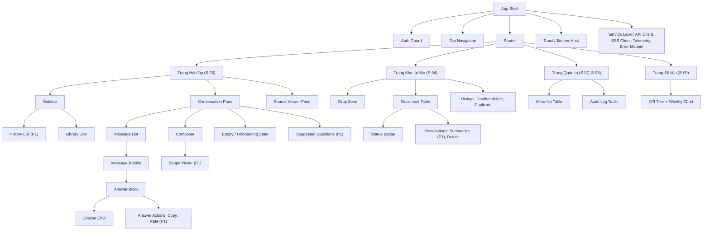
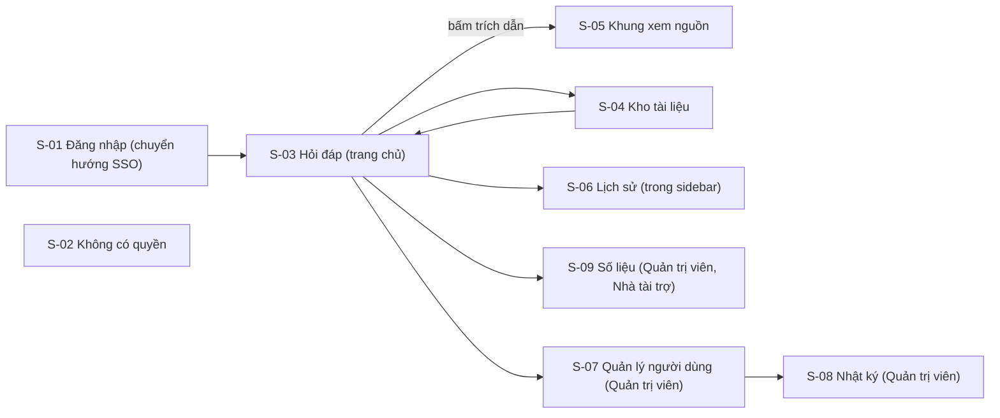
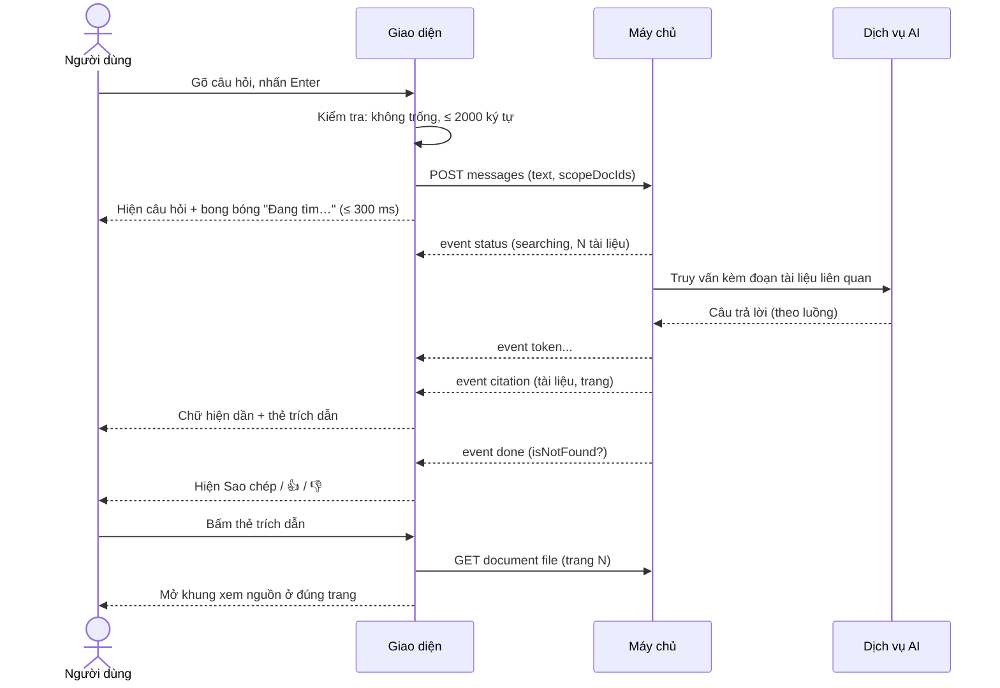
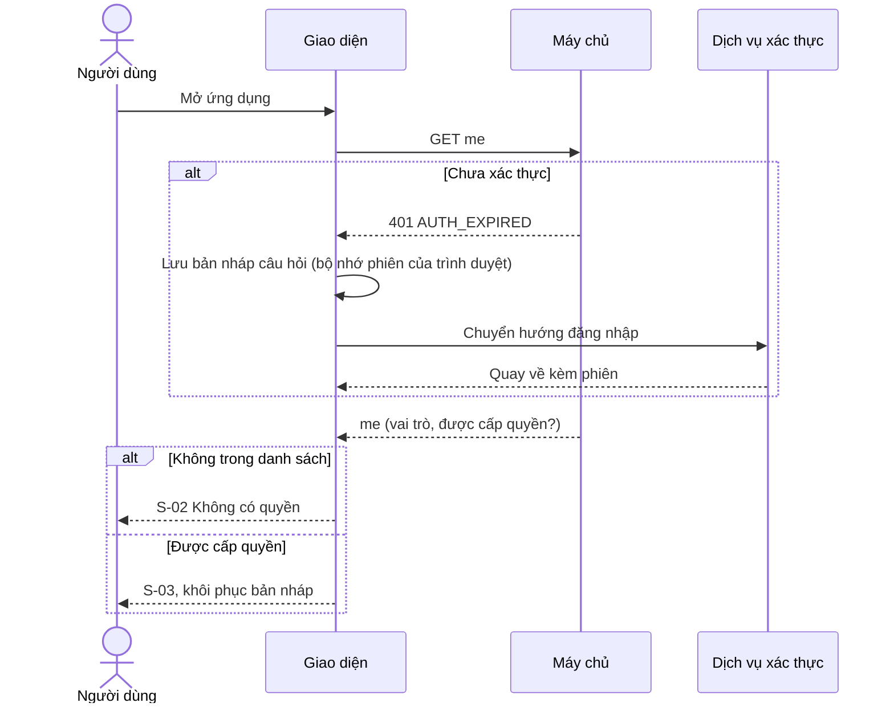
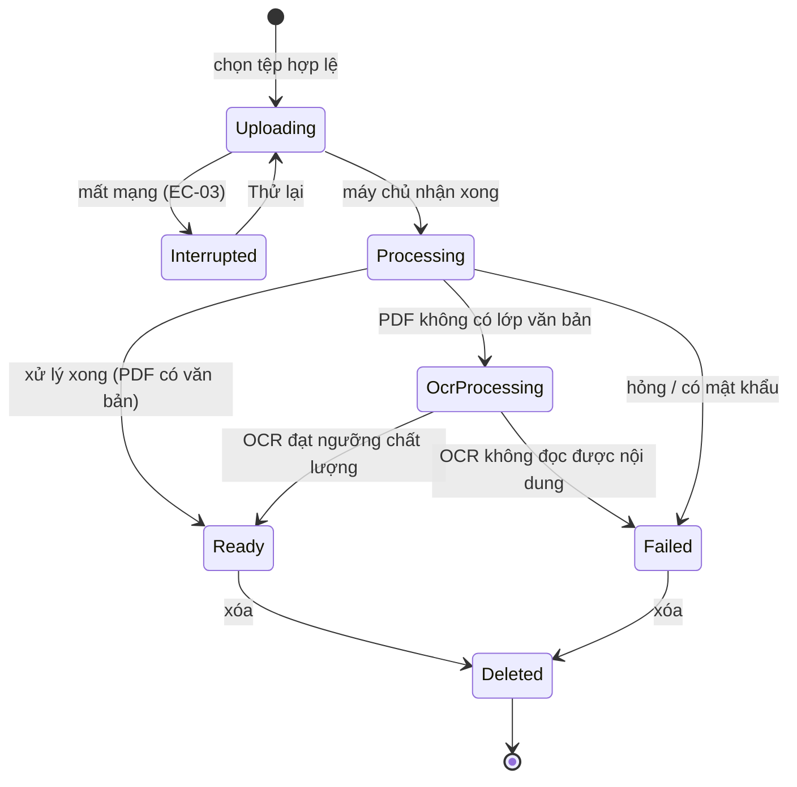
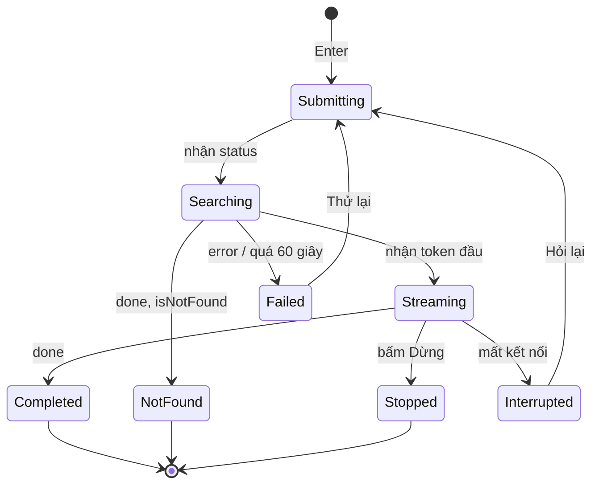
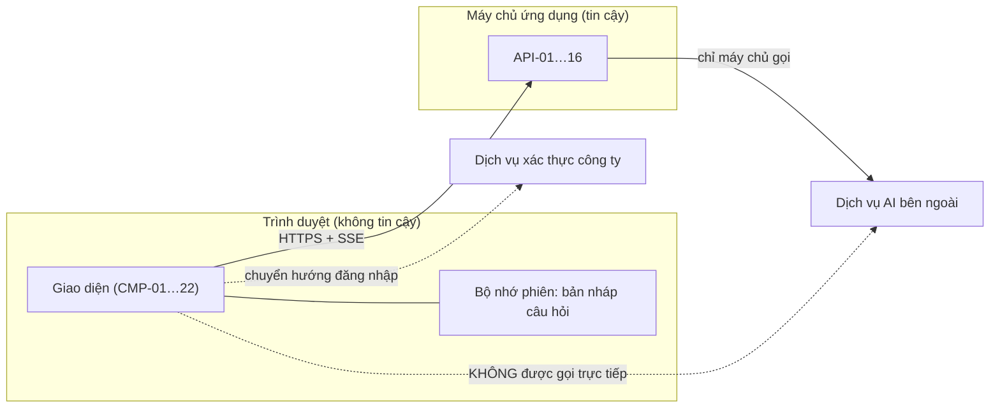

# BLUEPRINT THIẾT KẾ UI/UX (SDD – IEEE 1016-2009)
# Công cụ "Chat với tài liệu" – MVP

---

## 0. Thông tin tài liệu

| Thuộc tính | Giá trị |
|---|---|
| Mã tài liệu | SDD-UIUX-CWD-001 |
| Phiên bản | 0.2 |
| Trạng thái | Draft |
| Tiêu chuẩn | IEEE 1016-2009 (Software Design Descriptions) |
| Nguồn đầu vào | [PRD.md](../requirements/PRD.md) (PRD-CWD-001 v0.2), [BRD.md](../requirements/BRD.md) (BRD-CWD-001 v0.3), [UseCaseDiagram.drawio](../UseCaseDiagram.drawio) |
| Phạm vi tài liệu | **Lớp giao diện người dùng (UI/UX)**: cấu trúc, màn hình, tương tác, trạng thái, hệ thống thiết kế, hợp đồng giao tiếp giữa giao diện và máy chủ. Kiến trúc máy chủ, mô hình AI, kho dữ liệu thuộc tài liệu SAD riêng (chưa có). |
| Ngày | 2026-10-19 |

**Quy ước:**
- `[Đề xuất]` = giá trị do người thiết kế đề xuất hoặc kế thừa từ PRD/BRD, chưa được bên liên quan xác nhận.
- Mã truy vết: `US-xxx`, `EC-xx`, `NFR-xxx`, `BR-xxx` lấy từ PRD/BRD; `C-xx` = mối quan tâm (Mục 2.2); `UX-xx` = kịch bản chất lượng UX (Mục 2.4); `S-xx` = màn hình; `CMP-xx` = thành phần giao diện; `API-xx` = giao tiếp với máy chủ; `DD-xx` = quyết định thiết kế; `UQ-xx` = câu hỏi mở.
- Đây là bản **thiết kế trên giấy**: chưa có prototype tương tác và chưa kiểm thử với người dùng thật (xem Mục 9).

### 0.1 Lịch sử phiên bản

| Phiên bản | Ngày | Tác giả | Thay đổi |
|---|---|---|---|
| 0.1 | 2026-10-19 | Người thiết kế UI/UX | Bản đầu, dựa trên PRD v0.1 |
| 0.2 | 2026-10-19 | Người thiết kế UI/UX | Cập nhật theo 14 quyết định ngày 2026-10-19: chỉ Trưởng nhóm BD tải lên (UQ-03); có lưu nội dung câu hỏi (UQ-04); không có thương hiệu (UQ-05); SSO duy nhất (UQ-08); **thêm trạng thái OCR cho PDF ảnh quét (EC-20); thêm gợi ý câu hỏi mẫu tự động (CMP-23, API-17)** |

---

## 1. Bối cảnh và đối tượng thiết kế

### 1.1 Nhận diện hệ thống

| Thuộc tính | Giá trị |
|---|---|
| Tên hệ thống | Chat với tài liệu (MVP) |
| Phiên bản SDD | v0.1 |
| Chủ sở hữu tài liệu | Designer / Trưởng đội kỹ thuật [TBD: tên cụ thể] |
| Mô tả | Ứng dụng web giúp đội Phát triển kinh doanh (BD) tải PDF lên kho chung và hỏi đáp bằng tiếng Việt hoặc tiếng Anh. Mỗi câu trả lời do AI tổng hợp **kèm trích dẫn tên tài liệu và số trang**; khi tài liệu không có thông tin, hệ thống nói rõ là không tìm thấy thay vì đoán. |
| Trụ cột UX (PRD 0.2) | (1) Đáng tin trước, nhanh sau · (2) Không cần cấu hình · (3) Desktop-web-first · (4) Song ngữ Việt–Anh · (5) Riêng tư theo thiết kế |

### 1.2 Phạm vi và ranh giới bên ngoài

| Loại ranh giới | Mô tả |
|---|---|
| **Mục đích hệ thống** | Giảm thời gian tra cứu thông tin trong tài liệu PDF của đội BD từ ~20 phút xuống ≤ 10 phút `[Đề xuất]`, đồng thời giữ câu trả lời kiểm chứng được (BO-001, BO-002). |
| **Bên trong phạm vi tài liệu này** | Ứng dụng giao diện chạy trên trình duyệt; hợp đồng giao tiếp (API) mà giao diện cần từ máy chủ. |
| **Bên ngoài phạm vi** | Máy chủ ứng dụng, xử lý và lập chỉ mục tài liệu, mô hình AI, cơ sở dữ liệu, hạ tầng triển khai (thuộc SAD). |
| **Hệ thống bên ngoài (nhìn từ giao diện)** | (1) Máy chủ ứng dụng (duy nhất mà giao diện gọi trực tiếp); (2) Dịch vụ xác thực tài khoản công ty (chuyển hướng đăng nhập); (3) Dịch vụ AI bên ngoài **chỉ được máy chủ gọi, giao diện không bao giờ gọi trực tiếp**. |
| **Loại người dùng** | Người dùng BD (Lan), Trưởng nhóm BD (Minh), Quản trị viên, Nhà tài trợ (chỉ xem số liệu). Chi tiết Mục 2.1. |
| **Giao diện bên ngoài** | HTTPS/JSON API; luồng sự kiện một chiều (server-sent events) cho câu trả lời đang được tạo; chuyển hướng đăng nhập; tải tệp multipart. |
| **Ranh giới tin cậy** | Trình duyệt người dùng (không tin cậy) ↔ máy chủ ứng dụng (tin cậy) ↔ dịch vụ AI bên ngoài (bên thứ ba, theo CON-005). Mọi kiểm tra quyền thực hiện ở máy chủ; kiểm tra ở giao diện chỉ để phản hồi nhanh. |
| **Môi trường triển khai** | [TBD: SAD] – phụ thuộc OQ-006 và DEP-001. Thiết kế giao diện không giả định nhà cung cấp hạ tầng. |

### 1.3 Giả định và ràng buộc

| Loại | Mô tả | Nguồn |
|---|---|---|
| Ràng buộc kỹ thuật | Ứng dụng web; trình duyệt Chrome và Edge (2 phiên bản mới nhất); màn hình ≥ 1280 px là mục tiêu thiết kế chính; di động chỉ đảm bảo **đọc**. | CON-001, NFR-007 |
| Ràng buộc kỹ thuật | Giao diện bằng tiếng Việt; nội dung hỏi/đáp song ngữ Việt–Anh, trả lời theo ngôn ngữ của câu hỏi. | OQ-007, BR-026, NFR-010 |
| Ràng buộc kinh doanh | MVP trong 7 tuần (2026-11-02 → 12-18) với 1 BA, 2 kỹ sư, 1 PO bán thời gian; thí điểm 4 tuần. | CON-006, CON-007 |
| Ràng buộc dữ liệu | Tối đa 20 người dùng, 500 tài liệu, 300 trang/tài liệu, 50 MB/tệp, 10 tệp/lần tải, 2.000 ký tự/câu hỏi. | ASM-006, BR-002, BR-004, PQ-005 |
| Ràng buộc riêng tư | Không ghi nội dung câu hỏi/câu trả lời/tài liệu vào hệ thống phân tích; chỉ siêu dữ liệu. | PRD 5.2, PQ-003 |
| Giả định môi trường | Người dùng làm việc trong mạng nội bộ hoặc VPN, băng thông văn phòng thông thường; không hỗ trợ offline. | PRD 0.2 (loại mobile-first/offline) |
| Giả định môi trường | Tài liệu là PDF có lớp văn bản; PDF ảnh quét bị từ chối. | ASM-001, BRU-006 |
| Ngoài phạm vi UI MVP | Chế độ tối (dark mode), đa ngôn ngữ giao diện ngoài tiếng Việt, ứng dụng di động gốc, kéo thả sắp xếp thư mục. | PRD 5.3 |

---

## 2. Bên liên quan và mối quan tâm

### 2.1 Nhận diện bên liên quan

| Bên liên quan | Vai trò | Mối quan tâm chính |
|---|---|---|
| Người dùng BD – "Lan" (P1) | Tra cứu thông tin | Tìm nhanh, kiểm chứng được, ít thao tác, không bị lẫn thông tin |
| Trưởng nhóm BD – "Minh" (P2) | Nạp và quản lý tài liệu | Tải hàng loạt dễ, biết trạng thái, kho đúng phiên bản |
| Quản trị viên (P3) | Quản lý quyền, xử lý sự cố | Kiểm soát truy cập, nhật ký truy vết, xóa tài liệu |
| Nhà tài trợ | Ra quyết định đầu tư | Xem số liệu OKR mà không cần nhờ đội kỹ thuật |
| Bảo mật thông tin / Pháp chế | Kiểm soát dữ liệu | Không lộ dữ liệu, không ghi nội dung vào analytics, xóa thật |
| Designer | Thiết kế giao diện | Hệ thống thiết kế nhất quán, trạng thái đầy đủ, dễ bàn giao |
| Lập trình viên front-end | Xây dựng giao diện | Thành phần rõ ràng, hợp đồng API ổn định, dễ kiểm thử |
| Lập trình viên back-end | Xây dựng máy chủ | Hợp đồng API đơn giản, lỗi có mã, trạng thái rõ |
| QA | Kiểm thử | Tiêu chí đo được, mọi trạng thái/lỗi đều có hành vi quy định |
| Product Manager | Quản lý sản phẩm | Truy vết PRD → thiết kế; đo được OKR; cắt được phạm vi P1 |

### 2.2 Mối quan tâm của bên liên quan (IEEE 1016-2009)

| ID | Bên liên quan | Mối quan tâm | Ưu tiên | Tiêu chí chấp nhận (đo được) |
|---|---|---|---|---|
| C-01 | Lan | Kiểm chứng câu trả lời nhanh | Cao | Từ câu trả lời hiện xong đến khi thấy đúng trang nguồn ≤ 3 giây và ≤ 1 lần bấm (US-022) |
| C-02 | Lan | Không bị sai lệch khi tài liệu không có thông tin | Cao | ≥ 9/10 câu ngoài phạm vi nhận thông báo "không tìm thấy" (AC-011); trạng thái này không dùng màu báo lỗi |
| C-03 | Lan | Cảm giác phản hồi nhanh dù AI cần vài giây | Cao | Trạng thái "Đang tìm…" ≤ 1 giây; chữ đầu tiên xuất hiện ≤ 5 giây p90 `[Đề xuất]`; toàn bộ ≤ 15 giây p90 (NFR-001) |
| C-04 | Lan, Minh | Tìm được chức năng không cần học | Cao | Người dùng mới đặt được câu hỏi đầu tiên ≤ 90 giây từ lúc đăng nhập, 0 lỗi (UX-01) |
| C-05 | Minh | Tải nhiều tệp, biết rõ kết quả từng tệp | Cao | Tải 10 tệp trong một thao tác; mỗi tệp có trạng thái riêng, lỗi một tệp không chặn tệp khác (US-014, EC-08) |
| C-06 | Minh | Không giữ tài liệu lỗi thời | Trung bình | Xóa tài liệu ≤ 2 thao tác; sau xóa không còn trích dẫn tài liệu đó (US-016) |
| C-07 | Quản trị viên | Kiểm soát ai truy cập | Cao | Thêm/xóa người dùng có hiệu lực ≤ 1 phút (US-061) |
| C-08 | Quản trị viên | Truy vết thay đổi kho | Trung bình | Nhật ký đủ 4 trường: ai, thao tác, tài liệu, thời điểm (US-063) |
| C-09 | Nhà tài trợ | Xem OKR tự phục vụ | Cao | Bảng số liệu có WAU, số câu hỏi, p50/p90, tỷ lệ 👍; cập nhật ≤ 24 giờ (US-051) |
| C-10 | Bảo mật thông tin | Giao diện không làm lộ dữ liệu | Cao | 0 sự kiện analytics chứa nội dung; giao diện không gọi trực tiếp dịch vụ bên ngoài (Mục 3.7) |
| C-11 | Mọi người dùng | Dùng được bằng bàn phím và đọc được | Trung bình | Luồng hỏi đáp dùng hoàn toàn bằng bàn phím; mọi cặp màu đạt WCAG 2.1 AA (Mục 5.1) |
| C-12 | Mọi người dùng | Không mất dữ liệu đang nhập khi gặp lỗi mạng/hết phiên | Cao | Nội dung đang gõ được giữ ở 100% trường hợp EC-04, EC-05, EC-16 |
| C-13 | Front-end dev, QA | Thiết kế đủ chi tiết để xây và kiểm thử | Cao | 100% màn hình có đủ 5 trạng thái (Mục 3.2); 100% lỗi EC-01 – EC-19 có hành vi UI quy định (Mục 3.8.4) |
| C-14 | PM | Cắt được phạm vi nếu trễ | Trung bình | Thành phần P1 có thể tắt riêng mà không phá luồng P0 (DD-08) |

### 2.3 Kịch bản chất lượng hệ thống (định dạng 6 phần)

| ID | Thuộc tính | Nguồn | Kích thích | Đối tượng | Môi trường | Phản hồi | Thước đo |
|---|---|---|---|---|---|---|---|
| QA-01 | Hiệu năng | Lan | Gửi câu hỏi | Luồng hỏi đáp (UI + API) | Kho 200 tài liệu, 20 người dùng đồng thời | Hiện trạng thái "Đang tìm…", sau đó hiện chữ dần | Trạng thái ≤ 1 giây; hoàn tất ≤ 15 giây cho ≥ 90% câu hỏi (NFR-001, NFR-003) |
| QA-02 | Bảo mật | Người dùng không có quyền | Gọi trực tiếp đường dẫn/API | API + giao diện | Đã xác thực nhưng không trong danh sách | Từ chối, không lộ tên tài liệu | 0/10 lần thành công (AC-016) |
| QA-03 | Sẵn sàng | Máy chủ | Lỗi dịch vụ AI | Luồng hỏi đáp | Giờ làm việc | Giao diện báo lỗi thân thiện, giữ câu hỏi, cho thử lại | Mọi tính năng không phụ thuộc AI (xem danh sách, tải lên, xóa) vẫn dùng được; thông báo ≤ 2 giây sau lỗi (EC-07) |
| QA-04 | Bảo trì | Front-end dev | Thêm một trạng thái lỗi mới | Thành phần giao diện | Phát triển | Chỉ sửa bảng ánh xạ mã lỗi → thông báo | ≤ 1 tệp bị sửa (DD-06) |
| QA-05 | Kiểm thử | QA | Chạy bộ kiểm thử giao diện | Toàn bộ luồng P0 | Môi trường staging | Chạy tự động qua mọi trạng thái đã mô tả | ≥ 90% AC P0 có kiểm thử tự động `[Đề xuất]`; chạy ≤ 10 phút |
| QA-06 | Quan sát | PM | Thí điểm đang chạy | Bộ sự kiện đo lường | Staging và thí điểm | Sự kiện đúng tên, đúng thuộc tính, không có nội dung | 100% sự kiện P0 (PRD 5.2) bắn đúng trên staging (cổng G8) |

### 2.4 Kịch bản chất lượng UX/UI

| ID | Thuộc tính | Kịch bản UX/UI | Thước đo | Kiểm chứng |
|---|---|---|---|---|
| UX-01 | Khả dụng | Người dùng BD lần đầu đăng nhập, tìm được ô hỏi đáp và đặt câu hỏi đầu tiên mà không cần hướng dẫn | ≤ 90 giây, 0 lỗi, ≥ 4/5 người thử hoàn thành | UAT với 5 người (cổng G9) |
| UX-02 | Khả dụng | Minh tải 10 tệp PDF và biết khi nào cả 10 tệp sẵn sàng | Hoàn thành ≤ 5 thao tác; thấy trạng thái của 10 tệp trong cùng một màn hình | UAT |
| UX-03 | Khả năng tiếp cận | Mọi phần tử tương tác dùng được bằng bàn phím; trình đọc màn hình đọc được câu trả lời và trích dẫn | WCAG 2.1 AA; 0 lỗi mức "Serious/Critical" khi quét tự động | Quét tự động + kiểm tra thủ công bằng bàn phím và trình đọc màn hình |
| UX-04 | Hiệu năng cảm nhận | Trang chính tải xong trên mạng văn phòng | FCP < 1,5 giây, LCP < 2,5 giây, p75 `[Đề xuất]` | Đo trên staging |
| UX-05 | Đáp ứng | Giao diện thích ứng từ 1024 px đến 2560 px | Không cuộn ngang; viewer chuyển thành lớp phủ dưới 1280 px (EC-19) | Kiểm thử trên 4 độ rộng: 1024, 1280, 1440, 1920 |
| UX-06 | Nhất quán thị giác | Mọi thành phần dùng token của hệ thống thiết kế | 100% màu, cỡ chữ, khoảng cách lấy từ token; 0 giá trị cứng trong mã | Rà soát thiết kế + quy tắc kiểm tra mã |
| UX-07 | Khôi phục lỗi | Mạng đứt khi đang nhận câu trả lời | Giữ phần đã nhận; câu hỏi không mất; "Hỏi lại" bằng 1 lần bấm | Kiểm thử mô phỏng mạng đứt (EC-04) |
| UX-08 | Phản hồi và gợi ý hành động | Mọi thao tác bất đồng bộ có phản hồi nhìn thấy được | Trạng thái chờ ≤ 300 ms sau thao tác; nút bị vô hiệu khi không hợp lệ | Kiểm thử giao diện |
| UX-09 | Kiến trúc thông tin | Người dùng tới được mọi chức năng chính từ bất kỳ trang nào | ≤ 2 lần bấm | Kiểm thử cây điều hướng (Mục 3.2) |
| UX-10 | Tin cậy | Người dùng phân biệt được câu trả lời có căn cứ với câu "không tìm thấy" | ≥ 90% người thử mô tả đúng ý nghĩa của hai trạng thái | UAT, câu hỏi hậu kiểm |
| UX-11 | Quốc tế hóa | Hiển thị đúng chữ Việt có dấu, định dạng ngày giờ Việt | 0 lỗi mất dấu/ngắt chữ; ngày dạng `dd/MM/yyyy HH:mm` | Kiểm thử với bộ chữ mẫu |
| UX-12 | Trải nghiệm di động | Mở ứng dụng trên điện thoại để đọc lại câu trả lời | Đọc được, không cuộn ngang; vùng bấm ≥ 44×44 px; không cam kết tải lên trên di động | Kiểm thử thủ công trên 2 thiết bị |

### 2.5 Ma trận ràng buộc UX/UI

| Ràng buộc | Yêu cầu | Tiêu chuẩn/Công cụ | Cách kiểm chứng |
|---|---|---|---|
| Tương phản màu | Chữ thường ≥ 4,5:1; chữ lớn và biểu tượng/viền điều khiển ≥ 3:1 | WCAG 2.1 AA | Đã tính cho toàn bộ cặp màu ở Mục 5.1; quét tự động khi build |
| Kiểu chữ | Chữ nội dung ≥ 16 px (14 px cho phụ chú), phóng to tới 200% không vỡ bố cục | Hệ thống thiết kế | Rà soát thiết kế; kiểm thử phóng to |
| Vùng bấm | ≥ 44×44 px trên cảm ứng; ≥ 32×32 px trên chuột | Apple HIG / Material | Kiểm thử giao diện |
| Trạng thái chờ | Hiện chỉ báo ≤ 300 ms; dùng khung xương cho danh sách, vòng quay cho thao tác ngắn | Thực hành UX | Giám sát hiệu năng |
| Thông báo lỗi | Tiếng Việt, nêu nguyên nhân và hành động tiếp theo, không có mã/thuật ngữ kỹ thuật | Hướng dẫn viết UX (Mục 5.4) | Rà soát nội dung |
| Trạng thái trống | Mỗi trạng thái trống nêu rõ lý do và hành động kế tiếp | Thực hành UX | Kiểm kê giao diện (Mục 3.2) |
| Thông báo | Không chặn thao tác; tự ẩn sau 4 giây, riêng lỗi giữ đến khi đóng | Thực hành UX | Kiểm thử người dùng |
| Trợ giúp và định hướng | Màn hình chào lần đầu; dòng nhắc "AI có thể sai, hãy kiểm tra trích dẫn" | PRD US-030 | Chỉ số hoàn thành tác vụ |
| Chuyển động | Tôn trọng `prefers-reduced-motion`; hiệu ứng ≤ 200 ms | WCAG 2.3.3 | Kiểm thử thủ công |
| Riêng tư | Không đưa nội dung hỏi/đáp vào URL, tiêu đề tab, nhật ký console hay analytics | CON-005 | Rà soát mã + kiểm thử gói tin |

---

## 3. Các góc nhìn thiết kế (IEEE 1016-2009)

Tám góc nhìn, mỗi góc nhìn nêu mối quan tâm mà nó giải quyết (liên kết về Mục 2.2).

| # | Góc nhìn (viewpoint) | Mục | Mối quan tâm |
|---|---|---|---|
| V1 | Cấu thành (Composition) | 3.1 | C-13, C-14 |
| V2 | Thông tin (Information) – kiến trúc thông tin và kiểm kê màn hình | 3.2 | C-04, C-13 |
| V3 | Giao diện (Interface) – hợp đồng giao tiếp UI ↔ máy chủ | 3.3 | C-10, C-13 |
| V4 | Tương tác (Interaction) | 3.4 | C-01, C-03, C-05 |
| V5 | Động học trạng thái (State dynamics) | 3.5 | C-02, C-03, C-12 |
| V6 | Sử dụng mẫu (Patterns use) – hệ thống thiết kế | 3.6 | C-11, C-13 |
| V7 | Phụ thuộc (Dependency) | 3.7 | C-10, C-14 |
| V8 | Tài nguyên và chất lượng (Resource) – hiệu năng, đáp ứng, lỗi | 3.8 | C-03, C-11, C-12 |

---

### 3.1 Góc nhìn cấu thành (Composition View)

**Mục đích:** mô tả giao diện được lắp ráp từ các thành phần nào, để chia việc và cắt phạm vi.
**Mối quan tâm:** C-13 (đủ chi tiết để xây), C-14 (cắt được P1).



| ID | Thành phần | Loại | Cha | Trách nhiệm | Phụ thuộc | Ưu tiên | Story |
|---|---|---|---|---|---|---|---|
| CMP-01 | App Shell | Container | — | Khung chung: điều hướng, vùng thông báo, bắt lỗi toàn cục | Router, Auth Guard | P0 | US-001 |
| CMP-02 | Auth Guard | Logic | App Shell | Chặn chưa xác thực/không có quyền; xử lý hết phiên (giữ bản nháp) | API Client | P0 | US-001, US-002, EC-16, EC-17 |
| CMP-03 | Top Navigation | Container | App Shell | Điều hướng giữa Hỏi đáp / Kho tài liệu / Quản trị / Số liệu theo vai trò; menu người dùng | Auth Guard | P0 | UX-09 |
| CMP-04 | Conversation Pane | Container | Trang Hỏi đáp | Hiển thị hội thoại, nhận câu hỏi | Message List, Composer, SSE Client | P0 | US-020 |
| CMP-05 | Composer | Điều khiển | Conversation Pane | Ô nhập (Enter gửi, Shift+Enter xuống dòng), bộ đếm ký tự, nút Gửi/Dừng | Scope Picker | P0 | US-020, US-027, EC-11 |
| CMP-06 | Message Bubble | Hiển thị | Message List | Câu hỏi/câu trả lời, trạng thái: đang tìm, đang tạo, xong, không tìm thấy, bị dừng, lỗi | Answer Block | P0 | US-020, US-023 |
| CMP-07 | Answer Block | Hiển thị | Message Bubble | Văn bản trả lời (định dạng Markdown giới hạn: đoạn, danh sách, in đậm, bảng) + trích dẫn | Citation Chip | P0 | US-021, US-022 |
| CMP-08 | Citation Chip | Điều khiển | Answer Block | Thẻ `[Tên tài liệu – tr. N]`; di chuột/focus hiện đoạn trích ≤ 200 ký tự; bấm mở viewer | Source Viewer | P0 | US-022 |
| CMP-09 | Source Viewer Pane | Container | Trang Hỏi đáp | Hiển thị PDF ở đúng trang, chuyển trang, đóng bằng Esc; thành lớp phủ dưới 1280 px | API Client | P0 | US-022, EC-14, EC-19 |
| CMP-10 | Empty / Onboarding State | Hiển thị | Conversation Pane | Trạng thái kho trống, chưa có tài liệu sẵn sàng, màn hình chào lần đầu | — | P0 / P1 | EC-01, EC-02, US-030 |
| CMP-11 | Scope Picker | Điều khiển | Composer | Chọn một/nhiều tài liệu để giới hạn phạm vi; nhãn "Đang hỏi trong N tài liệu" | Document list | P1 | US-026, EC-15 |
| CMP-12 | Answer Actions | Điều khiển | Answer Block | Sao chép kèm nguồn; 👍/👎 kèm lý do | Telemetry | P1 | US-042, US-050 |
| CMP-13 | History List | Hiển thị | Sidebar | Danh sách phiên 90 ngày, nhóm Hôm nay / 7 ngày qua / Cũ hơn | API Client | P1 | US-041 |
| CMP-14 | Drop Zone | Điều khiển | Trang Kho | Kéo thả hoặc chọn tối đa 10 tệp; kiểm tra định dạng/kích thước phía trình duyệt; **chỉ hiển thị cho Trưởng nhóm BD** (BRU-007) | API Client | P0 | US-010, US-011, US-014 |
| CMP-15 | Document Table | Hiển thị | Trang Kho | Danh sách + tìm theo tên + sắp xếp; tự cập nhật trạng thái | Status Badge | P0 | US-015, US-012 |
| CMP-16 | Status Badge | Hiển thị | Document Table | Đang tải / Đang xử lý / Đang nhận dạng ký tự (OCR) / Sẵn sàng / Thất bại (+ lý do); luôn có chữ và biểu tượng, không chỉ màu | — | P0 | US-012, US-013 |
| CMP-17 | Dialog Host | Container | App Shell | Hộp thoại xác nhận xóa, tệp trùng, lý do 👎, tóm tắt | — | P0 / P1 | US-016, US-017 |
| CMP-18 | Toast / Banner Host | Container | App Shell | Thông báo tạm thời và dải thông báo mất kết nối | — | P0 | EC-05 |
| CMP-19 | Allow-list Table | Hiển thị | Trang Quản trị | Thêm/xóa người dùng được cấp quyền | API Client | P0 | US-061 |
| CMP-20 | Audit Log Table | Hiển thị | Trang Quản trị | Nhật ký tải lên/xóa | API Client | P1 | US-063 |
| CMP-21 | KPI Dashboard | Hiển thị | Trang Số liệu | WAU, số câu hỏi, p50/p90, tỷ lệ 👍 theo tuần | API Client | P0 | US-051 |
| CMP-23 | Suggested Questions | Điều khiển | Conversation Pane | ≥ 3 câu hỏi mẫu do hệ thống tạo từ nội dung tài liệu; bấm một lần là gửi; ẩn khi kho trống hoặc chưa có tài liệu sẵn sàng | API Client, Composer | P1 | US-031, BR-020 |
| CMP-22 | Service Layer | Logic | App Shell | API Client, SSE Client, Telemetry (không gửi nội dung), Error Mapper (mã lỗi → thông báo) | — | P0 | C-10, QA-04 |

---

### 3.2 Góc nhìn thông tin (Information View) – kiến trúc thông tin và kiểm kê màn hình

**Mục đích:** xác định cấu trúc điều hướng, danh sách màn hình, dữ liệu hiển thị và đủ trạng thái cho mỗi màn hình.
**Mối quan tâm:** C-04, C-13, UX-09.

#### 3.2.1 Sơ đồ điều hướng (sitemap)



Mọi màn hình chính đều tới được từ thanh điều hướng trên cùng bằng **1 lần bấm**; viewer nguồn tới được bằng **1 lần bấm** từ câu trả lời (đạt UX-09).

#### 3.2.2 Điều hướng theo vai trò

| Mục điều hướng | Người dùng BD | Trưởng nhóm BD | Quản trị viên | Nhà tài trợ |
|---|---|---|---|---|
| Hỏi đáp | ✔ | ✔ | ✔ | ✘ |
| Kho tài liệu (xem) | ✔ | ✔ | ✔ | ✘ |
| Tải lên | ✘ | ✔ (duy nhất) | ✘ | ✘ |
| Xóa tài liệu | ✘ | Của mình | Mọi tài liệu | ✘ |
| Số liệu | ✘ | ✘ | ✔ | ✔ |
| Quản trị (người dùng, nhật ký) | ✘ | ✘ | ✔ | ✘ |

> **Đã chốt (DEC-001, BRU-007):** chỉ Trưởng nhóm BD được tải lên. Người dùng BD thường và quản trị viên **không thấy** vùng kéo thả; thay vào đó trang Kho tài liệu hiển thị dòng "Chỉ Trưởng nhóm BD tải được tài liệu lên." Quản trị viên vẫn xóa được mọi tài liệu.

#### 3.2.3 Kiểm kê màn hình

| ID | Màn hình | Đường dẫn | Vai trò | Story | Dữ liệu hiển thị |
|---|---|---|---|---|---|
| S-01 | Đăng nhập | `/login` | Mọi người | US-001 | Nút "Đăng nhập bằng tài khoản công ty"; thông báo hết phiên |
| S-02 | Không có quyền | `/denied` | Đã xác thực, ngoài danh sách | US-002 | Thông báo + cách liên hệ quản trị viên; không có tên tài liệu |
| S-03 | Hỏi đáp | `/` và `/chat/:sessionId` | BD, TN, QT | US-020 – US-027, US-040 – US-042, US-050 | Hội thoại, câu trả lời, trích dẫn, phạm vi, lịch sử |
| S-04 | Kho tài liệu | `/library` | BD, TN, QT | US-010 – US-017 | Vùng kéo thả, bảng tài liệu (tên, số trang, người tải, thời điểm, trạng thái) |
| S-05 | Khung xem nguồn | Ngăn trong S-03 (`?doc=&page=`) | BD, TN, QT | US-022 | PDF ở trang N; không đưa nội dung câu hỏi vào URL |
| S-06 | Lịch sử | Phần của sidebar S-03 | BD, TN, QT | US-041 | Phiên theo nhóm thời gian; tiêu đề phiên = 60 ký tự đầu câu hỏi |
| S-07 | Quản lý người dùng | `/admin/users` | QT | US-061 | Danh sách email được cấp quyền, vai trò |
| S-08 | Nhật ký | `/admin/audit` | QT | US-063 | Người thực hiện, thao tác, tài liệu, thời điểm |
| S-09 | Số liệu | `/metrics` | QT, Nhà tài trợ | US-051 | WAU %, số câu hỏi, p50/p90, tỷ lệ 👍, theo tuần; **không có nội dung hỏi/đáp** |

> **Đã chốt (DEC-002, BRU-008):** nội dung câu hỏi được lưu, nên tiêu đề phiên lấy 60 ký tự đầu của câu hỏi đầu tiên. Thời hạn 90 ngày và quyền xem (mỗi người chỉ xem lịch sử của mình) vẫn là đề xuất chờ OQ-013. Nội dung này **không** đi vào hệ thống phân tích.

#### 3.2.4 Năm trạng thái bắt buộc cho mỗi màn hình

| Màn hình | Đang tải | Trống | Có dữ liệu | Lỗi | Hạn chế quyền |
|---|---|---|---|---|---|
| S-03 | Khung xương hội thoại ≤ 300 ms | Kho trống: "Kho chưa có tài liệu" (EC-01); chưa có hội thoại: màn hình chào (US-030) | Hội thoại | Dải "Mất kết nối" (EC-05); lỗi dịch vụ (EC-07) | → S-02 |
| S-04 | Khung xương 5 dòng | "Chưa có tài liệu. Kéo thả PDF vào đây." | Bảng | "Không tải được danh sách. [Thử lại]" | Nút Tải lên/Xóa ẩn theo vai trò |
| S-05 | Vòng quay trong khung | — | PDF ở đúng trang | "Không mở được trang. [Thử lại]"; tài liệu đã xóa: "Tài liệu đã bị xóa" (EC-14) | → S-02 |
| S-06 | Khung xương 3 dòng | "Chưa có phiên nào" | Danh sách nhóm theo thời gian | "Không tải được lịch sử. [Thử lại]" | — |
| S-07 | Khung xương | "Chưa có người dùng nào được cấp quyền" | Bảng | Lỗi + [Thử lại] | Chỉ QT |
| S-08 | Khung xương | "Chưa có hoạt động nào" | Bảng | Lỗi + [Thử lại] | Chỉ QT |
| S-09 | Khung xương các ô số liệu | "Chưa có dữ liệu. Số liệu xuất hiện sau tuần sử dụng đầu tiên." | Ô số liệu + biểu đồ tuần | Lỗi + [Thử lại] | QT, Nhà tài trợ |

---

### 3.3 Góc nhìn giao diện (Interface View) – hợp đồng UI ↔ máy chủ

**Mục đích:** nêu các giao tiếp mà giao diện cần để back-end và front-end phát triển song song.
**Mối quan tâm:** C-10 (riêng tư), C-13.

> **Toàn bộ mục này là đề xuất** để SAD xác nhận. Nó mô tả *giao diện cần gì*, không quy định cách máy chủ làm.

#### 3.3.1 Hợp đồng API

| ID | Phương thức và đường dẫn | Mục đích | Story |
|---|---|---|---|
| API-01 | `GET /api/v1/me` | Thông tin người dùng, vai trò, trạng thái được cấp quyền | US-001, US-002 |
| API-02 | `POST /api/v1/documents` (multipart, 1–10 tệp) | Tải lên; trả `202` với `docId` và trạng thái từng tệp | US-010, US-014 |
| API-03 | `GET /api/v1/documents?search=&sort=` | Danh sách tài liệu | US-015 |
| API-04 | `GET /api/v1/documents/events` (SSE) | Đẩy thay đổi trạng thái tài liệu (hoặc giao diện hỏi lại mỗi 3 giây nếu SSE không khả dụng) | US-012 |
| API-05 | `DELETE /api/v1/documents/{id}` | Xóa tài liệu | US-016, US-062 |
| API-06 | `GET /api/v1/documents/{id}/file` | Tệp PDF để khung xem nguồn hiển thị (hỗ trợ truy vấn theo khoảng byte) | US-022 |
| API-07 | `POST /api/v1/chat/sessions` | Tạo phiên | US-020 |
| API-08 | `POST /api/v1/chat/sessions/{sid}/messages` (phản hồi SSE) | Gửi câu hỏi `{text, scopeDocIds[]}`; nhận sự kiện `status`, `token`, `citation`, `done`, `error` | US-020, US-027 |
| API-09 | `POST /api/v1/chat/messages/{mid}/stop` | Dừng tạo câu trả lời | US-027 |
| API-10 | `GET /api/v1/chat/sessions` và `GET /api/v1/chat/sessions/{sid}` | Lịch sử, mở lại phiên | US-041 |
| API-11 | `POST /api/v1/chat/messages/{mid}/rating` | 👍/👎 kèm `reasonCode` | US-050 |
| API-12 | `POST /api/v1/documents/{id}/summary` | Tóm tắt tài liệu (có trích dẫn) | US-040 |
| API-13 | `GET /api/v1/metrics/weekly` | Số liệu cho S-09 | US-051 |
| API-14 | `GET/POST/DELETE /api/v1/admin/users` | Danh sách cho phép | US-061 |
| API-15 | `GET /api/v1/admin/audit-log` | Nhật ký | US-063 |
| API-16 | `POST /api/v1/telemetry/events` | Sự kiện đo lường (chỉ siêu dữ liệu) | PRD 5.2 |
| API-17 | `GET /api/v1/suggestions` | Lấy ≥ 3 câu hỏi mẫu do hệ thống tạo (chỉ trả về khi kho có tài liệu "Sẵn sàng") | US-031 |

#### 3.3.2 Hợp đồng sự kiện câu trả lời (API-08)

| Sự kiện | Nội dung | Hành vi giao diện |
|---|---|---|
| `status` | `{stage: "searching", docCount}` | Hiện "Đang tìm trong N tài liệu…" (≤ 1 giây sau gửi) |
| `token` | `{text}` | Nối chữ vào câu trả lời |
| `citation` | `{index, docId, docName, page, snippet}` | Hiện thẻ trích dẫn ngay khi có |
| `done` | `{messageId, citationCount, isNotFound}` | Hiện nút Sao chép/👍/👎; ghi `answer_completed` |
| `error` | `{code, retryable}` | Ánh xạ sang thông báo (Mục 3.8.4) |

Nếu kết nối SSE đứt mà chưa nhận `done`: coi là EC-04 (giữ phần đã nhận, nhãn "chưa đầy đủ", nút [Hỏi lại]).

#### 3.3.3 Hợp đồng lỗi

Mọi phản hồi lỗi: `{ "code": "<MÃ>", "retryable": true|false }`. Giao diện **không hiển thị chuỗi lỗi từ máy chủ**; thông báo tiếng Việt lấy từ bảng ánh xạ ở giao diện (DD-06).

| Mã lỗi | Ý nghĩa | EC |
|---|---|---|
| `AUTH_EXPIRED` | Hết phiên | EC-16 |
| `AUTH_FORBIDDEN` | Không có quyền / bị thu hồi | EC-17 |
| `FILE_NOT_PDF`, `FILE_TOO_LARGE`, `FILE_TOO_MANY` | Tệp không hợp lệ | EC-08 |
| `OCR_UNREADABLE`, `FILE_CORRUPTED`, `FILE_ENCRYPTED` | Không xử lý được tài liệu (`OCR_UNREADABLE` = bản quét không đạt ngưỡng chất lượng OCR) | EC-09 |
| `DOC_NOT_FOUND` | Tài liệu đã bị xóa | EC-14, EC-18 |
| `QUESTION_EMPTY`, `QUESTION_TOO_LONG` | Câu hỏi không hợp lệ | EC-11 |
| `AI_UNAVAILABLE`, `BUDGET_EXCEEDED` | Dịch vụ AI lỗi/hết hạn mức | EC-07 |
| `TIMEOUT` | Quá thời gian | EC-06 |

#### 3.3.4 Hợp đồng sự kiện đo lường

Toàn bộ 18 sự kiện ở PRD Mục 5.2 được gửi qua API-16. Quy tắc cứng:
- Chỉ siêu dữ liệu (độ dài, ngôn ngữ, số trích dẫn, độ trễ…); **cấm** trường văn bản tự do.
- `user_id` là mã ẩn danh.
- Kiểm tra tự động: lược đồ sự kiện từ chối trường lạ (cổng G8).

---

### 3.4 Góc nhìn tương tác (Interaction View)

**Mục đích:** mô tả chuỗi trao đổi giữa người dùng, giao diện, máy chủ khi thực hiện các luồng chính.
**Mối quan tâm:** C-01, C-03, C-05.

#### 3.4.1 Hỏi đáp có trích dẫn (US-020, US-022, US-027)



#### 3.4.2 Tải lên nhiều tài liệu (US-010 – US-014)

```mermaid
sequenceDiagram
    actor M as Minh
    participant UI as Giao diện
    participant API as Máy chủ
    M->>UI: Kéo thả 10 tệp
    UI->>UI: Kiểm tra từng tệp (đuôi .pdf, ≤ 50 MB, ≤ 10 tệp)
    UI-->>M: Tệp hợp lệ vào bảng "Đang tải"; tệp lỗi hiện lý do ngay
    UI->>API: POST documents (các tệp hợp lệ)
    API-->>UI: 202 (docId + trạng thái từng tệp)
    API-->>UI: SSE: Processing → Ready / Failed (lý do)
    UI-->>M: Badge tự cập nhật, không tải lại trang
```

#### 3.4.3 Đăng nhập và hết phiên (US-001, EC-16)



> Bản nháp chỉ lưu trong bộ nhớ phiên của trình duyệt (xóa khi đóng tab), không gửi lên máy chủ và không vào analytics.

---

### 3.5 Góc nhìn động học trạng thái (State Dynamics View)

**Mục đích:** quy định mọi trạng thái và chuyển đổi để giao diện không rơi vào trạng thái không xác định.
**Mối quan tâm:** C-02, C-03, C-12.

#### 3.5.1 Trạng thái tài liệu (CMP-16)



| Trạng thái | Nhãn hiển thị | Biểu tượng | Tông màu | Dùng để hỏi đáp? |
|---|---|---|---|---|
| Uploading | Đang tải lên (xx%) | Mũi tên lên | Thông tin | Không |
| Interrupted | Tải lên bị gián đoạn [Thử lại] | Cảnh báo | Cảnh báo | Không |
| Processing | Đang xử lý | Vòng quay | Thông tin | Không |
| OcrProcessing | Đang nhận dạng ký tự – cần thêm thời gian (EC-20) | Vòng quay + biểu tượng văn bản | Thông tin | Không; không chặn việc hỏi các tài liệu khác |
| Ready | Sẵn sàng | Dấu tích | Thành công | **Có** |
| Failed | Thất bại – *lý do* | Dấu X | Lỗi | Không |

#### 3.5.2 Trạng thái một câu trả lời (CMP-06)



| Trạng thái | Giao diện | Điều khiển khả dụng |
|---|---|---|
| Submitting | Câu hỏi hiện ngay; ô nhập bị vô hiệu tạm thời | — |
| Searching | "Đang tìm trong N tài liệu…"; sau 15 giây thêm "Mất nhiều thời gian hơn bình thường…" (EC-06) | Dừng |
| Streaming | Chữ hiện dần; trích dẫn xuất hiện khi có | Dừng |
| Completed | Đủ nội dung + trích dẫn | Sao chép, 👍/👎, bấm trích dẫn |
| NotFound | Giao diện trung tính (không màu lỗi): "Không tìm thấy thông tin này trong các tài liệu hiện có" + gợi ý | 👍/👎 (để biết có đúng là không tìm thấy), Hỏi lại |
| Stopped | Giữ phần đã có, nhãn "Đã dừng" | Hỏi lại |
| Interrupted | Giữ phần đã có, nhãn "Mất kết nối – chưa đầy đủ" | Hỏi lại |
| Failed | Thông báo thân thiện, giữ câu hỏi | Thử lại |

#### 3.5.3 Trạng thái phiên đăng nhập

`Authenticated → Expired` (hết hạn hoặc bị thu hồi) `→ Reauthenticating → Authenticated`. Khi `Expired` giữ nguyên màn hình hiện tại và bản nháp; sau đăng nhập lại trở về đúng màn hình (US-001). Khi bị thu hồi (`AUTH_FORBIDDEN`) chuyển S-02 (EC-17).

---

### 3.6 Góc nhìn sử dụng mẫu (Patterns Use View) – hệ thống thiết kế

**Mục đích:** nêu mẫu và token để mọi màn hình nhất quán và bàn giao thẳng cho lập trình.
**Mối quan tâm:** C-11, C-13, UX-06.

#### 3.6.1 Token màu (đã kiểm tra tương phản)

| Token | Mã màu | Dùng cho | Cặp kiểm tra | Tỷ lệ |
|---|---|---|---|---|
| `color.text` | `#1F2937` | Chữ nội dung | trên `#FFFFFF` | 14,68:1 |
| `color.text-muted` | `#4B5563` | Chữ phụ, nhãn | trên `#FFFFFF` / trên `#F3F4F6` | 7,56:1 / 6,87:1 |
| `color.primary` | `#1D4ED8` | Nút chính, liên kết, vòng focus | trên `#FFFFFF` | 6,70:1 |
| `color.on-primary` | `#FFFFFF` | Chữ trên nút chính | trên `#1D4ED8` | 6,70:1 |
| `color.user-bubble` | nền `#1E3A8A`, chữ `#FFFFFF` | Bong bóng câu hỏi | chữ trên nền | 10,36:1 |
| `color.citation` | nền `#E0E7FF`, chữ `#3730A3` | Thẻ trích dẫn | chữ trên nền | 8,06:1 |
| `color.success` | nền `#DCFCE7`, chữ `#166534` | Sẵn sàng | chữ trên nền | 6,49:1 |
| `color.warning` | nền `#FEF3C7`, chữ `#92400E` | Cảnh báo, gián đoạn | chữ trên nền | 6,37:1 |
| `color.danger` | nền `#FEE2E2`, chữ `#B91C1C` | Thất bại, lỗi | chữ trên nền | 5,30:1 |
| `color.info` | nền `#DBEAFE`, chữ `#1E40AF` | Đang xử lý, thông tin | chữ trên nền | 7,15:1 |
| `color.neutral` | nền `#E5E7EB`, chữ `#374151` | Nhãn trung tính | chữ trên nền | 8,33:1 |
| `color.not-found` | nền `#F3F4F6`, chữ `#374151` | Câu "không tìm thấy" | chữ trên nền | 9,37:1 |
| `color.border-control` | `#6B7280` | Viền ô nhập, nút | trên `#FFFFFF` | 4,83:1 (≥ 3:1) |
| `color.surface` | `#F3F4F6` | Nền thanh bên, vùng phụ | — | — |

Quy tắc: **trạng thái không bao giờ chỉ thể hiện bằng màu** — luôn kèm chữ và biểu tượng (WCAG 1.4.1). Màu thương hiệu của tổ chức, nếu có, thay `color.primary` sau khi kiểm tra lại tương phản (UQ-05).

#### 3.6.2 Kiểu chữ, khoảng cách, hình khối

| Token | Giá trị `[Đề xuất]` |
|---|---|
| Họ chữ | `"Segoe UI", "Be Vietnam Pro", Roboto, system-ui, sans-serif` (ưu tiên phông có đủ dấu tiếng Việt, tránh phông trang trí) |
| Cỡ chữ | Nội dung 16 px / dòng 24 px; phụ chú 14 px / 20 px; tiêu đề trang 24 px; tiêu đề phần 18 px |
| Khoảng cách | Bước cơ sở 4 px: 4, 8, 12, 16, 24, 32, 48 |
| Bo góc | Nút/ô nhập 6 px; thẻ/bong bóng 12 px; thẻ trích dẫn 999 px (hình viên thuốc) |
| Chiều rộng cột đọc | Câu trả lời tối đa 72 ký tự/dòng (≈ 720 px) |
| Bố cục | Sidebar 240 px · khung hội thoại co giãn · viewer 480 px (mở khi cần) |
| Điểm ngắt | ≥ 1280 px: 3 vùng · 1024–1279 px: 2 vùng, viewer thành lớp phủ · < 1024 px: một cột, chỉ đảm bảo đọc |
| Chuyển động | 150–200 ms, `ease-out`; tắt khi `prefers-reduced-motion` |
| Chế độ tối | Ngoài MVP |

#### 3.6.3 Mẫu thiết kế tái sử dụng

| Mẫu | Khi dùng | Quy tắc |
|---|---|---|
| Thẻ trích dẫn | Sau mỗi ý có căn cứ | Dạng `[Tên tài liệu – tr. N]`, tên dài rút gọn giữa ("HopDong…2026.pdf – tr. 12", đầy đủ ở tooltip); đánh số khi trùng tên; là `button`, có thể focus |
| Trạng thái "không tìm thấy" | Câu hỏi ngoài phạm vi | Nền `not-found`, biểu tượng kính lúp, **không** dùng đỏ; luôn kèm gợi ý hành động |
| Khung xương | Danh sách/bảng đang tải | Thay bằng dòng giả cùng kích thước; không dùng vòng quay toàn trang |
| Hộp thoại xác nhận phá hủy | Xóa tài liệu | Nêu tên tệp và hậu quả; nút phá hủy bên phải, nhãn rõ ("Xóa tài liệu"), mặc định focus vào "Hủy" |
| Thông báo tạm | Sao chép, đánh giá | Dưới cùng giữa, 4 giây, `role="status"` |
| Dải thông báo | Mất kết nối | Đầu trang, `role="alert"`, tự ẩn khi có mạng lại |
| Dòng nhắc AI | Dưới ô nhập, luôn hiện | "Câu trả lời do AI tạo – hãy kiểm tra trích dẫn với thông tin quan trọng." |
| Huy hiệu trạng thái | Bảng tài liệu | Biểu tượng + chữ + tông màu, xem 3.5.1 |

---

### 3.7 Góc nhìn phụ thuộc (Dependency View)

**Mục đích:** nêu giao diện phụ thuộc vào gì để đánh giá rủi ro và ranh giới tin cậy.
**Mối quan tâm:** C-10, C-14.



| Phụ thuộc | Loại | Tác động nếu không có | Phương án |
|---|---|---|---|
| API-xx (máy chủ) | Bắt buộc | Không có chức năng nào | Hợp đồng 3.3 là điểm thống nhất giữa hai nhóm; dùng bản giả lập (mock) khi phát triển song song |
| Dịch vụ xác thực (PD-001) | Bắt buộc cho US-001 | Không đăng nhập được | Không có phương án dự phòng đã duyệt (DEC-011); nếu SSO trễ, báo nhà tài trợ để quyết định lại |
| Dịch vụ AI | Chỉ cho hỏi đáp/tóm tắt | EC-07: hỏi đáp tạm ngừng; tải lên/xem/xóa vẫn dùng được | Thông báo QA-03 |
| Thư viện hiển thị PDF | Cho S-05 | Không mở được trang nguồn | UQ-02 (chọn thư viện ở SAD); phương án tối thiểu: mở tệp ở trang N bằng trình xem PDF của trình duyệt |
| Phông chữ | Tùy chọn | Phông thay thế | Dùng phông hệ thống; không tải từ bên thứ ba (riêng tư) |

Quy tắc phụ thuộc cho thành phần giao diện: Trang → Container → Hiển thị; thành phần hiển thị **không** gọi API trực tiếp, chỉ nhận dữ liệu qua Service Layer (CMP-22). Không có phụ thuộc vòng. P1 (CMP-11, 12, 13, 20 và US-040) tắt được mà không ảnh hưởng luồng P0 (DD-08).

---

### 3.8 Góc nhìn tài nguyên và chất lượng (Resource View)

**Mục đích:** gom ngân sách hiệu năng, đáp ứng, khả năng tiếp cận và xử lý lỗi.
**Mối quan tâm:** C-03, C-11, C-12.

#### 3.8.1 Ngân sách hiệu năng giao diện `[Đề xuất]`

| Chỉ số | Mục tiêu | Ghi chú |
|---|---|---|
| FCP / LCP (p75, mạng văn phòng) | < 1,5 s / < 2,5 s | UX-04 |
| Tương tác phản hồi (INP, p75) | < 200 ms | Gõ, bấm |
| Trạng thái "Đang tìm…" sau khi gửi | ≤ 1 s (≤ 300 ms phản hồi cục bộ) | C-03, US-027 |
| Mở trang nguồn sau khi bấm trích dẫn | ≤ 3 s | C-01 |
| Gói JavaScript ban đầu (nén) | ≤ 300 KB; tải trễ viewer PDF và biểu đồ | |
| Danh sách tài liệu | Cuộn mượt với 500 dòng (ảo hóa danh sách nếu cần) | ASM-006 |
| Xử lý tài liệu (hiển thị trạng thái) | PDF có văn bản ≤ 3 phút; bản quét 100 trang (OCR) ≤ 15 phút (p90) | NFR-002; giao diện chỉ hiển thị, thời gian do máy chủ quyết định |

#### 3.8.2 Khả năng tiếp cận

| Hạng mục | Yêu cầu |
|---|---|
| Bàn phím | Tab theo thứ tự trực quan; `Enter` gửi, `Shift+Enter` xuống dòng, `Esc` đóng viewer/hộp thoại, `/` đưa focus vào ô nhập `[Đề xuất]`; có "Bỏ qua tới nội dung chính" |
| Vòng focus | Viền 2 px `color.primary`, cách 2 px, luôn nhìn thấy |
| Trình đọc màn hình | Danh sách hội thoại `role="log"` `aria-live="polite"`; **thông báo khi câu trả lời xong**, không thông báo từng chữ; thẻ trích dẫn là `button` có nhãn đầy đủ "Trích dẫn: tên tài liệu, trang N, mở trang nguồn"; huy hiệu trạng thái có chữ |
| Hộp thoại | Giam focus bên trong, trả focus về phần tử đã mở, `aria-modal`, đóng bằng `Esc` |
| Không dựa vào màu | Mọi trạng thái có chữ + biểu tượng |
| Phóng to | Dùng được tới 200%, không cuộn ngang ở ≥ 1024 px |
| Giảm chuyển động | Tắt hiệu ứng chữ hiện dần mượt, chỉ nối chữ |

#### 3.8.3 Đáp ứng theo độ rộng

| Độ rộng | Bố cục | Khác biệt |
|---|---|---|
| ≥ 1280 px | Sidebar 240 · hội thoại · viewer 480 (mở khi cần) | Thiết kế chuẩn |
| 1024–1279 px | Sidebar thu thành biểu tượng · hội thoại · viewer là lớp phủ toàn khung | EC-19 |
| < 1024 px | Một cột; điều hướng thành menu; viewer toàn màn hình | Chỉ đảm bảo **đọc** và hỏi đáp cơ bản; tải lên không cam kết (UX-12) |

#### 3.8.4 Xử lý lỗi và trường hợp biên – hành vi giao diện

| EC | Hành vi giao diện | Thông báo (tiếng Việt) | Hành động |
|---|---|---|---|
| EC-01 | Kho trống: vô hiệu ô hỏi + khung hướng dẫn | "Kho chưa có tài liệu." | [Tải PDF lên] (nếu có quyền) |
| EC-02 | Ô hỏi vẫn dùng được | "3 tài liệu đang được xử lý, chưa dùng để trả lời." | — |
| EC-03 | Dòng tệp chuyển Interrupted | "Tải lên bị gián đoạn." | [Thử lại] từng tệp |
| EC-04 | Giữ phần đã nhận | "Mất kết nối – câu trả lời chưa đầy đủ." | [Hỏi lại] |
| EC-05 | Dải đầu trang, vô hiệu Gửi, giữ nội dung gõ | "Mất kết nối. Đang thử kết nối lại…" | Tự ẩn khi có mạng |
| EC-06 | Sau 15 s nhắn thêm; sau 60 s dừng | "Câu hỏi đang mất nhiều thời gian hơn bình thường…" / "Không thể trả lời lúc này." | [Thử lại] |
| EC-07 | Không hiện mã lỗi | "Dịch vụ hỏi đáp tạm thời gián đoạn. Vui lòng thử lại sau ít phút." | [Thử lại] |
| EC-08 | Từ chối ngay ở trình duyệt, từng tệp một | "Chỉ hỗ trợ tệp PDF." / "Tệp vượt quá 50 MB." / "Chỉ tải tối đa 10 tệp mỗi lần." | Các tệp hợp lệ vẫn được tải |
| EC-09 | Badge Failed + lý do | "Không đọc được nội dung." (bản quét OCR không đạt) / "Tệp bị hỏng." / "Tệp có mật khẩu." | [Xóa] |
| EC-20 | Badge "Đang nhận dạng ký tự"; không chặn hỏi các tài liệu khác; quá 15 phút thì thêm "Xử lý lâu bất thường" | "Tài liệu dạng ảnh quét cần thêm thời gian xử lý." | Chờ, hoặc [Xóa] |
| EC-10 | Hộp thoại | "Tài liệu này có thể đã có trong kho." | [Vẫn tải lên] [Hủy] |
| EC-11 | Vô hiệu Gửi; bộ đếm đổi màu cảnh báo khi vượt | "2.150/2.000 ký tự" | Rút gọn câu hỏi |
| EC-12 | Vẫn xử lý | "Hiện chỉ hỗ trợ tốt tiếng Việt và tiếng Anh." | — |
| EC-13 | Trả lời ngắn | "Công cụ chỉ trả lời dựa trên các tài liệu trong kho." | — |
| EC-14 | Thẻ trích dẫn đổi trạng thái, không mở được | "Tài liệu đã bị xóa." | — |
| EC-15 | Tự bỏ tài liệu khỏi phạm vi, báo người dùng | "Một tài liệu trong phạm vi đã bị xóa và được bỏ khỏi phạm vi." | — |
| EC-16 | Chuyển tới đăng nhập, giữ bản nháp, quay lại đúng màn hình | "Phiên đã hết hạn. Đang chuyển tới trang đăng nhập…" | — |
| EC-17 | → S-02 | "Quyền truy cập của bạn đã bị thu hồi." | Liên hệ quản trị viên |
| EC-18 | Không báo lỗi | "Tài liệu đã được xóa trước đó." | Làm mới danh sách |
| EC-19 | Viewer thành lớp phủ | — | Đóng bằng Esc |

---

## 4. Bản phác thảo màn hình (wireframe)

> Wireframe dạng chữ để bàn giao nhanh; **chưa phải thiết kế hình ảnh cuối cùng**. Ký hiệu: `[ ]` nút, `( )` lựa chọn, `▾` danh sách thả xuống, `▓` khung xương.

### 4.1 S-03 Hỏi đáp – có hội thoại (≥ 1280 px)

```
┌───────────────────────────────────────────────────────────────────────────────────────────────┐
│ ◆ Chat với tài liệu    [Hỏi đáp]  Kho tài liệu   Số liệu*   Quản trị*                 Lan ▾ │ ← Top Navigation (* theo vai trò)
├────────────────┬────────────────────────────────────────────────────┬─────────────────────────┤
│ [+ Phiên mới]  │                                                    │ HD_ABC_2026.pdf   ✕     │
│                │            ┌──────────────────────────────────┐    │ ◀ Trang 12/48 ▶         │
│ Lịch sử        │            │ Thời hạn hợp đồng với công ty X  │    │ ┌─────────────────────┐ │
│  Hôm nay       │            │ là bao lâu?                      │    │ │                     │ │
│  • Thời hạn…   │            └──────────────────────────────────┘    │ │   (trang PDF)       │ │
│  7 ngày qua    │                                                    │ │                     │ │
│  • Giá trị…    │  Hợp đồng với công ty X có thời hạn 24 tháng, bắt  │ │                     │ │
│  • Điều khoản… │  đầu từ 01/03/2026. [HD_ABC_2026 – tr. 12]         │ │                     │ │
│                │  Phụ lục 2 cho phép gia hạn thêm 12 tháng.         │ └─────────────────────┘ │
│ ─────────────  │  [PL2_ABC – tr. 3]                                 │                         │
│ Kho tài liệu   │                                                    │ ← Source Viewer (mở khi │
│  125 tài liệu  │  [⧉ Sao chép]  [👍] [👎]                           │   bấm thẻ trích dẫn)    │
│  [Mở kho →]    │                                                    │                         │
│                │  ┌────────────────────────────────────────────┐    │                         │
│                │  │ Phạm vi: Tất cả tài liệu ▾          0/2000 │    │                         │
│                │  │ Nhập câu hỏi…                      [ Gửi ] │    │                         │
│                │  └────────────────────────────────────────────┘    │                         │
│                │  Câu trả lời do AI tạo – hãy kiểm tra trích dẫn…   │                         │
└────────────────┴────────────────────────────────────────────────────┴─────────────────────────┘
```

**Ghi chú tương tác:** viewer ẩn mặc định, hội thoại chiếm phần còn lại; thẻ trích dẫn hiển thị đoạn trích khi di chuột/focus; khi đang tạo câu trả lời nút `[Gửi]` đổi thành `[■ Dừng]`.

### 4.2 S-03 Hỏi đáp – màn hình chào lần đầu / kho trống

```
┌───────────────────────────────────────────────────────────────────────────────┐
│ ◆ Chat với tài liệu    [Hỏi đáp]  Kho tài liệu                          Lan ▾ │
├────────────────┬──────────────────────────────────────────────────────────────┤
│ [+ Phiên mới]  │            Xin chào Lan! Kho đang có 125 tài liệu.            │
│                │      Hỏi bất cứ điều gì về nội dung tài liệu, ví dụ:          │
│ Lịch sử        │   ┌──────────────────────────────────────────────────────┐   │
│  (chưa có)     │   │ ▸ "Điều khoản thanh toán trong hợp đồng X là gì?"    │   │ ← gợi ý do hệ thống tạo từ
│                │   │ ▸ "So sánh giá trị hợp đồng của X và Y"              │   │   nội dung tài liệu (US-031, BR-020)
│ Kho tài liệu   │   │ ▸ "Rủi ro nào được nêu trong báo cáo Q3?"            │   │
│  125 tài liệu  │   └──────────────────────────────────────────────────────┘   │
│                │   ┌─────────────────────────────────────────────────────┐    │
│                │   │ Phạm vi: Tất cả tài liệu ▾                0/2000    │    │
│                │   │ Nhập câu hỏi…                             [ Gửi ]   │    │
│                │   └─────────────────────────────────────────────────────┘    │
└────────────────┴──────────────────────────────────────────────────────────────┘
Biến thể EC-01 (kho trống):   Kho chưa có tài liệu.   [ Tải PDF lên ]   (ô nhập bị vô hiệu)
```

### 4.3 Câu trả lời ở các trạng thái

```
(a) Đang tìm        ┌─ ◌ Đang tìm trong 125 tài liệu…                          [■ Dừng] ─┐

(b) Không tìm thấy  ┌─ 🔍 Không tìm thấy thông tin này trong các tài liệu hiện có. ──────┐
    (nền xám, không │   Thử diễn đạt khác, hoặc kiểm tra tài liệu đã được tải lên chưa.  │
     dùng màu đỏ)   └──────────────────────────────────────────────────────────────────┘

(c) Mất kết nối     Hợp đồng với công ty X có thời hạn 24…
                    ⚠ Mất kết nối – câu trả lời chưa đầy đủ.            [ Hỏi lại ]

(d) Lỗi dịch vụ     ┌─ ⚠ Dịch vụ hỏi đáp tạm thời gián đoạn. Vui lòng thử lại sau ít phút. ─┐
                    │                                                         [ Thử lại ]   │
```

### 4.4 S-04 Kho tài liệu

```
┌────────────────────────────────────────────────────────────────────────────────────────────┐
│ ◆ Chat với tài liệu     Hỏi đáp  [Kho tài liệu]  Số liệu*  Quản trị*                 Minh ▾ │
├────────────────────────────────────────────────────────────────────────────────────────────┤
│ Kho tài liệu (125)                                              Tìm theo tên: [__________🔍] │
│ ┌ ─ ─ ─ ─ ─ ─ ─ ─ ─ ─ ─ ─ ─ ─ ─ ─ ─ ─ ─ ─ ─ ─ ─ ─ ─ ─ ─ ─ ─ ─ ─ ─ ─ ─ ─ ─ ─ ─ ─ ─ ─ ─ ─ ┐ │
│   Kéo thả tệp PDF vào đây hoặc [ Chọn tệp ]  ·  tối đa 10 tệp, mỗi tệp ≤ 50 MB             │
│ └ ─ ─ ─ ─ ─ ─ ─ ─ ─ ─ ─ ─ ─ ─ ─ ─ ─ ─ ─ ─ ─ ─ ─ ─ ─ ─ ─ ─ ─ ─ ─ ─ ─ ─ ─ ─ ─ ─ ─ ─ ─ ─ ─ ┘ │
│ Tên tệp              Trang  Người tải  Thời điểm         Trạng thái                  Thao tác │
│ ────────────────────────────────────────────────────────────────────────────────────────── │
│ HD_ABC_2026.pdf        48   Minh       19/10/2026 09:12  ✔ Sẵn sàng                  ⋯      │
│ BaoCao_Q3.pdf         120   Lan        18/10/2026 16:40  ◌ Đang xử lý                ⋯      │
│ Scan_0042.pdf           —   Minh       18/10/2026 15:02  ◌ Đang nhận dạng ký tự (OCR)  ⋯      │
│ Scan_0043.pdf           —   Minh       18/10/2026 15:05  ✖ Thất bại – Không đọc được  🗑      │
│                                                           nội dung                              │
│ HD_XYZ.pdf              —   Minh       19/10/2026 09:20  ⬆ Đang tải lên 64%                 │
│ DieuKhoan.pdf           —   Minh       19/10/2026 09:20  ⚠ Tải lên bị gián đoạn [Thử lại]   │
└────────────────────────────────────────────────────────────────────────────────────────────┘
Menu "⋯": Tóm tắt (P1) · Xóa (chỉ hiện nếu là người tải lên hoặc quản trị viên)
Vùng kéo thả chỉ hiện với Trưởng nhóm BD. Người dùng khác thấy dòng: "Chỉ Trưởng nhóm BD tải được tài liệu lên."
```

### 4.5 Hộp thoại chính

```
┌──────────────────────────────── Xóa tài liệu? ────────────────────────────────┐
│ Bạn sắp xóa "HD_ABC_2026.pdf".                                                  │
│ Cả đội sẽ không thể hỏi về tài liệu này nữa. Dữ liệu được xóa trong 24 giờ.     │
│                                                    [ Hủy ]   [ Xóa tài liệu ]   │  ← focus mặc định: Hủy
└────────────────────────────────────────────────────────────────────────────────┘

┌───────────────────────── Tài liệu này có thể đã có trong kho ──────────────────┐
│ "HD_ABC_2026.pdf" (4,2 MB) trùng tên và kích thước với tài liệu đã tải 12/10.  │
│                                              [ Hủy ]   [ Vẫn tải lên ]          │
└────────────────────────────────────────────────────────────────────────────────┘

┌─────────────────────── Câu trả lời chưa tốt ở điểm nào? (tùy chọn) ────────────┐
│ ( ) Sai thông tin   ( ) Trích dẫn sai   ( ) Thiếu ý   ( ) Khác                 │
│                                                       [ Bỏ qua ]   [ Gửi ]     │
└────────────────────────────────────────────────────────────────────────────────┘
```

### 4.6 S-02 Không có quyền, S-07 Quản lý người dùng, S-09 Số liệu

```
S-02                                    S-07 (Quản trị viên)
┌───────────────────────────────┐       ┌──────────────────────────────────────────────────────┐
│   ⛔ Bạn chưa được cấp quyền   │       │ Người dùng được cấp quyền (18/20)   [ + Thêm người dùng ] │
│   Liên hệ quản trị viên để     │       │ Email                     Vai trò          Thêm lúc    ⋯   │
│   được thêm vào danh sách.     │       │ lan@congty.vn             Người dùng BD    15/10/2026  🗑   │
│   [ Đăng xuất ]                │       │ minh@congty.vn            Trưởng nhóm BD   15/10/2026  🗑   │
│  (không hiện tên tài liệu)     │       └──────────────────────────────────────────────────────┘
└───────────────────────────────┘

S-09 Số liệu (Quản trị viên, Nhà tài trợ)
┌────────────────────────────────────────────────────────────────────────────────────────┐
│ Số liệu thí điểm            Tuần: 21/12 – 27/12/2026 ▾              Cập nhật: 28/12 06:00 │
│ ┌ WAU ──────┐ ┌ Câu hỏi ───┐ ┌ Phản hồi p50/p90 ┐ ┌ 👍 hữu ích ┐ ┌ Không tìm thấy ┐  │
│ │ 72% (13/18)│ │ 241        │ │ 6,2 s / 13,8 s   │ │ 76%        │ │ 18%             │  │
│ │ mục tiêu 60│ │            │ │ mục tiêu ≤ 15 s  │ │ mục tiêu 70│ │ cảnh báo > 30%  │  │
│ └────────────┘ └────────────┘ └──────────────────┘ └────────────┘ └─────────────────┘  │
│ Biểu đồ theo tuần (cột: số câu hỏi; đường: WAU %)   — số liệu minh họa, không phải thật │
│ Không hiển thị nội dung câu hỏi hay câu trả lời.                                        │
└────────────────────────────────────────────────────────────────────────────────────────┘
```

> Các số trong wireframe (72%, 241, 6,2 s…) là **dữ liệu minh họa** để hình dung bố cục, không phải số liệu thật hay mục tiêu mới.

---

## 5. Hệ thống nội dung (content design)

### 5.1 Nguyên tắc viết

- Tiếng Việt, xưng hô trung tính (không dùng "bạn" ở thông báo hệ thống trừ khi cần chỉ hành động; dùng câu mệnh đề: "Tệp vượt quá 50 MB").
- Mỗi thông báo lỗi gồm: **chuyện gì xảy ra** + **làm gì tiếp** + (nếu cần) **dữ liệu có mất không**.
- Không dùng thuật ngữ kỹ thuật ("500", "timeout", "token", "embedding").
- "Không tìm thấy" là kết quả bình thường, giọng trung tính, không xin lỗi quá mức.
- Câu trả lời của AI dùng cùng ngôn ngữ với câu hỏi (BR-026); giao diện luôn tiếng Việt.

### 5.2 Bảng vi nội dung (microcopy) chính

| Vị trí | Nội dung |
|---|---|
| Ô nhập (placeholder) | "Hỏi về nội dung tài liệu…" |
| Dòng nhắc dưới ô nhập | "Câu trả lời do AI tạo – hãy kiểm tra trích dẫn với thông tin quan trọng." |
| Đang tìm | "Đang tìm trong {N} tài liệu…" |
| Không tìm thấy | "Không tìm thấy thông tin này trong các tài liệu hiện có." + "Thử diễn đạt khác, hoặc kiểm tra tài liệu đã được tải lên chưa." |
| Kho chưa có tài liệu sẵn sàng | "Kho chưa có tài liệu sẵn sàng. Hãy tải PDF lên để bắt đầu." |
| Đã dừng | "Đã dừng" |
| Sao chép thành công | "Đã sao chép" |
| Không có quyền | "Bạn chưa được cấp quyền. Liên hệ quản trị viên." |
| Phạm vi đang giới hạn | "Đang hỏi trong {N} tài liệu" |
| Tài liệu đã xóa (trích dẫn) | "Tài liệu đã bị xóa" |
| Tóm tắt (đầu kết quả) | "Tóm tắt do AI tạo cho {tên tài liệu}" |
| Đang nhận dạng ký tự | "Đang nhận dạng ký tự" · chú thích: "Tài liệu dạng ảnh quét cần thêm thời gian xử lý." |
| OCR không đạt | "Không đọc được nội dung" · chú thích: "Thử tải bản quét rõ nét hơn." |
| Người không có quyền tải lên | "Chỉ Trưởng nhóm BD tải được tài liệu lên." |
| Tiêu đề khối gợi ý | "Gợi ý câu hỏi" |

---

## 6. Truy vết: mối quan tâm → góc nhìn → thành phần → yêu cầu

| Mối quan tâm | Góc nhìn | Thành phần / màn hình | Story / NFR / EC | BR |
|---|---|---|---|---|
| C-01 Kiểm chứng nhanh | V1, V4, V5 | CMP-07, 08, 09 · S-05 | US-022 · AC-010 | BR-010 |
| C-02 Không đoán khi thiếu thông tin | V5, V6 | CMP-06 (NotFound), mẫu "không tìm thấy" | US-023 · EC-13 | BR-011 |
| C-03 Cảm giác phản hồi nhanh | V4, V5, V8 | CMP-05, 06 | US-020, US-027 · NFR-001 · EC-06 | BR-013 |
| C-04 Dễ học | V2, V6 | CMP-10 · S-03 (chào) · S-01 | US-030, US-001 | — (BO-003) |
| C-05 Tải hàng loạt | V1, V4, V5 | CMP-14, 15, 16 · S-04 | US-010 – US-014 · EC-03, 08, 09 | BR-001 – 005, 027 |
| C-06 Dọn kho | V4, V6 | CMP-15, 17 | US-016, US-062 · EC-14, 18 | BR-007, 029 |
| C-07 Kiểm soát truy cập | V2, V3, V7 | CMP-02, 19 · S-02, S-07 | US-001, 002, 061 · EC-17 | BR-016 |
| C-08 Truy vết kho | V2, V3 | CMP-20 · S-08 | US-063 | BR-018 |
| C-09 Số liệu tự phục vụ | V2, V3 | CMP-21 · S-09 | US-051 | BR-024 |
| C-10 Riêng tư | V3, V7 | CMP-22 (Telemetry) | US-060 · PRD 5.2 | BR-017, BR-028 |
| C-11 Khả năng tiếp cận | V6, V8 | Toàn bộ | UX-03, NFR-007 | — |
| C-12 Không mất dữ liệu nhập | V4, V5, V8 | CMP-02, 05, 18 | EC-04, 05, 16 | — |
| C-13 Đủ chi tiết để xây/kiểm thử | V1 – V8 | Toàn bộ | G1, G8 | — |
| C-14 Cắt được P1 | V1, V7 | CMP-11, 12, 13, 20 | PR-002 | — |

**Độ bao phủ PRD:**
- Mọi story P0 trong PRD (US-001, 002, 010 – 013, 015, 020 – 023, 027, 051, 060, 061) đều có thành phần và màn hình tương ứng ở Mục 3.1 và 3.2.
- Mọi trường hợp biên EC-01 – EC-19 đều có hành vi giao diện ở Mục 3.8.4.
- Các story P1 (US-014, 016, 017, 024 – 026, 030, 040 – 042, 050, 062 – 064) có thành phần; US-064 (xóa dữ liệu 24 giờ) không có giao diện riêng ngoài thông báo ở hộp thoại xóa. US-017 (cảnh báo tệp trùng) có hộp thoại ở Mục 4.5.
- US-024 (trả lời cùng ngôn ngữ) là hành vi của máy chủ, giao diện chỉ hiển thị.

---

## 7. Quyết định thiết kế và lý do

| ID | Quyết định | Lý do | Phương án đã loại | Ảnh hưởng |
|---|---|---|---|---|
| DD-01 | Một trang hỏi đáp 3 vùng (sidebar – hội thoại – viewer), viewer mở khi cần | Người dùng phải kiểm chứng ngay cạnh câu trả lời mà không rời ngữ cảnh (C-01) | Mở PDF ở tab mới (mất ngữ cảnh, khó đo `citation_clicked`) | CMP-09 |
| DD-02 | Trích dẫn là thẻ bấm được ngay trong câu, không gom cuối bài | Gắn nguồn với đúng ý; kiểm chứng từng ý | Danh sách nguồn ở cuối (khó biết nguồn nào cho ý nào) | CMP-08 |
| DD-03 | "Không tìm thấy" dùng giao diện trung tính, không màu đỏ | Đây là kết quả hợp lệ, không phải lỗi; tránh người dùng nghĩ hệ thống hỏng (UX-10) | Dùng lỗi đỏ | Mẫu 3.6.3 |
| DD-04 | Câu trả lời dùng **SSE** để hiện dần | Một chiều, đơn giản, tương thích proxy văn phòng; đạt "phản hồi đầu ≤ 1 giây" | WebSocket (phức tạp hơn mà không cần hai chiều); chờ toàn bộ rồi mới hiện (cảm giác chậm) | API-08, `[Đề xuất]` chờ SAD |
| DD-05 | Giao diện kiểm tra tệp ở trình duyệt **và** máy chủ kiểm tra lại | Phản hồi tức thì, nhưng không tin trình duyệt (ranh giới tin cậy) | Chỉ kiểm tra một phía | CMP-14 |
| DD-06 | Thông báo lỗi do giao diện giữ trong một bảng ánh xạ mã lỗi → tiếng Việt | Nhất quán nội dung, dễ sửa, không lộ chuỗi kỹ thuật (QA-04) | Máy chủ trả sẵn chuỗi | CMP-22 |
| DD-07 | Bản nháp câu hỏi lưu bộ nhớ phiên của trình duyệt, không gửi máy chủ | Không mất khi hết phiên (C-12) mà không vi phạm riêng tư | Lưu máy chủ | CMP-02 |
| DD-08 | Mọi thành phần P1 đứng độc lập, có "công tắc tính năng" | Cắt phạm vi khi trễ mà không phá luồng P0 (PR-002) | Gắn chặt vào luồng chính | C-14 |
| DD-09 | Nâng US-015 (xem danh sách tài liệu) lên P0 và đặt số lượng tài liệu ngay trong sidebar | Không thấy kho có gì thì khó tin câu trả lời | Chỉ có trang kho riêng | CMP-15, 4.1 |
| DD-10 | Không có chế độ tối, offline, hay ứng dụng di động trong MVP | Phạm vi 7 tuần; người dùng làm việc trên laptop có mạng | — | Mục 1.3 |
| DD-11 | Sự kiện đo lường không chứa văn bản, **dù nội dung câu hỏi được lưu để làm lịch sử** (DEC-002) | Bảo vệ thông tin nội bộ (CON-005, C-10); lịch sử là chức năng của người dùng, phân tích sử dụng thì không cần nội dung | Ghi cả nội dung vào analytics để dễ phân tích | CMP-22 |
| DD-12 | Bản quét hiển thị trạng thái riêng "Đang nhận dạng ký tự" thay vì gộp vào "Đang xử lý" | Người dùng hiểu vì sao lâu hơn (đến 15 phút) và không nghĩ hệ thống treo (DEC-010, EC-20) | Một trạng thái "Đang xử lý" chung | CMP-16 |

---

## 8. Câu hỏi mở của thiết kế

| ID | Câu hỏi | Ảnh hưởng | Chủ sở hữu | Hạn | Đề xuất |
|---|---|---|---|---|---|
| UQ-01 | ~~Trích dẫn có cần tô sáng đoạn văn không?~~ **Đã chốt 2026-10-19 (DEC-017): chỉ mở đúng trang; tô sáng là P2.** | CMP-09 | sonnt | — | Đóng |
| UQ-02 | Dùng thư viện hiển thị PDF nào, hay mở bằng trình xem PDF của trình duyệt? | CMP-09, hiệu năng | Trưởng đội kỹ thuật (SAD) | 2026-11-06 | Quyết định ở SAD; phương án tối thiểu: trình xem của trình duyệt mở ở trang N |
| UQ-03 | ~~Ai được tải lên?~~ **Đã chốt 2026-10-19 (DEC-001): chỉ Trưởng nhóm BD.** | Mục 3.2.2, CMP-14 | Nhà tài trợ | — | Đóng |
| UQ-04 | ~~Có lưu nội dung câu hỏi không?~~ **Đã chốt 2026-10-19 (DEC-002): có.** Còn mở: thời hạn và quyền xem (OQ-013) | S-06, tiêu đề phiên | Bảo mật thông tin | 2026-11-13 | Lưu 90 ngày, mỗi người chỉ xem lịch sử của mình |
| UQ-05 | ~~Có bộ nhận diện thương hiệu không?~~ **Đã chốt 2026-10-19 (DEC-003): không.** | Token màu 3.6.1 | Nhà tài trợ | — | Đóng; dùng bộ màu ở 3.6.1 làm chính thức cho MVP |
| UQ-06 | ~~Định dạng câu trả lời?~~ **Đã chốt 2026-10-19 (DEC-017): đoạn, danh sách, in đậm, bảng đơn giản.** | CMP-07 | sonnt | — | Đóng |
| UQ-07 | "Dừng" có tính là câu hỏi đã dùng (chi phí AI, số liệu) không? | API-09, số liệu | Trưởng đội kỹ thuật | 2026-11-13 | Tính vào số câu hỏi, đánh dấu `stopped` |
| UQ-08 | ~~Cần phương án dự phòng email + mã một lần nếu SSO chưa sẵn sàng?~~ **Đã chốt 2026-10-19 (DEC-011): chỉ SSO, không có dự phòng.** | S-01 | Nhà tài trợ | — | Đóng; nếu SSO trễ phải quyết định lại |
| UQ-09 | ~~Gợi ý câu hỏi (US-031) được tạo khi nào?~~ **Đã chốt 2026-10-19 (DEC-018): tạo một lần khi tài liệu "Sẵn sàng", không cần duyệt; hiển thị 3 gợi ý ngẫu nhiên.** | CMP-23, API-17 | sonnt | — | Đóng |
| UQ-10 | Bản quét đang OCR có cần thanh tiến độ phần trăm hay chỉ nhãn trạng thái? | CMP-16, EC-20 | Designer + Trưởng đội kỹ thuật | 2026-11-13 | Chỉ nhãn + vòng quay (MVP), vì thời gian OCR khó ước lượng |

---

## 9. Kiểm tra tài liệu và mức độ sẵn sàng

### 9.1 Tự kiểm tra

| Hạng mục | Kết quả | Ghi chú |
|---|---|---|
| Mỗi mối quan tâm có tiêu chí đo được | Đạt | Mục 2.2 |
| Mỗi mối quan tâm map tới ít nhất một góc nhìn và thành phần | Đạt | Mục 6 |
| Mọi story P0 của PRD có màn hình và thành phần | Đạt | Mục 6 |
| Mọi EC-01 – EC-19 có hành vi giao diện | Đạt | Mục 3.8.4 |
| Mỗi màn hình đủ 5 trạng thái | Đạt | Mục 3.2.4 |
| Tương phản màu đạt AA | Đạt | Đã tính bằng công thức WCAG, Mục 3.6.1 |
| Có wireframe cho các màn hình chính | Đạt | Mục 4; S-01, S-05, S-06, S-08 chỉ có mô tả, chưa có wireframe riêng |
| Giao diện tuân thủ ràng buộc riêng tư | Đạt trên giấy | Cần kiểm chứng bằng kiểm thử gói tin (QA-06, G8) |
| **Đã kiểm thử với người dùng thật** | **Chưa** | Persona vẫn là giả thuyết (OQ-016); UX-01, UX-02, UX-10 chỉ kiểm chứng được ở UAT |
| **Có prototype tương tác** | **Chưa** | Wireframe chữ; cần Designer dựng bản có thể bấm trước 2026-11-13 |
| Hợp đồng API đã được back-end xác nhận | Chưa | Mục 3.3 là đề xuất, chờ SAD |

### 9.2 Tuyên bố mức độ sẵn sàng

**Sẵn sàng để review với Designer, front-end, back-end và QA.** Chưa sẵn sàng để bắt đầu xây dựng cho tới khi:

1. Designer chuyển wireframe thành thiết kế hình ảnh và prototype (S-03, S-04 trước tiên).
2. SAD xác nhận hoặc điều chỉnh hợp đồng API (Mục 3.3), đặc biệt SSE (DD-04) và cách hiển thị PDF (UQ-02).
3. Các câu hỏi còn mở đều mang tính kỹ thuật và để đội kỹ thuật quyết định ở SAD: UQ-02 (thư viện hiển thị PDF), UQ-07 (tính lượt "Dừng"), UQ-10 (thanh tiến độ OCR). Các UQ-01, 03, 04, 05, 06, 08, 09 đã chốt ngày 2026-10-19.
4. Mọi giá trị `[Đề xuất]` được xác nhận cùng PRD/BRD.
