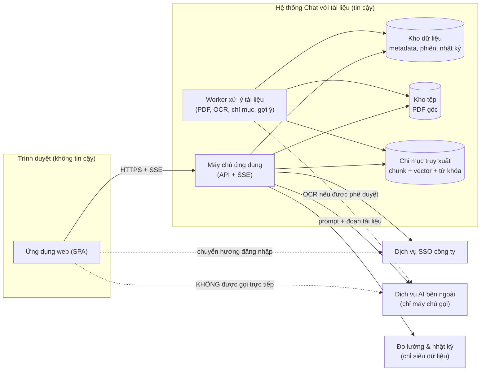
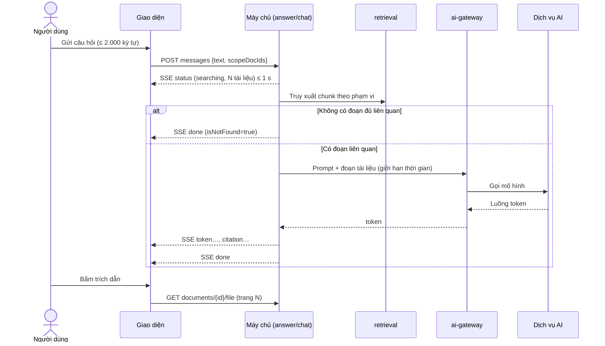
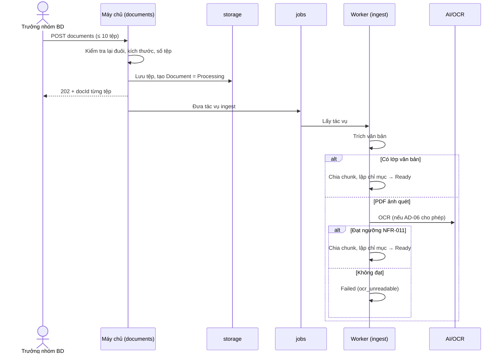

# MÔ TẢ KIẾN TRÚC PHẦN MỀM (SAD – IEEE 1016-2009)
# Công cụ "Chat với tài liệu" – MVP

> **Ghi chú (2026-10-21):** bản sắp xếp theo SOP 5.4 (4+1 view, cấu trúc của prompt `SAD_Prompt_IEEE_standard.md`) là [../04-design/SAD.md](../04-design/SAD.md) (SAD-CWD-002). Tài liệu này vẫn là nơi giữ mô hình dữ liệu chi tiết (DM-01 – DM-10), các ràng buộc DC-xx và danh sách câu hỏi Q-A mà SAD.md tham chiếu. Khi SAD.md được duyệt, hai bản cần được hợp nhất thành một.

---

## 0. Thông tin tài liệu

| Thuộc tính | Giá trị |
|---|---|
| Mã tài liệu | SAD-CWD-001 |
| Phiên bản | 0.1 |
| Trạng thái | Draft – chờ xác nhận của Trưởng đội kỹ thuật và Bảo mật thông tin |
| Tiêu chuẩn | IEEE 1016-2009 (Software Design Descriptions) |
| Ngày | 2026-10-21 |
| Chủ sở hữu | Trưởng đội kỹ thuật `[TBD: tên cụ thể]` |
| Nguồn đầu vào | [PRD.md](../requirements/PRD.md) (PRD-CWD-001 v0.2), [BRD.md](../requirements/BRD.md) (BRD-CWD-001 v0.4), [Blueprint_UIUX_Design.md](Blueprint_UIUX_Design.md) (SDD-UIUX-CWD-001 v0.2), [UseCaseDiagram.drawio](../UseCaseDiagram.drawio) |
| Phạm vi | Toàn bộ hệ thống MVP: thành phần giao diện, máy chủ ứng dụng, xử lý tài liệu, truy xuất và sinh câu trả lời, dữ liệu, bảo mật, triển khai. |

**Quy ước:**
- `[Đề xuất]` = quyết định kiến trúc do người thiết kế đề xuất, chưa được bên liên quan xác nhận.
- `[TBD]` = giá trị còn thiếu, phụ thuộc quyết định khác (ghi rõ mã câu hỏi mở).
- Mã: `AD-xx` quyết định kiến trúc; `CMP-xx` thành phần; `DM-xx` thực thể dữ liệu; `DC-xx` ràng buộc thiết kế; `C-xx` mối quan tâm; `UQ/OQ/PQ/DEP/RSK` lấy từ tài liệu nguồn.
- Tài liệu này **không quy định** nhà cung cấp cụ thể nếu chưa có quyết định. Các lựa chọn đã chốt ngày 2026-10-21 ghi ở Mục 5.2; AI và OCR còn chờ DEP-005.

### 0.1 Lịch sử phiên bản

| Phiên bản | Ngày | Tác giả | Thay đổi |
|---|---|---|---|
| 0.1 | 2026-10-21 | Người thiết kế kiến trúc | Bản đầu, dựa trên PRD v0.2, BRD v0.4 và Blueprint v0.2. |

---

## 1. Giới thiệu

### 1.1 Mục đích

- Mô tả kiến trúc để đội kỹ thuật chia việc, xây dựng và kiểm thử.
- Làm căn cứ cho cổng G4 (hiệu năng), G5 (bảo mật) và G10 (vận hành) của PRD Mục 5.1.
- Truy vết từ mối quan tâm và yêu cầu đến thành phần và quyết định kiến trúc (Mục 6).

### 1.2 Phạm vi và ranh giới

| Thuộc tính | Nội dung |
|---|---|
| Trong phạm vi | Ứng dụng web (giao diện đã mô tả trong Blueprint v0.2); máy chủ ứng dụng; dịch vụ xử lý và lập chỉ mục tài liệu (kể cả OCR); thành phần truy xuất và sinh câu trả lời; kho dữ liệu; nhật ký kiểm toán; đo lường chỉ siêu dữ liệu; triển khai và sao lưu. |
| Ngoài phạm vi | Thiết kế chi tiết từng màn hình (xem Blueprint); kế hoạch kiểm thử (xem Test Plan); mô hình AI cụ thể (quyết định ở AD-06 với điều kiện CON-005). |
| Hệ thống bên ngoài | (1) Dịch vụ xác thực tài khoản công ty (SSO, PD-001); (2) Dịch vụ AI bên ngoài, **chỉ máy chủ ứng dụng gọi** (ASM-005, CON-005); (3) Hạ tầng: tại chỗ (on-premise), chốt 2026-10-21 (AD-11). |

### 1.3 Đối tượng đọc

| Đối tượng | Dùng để | Mục chính |
|---|---|---|
| Lập trình viên back-end, front-end | Xây dựng, chia module | 3.1, 3.2, 3.5, 5 |
| Kỹ sư kiểm thử | Lập kế hoạch kiểm thử hiệu năng và bảo mật | 2.2, 3.6, 6 |
| Bảo mật thông tin / Pháp chế | Xét DEP-001 | 3.7, 2.2 |
| Trưởng đội kỹ thuật, PM | Duyệt kiến trúc và cắt phạm vi | 2, 4, 7 |
| Designer | Hiểu hợp đồng giao diện – máy chủ | 3.2, 3.6 |

### 1.4 Định nghĩa và viết tắt

| Thuật ngữ | Ý nghĩa |
|---|---|
| RAG | Retrieval-Augmented Generation: truy xuất đoạn tài liệu liên quan rồi nhờ mô hình sinh câu trả lời dựa trên đoạn đó. |
| OCR | Nhận dạng ký tự quang học cho PDF ảnh quét. |
| SSE | Server-Sent Events, luồng một chiều từ máy chủ tới trình duyệt. |
| Chunk | Đoạn văn bản đã cắt từ một trang tài liệu, kèm số trang, dùng để truy xuất. |
| Allow-list | Danh sách email được cấp quyền truy cập. |
| RPO / RTO | Lượng dữ liệu tối đa có thể mất / thời gian tối đa để khôi phục (NFR-006). |

### 1.5 Tài liệu tham chiếu

| Tài liệu | Mã | Phiên bản |
|---|---|---|
| Product Requirements Document | PRD-CWD-001 | v0.2 |
| Business Requirements Document | BRD-CWD-001 | v0.4 |
| UI/UX Blueprint | SDD-UIUX-CWD-001 | v0.2 |
| IEEE 1016-2009 | – | 2009 |
| IEEE 29148-2018 | – | 2018 |

---

## 2. Tổng quan thiết kế

### 2.1 Driver kiến trúc (quality attribute scenarios)

Các yêu cầu sau định hình kiến trúc. Thứ tự là thứ tự ưu tiên khi đánh đổi.

| # | Thuộc tính | Kịch bản (nguồn → kích thích → đáp ứng → thước đo) | Nguồn |
|---|---|---|---|
| Q1 | Riêng tư và bảo mật | Bất kỳ nội dung tài liệu nào chỉ đi tới dịch vụ AI đã duyệt, không dùng để huấn luyện; 0 truy cập ngoài allow-list | NFR-008, BR-017, BR-028, C-10 |
| Q2 | Đáng tin (không bịa) | Khi không có đoạn liên quan, hệ thống trả "không tìm thấy" thay vì sinh nội dung; mỗi ý có trích dẫn tài liệu và trang | BR-010, BR-011, BR-012, RSK-001 |
| Q3 | Hiệu năng hỏi đáp | 20 người dùng đồng thời, mỗi người 1 câu hỏi/phút, kho 200 tài liệu → p90 ≤ 15 s; trạng thái đầu ≤ 1 s | NFR-001, NFR-003, BR-013 |
| Q4 | Xử lý tài liệu | PDF 100 trang có văn bản ≤ 3 phút (p90); bản quét 100 trang ≤ 15 phút (p90) | NFR-002, PQ-007 |
| Q5 | Độ chính xác OCR | ≥ 95% ký tự trên bộ mẫu; không đạt thì từ chối rõ ràng | NFR-011, BR-027, BR-030 |
| Q6 | Sẵn sàng | ≥ 95% giờ làm việc; lỗi dịch vụ AI không làm hỏng tải lên, xem, xóa | NFR-005, QA-03 |
| Q7 | Phục hồi | RPO ≤ 24 giờ, RTO ≤ 1 ngày làm việc | NFR-006 |
| Q8 | Chi phí | Chi phí dịch vụ AI ≤ 300 USD/tháng trong thí điểm; có cảnh báo khi đạt 80% | NFR-009, CON-006, G10 |
| Q9 | Khả năng cắt phạm vi | Các tính năng Should (BR-019 – BR-022, OCR nếu cần) tắt được mà không phá luồng Must | RSK-005, RSK-008, CON-007 |
| Q10 | Bảo trì và kiểm thử | Hai kỹ sư, 7 tuần: ranh giới module rõ, kiểm thử được từng phần, không phụ thuộc vòng | CON-006, C-13 của Blueprint |

### 2.2 Ràng buộc thiết kế

| Mã | Ràng buộc | Nguồn | Tác động |
|---|---|---|---|
| DC-01 | Ứng dụng web; Chrome và Edge (2 phiên bản mới nhất); ≥ 1280 px; điện thoại chỉ đọc | CON-001, NFR-007 | Không có ứng dụng gốc; giao diện đọc được trên thiết bị nhỏ |
| DC-02 | Đăng nhập bằng SSO công ty, không có phương án dự phòng | DEC-011, PD-001 | Phụ thuộc cứng vào dịch vụ bên ngoài; không tự quản lý mật khẩu |
| DC-03 | Nội dung tài liệu xử lý bằng dịch vụ AI bên ngoài **chỉ khi** đáp ứng ba điều kiện (a) không lưu giữ quá thời gian xử lý, (b) không huấn luyện, (c) lưu trữ lâu dài trên hạ tầng được duyệt | CON-005, DEC-005 | Phải có văn bản phê duyệt (DEP-001) trước 2026-11-13, nếu không cần phương án AI nội bộ |
| DC-04 | Ngân sách 7 tuần, 1 BA, 2 kỹ sư, 1 PO bán thời gian | CON-006 | Ưu tiên dịch vụ được quản lý sẵn, hạn chế tự vận hành mô hình |
| DC-05 | Quy mô: ≤ 20 người dùng, ≤ 500 tài liệu, ≤ 300 trang, ≤ 50 MB/tệp, ≤ 10 tệp/lần, ≤ 2.000 ký tự/câu hỏi | OQ-005, ASM-006, PQ-005 | Không cần kiến trúc phân tán quy mô lớn |
| DC-06 | Tài liệu đầu vào là PDF có lớp văn bản hoặc PDF ảnh quét (OCR) | CON-003, DEC-010 | Cần đường xử lý OCR bất đồng bộ |
| DC-07 | Giao diện tiếng Việt; hỏi đáp Việt – Anh, trả lời theo ngôn ngữ câu hỏi | NFR-010, BR-026 | Phải kiểm chứng chất lượng cả hai ngôn ngữ |
| DC-08 | Kho chung, không phân quyền theo tài liệu; chỉ Trưởng nhóm BD tải lên | ASM-004, DEC-001 | Mô hình quyền đơn giản: vai trò + allow-list |
| DC-09 | Không ghi nội dung câu hỏi, câu trả lời hay tài liệu vào hệ thống phân tích | PRD 5.2, DEP-003 | Telemetry chỉ siêu dữ liệu, có kiểm tra lược đồ |
| DC-10 | Lưu nội dung câu hỏi để có lịch sử 90 ngày; mỗi người chỉ xem của mình | DEC-002, PQ-003 | Cần cơ chế kiểm soát truy cập theo người dùng và xóa theo thời hạn |
| DC-11 | Dữ liệu tài liệu bị xóa phải được xóa trong 24 giờ | BR-029, DEC-013 | Phải có tiến trình xóa theo lịch, bao gồm chỉ mục và tệp |

### 2.3 Phong cách kiến trúc đề xuất `[Đề xuất]`

**Monolith mô-đun** cho máy chủ ứng dụng, cộng **một tiến trình worker riêng** cho việc xử lý tài liệu (phân tích PDF, OCR, chia đoạn, lập chỉ mục, tạo gợi ý). Mỗi mô-đun có giao diện nội bộ rõ, để có thể tách thành dịch vụ riêng nếu cần sau thí điểm.

Lý do: đội 2 kỹ sư và 7 tuần (DC-04) không đủ năng lực vận hành nhiều dịch vụ; tải mục tiêu (≤ 20 người) không cần phân tán; worker tách riêng để OCR chậm không chặn hỏi đáp (EC-02, EC-20). Xem AD-01.

### 2.4 Bối cảnh hệ thống

### 2.5 Quyết định kiến trúc chính

| ID | Quyết định | Trạng thái | Tham chiếu |
|---|---|---|---|
| AD-01 | Monolith mô-đun + worker xử lý tài liệu | `[Đề xuất]` | Mục 2.3 |
| AD-02 | Trả lời dùng SSE, một chiều | Đã xác nhận 2026-10-21 | DD-04 (Blueprint) |
| AD-03 | Truy xuất lai: đoạn văn theo vector + từ khóa, lọc theo phạm vi tài liệu; lưu trong PostgreSQL + pgvector | Đã xác nhận 2026-10-21 | BR-009, BR-015 |
| AD-04 | Mọi lời gọi AI đi qua một **cổng AI** nội bộ trong máy chủ | `[Đề xuất]` | CON-005, DC-03 |
| AD-05 | OCR chạy trong worker, bất đồng bộ; có ngưỡng chất lượng để từ chối | `[Đề xuất]` – chờ thử nghiệm DEP-005 | BR-027, NFR-011 |
| AD-06 | Nhà cung cấp AI và OCR | Chốt sau DEP-005 (hạn 2026-11-06): AI đám mây có cam kết hoặc mô hình tự host; OCR thử cả Tesseract và dịch vụ đám mây | OQ-017, OQ-018, DEP-005 |
| AD-07 | Hiển thị PDF bằng trình xem của trình duyệt, mở đúng trang | Đã xác nhận 2026-10-21 | UQ-02 (Blueprint), PQ-006 |
| AD-08 | Xóa tài liệu là xóa logic ngay, xóa vật lý trong 24 giờ bằng tác vụ theo lịch; ngoại lệ sao lưu được ghi nhận, chờ Bảo mật thông tin duyệt | `[Đề xuất]` – ngoại lệ chờ duyệt | BR-029, DC-11 |
| AD-09 | Quyền truy cập: SSO → allow-list → vai trò; kiểm tra ở máy chủ cho mọi API | `[Đề xuất]` | BR-016, DC-02, DC-08 |
| AD-10 | Telemetry chỉ siêu dữ liệu, lược đồ từ chối trường lạ | `[Đề xuất]` | DC-09, QA-06 |
| AD-11 | Triển khai tại chỗ (on-premise) | Chốt 2026-10-21 | OQ-006, Mục 3.4 |
| AD-12 | Thời hạn lưu nhật ký kiểm toán: 90 ngày | Chốt 2026-10-21 | DM-09, US-063 |

---

## 3. Góc nhìn thiết kế (IEEE 1016-2009)

Sáu góc nhìn theo mục 3.2 của mẫu SAD, cộng góc nhìn bảo mật.

| # | Góc nhìn | Mục | Mối quan tâm chính |
|---|---|---|---|
| V1 | Mô-đun (Module) | 3.1 | Bảo trì, chia việc (Q10) |
| V2 | Thành phần và kết nối (Component-and-Connector) | 3.2 | Hiệu năng, hợp đồng (Q3) |
| V3 | Phân bổ (Allocation) | 3.3 | Chia việc, sở hữu |
| V4 | Triển khai (Deployment) | 3.4 | Sẵn sàng, sao lưu (Q6, Q7) |
| V5 | Thông tin (Information) | 3.5 | Riêng tư, xóa, lưu giữ (Q1, DC-10, DC-11) |
| V6 | Tương tác (Interaction) | 3.6 | Luồng hỏi đáp, tải lên, xóa |
| V7 | Bảo mật (Security) | 3.7 | Q1, AD-09 |

### 3.1 Góc nhìn mô-đun

| Mô-đun | Trách nhiệm | Phụ thuộc | Tham chiếu |
|---|---|---|---|
| `auth` | Xác thực SSO, phiên, allow-list, kiểm tra vai trò | `users` | AD-09, US-001, US-002 |
| `users` | Danh sách cho phép, vai trò (QT, TN, BD, NTT) | `db` | US-061 |
| `documents` | Nhận tệp, trạng thái tài liệu, danh sách, xóa logic | `storage`, `jobs`, `audit` | US-010 – US-017 |
| `ingest` (trong worker) | Kiểm tra PDF, trích văn bản, OCR, chia chunk, lập chỉ mục | `storage`, `index`, `ai-gateway` | US-013, BR-027 |
| `retrieval` | Truy xuất đoạn theo phạm vi tài liệu, xếp hạng | `index` | AD-03, US-026 |
| `answer` | Ghép prompt, gọi cổng AI, kiểm tra trích dẫn, trả "không tìm thấy" | `retrieval`, `ai-gateway` | US-020 – US-023, Q2 |
| `ai-gateway` | Gói mọi lời gọi AI: giới hạn thời gian, hạn mức chi phí, ghi nhận không chứa nội dung | – | AD-04, NFR-009 |
| `chat` | Phiên, lịch sử 90 ngày, dừng, đánh giá, sao chép | `answer`, `db` | US-025, US-041, US-050 |
| `suggest` | Tạo 3 gợi ý khi tài liệu "Sẵn sàng", lưu và trả về | `ai-gateway`, `index` | US-031, DEC-018 |
| `summary` | Tóm tắt tài liệu có trích dẫn | `ai-gateway`, `index` | US-040 (P1) |
| `metrics` | Tổng hợp số liệu tuần từ telemetry | `telemetry` | US-051 |
| `telemetry` | Nhận sự kiện, kiểm tra lược đồ, ghi kho đo lường | – | AD-10, PRD 5.2 |
| `audit` | Nhật ký tải lên và xóa (ai, thao tác, tài liệu, thời điểm) | `db` | US-063 |
| `jobs` | Hàng đợi tác vụ: xử lý tài liệu, xóa theo lịch, gợi ý | `db` | AD-08 |
| `storage` | Lưu và đọc tệp PDF, đọc theo khoảng byte có kiểm tra quyền | – | API-06 |

**Quy tắc phụ thuộc:** `chat` và `documents` không gọi trực tiếp `ai-gateway`; mọi gọi AI đi qua `answer`, `suggest`, `summary` và `ingest`, và `ai-gateway` là điểm duy nhất ra ngoài. Không có phụ thuộc vòng.

### 3.2 Góc nhìn thành phần và kết nối

| Thành phần | Tiến trình | Giao thức | Ghi chú |
|---|---|---|---|
| Ứng dụng web (SPA) | Trình duyệt | HTTPS, SSE | Hợp đồng API-01 đến API-17 (Blueprint 3.3) |
| Máy chủ ứng dụng | Tiến trình API | HTTPS/JSON, SSE | Chứa các mô-đun `auth`…`telemetry` |
| Worker | Tiến trình riêng, cùng mã nguồn | Hàng đợi tác vụ trong kho dữ liệu | `ingest`, `suggest`, xóa theo lịch |
| Kho dữ liệu quan hệ | PostgreSQL, máy chủ nội bộ (tại chỗ) | SQL | Metadata, phiên, nhật ký, cấu hình |
| Kho tệp | Máy chủ nội bộ (tại chỗ) | HTTPS | PDF gốc, mã hóa khi lưu |
| Chỉ mục | PostgreSQL + pgvector (chốt 2026-10-21) | SQL | Chunk, vector, từ khóa |
| Dịch vụ AI | Bên ngoài | HTTPS | Chỉ `ai-gateway` gọi |

**Luồng sự kiện trả lời (API-08):** `status` → `token`… → `citation`… → `done`. Nếu SSE đứt trước `done`, giao diện giữ phần đã nhận (EC-04); máy chủ hủy lời gọi AI khi kết nối đóng.

**Hợp đồng lỗi:** `{ "code": "<MÃ>", "retryable": true|false }` theo bảng mã ở Blueprint 3.3.3. Máy chủ không trả thông báo kỹ thuật cho người dùng.

### 3.3 Góc nhìn phân bổ

| Thành phần | Môi trường | Ai sở hữu | Ghi chú |
|---|---|---|---|
| Giao diện | Máy chủ tĩnh nội bộ (tại chỗ) | Kỹ sư front-end | Không tải font, script từ bên thứ ba (riêng tư, Blueprint 3.7) |
| Máy chủ ứng dụng và worker | Cùng cụm, hai tiến trình | Kỹ sư back-end | Worker có thể nhân bản khi OCR chậm |
| Kho dữ liệu, kho tệp, chỉ mục | Máy chủ nội bộ (tại chỗ) | Trưởng đội kỹ thuật | Sao lưu hằng ngày (NFR-006) |
| Cổng AI | Trong máy chủ | Kỹ sư back-end | Khóa API chỉ nằm trong bí mật của máy chủ |
| Telemetry | Cùng kho dữ liệu, bảng riêng | PM + kỹ sư | Không có nội dung văn bản tự do |

### 3.4 Góc nhìn triển khai

| Môi trường | Mục đích | Ghi chú |
|---|---|---|
| Phát triển | Phát triển và kiểm thử đơn vị | Dữ liệu giả, không dùng tài liệu thật |
| Staging | Kiểm thử tải G4, kiểm thử bảo mật G5, kiểm tra telemetry G8 | Kho ≥ 200 tài liệu mẫu (DEP-003) |
| Thí điểm (production) | 20 người dùng, giờ làm việc | Tài liệu thật, chỉ sau khi có DEP-001 |

**Trạng thái:** triển khai **tại chỗ (on-premise)**, chốt 2026-10-21. Dịch vụ AI bên ngoài (nếu được chọn ở AD-06) vẫn phải đáp ứng CON-005 và chờ DEP-001. CON-005(c) yêu cầu lưu trữ lâu dài trên hạ tầng do tổ chức phê duyệt; triển khai tại chỗ đáp ứng điều kiện này.

**Sao lưu và khôi phục (NFR-006):** sao lưu kho dữ liệu và kho tệp ít nhất mỗi 24 giờ; thử khôi phục định kỳ (G10). Ngoại lệ sao lưu cho BR-029 đã được ghi nhận (Q-A3), chờ Bảo mật thông tin duyệt.

### 3.5 Góc nhìn thông tin

**Thực thể dữ liệu:**

| Mã | Thực thể | Trường chính | Lưu giữ | Ghi chú |
|---|---|---|---|---|
| DM-01 | Document | `doc_id`, `name`, `uploaded_by`, `uploaded_at`, `page_count`, `status`, `failure_reason`, `used_ocr`, `file_key`, `deleted_at` | Đến khi xóa | `status` theo Blueprint 3.5.1 |
| DM-02 | Chunk | `chunk_id`, `doc_id`, `page`, `text`, `embedding`, `lang` | Xóa cùng tài liệu | Chứa nội dung tài liệu (phân loại Nội bộ) |
| DM-03 | Suggestion | `doc_id`, `questions[3]`, `created_at` | Xóa cùng tài liệu | DEC-018 |
| DM-04 | ChatSession | `session_id`, `user_id`, `title` (60 ký tự đầu câu hỏi), `created_at`, `scope_doc_ids` | 90 ngày | DEC-002, OQ-013 |
| DM-05 | Message | `message_id`, `session_id`, `role`, `text`, `status`, `is_not_found`, `stopped` | 90 ngày | Lưu nội dung theo DEC-002 |
| DM-06 | Citation | `message_id`, `index`, `doc_id`, `page`, `snippet` (≤ 200 ký tự) | 90 ngày | Trích dẫn không đổi khi tài liệu xóa; hiển thị "đã bị xóa" (EC-14) |
| DM-07 | Rating | `message_id`, `value` (up/down), `reason_code` | Cùng lịch sử | US-050 |
| DM-08 | AllowListEntry | `email`, `role`, `added_by`, `added_at` | Đến khi gỡ | US-061 |
| DM-09 | AuditLog | `actor`, `action`, `doc_id`, `at` | 90 ngày (chốt 2026-10-21) | Bốn trường bắt buộc (US-063) |
| DM-10 | TelemetryEvent | `event`, `anon_user_id`, `session_id`, `timestamp`, `app_version`, thuộc tính số/mã | `[TBD]` | Không có trường văn bản tự do (DC-09) |

**Quy tắc xóa (AD-08):** xóa tài liệu đặt `deleted_at`, ngừng truy xuất ngay; tác vụ theo lịch xóa `Chunk`, `Suggestion`, tệp gốc trong ≤ 24 giờ (BR-029); bản sao lưu là ngoại lệ đã ghi nhận, xem Q-A3. Trích dẫn cũ giữ nguyên nhưng không mở được.

### 3.6 Góc nhìn tương tác

**(a) Hỏi đáp có trích dẫn** (US-020, US-022, US-027)

**(b) Tải lên và xử lý** (US-010 – US-013)

**(c) Xóa tài liệu** (US-016, BR-029)

Người tải lên hoặc Quản trị viên gọi `DELETE /documents/{id}` → máy chủ đặt `deleted_at`, ghi `AuditLog`, trả 200 → tác vụ theo lịch xóa dữ liệu trong ≤ 24 giờ → ghi sự kiện `document_deleted`.

**(d) Đăng nhập và hết phiên** (US-001, EC-16, EC-17)

Xem Blueprint 3.4.3. Máy chủ kiểm tra phiên ở mọi lời gọi; hết phiên trả `AUTH_EXPIRED`; quyền bị thu hồi trả `AUTH_FORBIDDEN`.

### 3.7 Góc nhìn bảo mật

| Biện pháp | Áp dụng | Nguồn |
|---|---|---|
| Xác thực SSO; không tự lưu mật khẩu | Mọi người dùng | DC-02, AD-09 |
| Kiểm tra quyền ở máy chủ cho mọi API và mọi lần tải tệp | Mọi endpoint, kể cả đọc theo byte | BR-016, QA-02 |
| Trình duyệt không gọi trực tiếp dịch vụ AI; khóa API không đưa xuống giao diện | Toàn hệ thống | CON-005, C-10 |
| TLS 1.2+ khi truyền; mã hóa khi lưu cho kho tệp và kho dữ liệu | Toàn hệ thống | NFR-008 |
| Nội dung không đi vào URL, tiêu đề tab, log console, telemetry | Giao diện và máy chủ | Blueprint 2.5 |
| Lược đồ telemetry từ chối trường lạ; kiểm thử gói tin trên staging | Telemetry | DC-09, G8 |
| Nhật ký kiểm toán cho tải lên và xóa; không sửa được qua API | Mô-đun `audit` | US-063 |
| Quét lỗ hổng trước ra mắt; không có mức High/Critical | Cổng G5 | NFR-008 |
| Cổng AI có giới hạn thời gian và hạn mức chi phí; cảnh báo ở 80% | `ai-gateway` | NFR-009, G10 |

**Mối đe dọa chính (STRIDE rút gọn):**
- *Lộ tài liệu qua truy cập trái phép* (E, I): kiểm tra quyền ở máy chủ, kiểm thử QA-02.
- *Prompt injection từ nội dung PDF* (T): nội dung tài liệu được coi là dữ liệu, không phải chỉ dẫn; prompt tách rõ phần hệ thống và phần đoạn trích; câu trả lời chỉ được hiển thị kèm trích dẫn đã kiểm tra tồn tại trong chunk. `[Đề xuất]` – cần kiểm thử thêm.
- *Dữ liệu còn lại sau xóa* (I): tác vụ xóa theo lịch và xem xét sao lưu (Q-A3).
- *Bịa câu trả lời* (T, không phải bảo mật nhưng cùng cơ chế): Q2.

---

## 4. Lý do thiết kế (Design Rationale)

| ID | Quyết định | Lý do | Phương án đã loại | Đánh đổi |
|---|---|---|---|---|
| AD-01 | Monolith mô-đun + worker | Đội nhỏ, thời gian ngắn; OCR tách riêng để không chặn hỏi đáp | Microservices: nhiều hạ tầng, khó kiểm thử với 2 kỹ sư | Phải giữ ranh giới mô-đun bằng quy tắc và kiểm tra phụ thuộc |
| AD-02 | SSE | Một chiều, đơn giản, qua được proxy văn phòng (DD-04) | WebSocket: hai chiều không cần; chờ toàn bộ: cảm giác chậm (NFR-001) | Cần xử lý ngắt kết nối (EC-04) |
| AD-03 | Truy xuất lai | Từ khóa bắt được mã hợp đồng, số hiệu; vector bắt được ý tương đương | Chỉ vector: bỏ sót số hiệu; chỉ từ khóa: bỏ sót cách diễn đạt khác | Thêm bước lập chỉ mục |
| AD-04 | Cổng AI duy nhất | Gom kiểm soát chi phí, giới hạn thời gian, ghi nhận không chứa nội dung, và điểm kiểm toán CON-005 | Gọi AI từ nhiều mô-đun: khó kiểm soát | Thêm một lớp trung gian |
| AD-05 | OCR bất đồng bộ trong worker | Thời gian OCR dài (≤ 15 phút), không được chặn tải lên hay hỏi đáp (EC-20) | OCR đồng bộ: người dùng phải chờ | Cần trạng thái riêng "Đang nhận dạng ký tự" (DEC-010) |
| AD-07 | Trình xem PDF của trình duyệt mở đúng trang | Đơn giản, ít rủi ro bảo trì; đủ cho P0 (không tô sáng) | Thư viện PDF tự nhúng: nhiều công sức, tô sáng là P2 | Không tô sáng đoạn văn (PQ-006) |
| AD-08 | Xóa logic + tác vụ theo lịch | Người dùng thấy xóa ngay; dữ liệu bị xóa trong 24 giờ | Xóa đồng bộ: dễ lỗi giữa chừng, khó khôi phục | Có cửa sổ 24 giờ với dữ liệu đã xóa logic |
| AD-09 | Allow-list + vai trò | Quy mô nhỏ, quy tắc rõ, khớp DEC-001 | Phân quyền theo tài liệu: vượt phạm vi (ASM-004) | Không có quyền theo tài liệu |
| AD-10 | Telemetry chỉ siêu dữ liệu | Đáp ứng DC-09; đo được KR mà không lộ nội dung | Ghi nội dung: vi phạm riêng tư | Phân tích chất lượng câu trả lời phải dựa vào đánh giá 👍/👎 và kiểm tra thủ công |

---

## 5. Phần tử thiết kế và tài nguyên

### 5.1 Danh mục thành phần

| Mã | Thành phần | Loại | Trách nhiệm | Ưu tiên | Story |
|---|---|---|---|---|---|
| CMP-A01 | `auth` | Logic | SSO, phiên, allow-list | P0 | US-001, US-002 |
| CMP-A02 | `documents` | Logic | Tải lên, trạng thái, danh sách, xóa | P0 | US-010 – US-017 |
| CMP-A03 | `ingest` (worker) | Logic | Trích văn bản, OCR, chunk, lập chỉ mục | P0 | US-013 |
| CMP-A04 | `retrieval` | Logic | Truy xuất lai, lọc phạm vi | P0 | US-020, US-026 |
| CMP-A05 | `answer` | Logic | Prompt, kiểm tra trích dẫn, không tìm thấy | P0 | US-021 – US-023 |
| CMP-A06 | `ai-gateway` | Hạ tầng | Gọi AI, giới hạn, hạn mức | P0 | NFR-009 |
| CMP-A07 | `chat` | Logic | Phiên, lịch sử, dừng, đánh giá | P0/P1 | US-025, US-041, US-050 |
| CMP-A08 | `suggest` | Logic | Gợi ý câu hỏi mẫu | P1 | US-031 |
| CMP-A09 | `summary` | Logic | Tóm tắt có trích dẫn | P1 | US-040 |
| CMP-A10 | `metrics` + `telemetry` | Logic | Đo lường, số liệu tuần | P0 | US-051 |
| CMP-A11 | `audit` | Logic | Nhật ký tải lên và xóa | P1 | US-063 |
| CMP-A12 | `jobs` | Hạ tầng | Hàng đợi, tác vụ theo lịch | P0 | AD-08 |
| CMP-A13 | `storage` | Hạ tầng | Tệp PDF, đọc theo byte | P0 | US-022 |

P1 có thể tắt riêng (`suggest`, `summary`, `audit` có thể tắt; `chat` lịch sử là P1) mà không ảnh hưởng luồng P0 (DD-08, Q9).

### 5.2 Công nghệ và tài nguyên

| Hạng mục | Lựa chọn | Trạng thái | Ghi chú |
|---|---|---|---|
| Ngôn ngữ và framework back-end | Python (FastAPI) | Đã chốt 2026-10-21 | Hệ sinh thái RAG/OCR phong phú |
| Framework giao diện | Vue | Đã chốt 2026-10-21 | Đồng bộ component và token với Blueprint |
| Kho dữ liệu quan hệ | PostgreSQL | Đã chốt 2026-10-21 | Hỗ trợ mã hóa khi lưu và pgvector |
| Chỉ mục vector và từ khóa | PostgreSQL + pgvector | Đã chốt 2026-10-21 | Không thêm hạ tầng riêng |
| Dịch vụ AI và OCR | AI: chốt sau DEP-005; OCR: thử cả Tesseract và dịch vụ đám mây | Chờ thử nghiệm DEP-005 (hạn 2026-11-06) | Phải đáp ứng CON-005 và NFR-011 |
| Hạ tầng | Tại chỗ (on-premise) | Đã chốt 2026-10-21 | Chờ DEP-001 cho dịch vụ AI bên ngoài |
| Ngân sách AI | ≤ 300 USD/tháng | Ràng buộc | NFR-009; cảnh báo ở 80% |
| Nhân lực | 2 kỹ sư, 1 BA, 1 PO bán thời gian, 7 tuần | Ràng buộc | CON-006 |

---

## 6. Truy vết

### 6.1 Yêu cầu chất lượng → quyết định và thành phần

| Mã | Yêu cầu | Quyết định | Thành phần | Kiểm chứng |
|---|---|---|---|---|
| NFR-001 | p90 ≤ 15 s; trạng thái ≤ 1 s | AD-02, AD-03 | CMP-A04, CMP-A05, CMP-A06 | Kiểm thử tải G4 |
| NFR-002 | Xử lý PDF 3 phút / OCR 15 phút | AD-05 | CMP-A03, CMP-A12 | Đo trên bộ mẫu |
| NFR-003 | 20 người đồng thời | AD-01 | Máy chủ + worker | Kiểm thử tải G4 |
| NFR-004 | 500 tài liệu, 300 trang, 50 MB | DC-05 | CMP-A02, CMP-A13 | Kiểm thử dung lượng |
| NFR-005 | ≥ 95% giờ làm việc | Triển khai (3.4) | Toàn hệ thống | Giám sát |
| NFR-006 | RPO 24 giờ, RTO 1 ngày | 3.4 | Kho dữ liệu, kho tệp | Thử khôi phục G10 |
| NFR-007 | Chrome, Edge, ≥ 1280 px | Blueprint 3.8 | Giao diện | Kiểm thử trình duyệt |
| NFR-008 | TLS 1.2+, mã hóa khi lưu, không lỗ hổng High | AD-09, 3.7 | Toàn hệ thống | Quét bảo mật G5 |
| NFR-009 | AI ≤ 300 USD/tháng | AD-04 | CMP-A06 | Theo dõi chi phí |
| NFR-010 | Giao diện tiếng Việt | Blueprint 5 | Giao diện | Rà soát nội dung |
| NFR-011 | OCR ≥ 95% ký tự | AD-05, AD-06 | CMP-A03 | Thử nghiệm DEP-005 |

### 6.2 Mối quan tâm (Blueprint 2.2) → góc nhìn

| Mối quan tâm | Góc nhìn | Thành phần |
|---|---|---|
| C-01 Kiểm chứng nhanh | V2, V6 | CMP-A05, CMP-A13 |
| C-02 Không đoán khi thiếu thông tin | V6 | CMP-A05 (nhánh `isNotFound`) |
| C-03 Phản hồi nhanh | V2, V6 | CMP-A04, CMP-A06 |
| C-05 Tải hàng loạt | V2, V6 | CMP-A02, CMP-A03 |
| C-06 Dọn kho | V5, V6 | CMP-A02, CMP-A12 |
| C-07 Kiểm soát truy cập | V7 | CMP-A01 |
| C-08 Truy vết kho | V5 | CMP-A11 |
| C-09 Số liệu | V5 | CMP-A10 |
| C-10 Riêng tư | V5, V7 | CMP-A06, CMP-A10 |
| C-12 Không mất dữ liệu nhập | V6 | Giao diện (bản nháp), CMP-A07 |
| C-13 Đủ chi tiết | V1–V7 | Toàn bộ |

### 6.3 Yêu cầu kinh doanh → quyết định

| BR | Quyết định / thành phần |
|---|---|
| BR-001, BR-002, BR-004 | CMP-A02, DC-05 |
| BR-010, BR-011, BR-012 | AD-03, CMP-A05 (kiểm tra trích dẫn), Q2 |
| BR-013 | NFR-001 |
| BR-016, BR-017 | AD-09, 3.7 |
| BR-018 | CMP-A11 |
| BR-019 – BR-022 | CMP-A09, CMP-A08, CMP-A07 (Should, cắt được) |
| BR-027, BR-030 | AD-05, NFR-011 |
| BR-028 | AD-04, CON-005(b) |
| BR-029 | AD-08 |
| BR-031 – BR-034 | 3.4, NFR-005 – NFR-007 |

---

## 7. Tiến hóa, rủi ro kiến trúc và câu hỏi mở

### 7.1 Rủi ro kiến trúc

| ID | Rủi ro | Ảnh hưởng | Giảm thiểu |
|---|---|---|---|
| RA-01 | DEP-001 không được phê duyệt trước 2026-11-13 | Không dùng được AI bên ngoài | Chuẩn bị phương án AI nội bộ ở mức khảo sát; báo nhà tài trợ sớm |
| RA-02 | OCR tiếng Việt có dấu không đạt 95% | Q5 không đạt, RSK-003 | Thử nghiệm DEP-005 tuần 1–2; từ chối rõ ràng khi không đạt |
| RA-03 | Thời gian xử lý PDF quét vượt 15 phút | Q4 không đạt | Nhân bản worker; giới hạn kích thước theo DC-05 |
| RA-04 | Chi phí AI vượt 300 USD | NFR-009 | Cổng AI có hạn mức; cảnh báo 80%; giới hạn độ dài câu hỏi |
| RA-05 | Ranh giới mô-đun bị phá trong 7 tuần | Khó bảo trì (Q10) | Kiểm tra phụ thuộc trong CI; review kiến trúc tuần 3 |
| RA-06 | SSO trễ | Không đăng nhập được (PD-001) | Báo nhà tài trợ theo DEC-011 |

### 7.2 Câu hỏi mở về kiến trúc

| ID | Câu hỏi | Ảnh hưởng | Chủ sở hữu | Hạn |
|---|---|---|---|---|
| Q-A1 | Chọn nhà cung cấp AI (AD-06); OCR đã chọn thử cả hai | AD-04, NFR-009, NFR-011 | Trưởng đội kỹ thuật | 2026-11-06 | Chờ DEP-005 |
| Q-A2 | ~~Hạ tầng triển khai~~ **Đã chốt 2026-10-21: tại chỗ.** Còn lại: Bảo mật thông tin xác nhận vị trí lưu trữ (DEP-001) | 3.4, DC-03 | Bảo mật thông tin | 2026-11-13 | Chờ DEP-001 |
| Q-A3 | ~~Sao lưu và quyền xóa~~ **Đã chốt 2026-10-21: ghi nhận ngoại lệ** (bản sao lưu theo chu kỳ có thể chứa tài liệu đã xóa). Chờ Bảo mật thông tin duyệt ngoại lệ | BR-029, AD-08, NFR-006 | Bảo mật thông tin + Trưởng đội kỹ thuật | 2026-11-13 | Chờ duyệt |
| Q-A4 | ~~Xác nhận AD-02 và AD-07 với Blueprint UQ-02~~ **Đã xác nhận 2026-10-21** | Giao diện | Trưởng đội kỹ thuật | 2026-11-06 | Đóng |
| Q-A5 | ~~Ngôn ngữ và framework~~ **Đã chốt 2026-10-21:** Python (FastAPI), Vue, PostgreSQL + pgvector | Toàn bộ | Trưởng đội kỹ thuật | 2026-10-30 | Đóng |
| Q-A6 | ~~Thời hạn lưu nhật ký~~ **Đã chốt 2026-10-21: 90 ngày** | CMP-A11 | Bảo mật thông tin | 2026-11-13 | Đóng |
| Q-A7 | Hỏi đáp có đủ chất lượng với ≥ 1 PDF không có lớp văn bản và không OCR (OQ-018 phạm vi) | AD-05 | Trưởng đội kỹ thuật | 2026-11-06 |

### 7.3 Lộ trình tiến hóa

- Sau thí điểm: nếu tải vượt mục tiêu, tách `ingest` và `retrieval` thành dịch vụ riêng (đã có ranh giới ở 3.1).
- Nếu cần phân quyền theo tài liệu (ASM-004 thay đổi): mở rộng `auth` và thêm bảng ACL; ảnh hưởng `retrieval` và `storage`.
- Nếu cần tô sáng đoạn trích (P2, PQ-006): thêm lưu vị trí đoạn trong `Chunk`.

---

## 8. Kiểm tra chất lượng và mức sẵn sàng

### 8.1 Tự kiểm tra (IEEE 1016 Phụ lục A, rút gọn)

| Hạng mục | Kết quả | Ghi chú |
|---|---|---|
| Mỗi driver chất lượng có kịch bản đo được | Đạt | Mục 2.1 |
| Mỗi quyết định có lý do và phương án đã loại | Đạt | Mục 4 |
| Mỗi NFR có thành phần và cách kiểm chứng | Đạt | Mục 6.1 |
| Mỗi BR có quyết định hoặc thành phần | Đạt | Mục 6.3 |
| Có góc nhìn mô-đun, C&C, phân bổ, triển khai, thông tin, tương tác | Đạt | Mục 3 |
| Không có phụ thuộc vòng giữa mô-đun | Đạt trên giấy | Cần kiểm tra bằng công cụ khi có mã |
| Công nghệ cụ thể đã chốt | Đã chốt, trừ AI và OCR | Mục 5.2 (chốt 2026-10-21) |
| Hạ tầng đã chốt | Đã chốt: tại chỗ | Mục 3.4, OQ-006 |
| Dịch vụ AI đã được Bảo mật thông tin phê duyệt | **Chưa** | DEP-001 |
| Mô hình dữ liệu kiểm tra được với DBA | **Chưa** | Mục 3.5 |

### 8.2 Tuyên bố mức độ sẵn sàng

**Sẵn sàng để review** với Trưởng đội kỹ thuật, Bảo mật thông tin, Designer và QA.

**Chưa sẵn sàng để bắt đầu xây dựng** cho tới khi:
1. Q-A1 được chốt sau DEP-005 (nhà cung cấp AI và OCR).
2. Thử nghiệm OCR (DEP-005) cho kết quả và xác nhận Q-A7.
3. Bảo mật thông tin xác nhận DC-03 và Q-A2 (DEP-001), hoặc quyết định phương án thay thế.
4. Bảo mật thông tin duyệt ngoại lệ sao lưu (Q-A3).

Các tham chiếu SAD trong Blueprint v0.2 đã được cập nhật theo SAD v0.1.
