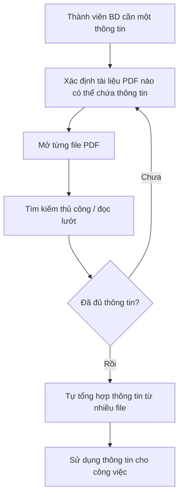
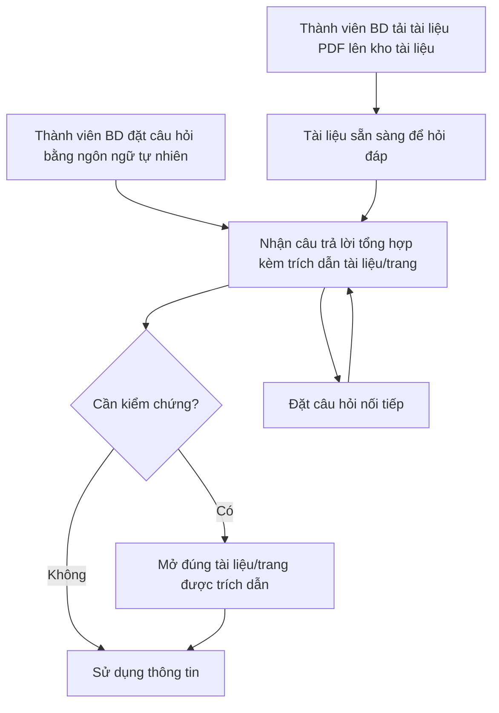

# TÀI LIỆU YÊU CẦU NGHIỆP VỤ (BRD)
# Công cụ "Chat với tài liệu" – MVP

---

## 1. Kiểm soát tài liệu

| Thuộc tính | Giá trị |
|---|---|
| Tiêu đề | Tài liệu Yêu cầu Nghiệp vụ – Công cụ "Chat với tài liệu" (MVP) |
| Mã tài liệu | BRD-CWD-001 |
| Phiên bản | 0.5 |
| Trạng thái | **In review** |
| Tiêu chuẩn áp dụng | IEEE 29148-2018 |
| Tác giả | Business Analyst (soạn thảo) |
| Người đóng góp | Đội BA |
| Người review | Trưởng đội Phát triển kinh doanh (BD), Trưởng đội kỹ thuật, Bảo mật thông tin / Pháp chế |
| Người phê duyệt | sonnt (Nhà tài trợ, người yêu cầu) |
| Phân loại bảo mật | Nội bộ (Internal) |

### 1.1 Lịch sử phiên bản

| Phiên bản | Ngày | Tác giả | Tóm tắt thay đổi |
|---|---|---|---|
| 0.1 | 2026-10-19 | Business Analyst | Bản nháp đầu tiên dựa trên yêu cầu của quản lý (SRC-001) |
| 0.2 | 2026-10-19 | Business Analyst | Điền giá trị đề xuất cho toàn bộ mục `[TBD]` (SRC-003); chuyển OQ-001 – OQ-016 sang trạng thái "Đề xuất – chờ xác nhận"; thêm BR-026 – BR-029, BRU-006; chuyển BR-020 sang Won't |
| 0.3 | 2026-10-19 | Business Analyst | Ghi nhận 14 quyết định của người yêu cầu ngày 2026-10-19 (SRC-004): chỉ Trưởng nhóm BD được tải lên (BRU-007); có lưu nội dung câu hỏi (BRU-008); xác nhận OQ-003, 005, 006, 010, 011; **mở rộng phạm vi: OCR cho PDF ảnh quét (BR-027 viết lại, thêm BR-030, DEP-005) và đưa gợi ý câu hỏi mẫu tự động vào MVP (BR-020 từ Won't lên Should)**; thêm RSK-008, OQ-017, OQ-018 |
| 0.4 | 2026-10-19 | Business Analyst | OQ-001: sonnt là nhà tài trợ và người phê duyệt (DEC-012). Chấp nhận toàn bộ giá trị đề xuất còn lại tại OQ-002, 004, 007, 009, 013 – 017 (DEC-013). Còn mở: OQ-018 (ước lượng tiến độ của đội kỹ thuật). Thêm tuyên bố tầm nhìn (Mục 2), nhóm yêu cầu F về vận hành và tương thích (BR-031 – BR-034), DEC-014 – DEC-018 |
| 0.5 | 2026-10-21 | Business Analyst | Ghi nhận 6 lựa chọn của người yêu cầu ngày 2026-10-21: thêm BR-035 (US-030) và BR-036 (NFR-002) cùng AC-035, AC-036; OQ-018 chốt "giữ đủ" (OCR và BR-019 – BR-022 vào MVP, RSK-008 vẫn ở mức cao); ngoại lệ sao lưu của BR-029 (OQ-013) được ghi nhận, chờ Bảo mật thông tin duyệt; điền ID PRD cho ma trận truy vết (Mục 11.1) |

### 1.2 Danh sách phân phối

| Vai trò | Mục đích |
|---|---|
| Nhà tài trợ / Quản lý (STK-001) | Phê duyệt |
| Đội BD (STK-002) | Review, xác nhận nhu cầu và giá trị đề xuất |
| Đội BA (STK-003) | Đóng góp, review |
| Đội kỹ thuật (STK-004) | Review tính khả thi, đầu vào cho PRD/SRS |
| Bảo mật thông tin / Pháp chế (STK-005) | Review ràng buộc dữ liệu |

### 1.3 Quy ước từ ngữ chuẩn tắc

| Từ trong tài liệu | Tương đương IEEE 29148 | Ý nghĩa |
|---|---|---|
| **phải** | *shall* | Bắt buộc |
| **nên** | *should* | Mong muốn, không bắt buộc |
| **có thể** | *may* | Được phép, tùy chọn |

Ký hiệu:
- `[Unverified]` = nhận định chưa có nguồn xác thực.
- `[Đề xuất]` = giá trị do BA đề xuất làm mặc định cho MVP (SRC-003), **chưa** được bên liên quan xác nhận. Mọi giá trị `[Đề xuất]` đều gắn với một câu hỏi mở (Mục 12) và phải được chủ sở hữu tương ứng xác nhận hoặc sửa trước khi baseline.
- `[Đã xác nhận]` = giá trị đã được người yêu cầu/nhà tài trợ xác nhận ngày 2026-10-19 (SRC-004). **Mục 12 là nguồn chuẩn:** câu hỏi mở nào có trạng thái "Đã xác nhận" thì giá trị tương ứng trong thân tài liệu được coi là đã xác nhận, kể cả khi nhãn `[Đề xuất]` còn sót lại.

---

## 2. Tóm tắt điều hành

**Vấn đề.** Dự án kinh doanh có nhiều tài liệu PDF; đội Phát triển kinh doanh (BD) khó nắm bắt đầy đủ nội dung, và mỗi lần cần tìm một thông tin thường mất thời gian tổng hợp từ nhiều file (SRC-001). Giả định ban đầu: trung bình **20 phút** cho mỗi lần tra cứu một thông tin `[Đề xuất]` — sẽ được đo lại trước khi thí điểm (DEP-004).

**Tầm nhìn** (đã duyệt 2026-10-19, DEC-014): *Mọi thành viên BD có được câu trả lời đáng tin cậy, có nguồn kiểm chứng, từ toàn bộ tri thức trong tài liệu dự án — trong vài giây, thay vì vài chục phút.*

**Thay đổi đề xuất.** Xây dựng MVP một ứng dụng web cho phép Trưởng nhóm BD tải lên tệp PDF (kể cả PDF dạng ảnh quét, xử lý bằng nhận dạng ký tự – OCR) và cho phép đội BD đặt câu hỏi bằng tiếng Việt hoặc tiếng Anh cho AI, nhận câu trả lời tổng hợp từ toàn bộ tài liệu đã tải lên, có trích dẫn tên tài liệu và số trang (SRC-001).

**Lợi ích kỳ vọng** `[Đề xuất]`:
- Giảm thời gian tra cứu ≥ 50% so với baseline (MET-001: 20 → ≤ 10 phút).
- ≥ 80% câu trả lời đúng và trích dẫn đúng nguồn trên bộ câu hỏi chuẩn (MET-002).
- ≥ 60% thành viên đội BD sử dụng công cụ hàng tuần trong thí điểm (MET-003).

**Đầu tư và tiến độ** `[Đề xuất]`: 1 BA, 2 kỹ sư, 1 PO (bán thời gian) trong 7 tuần xây dựng (2026-11-02 → 2026-12-18), thí điểm 4 tuần (2026-12-21 → 2027-01-15), quyết định go/no-go ngày 2027-01-22. Chi phí dịch vụ AI ≤ 300 USD/tháng trong thí điểm.

**Rủi ro chính:** (1) AI trả lời sai hoặc "bịa" thông tin (RSK-001); (2) lộ thông tin khi xử lý tài liệu bằng dịch vụ AI bên ngoài (RSK-002); (3) baseline giả định lệch so với thực tế (RSK-004).

**Quyết định cần từ người phê duyệt:** (a) Xác nhận phạm vi MVP (Mục 5); (b) xác nhận hoặc điều chỉnh các giá trị `[Đề xuất]` tại Mục 12; (c) giao Bảo mật thông tin phê duyệt chính sách dữ liệu trước 2026-11-13 (DEP-001).

---

## 3. Bối cảnh nghiệp vụ và phát biểu vấn đề

### 3.1 Quy trình hiện tại

Mô tả quy trình suy ra từ SRC-001; cần xác nhận qua phỏng vấn đội BD (OQ-016).

### 3.2 Quy trình đề xuất (mức nghiệp vụ)

### 3.3 Đối tượng bị ảnh hưởng

| Đối tượng | Ảnh hưởng | Bằng chứng |
|---|---|---|
| Đội BD | Tốn thời gian tổng hợp thông tin; khó nắm bắt đầy đủ nội dung tài liệu | SRC-001 |
| Quản lý | Hiệu suất đội BD giảm; rủi ro quyết định dựa trên thông tin thiếu | `[Unverified]` – suy luận từ SRC-001 |

### 3.4 Chi phí của việc không hành động

- Với giả định 20 người dùng `[Đề xuất]`, mỗi người tra cứu 5 lần/tuần `[Đề xuất]`, 20 phút/lần `[Đề xuất]`: khoảng **33 giờ công/tuần** dành cho tra cứu thủ công. Nếu giảm 50%, tiết kiệm ≈ 16,5 giờ công/tuần. Con số này phải được tính lại sau khi đo baseline (DEP-004).
- Rủi ro bỏ sót thông tin khi tổng hợp thủ công từ nhiều file `[Unverified]`.
- Không xác định tác động tuân thủ/pháp lý trực tiếp từ việc không hành động.

### 3.5 Nguyên nhân gốc rễ (phân biệt với triệu chứng)

| Triệu chứng | Nguyên nhân gốc rễ (giả thuyết) | Trạng thái |
|---|---|---|
| Mất nhiều thời gian tìm thông tin | Thông tin phân tán trong nhiều tệp PDF, không có điểm tra cứu tập trung theo nội dung | SRC-001 |
| Không nắm đầy đủ thông tin | Khối lượng tài liệu (ước tính tới 500 tài liệu `[Đề xuất]`) vượt khả năng đọc của người dùng | `[Unverified]` → OQ-005 |
| Phải tự tổng hợp | Không có công cụ tổng hợp câu trả lời xuyên nhiều tài liệu | SRC-001 |

### 3.6 Vì sao là bây giờ

Quản lý đã yêu cầu phát triển MVP (SRC-001). Đề xuất hoàn thành thí điểm và ra quyết định go/no-go trước 2027-01-22 để kết quả kịp đưa vào kế hoạch đầu tư năm 2027 `[Đề xuất]` (OQ-010).

---

## 4. Động lực nghiệp vụ và mục tiêu

| ID | Động lực nghiệp vụ | Mục tiêu (kết quả) | Chỉ số | Baseline | Mục tiêu | Thời hạn | Nguồn |
|---|---|---|---|---|---|---|---|
| BO-001 | Thời gian tra cứu thông tin trong tài liệu PDF quá lâu | Giảm thời gian để đội BD tìm được một thông tin cần thiết | MET-001 | 20 phút `[Đề xuất]`, đo lại qua DEP-004 | ≤ 10 phút (giảm ≥ 50%) `[Đề xuất]` | 2027-01-15 | SRC-001, SRC-003 |
| BO-002 | Đội BD khó nắm bắt đầy đủ nội dung tài liệu | Đội BD nhận được thông tin chính xác, có căn cứ, tổng hợp từ nhiều tài liệu | MET-002 | Không áp dụng (năng lực mới) | ≥ 80% `[Đề xuất]` | 2026-12-18 (nghiệm thu) | SRC-001, SRC-003 |
| BO-003 | Quản lý cần kiểm chứng giá trị trước khi đầu tư thêm | Đội BD chấp nhận và sử dụng công cụ thường xuyên | MET-003 | Không áp dụng (năng lực mới) | ≥ 60% `[Đề xuất]` | 2027-01-15 | SRC-001, SRC-003 |

### 4.1 Định nghĩa chỉ số

| ID | Định nghĩa | Công thức | Nguồn dữ liệu | Chủ sở hữu | Tần suất | Ngày baseline |
|---|---|---|---|---|---|---|
| MET-001 | Thời gian trung bình (phút) từ khi người dùng bắt đầu tìm đến khi có được thông tin cần thiết, đo trên bộ 10 tác vụ tra cứu chuẩn | Tổng thời gian các tác vụ ÷ số tác vụ | Bài đo có kiểm soát với tối thiểu 5 người dùng BD (trước: thủ công; sau: dùng công cụ) | Trưởng đội BD | Một lần trước thí điểm, một lần cuối thí điểm | 2026-12-11 |
| MET-002 | Tỷ lệ câu trả lời được chấm là đúng và có trích dẫn đúng nguồn trên bộ câu hỏi chuẩn | Số câu trả lời đạt ÷ tổng số câu hỏi × 100% | Bộ câu hỏi chuẩn ≥ 50 câu (DEP-003), chấm bởi 2 người am hiểu tài liệu | Trưởng đội BD | Mỗi lần nghiệm thu; hàng tuần trong thí điểm | Không áp dụng |
| MET-003 | Tỷ lệ thành viên đội BD được cấp quyền đặt ít nhất một câu hỏi trong tuần | Số người dùng hoạt động trong tuần ÷ tổng số thành viên BD được cấp quyền × 100% | Số liệu sử dụng do giải pháp ghi nhận (BR-024) | Nhà tài trợ | Hàng tuần trong thí điểm | Không áp dụng |

### 4.2 Tiêu chí go/no-go sau thí điểm `[Đề xuất]`

- **Go (mở rộng):** đạt cả ba mục tiêu MET-001, MET-002, MET-003.
- **Điều chỉnh rồi thí điểm lại:** đạt MET-002 nhưng chưa đạt MET-001 hoặc MET-003.
- **No-go:** MET-002 < 70%, hoặc có sự cố lộ dữ liệu.

---

## 5. Phạm vi

### 5.1 Trong phạm vi (MVP)

- Tiếp nhận tài liệu PDF, gồm cả PDF dạng ảnh quét xử lý bằng nhận dạng ký tự (OCR), vào một kho tài liệu dùng chung (SRC-001, BRU-006, SRC-004). Chỉ Trưởng nhóm BD được tải lên (BRU-007).
- Hỏi đáp bằng tiếng Việt và tiếng Anh về nội dung các tài liệu đã tải lên, có tổng hợp xuyên tài liệu và trích dẫn nguồn (SRC-001).
- Quản lý cơ bản danh sách tài liệu (xem, xóa).
- Tóm tắt một tài liệu, lưu lịch sử hội thoại 90 ngày, sao chép câu trả lời, gợi ý câu hỏi mẫu tự động (4 đề xuất của BA, đã được chọn – OQ-012).
- Kiểm soát truy cập: chỉ người dùng trong danh sách được cấp quyền.
- Ghi nhận số liệu sử dụng để đo chỉ số thành công.
- Đơn vị tổ chức: đội BD (tối đa 20 người dùng `[Đề xuất]`) và quản trị viên. Kênh: ứng dụng web (CON-001).

### 5.2 Ngoài phạm vi

| Hạng mục | Lý do |
|---|---|
| Định dạng khác PDF (Word, Excel, PowerPoint, email, trang web) | Yêu cầu ban đầu chỉ nêu PDF (SRC-001) |
| Chỉnh sửa nội dung tài liệu PDF | Không thuộc mục tiêu tra cứu |
| Ứng dụng di động gốc (native app) | Yêu cầu là ứng dụng web (SRC-001) |
| Tích hợp với hệ thống quản lý tài liệu/CRM hiện có | Không nằm trong yêu cầu MVP |
| Người dùng bên ngoài tổ chức (khách hàng, đối tác) | MVP phục vụ đội BD nội bộ (ASM-002) |

### 5.3 Hoãn lại (giai đoạn sau)

| Hạng mục | Điều kiện xem xét lại |
|---|---|
| Phân quyền truy cập theo từng tài liệu/dự án | Quyết định go/no-go (2027-01-22) |

### 5.4 Ranh giới

Sáng kiến bắt đầu từ thời điểm người dùng có tệp PDF và muốn đưa vào kho, và kết thúc khi người dùng nhận được câu trả lời có trích dẫn. Việc người dùng sử dụng thông tin đó cho công việc kinh doanh nằm ngoài ranh giới.

---

## 6. Bên liên quan và nhu cầu

### 6.1 Bên liên quan

| ID | Bên liên quan / nhóm | Vai trò nghiệp vụ | Mối quan tâm | Ảnh hưởng | Nhu cầu | Nguồn |
|---|---|---|---|---|---|---|
| STK-001 | Quản lý (người yêu cầu / nhà tài trợ) | Đưa ra yêu cầu, phê duyệt đầu tư | Kiểm chứng giá trị với chi phí và rủi ro thấp | Cao | SN-009 | SRC-001 |
| STK-002 | Đội Phát triển kinh doanh (BD) | Người dùng chính, tra cứu thông tin trong tài liệu | Tìm thông tin nhanh, đầy đủ, đáng tin cậy | Cao | SN-001 – SN-008 | SRC-001 |
| STK-003 | Đội BA | Phân tích yêu cầu, đề xuất tính năng | Giải pháp đáp ứng đúng nhu cầu, phạm vi rõ ràng | Trung bình | SN-010 | SRC-001 |
| STK-004 | Đội kỹ thuật (phát triển) | Xây dựng và vận hành MVP | Yêu cầu rõ ràng, khả thi, kiểm chứng được | Trung bình | SN-011 | SRC-003 |
| STK-005 | Bảo mật thông tin / Pháp chế | Kiểm soát việc xử lý dữ liệu nội bộ | Tài liệu không bị lộ; tuân thủ chính sách dữ liệu | Cao (có thể chặn triển khai) | SN-012 | SRC-003 |

> STK-005 là bên có khả năng **chặn** việc triển khai nếu việc xử lý tài liệu bằng dịch vụ AI không được phê duyệt. Người dùng BD có thói quen tra cứu thủ công là rủi ro chấp nhận (RSK-007).

### 6.2 Nhu cầu của bên liên quan

| ID | Bên liên quan | Phát biểu nhu cầu | Khó khăn hiện tại | Bằng chứng | Ưu tiên |
|---|---|---|---|---|---|
| SN-001 | STK-002 | Tôi cần tìm câu trả lời cho câu hỏi về nội dung tài liệu mà không phải mở từng file | Mở và đọc nhiều file mất thời gian | SRC-001 | Must |
| SN-002 | STK-002 | (Trưởng nhóm BD) Tôi cần đưa tài liệu PDF mới vào kho, kể cả bản quét, để cả đội có thể hỏi về nó | Không có nơi tập trung để tra cứu theo nội dung | SRC-001 | Must |
| SN-003 | STK-002 | Tôi cần một câu trả lời tổng hợp khi thông tin nằm rải rác trong nhiều tài liệu | Phải tự tổng hợp thủ công | SRC-001 | Must |
| SN-004 | STK-002 | Tôi cần biết thông tin lấy từ tài liệu nào, trang nào để kiểm chứng | Không tin được câu trả lời nếu không có nguồn | SRC-003 → OQ-016 | Must |
| SN-005 | STK-002 | Tôi cần được báo rõ khi tài liệu không chứa thông tin, thay vì nhận câu trả lời đoán mò | Nguy cơ dùng thông tin sai | SRC-003 → OQ-016 | Must |
| SN-006 | STK-002 | Tôi muốn hỏi tiếp các câu liên quan mà không phải nhắc lại ngữ cảnh | Mỗi lần tra cứu phải bắt đầu lại | SRC-003 → OQ-016 | Should |
| SN-007 | STK-002 | Tôi cần biết những tài liệu nào đang có trong kho và loại bỏ tài liệu lỗi thời | Không rõ phạm vi thông tin đang được tra cứu | SRC-003 → OQ-016 | Should |
| SN-008 | STK-002 | Tôi muốn giới hạn câu hỏi trong một số tài liệu cụ thể | Câu trả lời có thể lẫn thông tin từ tài liệu không liên quan | SRC-003 → OQ-016 | Should |
| SN-009 | STK-001 | Tôi cần số liệu chứng minh công cụ có giá trị để quyết định đầu tư tiếp | Chưa có dữ liệu đo lường | SRC-001 (yêu cầu dạng MVP) | Must |
| SN-010 | STK-003 | Đội BA cần các tính năng bổ sung được xem xét có kiểm soát, không làm phình phạm vi MVP | Gợi ý tính năng chưa được đánh giá | SRC-001 | Should |
| SN-011 | STK-004 | Đội kỹ thuật cần yêu cầu có tiêu chí nghiệm thu đo được | Cần ngưỡng định lượng cho hiệu năng/độ chính xác | SRC-003 | Must |
| SN-012 | STK-005 | Tài liệu nội bộ chỉ được người có quyền truy cập và không bị sử dụng ngoài mục đích | Chưa có đánh giá rủi ro dữ liệu | SRC-003 → OQ-006 | Must |

---

## 7. Yêu cầu nghiệp vụ

Thang ưu tiên: **Must** (thiếu thì sáng kiến thất bại), **Should** (giá trị đáng kể, có cách làm thay thế), **Could** (mong muốn), **Won't** (loại trừ trong phiên bản này). Không có mẫu BRD nội bộ với thang 1–5 nên không áp dụng ánh xạ.

Mỗi `BR-xxx` có tiêu chí nghiệm thu `AC-xxx` cùng số thứ tự (chi tiết tại Mục 7.7).

### 7.1 Nhóm A – Tiếp nhận và quản lý tài liệu

| ID | Yêu cầu | Lý do | Nguồn | Ưu tiên | Tiêu chí nghiệm thu | Phương pháp kiểm chứng | Trạng thái |
|---|---|---|---|---|---|---|---|
| BR-001 | Khi Trưởng nhóm BD gửi một tệp PDF, giải pháp **phải** tiếp nhận tệp đó vào kho tài liệu dùng chung. | Không có tài liệu thì không thể hỏi đáp | BO-001 / SN-002 | Must | AC-001 | Test | Draft |
| BR-002 | Giải pháp **nên** cho phép người dùng gửi tối đa 10 tệp PDF trong một lần thao tác. | Giảm công sức khi đưa bộ tài liệu dự án vào kho | BO-001 / SN-002 | Should | AC-002 | Demonstration | Draft |
| BR-003 | Giải pháp **phải** từ chối tệp không phải định dạng PDF và thông báo lý do cho người dùng. | Thực thi BRU-001 | SN-002 / BRU-001 | Must | AC-003 | Test | Draft |
| BR-004 | Giải pháp **phải** từ chối tệp PDF lớn hơn 50 MB `[Đề xuất]` và thông báo lý do cho người dùng. | Giới hạn khối lượng xử lý của MVP | SN-002 / OQ-005 | Must | AC-004 | Test | Draft |
| BR-005 | Giải pháp **phải** hiển thị cho người dùng trạng thái xử lý của từng tệp đã gửi, gồm: đang xử lý, sẵn sàng, thất bại kèm lý do. | Người dùng cần biết khi nào tài liệu có thể được hỏi | SN-002 | Must | AC-005 | Demonstration | Draft |
| BR-006 | Giải pháp **nên** hiển thị danh sách tài liệu trong kho, mỗi tài liệu gồm tên tệp, người tải lên và thời điểm tải lên. | Người dùng biết phạm vi thông tin đang được tra cứu | SN-007 | Should | AC-006 | Demonstration | Draft |
| BR-007 | Giải pháp **nên** cho phép người tải lên tài liệu hoặc quản trị viên xóa tài liệu đó khỏi kho. | Loại bỏ tài liệu lỗi thời hoặc tải nhầm | SN-007 / BRU-003 / BRU-005 | Should | AC-007 | Test | Draft |
| BR-027 | Khi tệp PDF không có lớp văn bản (dạng ảnh quét), giải pháp **phải** nhận dạng ký tự (OCR) để trích xuất nội dung tiếng Việt và tiếng Anh, và đưa tệp về trạng thái sẵn sàng khi chất lượng nhận dạng đạt ngưỡng tối thiểu: độ chính xác ký tự ≥ 95% `[Đề xuất]` trên bộ mẫu (OQ-017). | Nhiều tài liệu dự án có thể là bản quét; người yêu cầu xác nhận hỗ trợ OCR (SRC-004) | SN-002 / BRU-006 | Must | AC-027 | Test | Draft |
| BR-030 | Khi nhận dạng ký tự không đạt ngưỡng của BR-027 hoặc không đọc được nội dung, giải pháp **phải** đặt trạng thái tệp là thất bại với lý do "Không đọc được nội dung" và không dùng tệp đó để trả lời. | Tránh trả lời dựa trên nội dung bị đọc sai | SN-002 / SN-005 / BRU-006 | Must | AC-030 | Test | Draft |

### 7.2 Nhóm B – Hỏi đáp về nội dung tài liệu

| ID | Yêu cầu | Lý do | Nguồn | Ưu tiên | Tiêu chí nghiệm thu | Phương pháp kiểm chứng | Trạng thái |
|---|---|---|---|---|---|---|---|
| BR-008 | Khi người dùng đặt câu hỏi bằng tiếng Việt hoặc tiếng Anh, giải pháp **phải** trả lời dựa trên nội dung các tài liệu ở trạng thái sẵn sàng trong kho. | Năng lực cốt lõi của sáng kiến | BO-001 / SN-001 | Must | AC-008 | Test | Draft |
| BR-026 | Giải pháp **nên** trả lời bằng cùng ngôn ngữ với ngôn ngữ của câu hỏi. | Người dùng không phải dịch lại câu trả lời | BO-001 / SN-001 | Should | AC-026 | Test | Draft |
| BR-009 | Khi thông tin trả lời nằm trong từ hai tài liệu trở lên, giải pháp **phải** tổng hợp thông tin từ các tài liệu đó vào một câu trả lời. | Loại bỏ việc tổng hợp thủ công | BO-002 / SN-003 | Must | AC-009 | Test | Draft |
| BR-010 | Giải pháp **phải** kèm theo mỗi câu trả lời trích dẫn tên tài liệu và số trang chứa thông tin được sử dụng. | Cho phép kiểm chứng; xây dựng niềm tin | BO-002 / SN-004 / BRU-004 | Must | AC-010 | Test | Draft |
| BR-011 | Khi các tài liệu trong kho không chứa thông tin để trả lời câu hỏi, giải pháp **phải** thông báo rằng không tìm thấy thông tin thay vì đưa ra câu trả lời. | Ngăn người dùng sử dụng thông tin không có căn cứ | BO-002 / SN-005 / BRU-002 | Must | AC-011 | Test | Draft |
| BR-012 | Giải pháp **phải** đạt tỷ lệ câu trả lời đúng và trích dẫn đúng nguồn tối thiểu 80% `[Đề xuất]` trên bộ câu hỏi chuẩn. | Định lượng mức chất lượng chấp nhận được | BO-002 / SN-011 | Must | AC-012 | Analysis | Draft |
| BR-013 | Giải pháp **phải** trả về câu trả lời trong vòng 15 giây `[Đề xuất]` cho tối thiểu 90% câu hỏi khi kho chứa khối lượng tài liệu theo ASM-006. | Thời gian chờ ảnh hưởng trực tiếp tới BO-001 | BO-001 / SN-011 | Must | AC-013 | Test | Draft |
| BR-014 | Trong cùng một phiên hội thoại, giải pháp **nên** trả lời câu hỏi nối tiếp có tham chiếu tới câu hỏi hoặc câu trả lời trước đó mà người dùng không phải nhắc lại ngữ cảnh. | Tra cứu tự nhiên, ít thao tác hơn | BO-001 / SN-006 | Should | AC-014 | Test | Draft |
| BR-015 | Giải pháp **nên** cho phép người dùng giới hạn phạm vi câu hỏi vào một hoặc nhiều tài liệu do người dùng chọn. | Tránh lẫn thông tin từ tài liệu không liên quan | BO-002 / SN-008 | Should | AC-015 | Test | Draft |

### 7.3 Nhóm C – Truy cập và bảo vệ dữ liệu

| ID | Yêu cầu | Lý do | Nguồn | Ưu tiên | Tiêu chí nghiệm thu | Phương pháp kiểm chứng | Trạng thái |
|---|---|---|---|---|---|---|---|
| BR-016 | Giải pháp **phải** chỉ cho phép người dùng đã được xác thực và có tên trong danh sách được cấp quyền truy cập tài liệu và chức năng hỏi đáp. | Tài liệu dự án là thông tin nội bộ | SN-012 / OQ-015 | Must | AC-016 | Test | Draft |
| BR-017 | Giải pháp **phải** xử lý và lưu trữ nội dung tài liệu tuân thủ chính sách dữ liệu được Bảo mật thông tin/Pháp chế phê duyệt (CON-005). | Ngăn lộ thông tin; điều kiện để được triển khai | SN-012 / CON-005 | Must | AC-017 | Inspection | Draft |
| BR-028 | Nội dung tài liệu và câu hỏi **phải** không được bất kỳ bên cung cấp dịch vụ bên ngoài nào sử dụng để huấn luyện mô hình. | Bảo vệ thông tin nội bộ khi dùng dịch vụ AI bên ngoài (ASM-005) | SN-012 / CON-005 | Must | AC-028 | Inspection | Draft |
| BR-018 | Giải pháp **nên** ghi nhận nhật ký mỗi lần tải lên và xóa tài liệu, gồm người thực hiện, thao tác, tài liệu và thời điểm. | Truy vết thay đổi của kho tài liệu | SN-012 | Should | AC-018 | Inspection | Draft |
| BR-029 | Khi một tài liệu bị xóa, giải pháp **nên** xóa toàn bộ dữ liệu đã xử lý từ tài liệu đó trong vòng 24 giờ. | Thực thi chính sách lưu giữ dữ liệu (BRU-003) | SN-012 / BRU-003 / OQ-013 | Should | AC-029 | Inspection | Draft |

### 7.4 Nhóm D – Tính năng đề xuất của đội BA

Các yêu cầu sau là đề xuất của BA theo SRC-001 ("có thể có thêm tính năng theo gợi ý từ đội BA"). Lựa chọn đưa vào MVP theo đề xuất OQ-012.

| ID | Yêu cầu | Lý do | Nguồn | Ưu tiên | Tiêu chí nghiệm thu | Phương pháp kiểm chứng | Trạng thái |
|---|---|---|---|---|---|---|---|
| BR-019 | Giải pháp **nên** tạo bản tóm tắt nội dung của một tài liệu do người dùng chọn. | Giúp nắm bắt nhanh tài liệu mới — hỗ trợ trực tiếp BO-002 | BO-002 / SN-010 | Should | AC-019 | Demonstration | Draft |
| BR-020 | Giải pháp **nên** đề xuất cho người dùng tối thiểu 3 câu hỏi mẫu do hệ thống tạo ra từ nội dung tài liệu trong kho. | Giúp người dùng mới bắt đầu sử dụng; người yêu cầu chọn đưa vào MVP (SRC-004) | BO-003 / SN-010 | Should | AC-020 | Demonstration | Draft |
| BR-021 | Giải pháp **nên** lưu lịch sử hội thoại của mỗi người dùng trong 90 ngày `[Đề xuất]` để người dùng xem lại. | Tái sử dụng kết quả tra cứu | BO-001 / SN-010 / OQ-013 | Should | AC-021 | Demonstration | Draft |
| BR-022 | Giải pháp **nên** cho phép người dùng sao chép một câu trả lời cùng các trích dẫn của nó. | Đưa thông tin vào tài liệu công việc khác | BO-001 / SN-010 | Should | AC-022 | Demonstration | Draft |

### 7.5 Nhóm E – Đo lường giá trị

| ID | Yêu cầu | Lý do | Nguồn | Ưu tiên | Tiêu chí nghiệm thu | Phương pháp kiểm chứng | Trạng thái |
|---|---|---|---|---|---|---|---|
| BR-023 | Giải pháp **nên** cho phép người dùng đánh giá từng câu trả lời là "hữu ích" hoặc "không hữu ích". | Thu thập phản hồi chất lượng trong sử dụng thực tế | BO-002 / SN-009 | Should | AC-023 | Demonstration | Draft |
| BR-024 | Giải pháp **phải** ghi nhận số người dùng hoạt động theo tuần, số câu hỏi và thời gian phản hồi của từng câu hỏi. | Dữ liệu bắt buộc để đo MET-003 và kiểm chứng BR-013 | BO-003 / SN-009 | Must | AC-024 | Inspection | Draft |

### 7.6 Yêu cầu bị loại trừ (Won't – phiên bản này)

| ID | Yêu cầu | Lý do | Nguồn | Ưu tiên | Trạng thái |
|---|---|---|---|---|---|
| BR-025 | Giải pháp tiếp nhận định dạng tài liệu khác PDF. | Ngoài phạm vi MVP (Mục 5.2) | SRC-001 | Won't | Draft |

### 7.6A Nhóm F – Vận hành và tương thích

| ID | Yêu cầu | Lý do | Nguồn | Ưu tiên | Tiêu chí nghiệm thu | Phương pháp kiểm chứng | Trạng thái |
|---|---|---|---|---|---|---|---|
| BR-031 | Trong giờ làm việc (8:00–18:00, thứ Hai – thứ Sáu) của giai đoạn thí điểm, giải pháp **nên** sẵn sàng phục vụ tối thiểu 95% thời gian. | Người dùng mất niềm tin nếu công cụ thường xuyên không dùng được | BO-003 / SN-011 | Should | AC-031 | Analysis | Draft |
| BR-032 | Giải pháp **nên** cho phép khôi phục kho tài liệu với mất dữ liệu tối đa 24 giờ và hoàn tất trong vòng 1 ngày làm việc. | Tránh mất kho tài liệu do Trưởng nhóm BD đã nạp | SN-011 / SN-012 | Should | AC-032 | Test | Draft |
| BR-033 | Giải pháp **phải** hoạt động đầy đủ trên trình duyệt Chrome và Edge (2 phiên bản mới nhất) với màn hình rộng từ 1280 px. | Xác định phạm vi kiểm thử và thiết kế (CON-001) | SN-011 | Must | AC-033 | Test | Draft |
| BR-034 | Giải pháp **nên** hiển thị đọc được câu trả lời và trích dẫn trên màn hình điện thoại; không cam kết tải tài liệu lên từ điện thoại. | Người dùng có thể xem lại kết quả khi di chuyển | SN-001 | Should | AC-034 | Demonstration | Draft |
| BR-035 | Giải pháp **nên** hiển thị ngay sau đăng nhập lần đầu số tài liệu đang sẵn sàng trong kho và ít nhất 3 câu hỏi mẫu để người dùng bắt đầu hỏi ngay. | Giảm thời gian để người dùng mới đặt được câu hỏi đầu tiên (UX-01) | SN-001 / BO-003 (KR3.2) | Should | AC-035 | Demonstration | Draft |
| BR-036 | Giải pháp **nên** đưa PDF có lớp văn bản 100 trang sang trạng thái "Sẵn sàng" trong ≤ 3 phút và PDF ảnh quét 100 trang trong ≤ 15 phút (p90) `[Đề xuất]`. | Thời gian chờ tài liệu ảnh hưởng tới lúc đội bắt đầu hỏi (PQ-007, OQ-017) | SN-002 / BO-001 | Should | AC-036 | Test | Draft |

### 7.7 Tiêu chí nghiệm thu

| ID | Cho yêu cầu | Tiêu chí nghiệm thu (quyết định được một cách khách quan) |
|---|---|---|
| AC-001 | BR-001 | Với 10 tệp PDF hợp lệ từ bộ tài liệu mẫu (DEP-003), 10/10 tệp xuất hiện trong kho và có thể được hỏi đáp. |
| AC-002 | BR-002 | Người dùng chọn 10 tệp PDF trong một thao tác; cả 10 tệp được tiếp nhận mà không cần thao tác gửi lại. |
| AC-003 | BR-003 | Gửi lần lượt một tệp .docx, .xlsx, .png: cả 3 bị từ chối, mỗi lần hiển thị thông báo nêu rõ chỉ chấp nhận PDF; kho tài liệu không thay đổi. |
| AC-004 | BR-004 | Gửi một tệp PDF 51 MB: tệp bị từ chối, thông báo nêu giới hạn 50 MB; kho tài liệu không thay đổi. Gửi một tệp PDF 49 MB: tệp được tiếp nhận. |
| AC-005 | BR-005 | Với mỗi tệp đã gửi, người dùng nhìn thấy đúng một trong ba trạng thái; một tệp PDF bị hỏng cố ý hiển thị trạng thái "thất bại" kèm lý do. |
| AC-006 | BR-006 | Sau khi tải lên 3 tệp, danh sách hiển thị đủ 3 tệp, mỗi tệp có đúng tên tệp, người tải lên và thời điểm tải lên. |
| AC-007 | BR-007 | (a) Người tải lên xóa được tài liệu X; (b) một người dùng khác (không phải quản trị viên) không xóa được X; (c) sau khi xóa, X không còn trong danh sách, câu hỏi mà chỉ X chứa câu trả lời nhận được thông báo "không tìm thấy thông tin", và không câu trả lời nào trích dẫn X. |
| AC-008 | BR-008 | Với 20 câu hỏi chuẩn (10 tiếng Việt, 10 tiếng Anh) mà câu trả lời nằm trong một tài liệu, 20/20 câu nhận được câu trả lời có nội dung lấy từ tài liệu trong kho. |
| AC-009 | BR-009 | Với 10 câu hỏi chuẩn cần thông tin từ ≥ 2 tài liệu, ≥ 7/10 câu trả lời chứa thông tin và trích dẫn từ tất cả các tài liệu cần thiết theo đáp án chuẩn. |
| AC-010 | BR-010 | 100% câu trả lời (trừ trường hợp "không tìm thấy") có ít nhất một trích dẫn gồm tên tài liệu và số trang; người chấm mở đúng trang được trích dẫn và tìm thấy thông tin tương ứng ở ≥ 90% trích dẫn. |
| AC-011 | BR-011 | Với 10 câu hỏi có chủ ý nằm ngoài nội dung kho tài liệu, ≥ 9/10 câu nhận được thông báo không tìm thấy thông tin, và không câu nào đưa ra dữ kiện không có trong tài liệu. |
| AC-012 | BR-012 | Trên toàn bộ bộ câu hỏi chuẩn (≥ 50 câu, DEP-003), tỷ lệ câu trả lời được cả 2 người chấm đánh giá "đúng và trích dẫn đúng" ≥ 80%. |
| AC-013 | BR-013 | Với kho chứa ≥ 200 tài liệu mẫu, trên toàn bộ bộ câu hỏi chuẩn, ≥ 90% câu hỏi có thời gian phản hồi ≤ 15 giây theo số liệu ghi nhận tại BR-024. |
| AC-014 | BR-014 | Với 10 cặp câu hỏi nối tiếp chuẩn (ví dụ: câu 2 dùng đại từ "nó" chỉ đối tượng ở câu 1), ≥ 8 cặp nhận được câu trả lời đúng đối tượng. |
| AC-015 | BR-015 | Khi giới hạn phạm vi vào tài liệu A, câu trả lời cho một câu hỏi có thông tin ở cả A và B chỉ trích dẫn A. |
| AC-016 | BR-016 | Người dùng chưa xác thực và người dùng đã xác thực nhưng không có trong danh sách được cấp quyền đều không xem được danh sách tài liệu và không đặt được câu hỏi (0/10 lần thử thành công). |
| AC-017 | BR-017 | Bảo mật thông tin/Pháp chế ký xác nhận bằng văn bản rằng giải pháp tuân thủ chính sách dữ liệu được phê duyệt (DEP-001). |
| AC-018 | BR-018 | Sau 3 lần tải lên và 1 lần xóa, nhật ký chứa đúng 4 bản ghi với đủ người thực hiện, thao tác, tài liệu, thời điểm. |
| AC-019 | BR-019 | Với 5 tài liệu mẫu, người am hiểu tài liệu đánh giá ≥ 4/5 bản tóm tắt không chứa thông tin sai so với tài liệu gốc. |
| AC-020 | BR-020 | Khi kho có ít nhất 1 tài liệu "Sẵn sàng", người dùng thấy ≥ 3 câu hỏi mẫu; khi hỏi, ≥ 3/3 câu hỏi mẫu đều nhận được câu trả lời có trích dẫn từ tài liệu trong kho (không phải "không tìm thấy"). |
| AC-021 | BR-021 | Sau khi đăng xuất và đăng nhập lại, người dùng mở được phiên hội thoại trước với đầy đủ câu hỏi, câu trả lời và trích dẫn; phiên cũ hơn 90 ngày không còn hiển thị. |
| AC-022 | BR-022 | Nội dung sao chép được dán vào một trình soạn thảo văn bản chứa đầy đủ câu trả lời và các trích dẫn. |
| AC-023 | BR-023 | Người dùng gửi được đánh giá cho một câu trả lời; đánh giá đó xuất hiện trong số liệu sử dụng (BR-024). |
| AC-024 | BR-024 | Sau một tuần thí điểm, chủ sở hữu MET-003 lấy được số người dùng hoạt động trong tuần, tổng số câu hỏi và phân phối thời gian phản hồi mà không cần hỗ trợ kỹ thuật thủ công. |
| AC-026 | BR-026 | Với 10 câu hỏi tiếng Việt và 10 câu hỏi tiếng Anh, ≥ 19/20 câu trả lời dùng đúng ngôn ngữ của câu hỏi. |
| AC-027 | BR-027 | Với 5 tệp PDF ảnh quét rõ nét trong bộ mẫu (DEP-003; gồm tiếng Việt có dấu và tiếng Anh), cả 5 tệp chuyển sang "Sẵn sàng"; đối chiếu với văn bản chuẩn, độ chính xác ký tự trung bình ≥ 95% `[Đề xuất]`, và ≥ 80% câu hỏi chuẩn về các tệp này được trả lời đúng. |
| AC-031 | BR-031 | Trong 4 tuần thí điểm, thời gian dịch vụ sẵn sàng trong khung giờ làm việc ≥ 95%, tính từ số liệu giám sát. |
| AC-032 | BR-032 | Thực hiện một lần khôi phục thử từ bản sao lưu: dữ liệu khôi phục cũ nhất không quá 24 giờ so với thời điểm sự cố giả lập, và hoàn tất trong ≤ 1 ngày làm việc. |
| AC-033 | BR-033 | 100% kịch bản kiểm thử luồng chính (tải lên, hỏi đáp, trích dẫn, xóa) đạt trên Chrome và Edge ở độ rộng 1280, 1440, 1920 px. |
| AC-034 | BR-034 | Trên 2 điện thoại thử nghiệm, người dùng đọc được câu trả lời và trích dẫn, không cuộn ngang, vùng bấm ≥ 44 × 44 px. |
| AC-035 | BR-035 | Trong thử nghiệm UAT, người dùng mới thấy số tài liệu sẵn sàng và ít nhất 3 câu hỏi mẫu ngay sau đăng nhập lần đầu. |
| AC-036 | BR-036 | Trên bộ mẫu gồm ≥ 1 PDF 100 trang có văn bản và ≥ 1 PDF ảnh quét 100 trang, thời gian đến "Sẵn sàng" đạt p90 ≤ 3 phút và ≤ 15 phút tương ứng. |
| AC-030 | BR-030 | Với 3 tệp quét chất lượng kém cố ý (mờ, nghiêng, sai độ phân giải), cả 3 có trạng thái "Thất bại – Không đọc được nội dung"; không câu trả lời nào trích dẫn các tệp này. |
| AC-028 | BR-028 | Pháp chế xác nhận bằng văn bản rằng điều khoản của mọi dịch vụ bên ngoài xử lý nội dung tài liệu cam kết không dùng dữ liệu để huấn luyện mô hình. |
| AC-029 | BR-029 | 24 giờ sau khi xóa tài liệu X, kiểm tra kho dữ liệu không còn dữ liệu đã xử lý nào gắn với X (đội kỹ thuật cung cấp bằng chứng kiểm tra). |

---

## 8. Quy tắc nghiệp vụ

| ID | Quy tắc | Loại | Phạm vi | Chủ sở hữu thực thi | Nguồn |
|---|---|---|---|---|---|
| BRU-001 | Kho tài liệu chỉ chấp nhận tài liệu định dạng PDF trong MVP. | Chính sách | Tiếp nhận tài liệu | Nhà tài trợ | SRC-001 |
| BRU-002 | Câu trả lời về nội dung tài liệu chỉ được căn cứ vào tài liệu trong kho; nếu không có căn cứ, phải trả lời "không tìm thấy thông tin". | Quyết định | Hỏi đáp | Nhà tài trợ | SRC-003 → OQ-016 |
| BRU-003 | Tài liệu đã bị xóa không được sử dụng trong bất kỳ câu trả lời nào sau thời điểm xóa; dữ liệu đã xử lý từ tài liệu đó bị xóa trong vòng 24 giờ. | Chính sách | Quản lý tài liệu, hỏi đáp | Bảo mật thông tin | SRC-003 → OQ-013 |
| BRU-004 | Mỗi trích dẫn tối thiểu gồm tên tài liệu và số trang. | Chính sách | Hỏi đáp | Trưởng đội BD | SRC-003 → OQ-016 |
| BRU-005 | Chỉ người tải lên tài liệu hoặc quản trị viên được xóa tài liệu đó. | Chính sách | Quản lý tài liệu | Nhà tài trợ | SRC-003 → OQ-009 |
| BRU-006 | PDF không có lớp văn bản (ảnh quét) được xử lý bằng nhận dạng ký tự (OCR); nếu nhận dạng không đạt ngưỡng chất lượng của BR-027 thì tệp bị từ chối với lý do "Không đọc được nội dung". | Chính sách | Tiếp nhận tài liệu | Nhà tài trợ | SRC-004 (OQ-008) |
| BRU-007 | Chỉ Trưởng nhóm BD được tải tài liệu lên kho. | Chính sách | Tiếp nhận tài liệu | Nhà tài trợ | SRC-004 |
| BRU-008 | Nội dung câu hỏi và câu trả lời được lưu 90 ngày `[Đề xuất]` để hiển thị lịch sử; mỗi người dùng chỉ xem được lịch sử của chính mình `[Đề xuất]`; nội dung này không được đưa vào hệ thống phân tích sử dụng. | Chính sách | Hỏi đáp, lịch sử | Bảo mật thông tin | SRC-004 (lưu nội dung); phần còn lại `[Đề xuất]` → OQ-013 |

---

## 9. Ràng buộc

| ID | Ràng buộc | Loại | Bên áp đặt | Tác động | Nguồn |
|---|---|---|---|---|---|
| CON-001 | Giải pháp là ứng dụng web. | Kỹ thuật | Quản lý (STK-001) | Loại trừ ứng dụng desktop/di động gốc | SRC-001 |
| CON-002 | Giải pháp được phát triển ở dạng MVP. | Tổ chức | Quản lý (STK-001) | Phạm vi giới hạn ở năng lực cốt lõi và các đề xuất BA được chọn | SRC-001 |
| CON-003 | Đầu vào tài liệu là tệp PDF. | Nghiệp vụ | Quản lý (STK-001) | Xem BRU-001 | SRC-001 |
| CON-004 | Năng lực hỏi đáp được cung cấp bởi AI. | Kỹ thuật | Quản lý (STK-001) | Chất lượng câu trả lời mang tính xác suất → cần BR-011, BR-012 | SRC-001 |
| CON-005 | Tài liệu được phân loại "Nội bộ". Được phép xử lý bằng dịch vụ AI bên ngoài với điều kiện: (a) bên cung cấp không lưu giữ nội dung quá thời gian xử lý yêu cầu; (b) không dùng nội dung để huấn luyện mô hình; (c) dữ liệu lưu trữ lâu dài nằm trên hạ tầng được tổ chức phê duyệt. | Pháp lý / Quy định | Bảo mật thông tin / Pháp chế | Giới hạn lựa chọn dịch vụ AI, dịch vụ OCR và nơi lưu trữ; **người yêu cầu đã xác nhận được dùng dịch vụ bên ngoài theo các điều kiện này (2026-10-19)**, nhưng vẫn cần văn bản phê duyệt của Bảo mật thông tin (DEP-001) | SRC-004 (OQ-006) |
| CON-006 | Nguồn lực: 1 BA, 2 kỹ sư, 1 PO bán thời gian trong 7 tuần; chi phí dịch vụ AI ≤ 300 USD/tháng trong thí điểm. | Ngân sách | Nhà tài trợ | Giới hạn phạm vi và lựa chọn dịch vụ | SRC-003 → OQ-010 |
| CON-007 | MVP sẵn sàng thí điểm trước 2026-12-18; quyết định go/no-go trước 2027-01-22. | Thời gian | Nhà tài trợ | Ưu tiên Must; Should có thể bị cắt nếu trễ | SRC-003 → OQ-010 |

---

## 10. Giả định, phụ thuộc và rủi ro

| ID | Hạng mục | Loại | Mô tả | Tác động nếu sai | Chủ sở hữu | Xác thực / giảm thiểu | Hạn |
|---|---|---|---|---|---|---|---|
| ASM-001 | Chất lượng bản quét | Giả định | Các bản quét đủ rõ để OCR đạt độ chính xác ký tự ≥ 95% với tiếng Việt có dấu và tiếng Anh | OCR kém → câu trả lời sai hoặc thiếu; thời gian xử lý tăng (RSK-003, RSK-008) | Trưởng đội BD | Thử OCR trên bộ tài liệu mẫu có bản quét (DEP-003); đo tỷ lệ tài liệu dùng OCR | 2026-11-27 |
| ASM-002 | Người dùng nội bộ | Giả định | Người dùng MVP gồm tối đa 20 thành viên đội BD và quản trị viên | Yêu cầu truy cập/hiệu năng thay đổi | Nhà tài trợ | Xác nhận danh sách người dùng (OQ-015) | 2026-10-30 |
| ASM-003 | Ngôn ngữ | Giả định | Tài liệu và câu hỏi bằng tiếng Việt và/hoặc tiếng Anh | Chất lượng trả lời giảm với ngôn ngữ khác | Trưởng đội BD | Xác nhận qua OQ-007 | 2026-10-30 |
| ASM-004 | Kho chung | Giả định | Một kho tài liệu chung cho toàn bộ người dùng MVP, không phân quyền theo tài liệu | Nếu cần phân quyền theo tài liệu → mở rộng phạm vi | Nhà tài trợ | Xác nhận qua OQ-009 | 2026-10-30 |
| ASM-005 | Được dùng dịch vụ AI bên ngoài | Giả định | Nội dung tài liệu được phép gửi tới dịch vụ AI bên ngoài theo điều kiện CON-005 | Cần phương án AI nội bộ, tăng chi phí/tiến độ | Bảo mật thông tin | Xác thực qua DEP-001 | 2026-11-13 |
| ASM-006 | Khối lượng | Giả định | Kho chứa tối đa 500 tài liệu, mỗi tài liệu tối đa 300 trang và 50 MB | Hiệu năng (BR-013) không đạt | Trưởng đội BD | Thống kê bộ tài liệu hiện có | 2026-11-06 |
| ASM-007 | Tần suất tra cứu | Giả định | Mỗi người dùng tra cứu khoảng 5 lần/tuần, 20 phút/lần | Ước tính lợi ích (Mục 3.4) sai | Trưởng đội BD | Đo qua DEP-004 | 2026-12-11 |
| DEP-001 | Phê duyệt bảo mật | Phụ thuộc | Bảo mật thông tin/Pháp chế phê duyệt CON-005 và dịch vụ AI được chọn | Không thể triển khai | Bảo mật thông tin | Đặt lịch review trong tuần đầu xây dựng | 2026-11-13 |
| DEP-002 | Dịch vụ AI | Phụ thuộc | Có ngân sách và tài khoản dịch vụ AI theo CON-006 | Không thể xây dựng năng lực hỏi đáp | Nhà tài trợ | Phê duyệt ngân sách cùng BRD | 2026-11-06 |
| DEP-003 | Bộ dữ liệu nghiệm thu | Phụ thuộc | Đội BD cung cấp ≥ 200 tài liệu mẫu và bộ câu hỏi chuẩn ≥ 50 câu kèm đáp án và trang nguồn | Không thể nghiệm thu BR-008 – BR-013 | Trưởng đội BD | Giao nhiệm vụ cho đội BD | 2026-11-27 |
| DEP-004 | Đo baseline | Phụ thuộc | Tối thiểu 5 người dùng BD làm bài đo 10 tác vụ tra cứu thủ công | Không chứng minh được BO-001 | Trưởng đội BD | Lên lịch bài đo | 2026-12-11 |
| DEP-005 | Dịch vụ OCR | Phụ thuộc | Có giải pháp OCR hỗ trợ tiếng Việt có dấu, đáp ứng CON-005 và nằm trong ngân sách CON-006 | Không đọc được PDF ảnh quét → không đạt BR-027 (Must) | Trưởng đội kỹ thuật | Thử nghiệm kỹ thuật tuần 1–2 trên bộ mẫu; trình Bảo mật thông tin cùng DEP-001 | 2026-11-13 |
| RSK-001 | Câu trả lời sai/bịa | Rủi ro | AI tạo nội dung không có trong tài liệu → người dùng dùng thông tin sai → mất niềm tin, bỏ dùng | Cao | Trưởng đội kỹ thuật | BR-010, BR-011, BR-012; nghiệm thu trên bộ câu hỏi chuẩn | Liên tục |
| RSK-002 | Lộ thông tin | Rủi ro | Tài liệu nội bộ được xử lý bởi bên thứ ba → rò rỉ → thiệt hại uy tín/pháp lý | Cao | Bảo mật thông tin | BR-016, BR-017, BR-028; DEP-001 | 2026-11-13 |
| RSK-003 | Trích xuất kém | Rủi ro | PDF có bảng, hình, ảnh quét → nội dung không được đọc → câu trả lời thiếu | Trung bình | Trưởng đội kỹ thuật | BR-027, BR-030 (OCR và từ chối khi không đọc được); kiểm tra trên bộ tài liệu mẫu | 2026-11-27 |
| RSK-004 | Baseline giả định sai | Rủi ro | Baseline 20 phút là giả định → mục tiêu MET-001 không phản ánh thực tế → kết luận go/no-go sai | Cao | Nhà tài trợ | DEP-004; tính lại mục tiêu sau khi đo | 2026-12-11 |
| RSK-005 | Phình phạm vi | Rủi ro | Thêm nhiều tính năng đề xuất → chậm tiến độ MVP | Cao | BA | BR-019, BR-020, BR-021, BR-022 đều là Should và được cắt trước nếu trễ (CON-007); thứ tự cắt: BR-020 → BR-019 → BR-021 → BR-022. Cả bốn đã được người yêu cầu chọn đưa vào MVP (SRC-004), nên rủi ro tăng so với v0.2 | 2026-12-18 |
| RSK-006 | Chi phí vận hành AI | Rủi ro | Chi phí dịch vụ AI tăng theo lượng sử dụng → vượt 300 USD/tháng | Trung bình | Nhà tài trợ | Theo dõi hàng tuần bằng số liệu BR-024 | Liên tục |
| RSK-007 | Chấp nhận thấp | Rủi ro | Người dùng giữ thói quen tra cứu thủ công → MET-003 không đạt | Trung bình | Trưởng đội BD | Buổi hướng dẫn 30 phút đầu thí điểm; theo dõi phản hồi BR-023 | 2026-12-21 |
| RSK-008 | Phạm vi vượt năng lực 7 tuần | Rủi ro | Thêm OCR (BR-027, BR-030) và 4 tính năng Should vào MVP với 2 kỹ sư, 7 tuần → không kịp mốc 2026-12-18 hoặc giảm chất lượng kiểm thử | Cao | Nhà tài trợ / PM | Thử nghiệm OCR ngay tuần 1–2 (DEP-005); đội kỹ thuật ước lượng lại trước 2026-11-06 (OQ-018); cắt Should theo RSK-005, không cắt Must | 2026-11-06 |

---

## 11. Truy vết

### 11.1 Ma trận truy vết

| Mục tiêu nghiệp vụ | Nhu cầu | Yêu cầu nghiệp vụ | Tiêu chí nghiệm thu | ID PRD/SRS |
|---|---|---|---|---|
| BO-001 | SN-002 | BR-001, BR-002, BR-003, BR-004, BR-005, BR-027, BR-030 | AC-001 – AC-005, AC-027, AC-030 | US-010 – US-014, US-017; NFR-004, NFR-011 |
| BO-001 | SN-007 | BR-006, BR-007 | AC-006, AC-007 | US-015, US-016, US-062 |
| BO-001 | SN-001 | BR-008, BR-026 | AC-008, AC-026 | US-020, US-024 |
| BO-001 | SN-011 | BR-013 | AC-013 | US-020, US-027; NFR-001, NFR-003 |
| BO-001 | SN-006 | BR-014 | AC-014 | US-025 |
| BO-001 | SN-010 | BR-021, BR-022 | AC-021, AC-022 | US-041, US-042 |
| BO-002 | SN-003 | BR-009 | AC-009 | US-021 |
| BO-002 | SN-004 | BR-010 | AC-010 | US-022 |
| BO-002 | SN-005 | BR-011 | AC-011 | US-023 |
| BO-002 | SN-011 | BR-012 | AC-012 | US-020 – US-023 (G3) |
| BO-002 | SN-008 | BR-015 | AC-015 | US-026 |
| BO-002 | SN-010 | BR-019 | AC-019 | US-040 |
| BO-002 | SN-009 | BR-023 | AC-023 | US-050 |
| BO-003 | SN-009 | BR-024 | AC-024 | US-051 |
| BO-003 | SN-010 | BR-020 | AC-020 | US-031 |
| BO-003 | SN-011 | BR-031 – BR-034 | AC-031 – AC-034 | NFR-005 – NFR-007; BR-035, BR-036 (US-030, NFR-002) |
| — (điều kiện triển khai) | SN-012 | BR-016, BR-017, BR-018, BR-028, BR-029 | AC-016 – AC-018, AC-028, AC-029 | US-001, US-002, US-060, US-061, US-063, US-064 |

### 11.2 Báo cáo độ bao phủ

- **Mục tiêu không có yêu cầu:** Không có.
- **Yêu cầu mồ côi:** Không có. Nhóm C truy vết tới SN-012 (STK-005) và là điều kiện để triển khai.
- **Nhu cầu không có yêu cầu:** Không có.
- **Yêu cầu không có tiêu chí nghiệm thu/phương pháp kiểm chứng:** Không có. Mọi ngưỡng đã được định lượng; các ngưỡng gắn nhãn `[Đề xuất]` cần xác nhận trước khi baseline.

---

## 12. Câu hỏi mở và quyết định

Tất cả câu hỏi đã có **giải pháp đề xuất** của BA (SRC-003). Trạng thái "Đề xuất" nghĩa là giá trị đang được dùng trong tài liệu nhưng **chưa có người ra quyết định xác nhận**; chủ sở hữu xác nhận hoặc sửa trước hạn.

| ID | Câu hỏi / quyết định cần | Vì sao quan trọng | Chủ sở hữu | Hạn | Trạng thái | Giải quyết đề xuất |
|---|---|---|---|---|---|---|
| OQ-001 | Ai là nhà tài trợ, chủ sở hữu nghiệp vụ, người phê duyệt? | Mục 1, 4.1, 14 | Quản lý yêu cầu | 2026-10-23 | **Đã xác nhận 2026-10-19** (DEC-012): nhà tài trợ và người phê duyệt là **sonnt**. Chủ sở hữu nghiệp vụ, PO: giữ đề xuất vai trò (DEC-013) | Nhà tài trợ = Quản lý giao yêu cầu; Chủ sở hữu nghiệp vụ = Trưởng đội BD; PO = BA lead. Tên cụ thể điền tại Mục 14 khi ký. |
| OQ-002 | Baseline và mục tiêu thời gian tra cứu? | BO-001 / MET-001 | Trưởng đội BD | 2026-12-11 | **Chấp nhận giá trị đề xuất 2026-10-19** (DEC-013); vẫn đo lại baseline thực tế (DEP-004) | Baseline giả định 20 phút; mục tiêu ≤ 10 phút (giảm ≥ 50%). Đo lại qua DEP-004 và cập nhật mục tiêu theo tỷ lệ 50%. |
| OQ-003 | Ngưỡng độ chính xác tối thiểu? | BR-009, BR-011, BR-012 | Nhà tài trợ + Trưởng đội BD | 2026-10-30 | **Đã xác nhận 2026-10-19** (SRC-004) | ≥ 80% tổng thể; ≥ 70% câu hỏi đa tài liệu; ≥ 90% từ chối đúng câu ngoài phạm vi. |
| OQ-004 | Mục tiêu tỷ lệ sử dụng hàng tuần? | BO-003 / MET-003 | Nhà tài trợ | 2026-10-30 | **Chấp nhận giá trị đề xuất 2026-10-19** (DEC-013) | ≥ 60% thành viên BD được cấp quyền. |
| OQ-005 | Số người dùng, số tài liệu, số trang, kích thước tệp tối đa? | BR-004, BR-013, ASM-002, ASM-006 | Trưởng đội BD | 2026-10-30 | **Đã xác nhận 2026-10-19** (SRC-004) | ≤ 20 người dùng; ≤ 500 tài liệu; ≤ 300 trang/tài liệu; ≤ 50 MB/tệp. |
| OQ-006 | Phân loại bảo mật tài liệu; có được dùng dịch vụ AI bên ngoài? Nơi lưu trữ dữ liệu? | BR-017, BR-028, ASM-005, DEP-001 | Bảo mật thông tin / Pháp chế | 2026-11-13 | **Người yêu cầu đã xác nhận 2026-10-19** (SRC-004); chờ văn bản phê duyệt của Bảo mật thông tin (DEP-001) | Phân loại "Nội bộ"; được dùng dịch vụ AI và OCR bên ngoài theo điều kiện CON-005. |
| OQ-007 | Ngôn ngữ tài liệu và câu hỏi? | BR-008, BR-026 | Trưởng đội BD | 2026-10-30 | **Chấp nhận giá trị đề xuất 2026-10-19** (DEC-013) | Tiếng Việt và tiếng Anh; trả lời theo ngôn ngữ câu hỏi. |
| OQ-008 | MVP có hỗ trợ PDF ảnh quét? | Phạm vi, RSK-003 | Nhà tài trợ | 2026-10-30 | **Đã xác nhận 2026-10-19** (SRC-004) | **Có, bằng OCR** (BR-027, BR-030, BRU-006, DEP-005). Thay đổi so với đề xuất ban đầu (v0.2: không hỗ trợ); mở rộng phạm vi → RSK-008, OQ-017, OQ-018. |
| OQ-009 | Kho chung hay tách? Ai được tải lên và xóa? | ASM-004, BRU-005, BRU-007, BR-007 | Nhà tài trợ | 2026-10-30 | **Đã xác nhận 2026-10-19** (DEC-001: chỉ Trưởng nhóm BD tải lên; DEC-013: các phần còn lại giữ đề xuất) | Một kho chung (đề xuất); chỉ Trưởng nhóm BD tải lên (đã xác nhận); người tải lên hoặc quản trị viên được xóa (đề xuất). |
| OQ-010 | Ngân sách, mốc thời gian, lý do "vì sao bây giờ"? | CON-006, CON-007, Mục 3.6 | Nhà tài trợ | 2026-10-30 | **Đã xác nhận 2026-10-19** (SRC-004), xem OQ-018 | 1 BA + 2 kỹ sư + 1 PO bán thời gian, 7 tuần; AI ≤ 300 USD/tháng; MVP 2026-12-18; thí điểm đến 2027-01-15; go/no-go 2027-01-22 để kịp kế hoạch 2027. |
| OQ-011 | Thời gian phản hồi tối đa? | BR-013 | Trưởng đội BD | 2026-10-30 | **Đã xác nhận 2026-10-19** (SRC-004) | ≤ 15 giây cho ≥ 90% câu hỏi. |
| OQ-012 | Tính năng đề xuất nào của BA vào MVP? | Phạm vi, RSK-005 | Nhà tài trợ | 2026-10-30 | **Đã xác nhận 2026-10-19** (SRC-004) | Đưa cả 4 vào MVP ở mức Should: tóm tắt (BR-019), gợi ý câu hỏi mẫu (BR-020), lịch sử (BR-021), sao chép (BR-022). Thay đổi so với đề xuất v0.2 (hoãn BR-020). |
| OQ-013 | Thời gian lưu giữ tài liệu và lịch sử? Xóa có xóa hoàn toàn? | BRU-003, BR-021, BR-029 | Bảo mật thông tin | 2026-11-13 | **Chấp nhận giá trị đề xuất 2026-10-19** (DEC-002, DEC-013) | Tài liệu lưu đến khi bị xóa; lịch sử 90 ngày; dữ liệu xử lý bị xóa trong 24 giờ sau khi xóa tài liệu. **Ngoại lệ sao lưu (2026-10-21):** bản sao lưu theo chu kỳ có thể chứa dữ liệu đã xóa; ngoại lệ này chờ Bảo mật thông tin duyệt (SAD Q-A3). |
| OQ-014 | Tiêu chí go/no-go sau MVP? | BO-003 | Nhà tài trợ | 2026-10-30 | **Chấp nhận giá trị đề xuất 2026-10-19** (DEC-013) | Xem Mục 4.2. |
| OQ-015 | Ai được cấp quyền truy cập? | BR-016 | Nhà tài trợ | 2026-10-30 | **Chấp nhận giá trị đề xuất 2026-10-19** (DEC-013) | Thành viên đội BD và đội BA theo danh sách do Trưởng đội BD cung cấp; quản trị viên do đội kỹ thuật chỉ định. |
| OQ-016 | Xác nhận quy trình hiện tại, SN-004 – SN-008, BRU-002, BRU-004 qua phỏng vấn đội BD. | Các nhu cầu/quy tắc dựa trên đề xuất của BA | BA | 2026-10-30 | **Chấp nhận giá trị đề xuất 2026-10-19** (DEC-013); chưa phỏng vấn thực tế, khuyến nghị vẫn làm | Giữ nguyên như tài liệu; tổ chức 1 buổi phỏng vấn nhóm 60 phút với ≥ 3 thành viên BD để xác nhận. |
| OQ-017 | Ngưỡng chất lượng OCR (độ chính xác ký tự 95%), loại bản quét và ngôn ngữ cần hỗ trợ, thời gian xử lý chấp nhận được cho PDF quét 100 trang? | BR-027, BR-030, AC-027, NFR-002 của PRD | Trưởng đội BD + Trưởng đội kỹ thuật | 2026-11-13 | **Chấp nhận giá trị đề xuất 2026-10-19** (DEC-013); kết quả thử OCR tuần 1–2 có thể điều chỉnh | ≥ 95% ký tự trên bộ mẫu; tiếng Việt có dấu và tiếng Anh; ≤ 15 phút cho PDF quét 100 trang (p90). |
| OQ-018 | Với OCR và 4 tính năng Should đều vào MVP, đội kỹ thuật có cam kết được mốc 2026-12-18 không? Nếu không, cắt gì trước? | CON-007, RSK-005, RSK-008 | Trưởng đội kỹ thuật + Nhà tài trợ | 2026-11-06 | **Đã chốt 2026-10-21**: giữ đủ OCR và BR-019 – BR-022 trong MVP (lựa chọn của người yêu cầu). Thử nghiệm OCR tuần 1–2; ước lượng lại; thứ tự cắt: BR-020 → BR-019 → BR-021 → BR-022 (không cắt BR-027). |

### 12.1 Nhật ký quyết định

Các quyết định dưới đây do người yêu cầu đưa ra trong phiên làm việc ngày 2026-10-19 (SRC-004). Người ra quyết định được ghi theo vai trò "Người yêu cầu/Nhà tài trợ"; tên cụ thể điền tại Mục 14.

| ID | Quyết định | Ngày | Người quyết định | Lý do | Ảnh hưởng |
|---|---|---|---|---|---|
| DEC-001 | Chỉ Trưởng nhóm BD được tải tài liệu lên | 2026-10-19 | Người yêu cầu | Kiểm soát chất lượng và phiên bản tài liệu trong kho | BRU-007, BR-001; người dùng BD thường chỉ hỏi và xem |
| DEC-002 | Lưu nội dung câu hỏi | 2026-10-19 | Người yêu cầu | Cần lịch sử hội thoại và đánh giá chất lượng | BRU-008, BR-021; chi tiết lưu giữ chờ OQ-013 |
| DEC-003 | Không có bộ nhận diện thương hiệu; dùng bộ giao diện chuẩn | 2026-10-19 | Người yêu cầu | Không có quy định thương hiệu | Thiết kế giao diện dùng bộ màu mặc định |
| DEC-004 | Ngưỡng chính xác ≥ 80% (≥ 70% câu hỏi nhiều tài liệu, ≥ 90% từ chối đúng) | 2026-10-19 | Người yêu cầu | Cân bằng giữa chất lượng và khả thi cho MVP | OQ-003, BR-012, AC-009, AC-011, AC-012 |
| DEC-005 | Được dùng dịch vụ AI bên ngoài theo điều kiện CON-005 | 2026-10-19 | Người yêu cầu | Phù hợp ngân sách và tiến độ 7 tuần | OQ-006, ASM-005; vẫn cần DEP-001 |
| DEC-006 | Giữ ngân sách và tiến độ: 7 tuần, AI ≤ 300 USD/tháng | 2026-10-19 | Người yêu cầu | — | OQ-010, CON-006, CON-007 |
| DEC-007 | Đưa 4 tính năng BA đề xuất vào MVP (tóm tắt, lịch sử 90 ngày, sao chép, gợi ý câu hỏi mẫu) | 2026-10-19 | Người yêu cầu | Tăng giá trị sử dụng | OQ-012, BR-019 – BR-022; RSK-005, RSK-008 |
| DEC-008 | Phản hồi ≤ 15 giây cho ≥ 90% câu hỏi | 2026-10-19 | Người yêu cầu | — | OQ-011, BR-013 |
| DEC-009 | Quy mô: 20 người, 500 tài liệu, 50 MB/tệp | 2026-10-19 | Người yêu cầu | — | OQ-005, BR-004, ASM-006 |
| DEC-010 | **Hỗ trợ PDF ảnh quét bằng OCR** | 2026-10-19 | Người yêu cầu | Tài liệu dự án có thể là bản quét | OQ-008, BR-027, BR-030, BRU-006, DEP-005, RSK-008 |
| DEC-011 | Đăng nhập bằng SSO tài khoản công ty (không có phương án dự phòng) | 2026-10-19 | Người yêu cầu | Không phải nhớ thêm mật khẩu | BR-016, DEP-001; nếu SSO trễ phải quyết định lại |
| DEC-012 | Nhà tài trợ và người phê duyệt BRD là **sonnt** | 2026-10-19 | sonnt | Trả lời OQ-001 | Mục 1, Mục 14 |
| DEC-013 | Chấp nhận toàn bộ giá trị đề xuất còn lại: OQ-002 (baseline 20 phút → ≤ 10 phút), OQ-004 (≥ 60% dùng hàng tuần), OQ-007 (Việt và Anh), OQ-009 (một kho chung; người tải lên hoặc quản trị viên được xóa), OQ-013 (lịch sử 90 ngày, xóa dữ liệu trong 24 giờ), OQ-014 (tiêu chí go/no-go Mục 4.2), OQ-015 (danh sách người dùng do Trưởng đội BD cung cấp), OQ-016 (giữ nhu cầu/quy tắc dựa trên đề xuất của BA), OQ-017 (OCR ≥ 95%, ≤ 15 phút) | 2026-10-19 | sonnt | "Giữ lại giá trị đề xuất" | Các OQ nêu trên; chủ sở hữu nghiệp vụ/PO giữ đề xuất vai trò (Trưởng đội BD, BA lead) |
| DEC-014 | Duyệt nguyên văn tuyên bố tầm nhìn (Mục 2) | 2026-10-19 | sonnt | Đóng mục Fail dòng 5 của checklist BRD | Mục 2 |
| DEC-015 | Chấp nhận 3 persona (Người dùng BD, Trưởng nhóm BD, Quản trị viên) làm cơ sở thiết kế; xác minh khi phỏng vấn đội BD | 2026-10-19 | sonnt | Dùng ngay để thiết kế; xác minh qua OQ-016 | PRD Mục 2.1; vẫn còn rủi ro persona chưa kiểm chứng |
| DEC-016 | Tính sẵn sàng ≥ 95% giờ làm việc; sao lưu RPO ≤ 24 giờ, RTO ≤ 1 ngày làm việc | 2026-10-19 | sonnt | Đóng mục Fail dòng 17 của checklist | BR-031, BR-032 |
| DEC-017 | Hỗ trợ Chrome + Edge desktop; điện thoại chỉ đọc; chỉ mở đúng trang PDF (không tô sáng đoạn); tệp trùng: cảnh báo và cho chọn; định dạng câu trả lời: đoạn, danh sách, in đậm, bảng đơn giản | 2026-10-19 | sonnt | Giữ MVP gọn, đủ kiểm chứng | BR-033, BR-034; PRD US-017, PRD PQ-001/002/006; blueprint UQ-01, UQ-06 |
| DEC-018 | Gợi ý câu hỏi mẫu tạo 1 lần khi tài liệu "Sẵn sàng", không cần Trưởng nhóm BD duyệt | 2026-10-19 | sonnt | Chi phí AI thấp, ổn định | BR-020; PRD PQ-008 |

**Lưu ý quan trọng:** DEC-007 và DEC-010 làm tăng phạm vi so với phiên bản 0.2 trong khi ngân sách và tiến độ (DEC-006) giữ nguyên. Đội kỹ thuật chưa ước lượng lại (OQ-018, RSK-008).

---

## 13. Thuật ngữ và tài liệu tham khảo

### 13.1 Thuật ngữ

| Thuật ngữ | Định nghĩa |
|---|---|
| BRD | Business Requirements Document – Tài liệu yêu cầu nghiệp vụ |
| MVP | Minimum Viable Product – phiên bản tối thiểu đủ để kiểm chứng giá trị với người dùng thực |
| BD | Business Development – đội Phát triển kinh doanh |
| BA | Business Analyst – chuyên viên phân tích nghiệp vụ |
| PO | Product Owner – người chịu trách nhiệm về sản phẩm |
| AI | Trí tuệ nhân tạo; trong tài liệu này là thành phần sinh câu trả lời bằng ngôn ngữ tự nhiên |
| PDF | Portable Document Format – định dạng tệp tài liệu |
| PDF dạng văn bản | PDF có lớp chữ có thể chọn/sao chép được |
| PDF dạng ảnh quét | PDF chỉ chứa hình ảnh của trang giấy, không có lớp chữ |
| OCR | Optical Character Recognition – nhận dạng ký tự: chuyển hình ảnh chữ trong PDF ảnh quét thành văn bản để có thể hỏi đáp |
| Độ chính xác ký tự | Tỷ lệ ký tự được nhận dạng đúng so với văn bản chuẩn, trên bộ mẫu (OQ-017) |
| Kho tài liệu | Tập hợp các tài liệu PDF đã tải lên và có thể được hỏi đáp |
| Trạng thái sẵn sàng | Tài liệu đã được xử lý xong và nội dung có thể dùng để trả lời câu hỏi |
| Trích dẫn | Thông tin chỉ ra nguồn của câu trả lời, tối thiểu gồm tên tài liệu và số trang (BRU-004) |
| Phiên hội thoại | Chuỗi câu hỏi – câu trả lời liên tiếp của một người dùng, trong đó ngữ cảnh câu trước được dùng cho câu sau |
| Câu hỏi nối tiếp | Câu hỏi tham chiếu tới câu hỏi/câu trả lời trước đó trong cùng phiên |
| Câu trả lời "bịa" (hallucination) | Câu trả lời chứa dữ kiện không có trong tài liệu nguồn |
| Bộ câu hỏi chuẩn | Bộ ≥ 50 câu hỏi kèm đáp án đúng và tài liệu/trang nguồn, do đội BD xây dựng để nghiệm thu (DEP-003) |
| Người dùng hoạt động trong tuần | Người dùng đặt ít nhất một câu hỏi trong tuần đó |
| Quản trị viên | Người dùng do đội kỹ thuật chỉ định, có quyền xóa mọi tài liệu và quản lý danh sách người dùng được cấp quyền |
| Thí điểm | Giai đoạn 4 tuần đội BD sử dụng MVP trong công việc thực tế để đo chỉ số thành công |

### 13.2 Tài liệu tham khảo

| ID | Tên | Phiên bản | Vị trí | Ngày truy cập |
|---|---|---|---|---|
| SRC-001 | Bối cảnh và yêu cầu của quản lý (Mục 2.1 của BRD_Prompt_IEEE_standard.md) | 1.0 | `BRD_Prompt_IEEE_standard.md` | 2026-10-19 |
| SRC-002 | ISO/IEC/IEEE 29148:2018 – Systems and software engineering — Life cycle processes — Requirements engineering | 2018 | ISO/IEEE | 2026-10-19 |
| SRC-003 | Giá trị đề xuất của BA cho MVP (mặc định chờ xác nhận, liệt kê tại Mục 12) | 0.2 | Tài liệu này, Mục 12 | 2026-10-19 |
| SRC-004 | Quyết định của người yêu cầu/nhà tài trợ trong phiên làm việc ngày 2026-10-19 (Mục 12.1) | 1.0 | Tài liệu này, Mục 12.1 | 2026-10-19 |

---

## 14. Phê duyệt

| Vai trò | Tên | Quyết định | Chữ ký / ngày |
|---|---|---|---|
| Nhà tài trợ (người yêu cầu) | sonnt | [Phê duyệt / Phê duyệt có điều kiện / Từ chối] | |
| Chủ sở hữu nghiệp vụ (Trưởng đội BD) | | [Phê duyệt / Từ chối] | |
| Product owner (BA lead) | | [Phê duyệt / Từ chối] | |
| Bảo mật thông tin / Pháp chế | | [Phê duyệt / Từ chối] | |

**Phiên bản trình phê duyệt:** 0.4.
**Điều kiện phê duyệt đề xuất:** Phê duyệt có điều kiện — các giá trị `[Đề xuất]` còn lại được xác nhận tại buổi review; đội kỹ thuật ước lượng lại tiến độ với OCR và 4 tính năng Should (OQ-018, trước 2026-11-06); MET-001 được hiệu chỉnh sau khi đo baseline (DEP-004, 2026-12-11); triển khai thí điểm chỉ khi DEP-001 và DEP-005 hoàn tất.

---

## 15. Phụ lục

### 15.1 Ghi chú cho PRD/SAD (không phải yêu cầu nghiệp vụ)

- Mô hình kỹ thuật phù hợp cho năng lực hỏi đáp có trích dẫn là truy xuất tăng cường sinh (RAG). Đây là quyết định thiết kế cho SAD, không ràng buộc BRD.
- Việc chọn dịch vụ AI, mô hình nhúng, kho vector, phương thức xác thực (ví dụ SSO) thuộc SAD và phải thỏa CON-005, CON-006.

### 15.2 Kết quả tự kiểm tra (theo IEEE 29148)

**Chất lượng yêu cầu**

| Mục kiểm tra | Kết quả | Ghi chú |
|---|---|---|
| Mỗi yêu cầu dùng cú pháp "phải/nên/có thể" và chỉ một nghĩa vụ | Đạt | |
| Không có ngôn ngữ giải pháp/thiết kế | Đạt | Ứng dụng web và AI được ghi là ràng buộc (CON-001, CON-004) |
| Định lượng khi số lượng ảnh hưởng nghiệm thu | Đạt | Ngưỡng là giá trị đề xuất (SRC-003) |
| Không còn từ mơ hồ | Đạt | |
| Thuật ngữ chuyên biệt có trong bảng thuật ngữ | Đạt | |
| Không trùng lặp/mâu thuẫn | Đạt | |
| ID duy nhất, cố định | Đạt | BR-020 giữ ID, trạng thái Withdrawn |

**Độ đầy đủ và truy vết**

| Mục kiểm tra | Kết quả | Ghi chú |
|---|---|---|
| Mỗi BO có ít nhất một BR | Đạt | |
| Mỗi BR truy vết tới BO hoặc SN | Đạt | |
| Mỗi BR có AC | Đạt | |
| Mỗi BR có phương pháp kiểm chứng | Đạt | |
| Mỗi nhóm bên liên quan có ít nhất một nhu cầu | Đạt | |
| Phạm vi, loại trừ, giả định, phụ thuộc, rủi ro đều có nội dung | Đạt | |
| Mỗi OQ có chủ sở hữu và hạn | Đạt | |

**Xác nhận nghiệp vụ**

| Mục kiểm tra | Kết quả | Ghi chú |
|---|---|---|
| Phát biểu vấn đề có bằng chứng | Một phần | Định tính từ SRC-001; định lượng là giả định (ASM-007) |
| Baseline và mục tiêu có nguồn và đo được | Một phần | Có phương pháp đo; baseline MET-001 là giả định cho đến DEP-004 |
| Lợi ích và chi phí nêu bằng thuật ngữ nghiệp vụ | Đạt | Mục 2, 3.4, CON-006 |
| Nhà tài trợ xác nhận vấn đề và kết quả mong muốn | Một phần | 11 quyết định đã xác nhận ngày 2026-10-19 (Mục 12.1); OQ-001 – 017 đã được chấp nhận hoặc xác nhận ngày 2026-10-19 (DEC-012, DEC-013); OQ-016 vẫn cần phỏng vấn thực tế; OQ-018 đã chốt ngày 2026-10-21 |
| Người đọc nghiệp vụ hiểu được không cần diễn giải kỹ thuật | Đạt | |

---

## Tuyên bố mức độ sẵn sàng

**Ready for review** — Mọi mục đã có nội dung, mọi yêu cầu Must đã được định lượng và có tiêu chí nghiệm thu.

Trước khi baseline (phê duyệt chính thức) cần:

- OQ-003, 005, 006, 008, 010, 011, 012 đã được xác nhận ngày 2026-10-19 — các yêu cầu Must BR-004, BR-009, BR-011 – BR-013 không còn bị chặn bởi ngưỡng chưa xác định.
- Các giá trị `[Đề xuất]` còn lại (OQ-001, 002, 004, 007, 009, 013 – 017) đã được sonnt chấp nhận (DEC-012, DEC-013). Riêng baseline 20 phút vẫn phải đo thực tế (DEP-004) và phần phỏng vấn đội BD (OQ-016) chưa thực hiện.
- **Đội kỹ thuật ước lượng lại tiến độ với OCR và 4 tính năng Should (OQ-018, RSK-008).**
- Hoàn tất DEP-001 (phê duyệt bảo mật) cho BR-017, BR-028 và DEP-005 (dịch vụ OCR) — điều kiện để thí điểm.
- Đo baseline MET-001 (DEP-004) và hiệu chỉnh mục tiêu BO-001.
