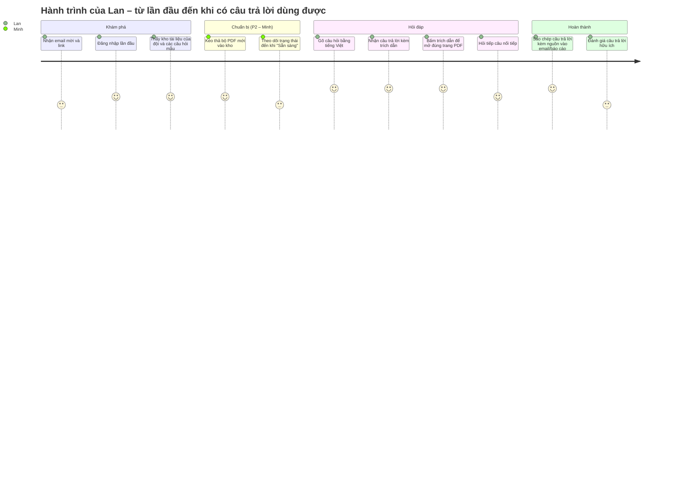

# TÀI LIỆU YÊU CẦU SẢN PHẨM (PRD)
# Công cụ "Chat với tài liệu" – MVP

---

## 0. Thông tin tài liệu

| Thuộc tính | Giá trị |
|---|---|
| Mã tài liệu | PRD-CWD-001 |
| Phiên bản | 0.1 |
| Trạng thái | Draft |
| Tiêu chuẩn áp dụng | IEEE 29148-2018 |
| Tài liệu nguồn | [BRD.md](BRD.md) – BRD-CWD-001 v0.2 (In review) |
| Kết quả review BRD | [BRD_IEEE_29148_Checklist.xlsx](BRD_IEEE_29148_Checklist.xlsx) – 8 Pass / 9 Partial / 3 Fail |
| Người soạn | Product Manager |
| Người review | Trưởng đội kỹ thuật, Designer, QA lead, Trưởng đội BD, Bảo mật thông tin |
| Ngày | 2026-10-19 |

**Quy ước:**
- `[Đề xuất]` = giá trị kế thừa từ BRD hoặc do PM đề xuất, chưa được bên liên quan xác nhận.
- Ưu tiên **P0** = bắt buộc để ra mắt (tương ứng *Must* trong BRD), **P1** = nên có (*Should*), **P2** = có thì tốt (*Could*).
- Mỗi user story truy vết tới một hoặc nhiều yêu cầu nghiệp vụ `BR-xxx` trong BRD.

### 0.1 Nền tảng sản phẩm

| Hạng mục | Nội dung |
|---|---|
| **Tên sản phẩm** | Chat với tài liệu (MVP) |
| **Người dùng mục tiêu** | Đội Phát triển kinh doanh (BD) nội bộ, tối đa 20 người dùng `[Đề xuất]`, phải tra cứu thông tin trong bộ tài liệu PDF lớn của dự án (BRD STK-002) |
| **Vấn đề** | Thông tin nằm rải rác trong nhiều tệp PDF; mỗi lần tra cứu phải mở từng file, đọc và tự tổng hợp — ước tính 20 phút/lần `[Đề xuất]` (BRD Mục 2, 3) |
| **Giải pháp cốt lõi** | Ứng dụng web: tải PDF lên kho chung, hỏi bằng tiếng Việt hoặc tiếng Anh, nhận câu trả lời tổng hợp từ nhiều tài liệu **kèm trích dẫn tên tài liệu và số trang**, và từ chối trả lời khi tài liệu không có thông tin |
| **Trụ cột UX** | (1) Đáng tin trước, nhanh sau; (2) Không cần cấu hình: tải lên là hỏi được; (3) Desktop-web-first; (4) Song ngữ Việt – Anh; (5) Riêng tư theo thiết kế |

### 0.2 Xác thực các trụ cột sản phẩm

| Trụ cột | Đánh giá | Căn cứ | Hệ quả cho thiết kế |
|---|---|---|---|
| **Đáng tin trước, nhanh sau** | Giữ | RSK-001 là rủi ro cao nhất; BR-010, BR-011 là Must. Một câu trả lời sai làm mất niềm tin nhiều hơn một câu trả lời chậm. | Mọi câu trả lời phải có trích dẫn bấm được; câu "không tìm thấy" được thiết kế như một kết quả hợp lệ, không phải lỗi. |
| **Không cần cấu hình** | Giữ | SN-001, SN-002; MET-003 cần người dùng mới dùng được ngay. | Không bắt buộc tạo thư mục, gắn thẻ hay chọn tài liệu trước khi hỏi; mặc định hỏi trên toàn kho. |
| **Desktop-web-first** | Giữ, cần xác nhận | CON-001 (ứng dụng web). Đội BD làm việc chủ yếu trên máy tính khi đọc tài liệu `[Đề xuất]`. | Tối ưu cho màn hình ≥ 1280 px; trên di động chỉ đảm bảo đọc được (không tối ưu tải lên). → PQ-002 |
| **Song ngữ Việt – Anh** | Giữ | OQ-007, BR-008, BR-026. | Giao diện tiếng Việt; câu trả lời theo ngôn ngữ của câu hỏi. |
| **Riêng tư theo thiết kế** | Giữ, là điều kiện ra mắt | CON-005, BR-017, BR-028, DEP-001. | Không ghi nội dung câu hỏi vào hệ thống phân tích (analytics); xóa tài liệu là xóa thật trong 24 giờ. |
| ~~Mobile-first / offline~~ | **Loại** | Ví dụ mẫu trong prompt, không phù hợp: tải PDF và đối chiếu trích dẫn cần màn hình lớn; hỏi đáp cần kết nối mạng. | Không làm chế độ offline. |

---

## 1. Tóm tắt điều hành và chiến lược

### 1.1 Tầm nhìn sản phẩm

> **Mọi thành viên BD có được câu trả lời đáng tin cậy, có nguồn kiểm chứng, từ toàn bộ tri thức trong tài liệu dự án — trong vài giây, thay vì vài chục phút.**

Về dài hạn (sau MVP, tùy quyết định go/no-go ngày 2027-01-22), sản phẩm có thể mở rộng thành điểm tra cứu tri thức chung của tổ chức: nhiều định dạng tài liệu, phân quyền theo dự án, tích hợp kho tài liệu sẵn có. MVP chỉ chứng minh giả thuyết cốt lõi: *hỏi đáp có trích dẫn trên PDF giúp đội BD tra cứu nhanh hơn mà không giảm độ chính xác.*

> Ghi chú: BRD chưa có tuyên bố tầm nhìn (checklist dòng 5 – Fail). Tầm nhìn trên là đề xuất của PM; cần nhà tài trợ xác nhận và bổ sung ngược vào BRD.

### 1.2 OKR

Thời hạn đánh giá: cuối thí điểm, 2027-01-15.

**O1 – Rút ngắn thời gian tra cứu thông tin của đội BD**

| KR | Chỉ số | Mục tiêu | Nguồn |
|---|---|---|---|
| KR1.1 | Thời gian trung bình để tìm một thông tin (bài đo 10 tác vụ chuẩn) | ≤ 10 phút, giảm ≥ 50% so với baseline đo ngày 2026-12-11 `[Đề xuất]` | MET-001, BR-013 |
| KR1.2 | Thời gian phản hồi p90, tính từ lúc gửi câu hỏi đến khi hiển thị đầy đủ câu trả lời | ≤ 15 giây với kho ≥ 200 tài liệu `[Đề xuất]` | BR-013 |
| KR1.3 | Thời gian p90 để một PDF 100 trang chuyển sang trạng thái "Sẵn sàng" | ≤ 3 phút `[Đề xuất]` | PQ-007 |

**O2 – Câu trả lời đủ tin cậy để dùng trong công việc**

| KR | Chỉ số | Mục tiêu | Nguồn |
|---|---|---|---|
| KR2.1 | Tỷ lệ câu trả lời đúng và trích dẫn đúng trên bộ câu hỏi chuẩn (≥ 50 câu) | ≥ 80% `[Đề xuất]` | MET-002, BR-012 |
| KR2.2 | Tỷ lệ từ chối đúng với câu hỏi ngoài phạm vi tài liệu | ≥ 90% `[Đề xuất]` | BR-011 |
| KR2.3 | Tỷ lệ đánh giá "hữu ích" trên tổng số đánh giá trong thí điểm | ≥ 70% `[Đề xuất]` | BR-023 |

**O3 – Được đội BD chấp nhận trong công việc hằng ngày**

| KR | Chỉ số | Mục tiêu | Nguồn |
|---|---|---|---|
| KR3.1 | Tỷ lệ người dùng hoạt động hàng tuần (WAU ÷ số người được cấp quyền) | ≥ 60% trong mỗi tuần thí điểm `[Đề xuất]` | MET-003 |
| KR3.2 | Tỷ lệ người dùng đặt câu hỏi đầu tiên trong ngày đầu được cấp quyền | ≥ 80% `[Đề xuất]` | Phễu kích hoạt (Mục 5.2) |

---

## 2. Persona và hành trình người dùng

### 2.1 Persona mục tiêu

> Các persona dưới đây được xây dựng từ BRD và là **giả thuyết**; cần xác nhận qua buổi phỏng vấn OQ-016 (checklist dòng 7 – Fail).

#### Persona chính – P1: "Lan, Chuyên viên BD"

| Thuộc tính | Mô tả |
|---|---|
| Vai trò | Chuẩn bị đề xuất, trả lời câu hỏi khách hàng, chuẩn bị cuộc họp |
| Bối cảnh | Làm việc trên laptop; thường mở 5–10 tệp PDF (hồ sơ dự án, hợp đồng, báo cáo) cùng lúc |
| Tần suất tra cứu | ~5 lần/tuần, mỗi lần ~20 phút `[Đề xuất]` (ASM-007) |
| Mức thành thạo | Thành thạo công cụ văn phòng; đã từng dùng chatbot AI nhưng **không tin hẳn** vì sợ AI "bịa" |
| Mục tiêu | Có câu trả lời đúng **và** chỉ được cho sếp/khách hàng thấy thông tin nằm ở trang nào |
| Nỗi đau | Mở nhiều file, Ctrl+F không tìm được do cách diễn đạt khác; dễ bỏ sót thông tin ở tài liệu thứ 3–4 |
| Câu nói đặc trưng | "Tôi cần biết nó nằm ở đâu để tôi tự kiểm tra lại." |
| Truy vết | STK-002, SN-001, SN-003 – SN-006, SN-008 |

#### Persona phụ – P2: "Minh, Trưởng nhóm BD (người quản lý tài liệu)"

| Thuộc tính | Mô tả |
|---|---|
| Vai trò | Nhận tài liệu mới từ khách hàng/đối tác, quyết định tài liệu nào là bản hiện hành |
| Bối cảnh | Thường tải lên cả bộ 5–10 tệp sau mỗi đợt nhận tài liệu |
| Mục tiêu | Kho tài liệu luôn đúng phiên bản; đội không trả lời dựa trên tài liệu lỗi thời |
| Nỗi đau | Không biết đội đang dùng phiên bản tài liệu nào |
| Truy vết | STK-002, SN-002, SN-007 |

#### Persona phụ – P3: "Quản trị viên"

| Thuộc tính | Mô tả |
|---|---|
| Vai trò | Thành viên đội kỹ thuật được chỉ định; quản lý danh sách người dùng, xử lý tài liệu tải nhầm của người khác |
| Mục tiêu | Kiểm soát ai truy cập được; truy vết được thay đổi khi có sự cố |
| Truy vết | STK-004, STK-005, SN-012, BRU-005 |

#### Anti-persona (không phục vụ trong MVP)

- Khách hàng/đối tác bên ngoài (BRD Mục 5.2).
- Người dùng cần tra cứu tài liệu dạng ảnh quét, Word hoặc Excel (BRU-006, BR-025).

### 2.2 Hành trình người dùng cấp cao



| Bước | Hành động người dùng | Phản hồi của hệ thống | Story | Chỉ số |
|---|---|---|---|---|
| 1. Truy cập | Mở link, đăng nhập | Xác thực; kiểm tra danh sách được cấp quyền | US-001, US-002 | `auth_login_succeeded` |
| 2. Định hướng | Lần đầu vào ứng dụng | Màn hình chào: số tài liệu trong kho, ô hỏi đáp, gợi ý cách hỏi | US-030 | `onboarding_viewed` |
| 3. Nạp tài liệu (P2) | Kéo thả nhiều PDF | Kiểm tra định dạng/kích thước, hiển thị tiến trình và trạng thái từng tệp | US-010 – US-014 | `document_upload_*` |
| 4. Đặt câu hỏi | Gõ câu hỏi, nhấn Enter | Hiển thị "Đang tìm trong N tài liệu…", trả lời dạng streaming | US-020 | `question_submitted` |
| 5. Kiểm chứng | Bấm thẻ trích dẫn | Mở PDF ở đúng trang trong khung bên phải | US-022 | `citation_clicked` |
| 6. Hỏi tiếp | Gõ câu nối tiếp | Trả lời trong ngữ cảnh phiên | US-025 | `question_submitted` (`is_followup=true`) |
| 7. Sử dụng kết quả | Bấm "Sao chép" | Sao chép câu trả lời kèm danh sách nguồn | US-042 | `answer_copied` |
| 8. Phản hồi | Bấm 👍 / 👎 | Ghi nhận đánh giá | US-050 | `answer_rated` |

---

## 3. Yêu cầu chức năng và user story

### 3.1 Ma trận Epic

| Epic | Tên | Mục tiêu | BR liên quan | Số story P0 / P1 / P2 |
|---|---|---|---|---|
| E1 | Truy cập và xác thực | Chỉ người được cấp quyền mới vào được | BR-016 | 2 / 0 / 0 |
| E2 | Quản lý kho tài liệu | Đưa PDF vào kho và giữ kho đúng | BR-001 – BR-007, BR-027 | 5 / 3 / 0 |
| E3 | Hỏi đáp có trích dẫn | Năng lực cốt lõi | BR-008 – BR-015, BR-026 | 5 / 3 / 0 |
| E4 | Định hướng người dùng mới | Kích hoạt người dùng nhanh (KR3.2) | — (hỗ trợ BO-003) | 0 / 1 / 0 |
| E5 | Tóm tắt, lịch sử, sao chép | Tăng giá trị sử dụng lại | BR-019, BR-021, BR-022 | 0 / 3 / 0 |
| E6 | Phản hồi và đo lường | Đo OKR | BR-023, BR-024 | 1 / 1 / 0 |
| E7 | Quản trị và tuân thủ | Điều kiện để ra mắt | BR-017, BR-018, BR-028, BR-029 | 2 / 3 / 0 |

### 3.2 E1 – Truy cập và xác thực

| ID | User story | Ưu tiên | BR |
|---|---|---|---|
| US-001 | Là **Lan**, tôi muốn đăng nhập bằng tài khoản công ty, để tôi không phải nhớ thêm mật khẩu. | P0 | BR-016 |
| US-002 | Là **Quản trị viên**, tôi muốn chỉ người có tên trong danh sách được cấp quyền mới truy cập được, để tài liệu nội bộ không bị lộ. | P0 | BR-016 |

**AC – US-001**
- **Given** Lan có tài khoản công ty hợp lệ và có tên trong danh sách được cấp quyền, **When** Lan đăng nhập, **Then** Lan vào được màn hình chính trong ≤ 5 giây.
- **Given** phiên đăng nhập của Lan đã hết hạn, **When** Lan thực hiện bất kỳ thao tác nào, **Then** hệ thống chuyển tới trang đăng nhập, và sau khi đăng nhập lại đưa Lan về đúng màn hình trước đó; câu hỏi đang gõ dở không bị mất.

**AC – US-002**
- **Given** một người dùng đã xác thực nhưng không có trong danh sách, **When** người đó truy cập ứng dụng, **Then** hệ thống hiển thị "Bạn chưa được cấp quyền. Liên hệ quản trị viên." và không hiển thị bất kỳ tên tài liệu hay dữ liệu nào.
- **Given** một người dùng chưa xác thực, **When** người đó gọi trực tiếp bất kỳ đường dẫn hay API nào, **Then** hệ thống trả lỗi từ chối truy cập; 0/10 lần thử lấy được dữ liệu (AC-016).

### 3.3 E2 – Quản lý kho tài liệu

| ID | User story | Ưu tiên | BR |
|---|---|---|---|
| US-010 | Là **Minh**, tôi muốn tải một tệp PDF lên kho chung, để cả đội hỏi được về nội dung của nó. | P0 | BR-001 |
| US-011 | Là **Minh**, tôi muốn được báo ngay khi tệp không phải PDF hoặc lớn hơn 50 MB, để tôi biết cần xử lý tệp đó thế nào. | P0 | BR-003, BR-004 |
| US-012 | Là **Minh**, tôi muốn thấy trạng thái xử lý của từng tệp (Đang xử lý / Sẵn sàng / Thất bại kèm lý do), để tôi biết khi nào đội có thể hỏi. | P0 | BR-005 |
| US-013 | Là **Minh**, tôi muốn được báo rõ khi PDF là ảnh quét, để tôi đi tìm bản PDF có văn bản. | P0 | BR-027 |
| US-014 | Là **Minh**, tôi muốn kéo thả tối đa 10 tệp PDF trong một lần, để không phải tải từng tệp. | P1 | BR-002 |
| US-015 | Là **Lan**, tôi muốn xem danh sách tài liệu trong kho (tên, người tải lên, thời điểm, số trang), để biết câu trả lời đang dựa trên những tài liệu nào. | P0 | BR-006 |
| US-016 | Là **Minh**, tôi muốn xóa tài liệu do tôi tải lên, để đội không nhận câu trả lời từ tài liệu lỗi thời. | P1 | BR-007 |
| US-017 | Là **Minh**, tôi muốn được cảnh báo khi tải lên một tệp trùng với tệp đã có trong kho, để kho không bị trùng lặp. | P1 | BR-001 (PQ-001) |

> US-015 được nâng từ Should (BR-006) lên **P0**: nếu người dùng không thấy kho có gì thì trụ cột "đáng tin" không đạt được. Cần BA cập nhật ưu tiên BR-006 trong BRD.

**AC – US-010**
- **Given** Lan/Minh đã đăng nhập, **When** chọn một tệp PDF hợp lệ ≤ 50 MB, **Then** tệp xuất hiện trong danh sách với trạng thái "Đang xử lý" trong ≤ 2 giây sau khi tải lên xong.
- **Given** tệp đã chuyển sang "Sẵn sàng", **When** bất kỳ người dùng nào hỏi về nội dung trong tệp đó, **Then** câu trả lời có thể trích dẫn tệp đó.

**AC – US-011**
- **Given** Minh chọn một tệp `.docx`, `.xlsx` hoặc `.png`, **When** gửi, **Then** tệp bị từ chối ngay ở trình duyệt với thông báo "Chỉ hỗ trợ tệp PDF", và kho không thay đổi.
- **Given** Minh chọn một PDF 51 MB, **When** gửi, **Then** tệp bị từ chối trước khi tải lên với thông báo "Tệp vượt quá 50 MB".
- **Given** một tệp đổi đuôi thành `.pdf` nhưng nội dung không phải PDF, **When** gửi, **Then** máy chủ từ chối và tệp có trạng thái "Thất bại – tệp không phải PDF hợp lệ".

**AC – US-012**
- **Given** một tệp đang được xử lý, **When** Minh mở danh sách, **Then** tệp hiển thị "Đang xử lý" và tự cập nhật sang trạng thái mới mà không cần tải lại trang.
- **Given** một PDF bị hỏng hoặc có mật khẩu, **When** xử lý thất bại, **Then** trạng thái là "Thất bại" kèm lý do cụ thể ("Tệp bị hỏng" / "Tệp có mật khẩu").

**AC – US-013**
- **Given** một PDF không có lớp văn bản, **When** xử lý xong, **Then** trạng thái là "Thất bại – không hỗ trợ PDF dạng ảnh quét", và tệp không bao giờ xuất hiện trong trích dẫn (AC-027).

**AC – US-015**
- **Given** kho có 3 tài liệu, **When** Lan mở danh sách, **Then** thấy đủ 3 dòng với tên tệp, người tải lên, thời điểm tải lên, số trang và trạng thái.
- **Given** kho có > 50 tài liệu, **When** Lan gõ vào ô tìm kiếm, **Then** danh sách lọc theo tên tệp ngay khi gõ.

**AC – US-016** (P1, ghi để tham khảo)
- **Given** Minh là người tải lên tài liệu X, **When** Minh xóa X và xác nhận, **Then** X biến mất khỏi danh sách, mọi câu hỏi sau đó không trích dẫn X, và dữ liệu xử lý của X bị xóa trong ≤ 24 giờ (AC-007, AC-029).
- **Given** Lan không phải người tải lên X và không phải quản trị viên, **When** Lan xem X, **Then** Lan không thấy nút xóa.

### 3.4 E3 – Hỏi đáp có trích dẫn

| ID | User story | Ưu tiên | BR |
|---|---|---|---|
| US-020 | Là **Lan**, tôi muốn đặt câu hỏi bằng tiếng Việt hoặc tiếng Anh và nhận câu trả lời từ các tài liệu trong kho, để không phải mở từng file. | P0 | BR-008, BR-013 |
| US-021 | Là **Lan**, tôi muốn câu trả lời tổng hợp thông tin từ nhiều tài liệu, để không phải tự ghép thông tin. | P0 | BR-009 |
| US-022 | Là **Lan**, tôi muốn mỗi câu trả lời có trích dẫn (tên tài liệu và số trang), và bấm vào trích dẫn thì mở đúng trang đó, để tôi kiểm chứng trong vài giây. | P0 | BR-010 |
| US-023 | Là **Lan**, tôi muốn được báo rõ "Không tìm thấy thông tin trong tài liệu" khi kho không có câu trả lời, để không dùng nhầm thông tin bịa. | P0 | BR-011 |
| US-024 | Là **Lan**, tôi muốn nhận câu trả lời bằng ngôn ngữ tôi đã hỏi, để không phải dịch lại. | P1 | BR-026 |
| US-025 | Là **Lan**, tôi muốn hỏi câu nối tiếp mà không phải nhắc lại ngữ cảnh, để tra cứu tự nhiên như hỏi đồng nghiệp. | P1 | BR-014 |
| US-026 | Là **Lan**, tôi muốn giới hạn câu hỏi vào một số tài liệu tôi chọn, để câu trả lời không lẫn thông tin từ tài liệu khác. | P1 | BR-015 |
| US-027 | Là **Lan**, tôi muốn thấy câu trả lời xuất hiện dần trong khi hệ thống đang soạn, để không phải nhìn màn hình trống. | P0 | BR-013 |

**AC – US-020**
- **Given** kho có ≥ 1 tài liệu "Sẵn sàng", **When** Lan gửi một câu hỏi tiếng Việt mà câu trả lời nằm trong một tài liệu, **Then** câu trả lời có nội dung lấy từ tài liệu đó và kèm ≥ 1 trích dẫn.
- **Given** kho có ≥ 200 tài liệu, **When** chạy toàn bộ bộ câu hỏi chuẩn, **Then** ≥ 90% câu hỏi hiển thị đầy đủ câu trả lời trong ≤ 15 giây (AC-013).
- **Given** ô nhập trống hoặc chỉ có khoảng trắng, **When** Lan nhấn Enter, **Then** không gửi gì và nút Gửi bị vô hiệu.

**AC – US-021**
- **Given** một câu hỏi chuẩn cần thông tin từ tài liệu A và B, **When** Lan hỏi, **Then** câu trả lời chứa thông tin từ cả A và B, có trích dẫn cả hai; đạt ở ≥ 7/10 câu hỏi đa tài liệu (AC-009).

**AC – US-022**
- **Given** một câu trả lời (không phải "không tìm thấy"), **When** hiển thị xong, **Then** mỗi ý dựa trên tài liệu có ≥ 1 thẻ trích dẫn dạng `[Tên tài liệu – tr. N]`.
- **Given** Lan bấm một thẻ trích dẫn, **When** khung xem PDF mở ra, **Then** khung mở đúng tài liệu ở đúng trang N trong ≤ 3 giây.
- **Given** người chấm mở trang được trích dẫn, **When** đối chiếu, **Then** thông tin tương ứng có ở trang đó với ≥ 90% trích dẫn (AC-010).

**AC – US-023**
- **Given** một câu hỏi về nội dung không có trong kho, **When** Lan hỏi, **Then** hệ thống trả lời "Không tìm thấy thông tin này trong các tài liệu hiện có" và không đưa ra dữ kiện nào; đạt ở ≥ 9/10 câu hỏi ngoài phạm vi (AC-011).
- **Given** kho không có tài liệu nào "Sẵn sàng", **When** Lan hỏi, **Then** hệ thống báo "Kho chưa có tài liệu sẵn sàng" và gợi ý tải tài liệu lên; không gọi tới dịch vụ AI.

**AC – US-027**
- **Given** Lan đã gửi câu hỏi, **When** hệ thống bắt đầu xử lý, **Then** trong ≤ 1 giây hiển thị trạng thái "Đang tìm trong N tài liệu…", và văn bản trả lời bắt đầu xuất hiện dần.
- **Given** câu trả lời đang được tạo, **When** Lan bấm "Dừng", **Then** việc tạo câu trả lời dừng trong ≤ 1 giây và phần đã hiển thị được giữ lại kèm nhãn "Đã dừng".

**AC – US-025** (P1, ghi để tham khảo)
- **Given** Lan hỏi "Hợp đồng với công ty X có giá trị bao nhiêu?" rồi hỏi "Thời hạn của nó?", **Then** câu trả lời thứ hai nói về thời hạn hợp đồng với công ty X; đạt ở ≥ 8/10 cặp câu hỏi (AC-014).

### 3.5 E4 – Định hướng người dùng mới

| ID | User story | Ưu tiên | BR |
|---|---|---|---|
| US-030 | Là **Lan** lần đầu dùng, tôi muốn thấy kho đang có bao nhiêu tài liệu và 3 ví dụ cách đặt câu hỏi tốt, để bắt đầu hỏi ngay. | P1 | — (hỗ trợ BO-003, KR3.2) |

> US-030 dùng **ví dụ tĩnh** do đội BD soạn, không phải câu hỏi do hệ thống tự sinh. Gợi ý câu hỏi tự động (BR-020) vẫn là Won't.

### 3.6 E5 – Tóm tắt, lịch sử, sao chép

| ID | User story | Ưu tiên | BR |
|---|---|---|---|
| US-040 | Là **Lan**, tôi muốn yêu cầu bản tóm tắt một tài liệu, để nắm nhanh tài liệu mới trước khi họp. | P1 | BR-019 |
| US-041 | Là **Lan**, tôi muốn xem lại các phiên hội thoại trong 90 ngày gần nhất, để dùng lại kết quả đã tra cứu. | P1 | BR-021 |
| US-042 | Là **Lan**, tôi muốn sao chép câu trả lời kèm danh sách nguồn chỉ bằng một lần bấm, để dán vào email hoặc báo cáo. | P1 | BR-022 |

Ghi chú hành vi:
- US-040: bản tóm tắt có trích dẫn số trang như câu trả lời thông thường.
- US-041: nếu phiên cũ trích dẫn một tài liệu đã bị xóa, thẻ trích dẫn hiển thị "Tài liệu đã bị xóa" và không mở được.
- US-042: định dạng sao chép là văn bản thuần, nguồn ghi dạng `Nguồn: [1] Tên tài liệu, tr. N`.

### 3.7 E6 – Phản hồi và đo lường

| ID | User story | Ưu tiên | BR |
|---|---|---|---|
| US-050 | Là **Lan**, tôi muốn đánh giá 👍/👎 từng câu trả lời (kèm lý do tùy chọn khi chọn 👎), để đội sản phẩm cải thiện chất lượng. | P1 | BR-023 |
| US-051 | Là **Nhà tài trợ**, tôi muốn có bảng số liệu hàng tuần (WAU, số câu hỏi, thời gian phản hồi p50/p90, tỷ lệ 👍), để đánh giá OKR mà không cần nhờ đội kỹ thuật. | P0 | BR-024 |

**AC – US-051**
- **Given** thí điểm đã chạy ≥ 1 tuần, **When** nhà tài trợ mở bảng số liệu, **Then** thấy WAU, tổng số câu hỏi, thời gian phản hồi p50/p90, tỷ lệ 👍, tính theo tuần, và số liệu được cập nhật trong vòng 24 giờ.
- **Given** bảng số liệu, **When** kiểm tra nội dung, **Then** không có văn bản câu hỏi hay câu trả lời nào xuất hiện (trụ cột Riêng tư).

### 3.8 E7 – Quản trị và tuân thủ

| ID | User story | Ưu tiên | BR |
|---|---|---|---|
| US-060 | Là **Bảo mật thông tin**, tôi muốn nội dung tài liệu chỉ được xử lý bởi dịch vụ đã được phê duyệt và không bị dùng để huấn luyện mô hình, để tuân thủ chính sách dữ liệu. | P0 | BR-017, BR-028 |
| US-061 | Là **Quản trị viên**, tôi muốn thêm/xóa người khỏi danh sách được cấp quyền, để kiểm soát ai dùng được công cụ. | P0 | BR-016 |
| US-062 | Là **Quản trị viên**, tôi muốn xóa bất kỳ tài liệu nào, để xử lý tài liệu tải nhầm. | P1 | BR-007, BRU-005 |
| US-063 | Là **Quản trị viên**, tôi muốn xem nhật ký tải lên/xóa tài liệu (ai, khi nào, tài liệu nào), để truy vết khi có sự cố. | P1 | BR-018 |
| US-064 | Là **Bảo mật thông tin**, tôi muốn dữ liệu xử lý của tài liệu bị xóa được xóa hoàn toàn trong ≤ 24 giờ, để thực thi chính sách lưu giữ. | P1 | BR-029 |

**AC – US-060**
- **Given** kiến trúc và hợp đồng dịch vụ AI đã chọn, **When** Bảo mật thông tin/Pháp chế review, **Then** có văn bản phê duyệt xác nhận CON-005 (a), (b), (c) được đáp ứng (AC-017, AC-028).
- **Given** hệ thống đang chạy, **When** kiểm tra cấu hình, **Then** chỉ các dịch vụ bên ngoài nằm trong danh sách được phê duyệt nhận được nội dung tài liệu.

**AC – US-061**
- **Given** quản trị viên thêm email X vào danh sách, **When** X đăng nhập, **Then** X truy cập được trong ≤ 1 phút sau khi được thêm.
- **Given** quản trị viên xóa X khỏi danh sách, **When** X thao tác tiếp, **Then** X bị chặn ở yêu cầu kế tiếp, kể cả khi phiên đăng nhập còn hiệu lực.

### 3.9 Yêu cầu phi chức năng

| ID | Hạng mục | Yêu cầu | Ưu tiên | Nguồn |
|---|---|---|---|---|
| NFR-001 | Hiệu năng – hỏi đáp | p90 ≤ 15 giây cho câu trả lời đầy đủ; phản hồi đầu tiên (trạng thái) ≤ 1 giây | P0 | BR-013 |
| NFR-002 | Hiệu năng – xử lý tài liệu | PDF 100 trang chuyển "Sẵn sàng" trong ≤ 3 phút (p90) `[Đề xuất]` | P1 | PQ-007 |
| NFR-003 | Tải đồng thời | Đạt NFR-001 khi có 20 người dùng đồng thời, mỗi người 1 câu hỏi/phút `[Đề xuất]` | P0 | ASM-002 |
| NFR-004 | Dung lượng | 500 tài liệu, ≤ 300 trang/tài liệu, ≤ 50 MB/tệp | P0 | ASM-006 |
| NFR-005 | Tính sẵn sàng | ≥ 95% trong giờ làm việc (8:00–18:00, thứ Hai – thứ Sáu) trong thí điểm `[Đề xuất]` | P1 | Checklist dòng 17 – PQ-004 |
| NFR-006 | Sao lưu | Mất tối đa 24 giờ dữ liệu kho tài liệu (RPO ≤ 24 giờ); khôi phục trong ≤ 1 ngày làm việc (RTO) `[Đề xuất]` | P1 | Checklist dòng 17 – PQ-004 |
| NFR-007 | Trình duyệt | Chrome và Edge (2 phiên bản mới nhất); độ rộng màn hình ≥ 1280 px | P0 | PQ-002 |
| NFR-008 | Bảo mật | Mã hóa khi truyền (TLS 1.2+) và khi lưu; không có lỗ hổng mức High/Critical trong lần quét bảo mật trước khi ra mắt | P0 | BR-017 |
| NFR-009 | Chi phí | Chi phí dịch vụ AI ≤ 300 USD/tháng ở mức sử dụng của thí điểm | P0 | CON-006 |
| NFR-010 | Ngôn ngữ giao diện | Tiếng Việt | P0 | OQ-007 |

---

## 4. Yêu cầu UX và UI

### 4.1 Bố cục và luồng tương tác cốt lõi

**Bố cục 3 vùng (desktop ≥ 1280 px):**

```
┌───────────────┬──────────────────────────────────┬────────────────────────┐
│ THANH BÊN     │ KHUNG HỘI THOẠI                   │ KHUNG XEM NGUỒN        │
│ (240 px)      │ (co giãn)                         │ (thu gọn mặc định,     │
│               │                                   │  mở khi bấm trích dẫn) │
│ [+ Phiên mới] │  Câu hỏi của người dùng           │                        │
│               │  ─────────────────────────        │  Tên tài liệu – tr. 12 │
│ Lịch sử phiên │  Câu trả lời … [HĐ_X.pdf – tr.12] │  ┌──────────────────┐  │
│  • Hôm nay    │  … [BaoCao_Q3.pdf – tr.4]         │  │  Trang PDF,       │  │
│  • 7 ngày qua │  [Sao chép] [👍] [👎]             │  │  đoạn được dùng  │  │
│               │                                   │  │  được tô sáng    │  │
│ Kho tài liệu  │                                   │  │  (PQ-006)        │  │
│  (125) [Mở]   │                                   │  └──────────────────┘  │
│               │ ┌───────────────────────────────┐ │  [◀ Trang] [Trang ▶]   │
│               │ │ Phạm vi: Tất cả tài liệu ▾     │ │                        │
│               │ │ Nhập câu hỏi…          [Gửi]  │ │                        │
│               │ └───────────────────────────────┘ │                        │
└───────────────┴──────────────────────────────────┴────────────────────────┘
```

**Màn hình Kho tài liệu** (mở từ thanh bên, dạng trang riêng hoặc ngăn kéo):
- Vùng kéo thả ở đầu trang: "Kéo thả tệp PDF vào đây hoặc [Chọn tệp] — tối đa 10 tệp, mỗi tệp ≤ 50 MB".
- Bảng tài liệu: Tên · Số trang · Người tải lên · Thời điểm · Trạng thái (huy hiệu màu) · Thao tác (Tóm tắt, Xóa nếu có quyền).
- Ô tìm theo tên; sắp xếp theo thời điểm tải lên, mới nhất trước.

**Tương tác then chốt:**

| Tương tác | Hành vi |
|---|---|
| Gửi câu hỏi | Enter để gửi, Shift+Enter để xuống dòng; tối đa 2.000 ký tự `[Đề xuất]` (PQ-005) |
| Câu trả lời streaming | Văn bản xuất hiện dần; thẻ trích dẫn hiển thị ngay khi có; nút "Dừng" trong lúc tạo |
| Thẻ trích dẫn | Dạng `[Tên tài liệu – tr. N]`; di chuột hiện đoạn trích ≤ 200 ký tự; bấm để mở khung xem nguồn ở đúng trang |
| Chọn phạm vi | Danh sách thả xuống nhiều lựa chọn; mặc định "Tất cả tài liệu"; khi đã giới hạn, hiển thị nhãn "Đang hỏi trong 3 tài liệu" phía trên ô nhập |
| Phiên mới | Nút "+ Phiên mới" xóa ngữ cảnh hội thoại; phiên cũ lưu vào lịch sử |
| Sao chép | Một lần bấm; hiện thông báo "Đã sao chép" trong 2 giây |
| Đánh giá | 👍 ghi nhận ngay; 👎 mở ô lý do tùy chọn (Sai thông tin / Trích dẫn sai / Thiếu ý / Khác) |
| Xóa tài liệu | Hộp thoại xác nhận nêu tên tệp và câu "Đội sẽ không thể hỏi về tài liệu này nữa" |

**Nguyên tắc trình bày:**
- Câu "Không tìm thấy" dùng giao diện trung tính (không màu đỏ), kèm gợi ý: "Thử diễn đạt khác, hoặc kiểm tra tài liệu đã được tải lên chưa."
- Hiển thị dòng nhắc cố định dưới ô nhập: "Câu trả lời do AI tạo — hãy kiểm tra trích dẫn với thông tin quan trọng."
- Đạt mức tương phản WCAG 2.1 AA; dùng được hoàn toàn bằng bàn phím cho luồng hỏi đáp.

### 4.2 Trường hợp biên và trạng thái lỗi

| # | Tình huống | Hành vi của hệ thống | Story |
|---|---|---|---|
| EC-01 | Kho trống (chưa có tài liệu nào) | Màn hình chính hiển thị: "Kho chưa có tài liệu. [Tải PDF lên]"; ô hỏi đáp bị vô hiệu kèm chú thích | US-023, US-030 |
| EC-02 | Có tài liệu nhưng tất cả đang "Đang xử lý" | Ô hỏi đáp vẫn dùng được; nhãn "3 tài liệu đang được xử lý, chưa được dùng để trả lời" | US-012 |
| EC-03 | Mất mạng khi đang tải lên | Tệp hiển thị "Tải lên bị gián đoạn" kèm nút [Thử lại]; các tệp khác trong lô không bị ảnh hưởng | US-010 |
| EC-04 | Mất mạng khi đang nhận câu trả lời | Giữ phần đã nhận, gắn nhãn "Mất kết nối – câu trả lời chưa đầy đủ" và nút [Hỏi lại]; câu hỏi không bị mất | US-020 |
| EC-05 | Mất mạng khi đang gõ | Hiện dải thông báo "Mất kết nối" ở đầu trang; nút Gửi bị vô hiệu; nội dung đang gõ được giữ; tự ẩn khi có mạng lại | US-020 |
| EC-06 | Phản hồi > 15 giây | Sau 15 giây hiện "Câu hỏi đang mất nhiều thời gian hơn bình thường…"; sau 60 giây dừng và báo "Không thể trả lời lúc này. [Thử lại]" | US-020, US-027 |
| EC-07 | Dịch vụ AI lỗi hoặc vượt hạn mức chi phí | Báo "Dịch vụ hỏi đáp tạm thời gián đoạn. Vui lòng thử lại sau ít phút."; không hiển thị mã lỗi kỹ thuật; ghi sự kiện `question_failed` | US-020 |
| EC-08 | Tệp không phải PDF / > 50 MB / > 10 tệp mỗi lần | Từ chối ngay ở trình duyệt, nêu lý do cụ thể cho từng tệp; tệp hợp lệ trong cùng lô vẫn được tải lên | US-011, US-014 |
| EC-09 | PDF ảnh quét, bị hỏng, có mật khẩu | Trạng thái "Thất bại" kèm lý do tương ứng; có nút [Xóa] để dọn kho | US-012, US-013 |
| EC-10 | Tệp trùng (cùng tên và cùng kích thước) | Hộp thoại: "Tài liệu này có thể đã có trong kho. [Vẫn tải lên] [Hủy]" | US-017 |
| EC-11 | Câu hỏi trống, chỉ có khoảng trắng, hoặc > 2.000 ký tự | Nút Gửi bị vô hiệu; bộ đếm ký tự chuyển đỏ khi vượt giới hạn | US-020 |
| EC-12 | Câu hỏi bằng ngôn ngữ khác Việt/Anh | Vẫn xử lý; nếu chất lượng không đảm bảo, trả lời bằng tiếng Việt kèm ghi chú "Hiện chỉ hỗ trợ tốt tiếng Việt và tiếng Anh" | US-024 |
| EC-13 | Câu hỏi không liên quan tài liệu (chào hỏi, kiến thức chung) | Trả lời ngắn rằng công cụ chỉ trả lời dựa trên tài liệu trong kho; không dùng kiến thức bên ngoài | US-023 |
| EC-14 | Tài liệu bị xóa khi đang có câu trả lời trích dẫn nó | Thẻ trích dẫn chuyển sang "Tài liệu đã bị xóa", không mở được; nội dung câu trả lời cũ giữ nguyên | US-016, US-041 |
| EC-15 | Phạm vi đã chọn chứa tài liệu vừa bị xóa | Tự loại tài liệu đó khỏi phạm vi và báo cho người dùng; nếu phạm vi trống thì quay về "Tất cả tài liệu" | US-026 |
| EC-16 | Phiên đăng nhập hết hạn giữa chừng | Chuyển tới đăng nhập, sau đó quay lại đúng màn hình; nội dung đang gõ được giữ trong trình duyệt | US-001 |
| EC-17 | Người dùng bị thu hồi quyền khi đang dùng | Yêu cầu kế tiếp bị chặn; hiển thị "Quyền truy cập của bạn đã bị thu hồi" | US-061 |
| EC-18 | Hai người cùng xóa một tài liệu | Người thứ hai nhận "Tài liệu đã được xóa trước đó"; không báo lỗi | US-016 |
| EC-19 | Màn hình < 1280 px | Khung xem nguồn mở dạng lớp phủ toàn màn hình thay vì cột bên phải; thanh bên thu gọn thành biểu tượng | NFR-007 |

---

## 5. Tiêu chí ra mắt và chỉ số sau ra mắt

### 5.1 Tiêu chí cổng ra mắt (Launch Gate)

"Ra mắt" ở đây là **bắt đầu thí điểm với đội BD (2026-12-21)**. Mọi tiêu chí dưới đây phải đạt; mục nào không đạt cần nhà tài trợ chấp nhận bằng văn bản.

| # | Nhóm | Tiêu chí | Cách đo | Chủ sở hữu |
|---|---|---|---|---|
| G1 | Chức năng | 100% AC của các story P0 đạt | Báo cáo kiểm thử QA | QA lead |
| G2 | Chức năng | ≥ 80% AC của các story P1 đạt; story P1 chưa đạt được nhà tài trợ chấp nhận hoãn | Báo cáo kiểm thử QA | PM |
| G3 | Chất lượng câu trả lời | KR2.1 ≥ 80%, KR2.2 ≥ 90%, AC-009 ≥ 7/10 trên bộ câu hỏi chuẩn (DEP-003) | Chấm độc lập bởi 2 người đội BD | Trưởng đội BD |
| G4 | Hiệu năng | NFR-001 và NFR-003 đạt với kho ≥ 200 tài liệu mẫu và 20 người dùng đồng thời giả lập | Kiểm thử tải | Trưởng đội kỹ thuật |
| G5 | Bảo mật | Văn bản phê duyệt của Bảo mật thông tin/Pháp chế (DEP-001, AC-017, AC-028) | Văn bản ký | Bảo mật thông tin |
| G6 | Bảo mật | Quét bảo mật (OWASP Top 10) không còn lỗ hổng High/Critical; kiểm thử phân quyền US-002, US-061 đạt | Báo cáo quét | Trưởng đội kỹ thuật |
| G7 | Chất lượng mã | Không còn lỗi mức Sev-1/Sev-2 đang mở; độ bao phủ unit test ≥ 70% ở logic xử lý tài liệu và trích dẫn `[Đề xuất]` | Hệ thống quản lý lỗi; báo cáo coverage | Trưởng đội kỹ thuật |
| G8 | Đo lường | Toàn bộ sự kiện P0 ở Mục 5.2 đã được kiểm tra bắn đúng ở môi trường staging; bảng số liệu US-051 hoạt động | Danh sách kiểm tra tracking | PM |
| G9 | Người dùng | UAT với ≥ 5 thành viên BD; không có vấn đề nào chặn luồng chính | Biên bản UAT | Trưởng đội BD |
| G10 | Vận hành | Có bản sao lưu đã khôi phục thử thành công (NFR-006); có cảnh báo khi chi phí AI đạt 80% hạn mức | Biên bản thử nghiệm | Trưởng đội kỹ thuật |
| G11 | Baseline | Đã đo baseline MET-001 (DEP-004) | Kết quả bài đo | Trưởng đội BD |

### 5.2 Phân tích và theo dõi (Analytics & Tracking)

**Nguyên tắc:**
- **Không** ghi văn bản câu hỏi, câu trả lời hay nội dung tài liệu vào hệ thống phân tích. Chỉ ghi siêu dữ liệu.
- Việc lưu nội dung câu hỏi để phục vụ đánh giá chất lượng là quyết định riêng, chờ PQ-003.
- Mỗi sự kiện có thuộc tính chung: `user_id` (mã ẩn danh), `session_id`, `timestamp`, `app_version`.

**Danh mục sự kiện:**

| Sự kiện | Kích hoạt khi | Thuộc tính riêng | Phục vụ | Ưu tiên |
|---|---|---|---|---|
| `auth_login_succeeded` | Đăng nhập thành công | `is_first_login` | KR3.1, KR3.2 | P0 |
| `auth_access_denied` | Bị từ chối vì không có quyền | `reason` | Bảo mật | P0 |
| `onboarding_viewed` | Lần đầu thấy màn hình chào | `doc_count` | KR3.2 | P1 |
| `document_upload_started` | Bắt đầu tải lên | `file_count`, `total_size_mb` | Phễu nạp | P0 |
| `document_upload_rejected` | Bị từ chối ở trình duyệt hoặc máy chủ | `reason` (`not_pdf`/`too_large`/`too_many`/`invalid_pdf`) | Phễu nạp, EC-08 | P0 |
| `document_processing_completed` | Chuyển sang "Sẵn sàng" | `doc_id`, `page_count`, `processing_seconds` | KR1.3 | P0 |
| `document_processing_failed` | Chuyển sang "Thất bại" | `doc_id`, `reason` (`scanned`/`corrupted`/`encrypted`/`other`) | RSK-003, ASM-001 | P0 |
| `document_deleted` | Xóa tài liệu | `doc_id`, `actor_role` | BR-018 | P1 |
| `question_submitted` | Gửi câu hỏi | `question_id`, `length_chars`, `language`, `is_followup`, `scope_doc_count` (0 = tất cả) | KR3.1, US-025, US-026 | P0 |
| `answer_first_token` | Hiển thị phần trả lời đầu tiên | `question_id`, `latency_ms` | NFR-001 | P0 |
| `answer_completed` | Câu trả lời hiển thị xong | `question_id`, `latency_ms`, `citation_count`, `distinct_doc_count`, `is_not_found` | KR1.2, KR2.2, US-021 | P0 |
| `question_failed` | Lỗi, quá 60 giây, hoặc mất mạng | `question_id`, `reason` (`timeout`/`network`/`provider_error`/`budget`) | EC-04, EC-06, EC-07 | P0 |
| `answer_stopped` | Người dùng bấm "Dừng" | `question_id`, `elapsed_ms` | US-027 | P1 |
| `citation_clicked` | Bấm thẻ trích dẫn | `question_id`, `doc_id`, `page` | Mức độ kiểm chứng (trụ cột Đáng tin) | P0 |
| `answer_copied` | Sao chép câu trả lời | `question_id` | Giá trị sử dụng lại | P1 |
| `answer_rated` | Đánh giá 👍/👎 | `question_id`, `rating`, `reason_code` | KR2.3 | P1 |
| `summary_requested` | Yêu cầu tóm tắt | `doc_id`, `latency_ms` | US-040 | P1 |
| `history_session_opened` | Mở lại phiên cũ | `session_age_days` | US-041 | P1 |

**Phễu theo dõi:**

1. **Phễu kích hoạt (KR3.2):** `auth_login_succeeded (is_first_login)` → `question_submitted` (lần đầu) → `answer_completed` → `citation_clicked` hoặc `answer_copied`.
2. **Phễu nạp tài liệu:** `document_upload_started` → (`document_upload_rejected`) → `document_processing_completed` / `document_processing_failed`.
3. **Phễu giá trị câu trả lời:** `answer_completed` → `citation_clicked` → `answer_copied` → `answer_rated (up)`.

**Chỉ số theo dõi sau ra mắt (báo cáo hàng tuần trong thí điểm):**

| Chỉ số | Công thức | Ngưỡng cảnh báo |
|---|---|---|
| WAU % | Số người dùng có `question_submitted` trong tuần ÷ số người được cấp quyền | < 60% (KR3.1) |
| Latency p90 | p90 của `answer_completed.latency_ms` | > 15.000 ms |
| Tỷ lệ "không tìm thấy" | `is_not_found=true` ÷ `answer_completed` | > 30% (nghi thiếu tài liệu hoặc truy xuất kém) |
| Tỷ lệ lỗi | `question_failed` ÷ `question_submitted` | > 2% |
| Tỷ lệ kiểm chứng | Số câu trả lời có ≥ 1 `citation_clicked` ÷ `answer_completed` | Theo dõi xu hướng, chưa đặt ngưỡng |
| Tỷ lệ 👍 | `rating=up` ÷ `answer_rated` | < 70% (KR2.3) |
| Tỷ lệ tài liệu ảnh quét | `reason=scanned` ÷ tổng số tài liệu đã xử lý | > 10% → xem lại BRU-006 |
| Chi phí AI/tuần | Từ bảng chi phí của nhà cung cấp | > 70 USD/tuần (≈ 300 USD/tháng) |

---

## 6. Truy vết BRD → PRD

| BR | Ưu tiên BRD | User story / NFR | Ưu tiên PRD | Ghi chú |
|---|---|---|---|---|
| BR-001 | Must | US-010, US-017 | P0, P1 | |
| BR-002 | Should | US-014 | P1 | |
| BR-003 | Must | US-011 | P0 | |
| BR-004 | Must | US-011, NFR-004 | P0 | |
| BR-005 | Must | US-012 | P0 | |
| BR-006 | Should | US-015 | **P0** | Nâng ưu tiên – cần cập nhật BRD |
| BR-007 | Should | US-016, US-062 | P1 | |
| BR-008 | Must | US-020 | P0 | |
| BR-009 | Must | US-021 | P0 | |
| BR-010 | Must | US-022 | P0 | |
| BR-011 | Must | US-023 | P0 | |
| BR-012 | Must | US-020 – US-023 (G3) | P0 | Kiểm chứng ở cổng ra mắt |
| BR-013 | Must | US-020, US-027, NFR-001, NFR-003 | P0 | |
| BR-014 | Should | US-025 | P1 | |
| BR-015 | Should | US-026 | P1 | |
| BR-016 | Must | US-001, US-002, US-061 | P0 | |
| BR-017 | Must | US-060, NFR-008 | P0 | |
| BR-018 | Should | US-063 | P1 | |
| BR-019 | Should | US-040 | P1 | |
| BR-020 | Won't | — | — | US-030 dùng ví dụ tĩnh, không thay thế BR-020 |
| BR-021 | Should | US-041 | P1 | |
| BR-022 | Should | US-042 | P1 | |
| BR-023 | Should | US-050 | P1 | |
| BR-024 | Must | US-051 | P0 | |
| BR-025 | Won't | — | — | |
| BR-026 | Should | US-024 | P1 | |
| BR-027 | Must | US-013 | P0 | |
| BR-028 | Must | US-060 | P0 | |
| BR-029 | Should | US-064 | P1 | |

**Độ bao phủ:**
- Tất cả BR trong phạm vi (trừ BR-020, BR-025 là Won't) đều có ≥ 1 story hoặc NFR.
- Mọi story P0 đều có AC dạng Given-When-Then.
- Các story và NFR không có BR trực tiếp — US-030, NFR-002, NFR-005, NFR-006, NFR-007 — đều được ghi nguồn (OKR hoặc kết quả checklist). Cần bổ sung BR tương ứng vào BRD v0.3.

---

## 7. Câu hỏi mở của PRD

| ID | Câu hỏi | Ảnh hưởng | Chủ sở hữu | Hạn | Đề xuất của PM |
|---|---|---|---|---|---|
| PQ-001 | Xử lý tệp trùng thế nào? | US-017, EC-10 | Trưởng đội BD | 2026-10-30 | Cảnh báo khi trùng tên và kích thước; người dùng chọn "Vẫn tải lên" hoặc "Hủy" |
| PQ-002 | Danh sách trình duyệt và thiết bị cần hỗ trợ? | NFR-007 | Trưởng đội BD | 2026-10-30 | Chrome và Edge trên desktop; di động chỉ đảm bảo đọc |
| PQ-003 | Có được lưu văn bản câu hỏi/câu trả lời để đánh giá chất lượng không? Lưu bao lâu, ai được xem? | Mục 5.2, BR-021 | Bảo mật thông tin | 2026-11-13 | Lưu cùng lịch sử 90 ngày; chỉ PM và QA được xem bản ẩn danh khi điều tra lỗi |
| PQ-004 | Xác nhận mục tiêu tính sẵn sàng và sao lưu | NFR-005, NFR-006 | Nhà tài trợ | 2026-10-30 | Sẵn sàng ≥ 95% trong giờ làm việc; RPO ≤ 24 giờ; RTO ≤ 1 ngày làm việc |
| PQ-005 | Độ dài tối đa của câu hỏi? | EC-11 | Trưởng đội kỹ thuật | 2026-11-06 | 2.000 ký tự |
| PQ-006 | Có cần tô sáng đoạn văn được trích dẫn trong khung xem PDF không, hay chỉ cần mở đúng trang? | US-022 | Designer + Trưởng đội kỹ thuật | 2026-11-06 | MVP: mở đúng trang (P0); tô sáng là P2 |
| PQ-007 | Thời gian chờ chấp nhận được để một tài liệu "Sẵn sàng"? | NFR-002, KR1.3 | Trưởng đội BD | 2026-10-30 | ≤ 3 phút cho PDF 100 trang |
| PQ-008 | Ai soạn 3 câu hỏi ví dụ cho màn hình chào? | US-030 | Trưởng đội BD | 2026-12-04 | Đội BD soạn từ bộ câu hỏi chuẩn (DEP-003) |

Kế thừa từ BRD (chưa được xác nhận): toàn bộ giá trị `[Đề xuất]` từ OQ-001 – OQ-016, đặc biệt OQ-003 (ngưỡng độ chính xác), OQ-006 (chính sách dữ liệu), OQ-011 (thời gian phản hồi).

---

## 8. Phụ thuộc và rủi ro sản phẩm

| ID | Nội dung | Tác động | Giảm thiểu |
|---|---|---|---|
| DEP-001 (BRD) | Phê duyệt bảo mật trước 2026-11-13 | Chặn cổng G5 | PM đặt lịch review kiến trúc với Bảo mật thông tin trong tuần 1 |
| DEP-003 (BRD) | Bộ tài liệu mẫu và bộ câu hỏi chuẩn trước 2026-11-27 | Chặn G3, G4 | PM theo dõi hàng tuần; QA hỗ trợ đội BD định dạng bộ câu hỏi |
| PD-001 | Dịch vụ xác thực tài khoản công ty (đăng nhập một lần) sẵn sàng tích hợp | Chặn US-001 | Nếu không kịp: dùng đăng nhập bằng email + mã một lần, cần Bảo mật thông tin chấp thuận |
| PR-001 | Người dùng bỏ qua trích dẫn và tin câu trả lời sai | Mất niềm tin khi phát hiện sai (RSK-001) | Dòng nhắc kiểm tra trích dẫn; theo dõi tỷ lệ kiểm chứng; buổi hướng dẫn đầu thí điểm |
| PR-002 | Phạm vi P1 không kịp trong 7 tuần | Trễ ngày thí điểm | Thứ tự cắt giảm nếu trễ: US-040 → US-041 → US-026 → US-017; không cắt P0 |

---

## Phụ lục – Lộ trình thực hiện `[Đề xuất]`

| Tuần | Thời gian | Trọng tâm | Cổng |
|---|---|---|---|
| 1 | 2026-11-02 → 11-06 | Thiết kế UX (wireframe Mục 4.1), kiến trúc, review bảo mật | Wireframe được duyệt |
| 2–3 | 2026-11-09 → 11-20 | E1, E2 (P0), xử lý tài liệu | Tải lên → Sẵn sàng chạy từ đầu đến cuối |
| 4–5 | 2026-11-23 → 12-04 | E3 (P0), E6 (US-051), tracking | Hỏi đáp có trích dẫn chạy được; đánh giá lần đầu trên bộ câu hỏi chuẩn |
| 6 | 2026-12-07 → 12-11 | P1 (E3, E5, E7), đo baseline MET-001 | Hoàn tất tính năng |
| 7 | 2026-12-14 → 12-18 | Kiểm thử tải, quét bảo mật, UAT, sửa lỗi | Toàn bộ cổng G1 – G11 |
| — | 2026-12-21 → 2027-01-15 | Thí điểm 4 tuần | Báo cáo OKR hàng tuần |
| — | 2027-01-22 | Quyết định go/no-go (BRD Mục 4.2) | |
